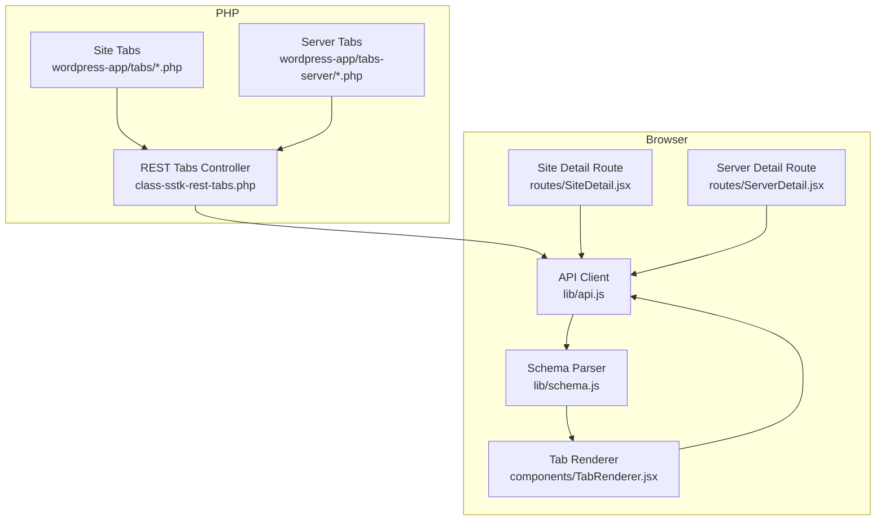
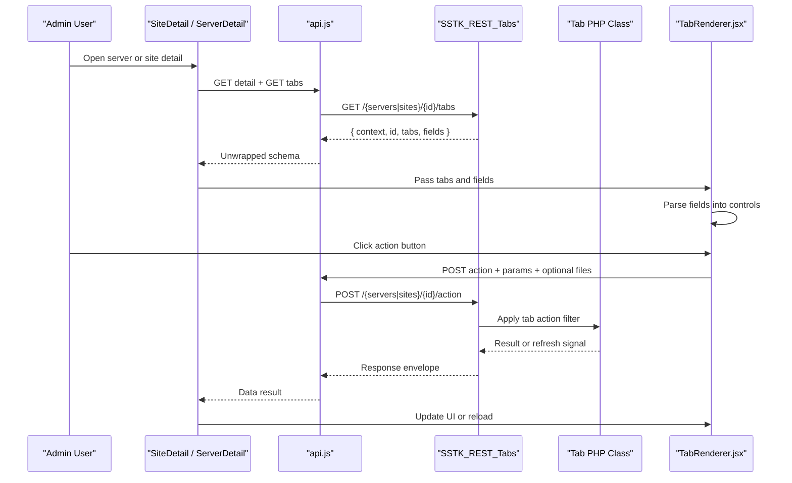
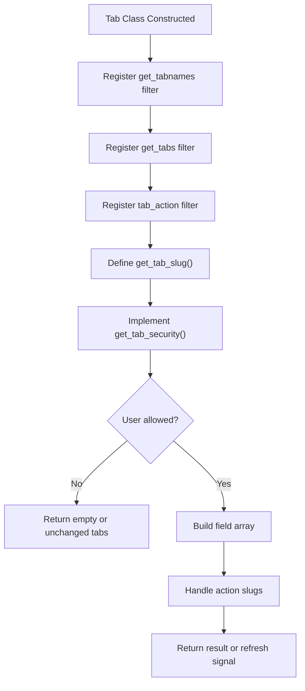
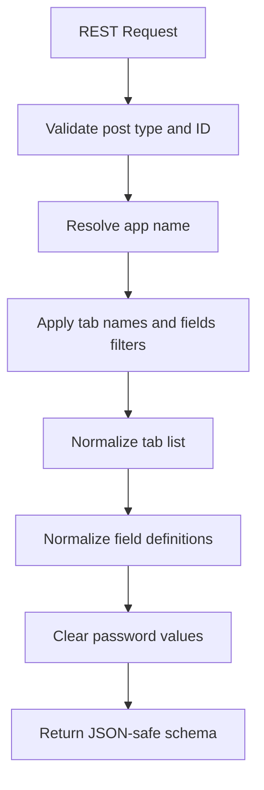
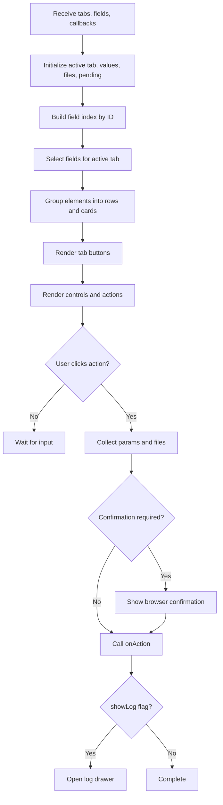
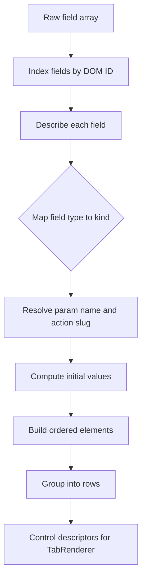
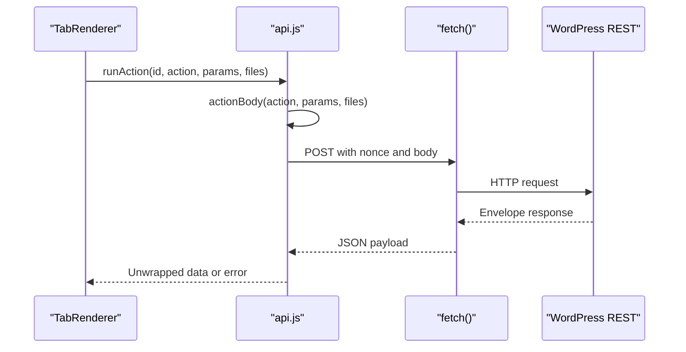
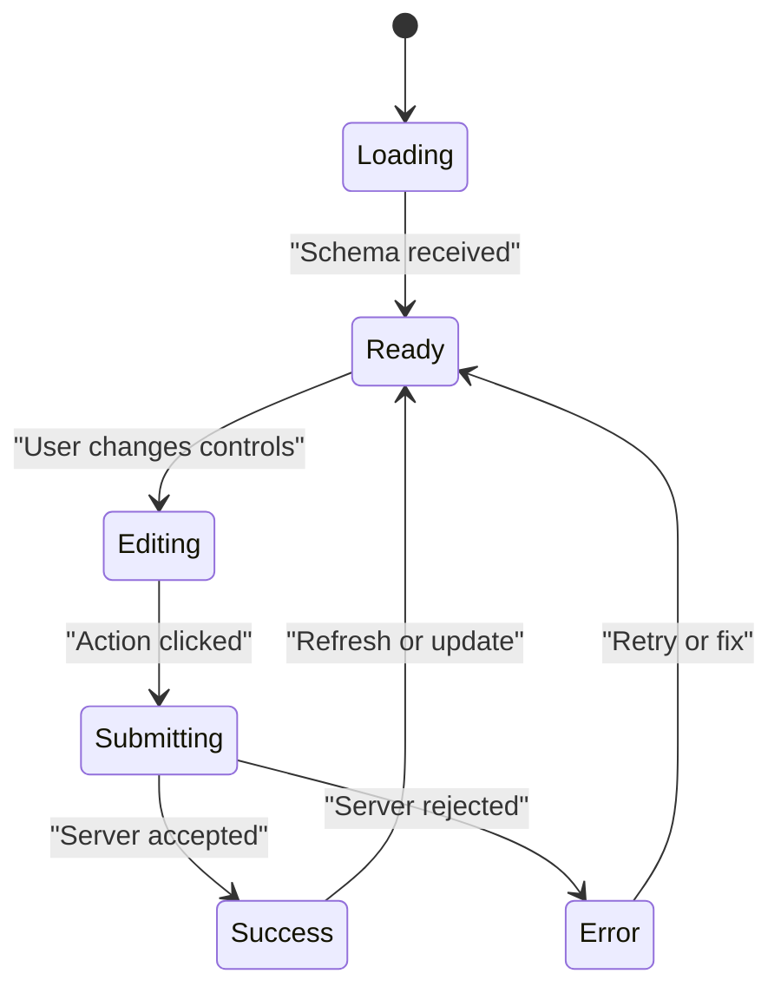
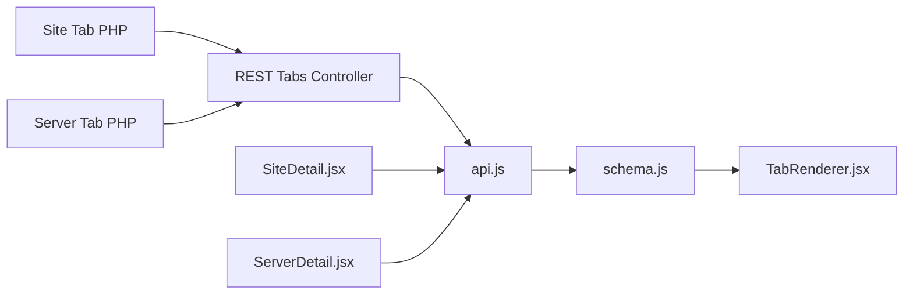

# Admin Interface Extension System

<cite>
**Referenced Files in This Document**   
- [class-sstk-rest-tabs.php](file://includes/core/api/class-sstk-rest-tabs.php)
- [schema.js](file://src/admin/lib/schema.js)
- [TabRenderer.jsx](file://src/admin/components/TabRenderer.jsx)
- [api.js](file://src/admin/lib/api.js)
- [SiteDetail.jsx](file://src/admin/routes/SiteDetail.jsx)
- [ServerDetail.jsx](file://src/admin/routes/ServerDetail.jsx)
- [general.php (site)](file://includes/core/apps/wordpress-app/tabs/general.php)
- [sftp.php](file://includes/core/apps/wordpress-app/tabs/sftp.php)
- [sshkeys.php](file://includes/core/apps/wordpress-app/tabs-server/sshkeys.php)
- [general.php (server)](file://includes/core/apps/wordpress-app/tabs-server/general.php)
</cite>

## Table of Contents
1. [Introduction](#introduction)
2. [Project Structure](#project-structure)
3. [Core Components](#core-components)
4. [Architecture Overview](#architecture-overview)
5. [Detailed Component Analysis](#detailed-component-analysis)
6. [Dependency Analysis](#dependency-analysis)
7. [Performance Considerations](#performance-considerations)
8. [Troubleshooting Guide](#troubleshooting-guide)
9. [Conclusion](#conclusion)

## Introduction
This document explains how to extend the Simple Stack admin interface through its tab system. The extension model is built around a small contract:

- Server and site tabs declare their UI as Meta Box field arrays.
- A REST controller exposes those declarations as JSON schema.
- A single React component renders every tab generically from that schema.
- Tab actions are dispatched back through REST endpoints, which route to PHP tab handlers.

This design lets you add custom configuration panels, integrate third-party tools, or implement real-time status displays without rewriting existing screens. It also preserves compatibility with legacy jQuery behavior by keeping the same action names, parameter keys, confirmation prompts, and file-upload conventions.

## Project Structure
The tab extension system spans three layers:

| Layer | Responsibility | Key Files |
|---|---|---|
| Server-side tab definitions | Register tab labels, fields, permissions, and action handlers | `includes/core/apps/wordpress-app/tabs/*.php`, `includes/core/apps/wordpress-app/tabs-server/*.php` |
| REST schema bridge | Convert tab definitions into JSON-safe schema for the browser | `includes/core/api/class-sstk-rest-tabs.php` |
| React renderer | Render tabs, controls, actions, files, logs, and state | `src/admin/components/TabRenderer.jsx`, `src/admin/lib/schema.js`, `src/admin/lib/api.js` |
| Detail routes | Load detail data, fetch tab schema, dispatch actions | `src/admin/routes/SiteDetail.jsx`, `src/admin/routes/ServerDetail.jsx` |

**Diagram sources**
- [class-sstk-rest-tabs.php:12-26](file://includes/core/api/class-sstk-rest-tabs.php#L12-L26)
- [schema.js:1-19](file://src/admin/lib/schema.js#L1-L19)
- [TabRenderer.jsx:1-11](file://src/admin/components/TabRenderer.jsx#L1-L11)
- [api.js:1-7](file://src/admin/lib/api.js#L1-L7)
- [SiteDetail.jsx:1-8](file://src/admin/routes/SiteDetail.jsx#L1-L8)
- [ServerDetail.jsx:1-8](file://src/admin/routes/ServerDetail.jsx#L1-L8)

**Section sources**
- [class-sstk-rest-tabs.php:12-26](file://includes/core/api/class-sstk-rest-tabs.php#L12-L26)
- [schema.js:1-19](file://src/admin/lib/schema.js#L1-L19)
- [TabRenderer.jsx:1-11](file://src/admin/components/TabRenderer.jsx#L1-L11)
- [api.js:1-7](file://src/admin/lib/api.js#L1-L7)
- [SiteDetail.jsx:1-8](file://src/admin/routes/SiteDetail.jsx#L1-L8)
- [ServerDetail.jsx:1-8](file://src/admin/routes/ServerDetail.jsx#L1-L8)

## Core Components
The extension system has five core responsibilities:

1. **Tab registration**: Add a tab entry under `sstk_app_{app}_get_tabnames` for sites or `sstk_server_{app}_get_tabnames` for servers.
2. **Field declaration**: Add Meta Box-style field arrays under `sstk_app_{app}_get_tabs` or `sstk_server_{app}_get_tabs`.
3. **Action handling**: Implement logic under `sstk_app_{app}_tab_action` or server equivalents.
4. **Schema exposure**: Serve sanitized tab lists and field definitions through `/servers/{id}/tabs` and `/sites/{id}/tabs`.
5. **Generic rendering**: Let `TabRenderer` draw controls, cards, actions, files, and logs from the schema.

Key implementation patterns:

| Pattern | Purpose | Example Reference |
|---|---|---|
| Tab slug + label + icon | Identifies and titles the tab | Site general tab |
| Permission gate | Controls visibility per team and author | `get_tab_security` methods |
| Field array | Declares inputs, headings, buttons, and HTML | sFTP tab fields |
| Action button attributes | Connects UI to backend action | `data-sstk-action`, `data-sstk-fields` |
| File upload | Sends public key or other files | sFTP set-key flow |
| Refresh response | Tells the client to reload data | `refresh => yes` |

**Section sources**
- [general.php (site):15-25](file://includes/core/apps/wordpress-app/tabs/general.php#L15-L25)
- [general.php (site):50-69](file://includes/core/apps/wordpress-app/tabs/general.php#L50-L69)
- [sftp.php:20-31](file://includes/core/apps/wordpress-app/tabs/sftp.php#L20-L31)
- [sftp.php:55-79](file://includes/core/apps/wordpress-app/tabs/sftp.php#L55-L79)
- [sftp.php:171-216](file://includes/core/apps/wordpress-app/tabs/sftp.php#L171-L216)
- [sshkeys.php:20-27](file://includes/core/apps/wordpress-app/tabs-server/sshkeys.php#L20-L27)
- [sshkeys.php:51-70](file://includes/core/apps/wordpress-app/tabs-server/sshkeys.php#L51-L70)

## Architecture Overview
The tab lifecycle flows from PHP declarations to React rendering and back to PHP action handlers.

**Diagram sources**
- [SiteDetail.jsx:39-69](file://src/admin/routes/SiteDetail.jsx#L39-L69)
- [ServerDetail.jsx:39-72](file://src/admin/routes/ServerDetail.jsx#L39-L72)
- [api.js:124-151](file://src/admin/lib/api.js#L124-L151)
- [api.js:186-229](file://src/admin/lib/api.js#L186-L229)
- [class-sstk-rest-tabs.php:41-86](file://includes/core/api/class-sstk-rest-tabs.php#L41-L86)
- [class-sstk-rest-tabs.php:98-125](file://includes/core/api/class-sstk-rest-tabs.php#L98-L125)
- [TabRenderer.jsx:108-144](file://src/admin/components/TabRenderer.jsx#L108-L144)

## Detailed Component Analysis

### Server-Side Tab Registration
A server or site tab class typically:

1. Extends the base tab class.
2. Registers filters for tab names, fields, and actions.
3. Defines a unique tab slug.
4. Implements a permission check.
5. Returns tab metadata when the user is allowed to view it.
6. Builds field arrays for the tab.
7. Handles action requests.

For site tabs, the relevant filters use the app namespace. For server tabs, the server namespace is used. Both follow the same pattern: register on construction, guard visibility, and return structured arrays.

**Diagram sources**
- [general.php (site):15-25](file://includes/core/apps/wordpress-app/tabs/general.php#L15-L25)
- [general.php (site):50-69](file://includes/core/apps/wordpress-app/tabs/general.php#L50-L69)
- [sftp.php:20-31](file://includes/core/apps/wordpress-app/tabs/sftp.php#L20-L31)
- [sftp.php:55-79](file://includes/core/apps/wordpress-app/tabs/sftp.php#L55-L79)
- [sshkeys.php:20-27](file://includes/core/apps/wordpress-app/tabs-server/sshkeys.php#L20-L27)
- [sshkeys.php:51-70](file://includes/core/apps/wordpress-app/tabs-server/sshkeys.php#L51-L70)

**Section sources**
- [general.php (site):15-25](file://includes/core/apps/wordpress-app/tabs/general.php#L15-L25)
- [general.php (site):50-69](file://includes/core/apps/wordpress-app/tabs/general.php#L50-L69)
- [sftp.php:20-31](file://includes/core/apps/wordpress-app/tabs/sftp.php#L20-L31)
- [sftp.php:55-79](file://includes/core/apps/wordpress-app/tabs/sftp.php#L55-L79)
- [sshkeys.php:20-27](file://includes/core/apps/wordpress-app/tabs-server/sshkeys.php#L20-L27)
- [sshkeys.php:51-70](file://includes/core/apps/wordpress-app/tabs-server/sshkeys.php#L51-L70)

### REST Schema Exposure
The REST tabs controller provides two read endpoints:

| Endpoint | Context | Payload |
|---|---|---|
| `GET /servers/{id}/tabs` | Server | `{ context, id, tabs, fields }` |
| `GET /sites/{id}/tabs` | Site | `{ context, id, server_id, tabs, fields }` |

It validates the post type, resolves the active app name, applies the appropriate tab-name and tab-field filters, then normalizes the output. Closures, objects, and non-scalar values are dropped because they cannot be sent as JSON. Password fields have their stored value cleared before transmission.

**Diagram sources**
- [class-sstk-rest-tabs.php:41-86](file://includes/core/api/class-sstk-rest-tabs.php#L41-L86)
- [class-sstk-rest-tabs.php:98-125](file://includes/core/api/class-sstk-rest-tabs.php#L98-L125)
- [class-sstk-rest-tabs.php:134-154](file://includes/core/api/class-sstk-rest-tabs.php#L134-L154)
- [class-sstk-rest-tabs.php:163-221](file://includes/core/api/class-sstk-rest-tabs.php#L163-L221)

**Section sources**
- [class-sstk-rest-tabs.php:41-86](file://includes/core/api/class-sstk-rest-tabs.php#L41-L86)
- [class-sstk-rest-tabs.php:98-125](file://includes/core/api/class-sstk-rest-tabs.php#L98-L125)
- [class-sstk-rest-tabs.php:134-154](file://includes/core/api/class-sstk-rest-tabs.php#L134-L154)
- [class-sstk-rest-tabs.php:163-221](file://includes/core/api/class-sstk-rest-tabs.php#L163-L221)

### React Tab Rendering
`TabRenderer` is the central UI component. It receives:

- `tabs`: an array of `{ slug, label, icon }`.
- `fields`: raw field definitions from the REST endpoint.
- `onAction`: function called when a user triggers an action.
- `onShowLog`: optional callback to open the log drawer.
- `loading`: placeholder mode.
- `disabledReason`: reason to disable all controls.

Internally, it manages:

- Active tab selection.
- Control values keyed by element ID.
- File uploads.
- Pending action state.
- Expandable card sections.
- Row grouping based on card containers.

Supported control kinds include hidden, label, HTML, readonly, action, toggle, select, textarea, password, file, number, temporal, and generic text inputs.

**Diagram sources**
- [TabRenderer.jsx:46-74](file://src/admin/components/TabRenderer.jsx#L46-L74)
- [TabRenderer.jsx:76-81](file://src/admin/components/TabRenderer.jsx#L76-L81)
- [TabRenderer.jsx:100-144](file://src/admin/components/TabRenderer.jsx#L100-L144)
- [TabRenderer.jsx:146-210](file://src/admin/components/TabRenderer.jsx#L146-L210)
- [TabRenderer.jsx:219-402](file://src/admin/components/TabRenderer.jsx#L219-L402)

**Section sources**
- [TabRenderer.jsx:46-74](file://src/admin/components/TabRenderer.jsx#L46-L74)
- [TabRenderer.jsx:76-81](file://src/admin/components/TabRenderer.jsx#L76-L81)
- [TabRenderer.jsx:100-144](file://src/admin/components/TabRenderer.jsx#L100-L144)
- [TabRenderer.jsx:146-210](file://src/admin/components/TabRenderer.jsx#L146-L210)
- [TabRenderer.jsx:219-402](file://src/admin/components/TabRenderer.jsx#L219-L402)

### Schema Translation Layer
`schema.js` translates Meta Box field arrays into renderable descriptors. It is the parity mechanism between the legacy renderer and the new React renderer.

Key responsibilities:

- Identify action fields by `data-sstk-action` or the generated action ID prefix.
- Resolve request parameter names via `data-sstk-name` or the element ID.
- Parse `data-sstk-fields` selectors to collect dependent inputs.
- Encode switch and checkbox values as `'on'` or `'off'` to match legacy PHP comparisons.
- Build initial control values from declared attributes, values, defaults, and stored values.
- Describe each field as a control kind with metadata.
- Convert flat field lists into ordered elements using card container markers.
- Split elements into responsive rows.

**Diagram sources**
- [schema.js:49-122](file://src/admin/lib/schema.js#L49-L122)
- [schema.js:124-182](file://src/admin/lib/schema.js#L124-L182)
- [schema.js:195-250](file://src/admin/lib/schema.js#L195-L250)
- [schema.js:258-310](file://src/admin/lib/schema.js#L258-L310)
- [schema.js:354-423](file://src/admin/lib/schema.js#L354-L423)

**Section sources**
- [schema.js:49-122](file://src/admin/lib/schema.js#L49-L122)
- [schema.js:124-182](file://src/admin/lib/schema.js#L124-L182)
- [schema.js:195-250](file://src/admin/lib/schema.js#L195-L250)
- [schema.js:258-310](file://src/admin/lib/schema.js#L258-L310)
- [schema.js:354-423](file://src/admin/lib/schema.js#L354-L423)

### API Integration Patterns
The React API client wraps REST calls, handles nonces, unwraps envelopes, and builds multipart bodies when files are present.

Important behaviors:

- Requests use `X-WP-Nonce` when available.
- Successful responses unwrap `{ ok, data, meta }` so components receive only `data`.
- Errors become typed `ApiError` objects with code and HTTP status.
- Tab actions send either JSON or `FormData`.
- File uploads append `action`, JSON-encoded `params`, and file fields.
- Server and site routes call `runAction` with the resource ID, action slug, parameters, and optional files.

**Diagram sources**
- [api.js:67-120](file://src/admin/lib/api.js#L67-L120)
- [api.js:124-151](file://src/admin/lib/api.js#L124-L151)
- [api.js:186-229](file://src/admin/lib/api.js#L186-L229)
- [TabRenderer.jsx:108-144](file://src/admin/components/TabRenderer.jsx#L108-L144)

**Section sources**
- [api.js:67-120](file://src/admin/lib/api.js#L67-L120)
- [api.js:124-151](file://src/admin/lib/api.js#L124-L151)
- [api.js:186-229](file://src/admin/lib/api.js#L186-L229)
- [TabRenderer.jsx:108-144](file://src/admin/components/TabRenderer.jsx#L108-L144)

### Site-Level Tab Extensions
Site-level tabs live under `includes/core/apps/wordpress-app/tabs`. A typical site tab class:

- Registers `sstk_app_{app}_get_tabnames`.
- Registers `sstk_app_{app}_get_tabs`.
- Registers `sstk_app_{app}_tab_action`.
- Guards visibility with team and author permissions.
- Returns tab metadata including label and icon.
- Builds field arrays grouped by tab slug.
- Validates and executes action slugs.

Example patterns:

- General tab shows welcome content and conditional status messages.
- sFTP tab defines users, passwords, public keys, and multiple actions.
- Actions may return `refresh => yes` to trigger a full schema reload.

**Section sources**
- [general.php (site):15-25](file://includes/core/apps/wordpress-app/tabs/general.php#L15-L25)
- [general.php (site):50-69](file://includes/core/apps/wordpress-app/tabs/general.php#L50-L69)
- [general.php (site):102-124](file://includes/core/apps/wordpress-app/tabs/general.php#L102-L124)
- [sftp.php:20-31](file://includes/core/apps/wordpress-app/tabs/sftp.php#L20-L31)
- [sftp.php:55-79](file://includes/core/apps/wordpress-app/tabs/sftp.php#L55-L79)
- [sftp.php:90-125](file://includes/core/apps/wordpress-app/tabs/sftp.php#L90-L125)

### Server-Level Tab Extensions
Server-level tabs live under `includes/core/apps/wordpress-app/tabs-server`. They follow the same structure but use server-scoped filters and permissions.

Example patterns:

- SSH Keys tab registers server tab names, fields, and actions.
- It reads and writes encrypted SSH credentials.
- It supports save, copy from provider settings, and remove operations.
- It returns refresh signals after successful mutations.

**Section sources**
- [sshkeys.php:20-27](file://includes/core/apps/wordpress-app/tabs-server/sshkeys.php#L20-L27)
- [sshkeys.php:51-70](file://includes/core/apps/wordpress-app/tabs-server/sshkeys.php#L51-L70)
- [sshkeys.php:102-133](file://includes/core/apps/wordpress-app/tabs-server/sshkeys.php#L102-L133)
- [sshkeys.php:155-325](file://includes/core/apps/wordpress-app/tabs-server/sshkeys.php#L155-L325)
- [sshkeys.php:335-392](file://includes/core/apps/wordpress-app/tabs-server/sshkeys.php#L335-L392)

### Tab Lifecycle Summary
The complete lifecycle can be summarized as follows:

1. The detail route loads resource data and tab schema concurrently.
2. The REST tabs controller applies tab-name and tab-field filters.
3. The schema is normalized and sent to the browser.
4. `schema.js` converts fields into renderable descriptors.
5. `TabRenderer` renders controls and groups them into responsive rows.
6. On action submission, the client collects parameters and files.
7. The API sends JSON or multipart form data.
8. The server applies the tab action handler.
9. The client updates UI, opens logs, or reloads data.

[No sources needed since this diagram shows conceptual workflow, not actual code structure]

## Dependency Analysis
The tab system has clear boundaries:

- Tab definition files depend on the WordPress environment and helper functions.
- The REST controller depends on tab filters and the base REST controller.
- The React layer depends on the REST API and schema parser.
- Routes depend on the API client and `TabRenderer`.
- `TabRenderer` depends on `schema.js` utilities.

**Diagram sources**
- [class-sstk-rest-tabs.php:41-86](file://includes/core/api/class-sstk-rest-tabs.php#L41-L86)
- [api.js:153-251](file://src/admin/lib/api.js#L153-L251)
- [schema.js:1-19](file://src/admin/lib/schema.js#L1-L19)
- [TabRenderer.jsx:1-11](file://src/admin/components/TabRenderer.jsx#L1-L11)
- [SiteDetail.jsx:1-8](file://src/admin/routes/SiteDetail.jsx#L1-L8)
- [ServerDetail.jsx:1-8](file://src/admin/routes/ServerDetail.jsx#L1-L8)

**Section sources**
- [class-sstk-rest-tabs.php:41-86](file://includes/core/api/class-sstk-rest-tabs.php#L41-L86)
- [api.js:153-251](file://src/admin/lib/api.js#L153-L251)
- [schema.js:1-19](file://src/admin/lib/schema.js#L1-L19)
- [TabRenderer.jsx:1-11](file://src/admin/components/TabRenderer.jsx#L1-L11)
- [SiteDetail.jsx:1-8](file://src/admin/routes/SiteDetail.jsx#L1-L8)
- [ServerDetail.jsx:1-8](file://src/admin/routes/ServerDetail.jsx#L1-L8)

## Performance Considerations
When extending the tab system, consider these performance implications:

- **Avoid heavy computation in filters**: Tab-name and tab-field filters run on every tab schema request. Cache expensive lookups where safe.
- **Keep field arrays lightweight**: The REST controller strips closures and objects, but large nested arrays still increase payload size.
- **Use lazy loading for large datasets**: If a tab needs dynamic options, prefer an additional API call rather than embedding thousands of options in the schema.
- **Minimize file uploads**: Only attach files when necessary; the client switches to multipart form data for uploads.
- **Use refresh signals sparingly**: Returning `refresh => yes` reloads the entire schema. Prefer targeted updates when possible.
- **Prefer readonly fields for display-only data**: Readonly controls avoid unnecessary editing state and reduce accidental mutations.
- **Reuse shared helpers**: Use existing schema utilities instead of reimplementing selector parsing or value encoding.

[No sources needed since this section provides general guidance]

## Troubleshooting Guide

### Custom Tab Does Not Appear
Likely causes:

- The tab slug is missing or duplicated.
- The permission check returns false.
- The tab is registered under the wrong filter namespace.
- The tab is guarded by site/server state checks.

Checklist:

1. Verify the tab slug matches the intended identifier.
2. Confirm the correct filter is used:
   - Site: `sstk_app_{app}_get_tabnames`
   - Server: `sstk_server_{app}_get_tabnames`
3. Ensure `get_tab_security` allows the current user.
4. Check whether the tab is conditionally hidden by enabled/disabled state.

**Section sources**
- [general.php (site):50-69](file://includes/core/apps/wordpress-app/tabs/general.php#L50-L69)
- [sftp.php:55-79](file://includes/core/apps/wordpress-app/tabs/sftp.php#L55-L79)
- [sshkeys.php:51-70](file://includes/core/apps/wordpress-app/tabs-server/sshkeys.php#L51-L70)

### Action Button Does Nothing
Likely causes:

- The action slug does not match the handler.
- `data-sstk-fields` references missing IDs.
- Parameter names do not match expected keys.
- The action is blocked by permissions.
- The server is unavailable.

Checklist:

1. Confirm the button uses `data-sstk-action`.
2. Confirm `data-sstk-fields` contains valid element IDs.
3. Confirm `data-sstk-name` maps to the expected parameter key.
4. Confirm the action slug is whitelisted in the handler.
5. Check whether the route disables actions due to unavailability.

**Section sources**
- [schema.js:55-104](file://src/admin/lib/schema.js#L55-L104)
- [schema.js:124-182](file://src/admin/lib/schema.js#L124-L182)
- [sftp.php:90-125](file://includes/core/apps/wordpress-app/tabs/sftp.php#L90-L125)
- [ServerDetail.jsx:181-193](file://src/admin/routes/ServerDetail.jsx#L181-L193)

### Password Field Shows Blank Value
This is intentional. The REST controller clears password values before sending them to the browser to prevent credentials from leaking into the frontend.

Behavior:

- Stored password values are removed from `std`, `value`, `default`, and nested attributes.
- The field still renders as a password input.
- Submissions should send only the new value, not the existing secret.

**Section sources**
- [class-sstk-rest-tabs.php:29-34](file://includes/core/api/class-sstk-rest-tabs.php#L29-L34)
- [class-sstk-rest-tabs.php:193-221](file://includes/core/api/class-sstk-rest-tabs.php#L193-L221)

### File Upload Fails
Likely causes:

- The field is not recognized as a file type.
- The action does not expect a file.
- The request body was not constructed as multipart.
- The server handler expects a different field name.

Checklist:

1. Use a field type recognized by the schema parser as a file.
2. Attach the file through the action’s file collection.
3. Confirm the server handler reads `$_FILES['file']` or the mapped key.
4. Confirm the action returns a proper success or error result.

**Section sources**
- [schema.js:40-41](file://src/admin/lib/schema.js#L40-L41)
- [TabRenderer.jsx:123-129](file://src/admin/components/TabRenderer.jsx#L123-L129)
- [api.js:124-151](file://src/admin/lib/api.js#L124-L151)
- [sftp.php:350-379](file://includes/core/apps/wordpress-app/tabs/sftp.php#L350-L379)

### Real-Time Status Display
Recommended approach:

- Use readonly or HTML fields for read-only status.
- Use a dedicated status tab that polls a lightweight API if needed.
- Avoid putting heavy real-time streams directly into the static tab schema.
- Use the log drawer for long-running command output.
- Refresh the schema after mutating actions that change visible state.

**Section sources**
- [schema.js:258-310](file://src/admin/lib/schema.js#L258-L310)
- [TabRenderer.jsx:254-263](file://src/admin/components/TabRenderer.jsx#L254-L263)
- [TabRenderer.jsx:240-252](file://src/admin/components/TabRenderer.jsx#L240-L252)
- [ServerDetail.jsx:174-179](file://src/admin/routes/ServerDetail.jsx#L174-L179)

### Responsive Design and Accessibility
Built-in considerations:

- Tabs use keyboard-focusable buttons with `aria-current` for the active tab.
- Card layouts adapt from one column on mobile to multi-column on larger screens.
- Labels are associated with inputs using `htmlFor`.
- Disabled states are propagated to controls when the target is unavailable.
- Tailwind utilities are scoped to the admin container to avoid leaking styles.

Guidelines for custom tabs:

- Keep descriptions concise and scannable.
- Avoid relying solely on color to convey meaning.
- Provide meaningful labels for all inputs.
- Test with screen readers and keyboard navigation.
- Do not override global styles inside the admin container.

**Section sources**
- [TabRenderer.jsx:148-168](file://src/admin/components/TabRenderer.jsx#L148-L168)
- [TabRenderer.jsx:288-296](file://src/admin/components/TabRenderer.jsx#L288-L296)
- [TabRenderer.jsx:319-325](file://src/admin/components/TabRenderer.jsx#L319-L325)
- [TabRenderer.jsx:181-206](file://src/admin/components/TabRenderer.jsx#L181-L206)

## Conclusion
Extending the Simple Stack admin interface through the tab system means working with a small, stable contract:

- Declare tabs and fields in PHP.
- Expose them through the REST tabs controller.
- Let `TabRenderer` render them generically.
- Handle actions through the same filter-based action bridge.

This approach keeps custom tabs consistent with built-in tabs, reduces duplication, and makes it easier to maintain both server and site extensions. When adding new functionality, focus on clean field declarations, secure permission checks, well-named actions, and careful handling of secrets and files.