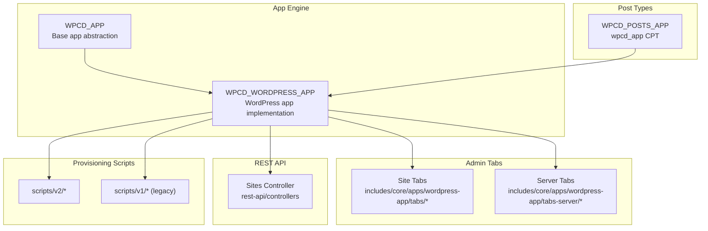
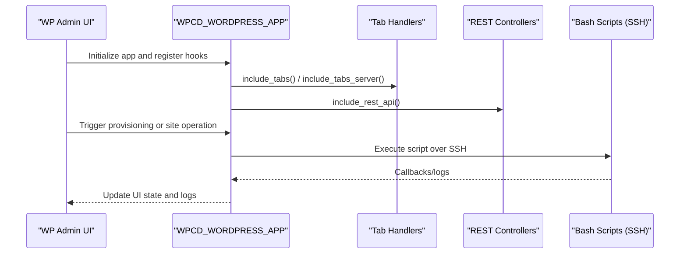
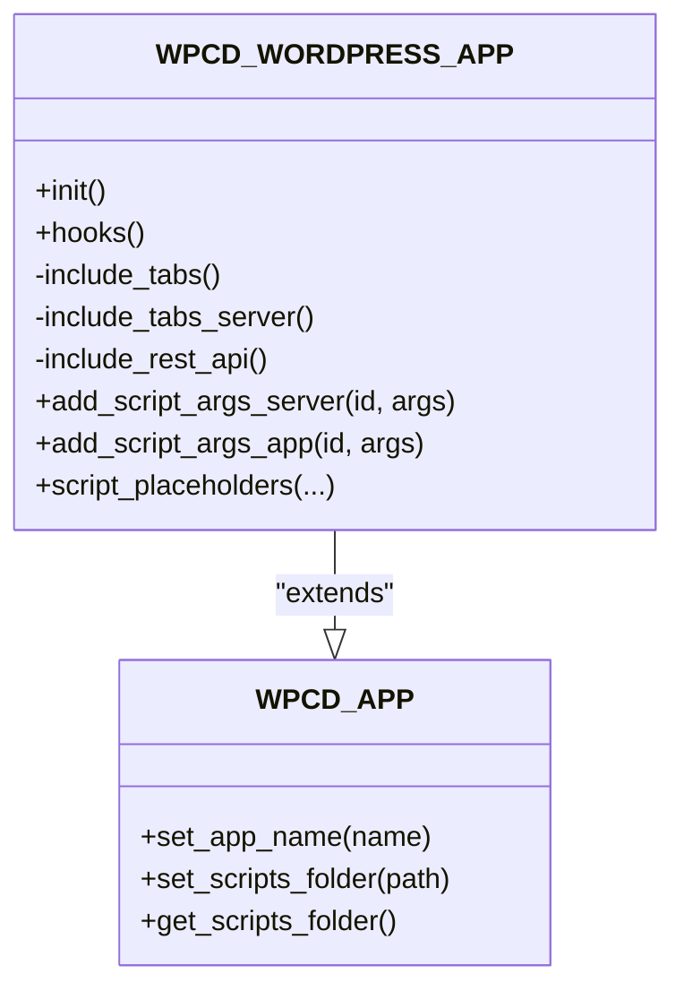
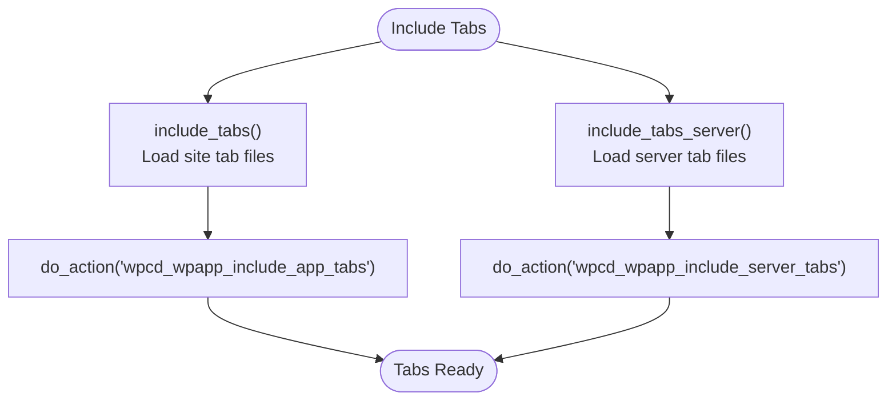
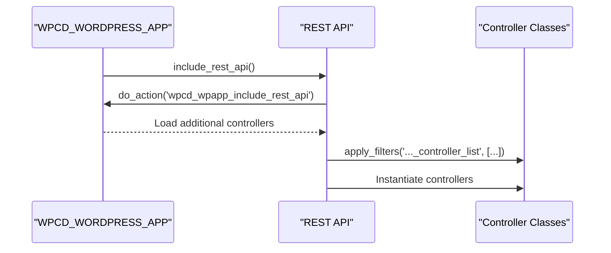
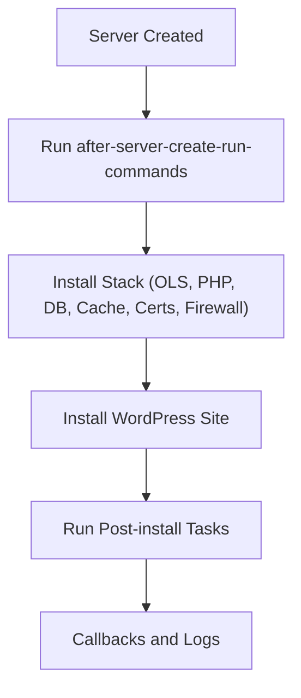
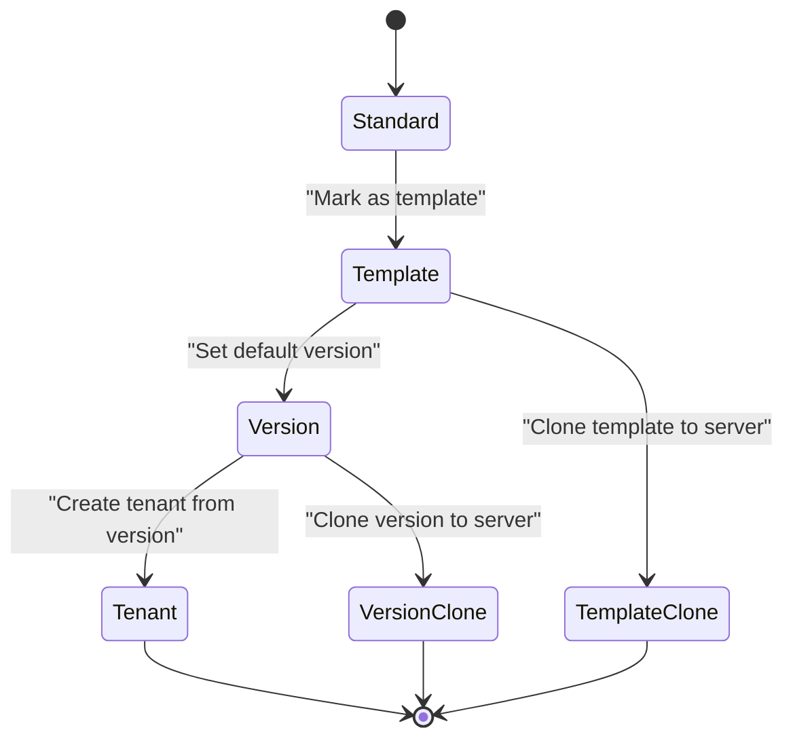
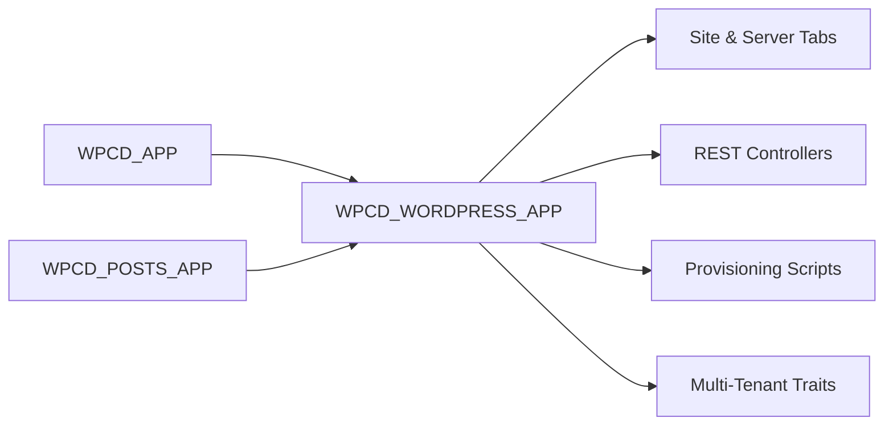

# Customization & Extension Points

<cite>
**Referenced Files in This Document**
- [README.md](file://README.md)
- [class-wpcd-app.php](file://includes/core/apps/class-wpcd-app.php)
- [class-wpcd-posts-app.php](file://includes/core/class-wpcd-posts-app.php)
- [class-wordpress-app.php](file://includes/core/apps/wordpress-app/class-wordpress-app.php)
- [tabs.php](file://includes/core/apps/wordpress-app/tabs/tabs.php)
- [multitenant-site.php](file://includes/core/apps/wordpress-app/tabs/multitenant-site.php)
- [multi-tenant-app.php](file://includes/core/apps/wordpress-app/traits/traits-for-class-wordpress-app/multi-tenant-app.php)
- [class-wpcd-rest-api-controller-sites.php](file://includes/core/apps/wordpress-app/rest-api/class-wpcd-rest-api-controller-sites.php)
- [v2/readme.txt](file://includes/core/apps/wordpress-app/scripts/v2/readme.txt)
</cite>

## Table of Contents
1. [Introduction](#introduction)
2. [Project Structure](#project-structure)
3. [Core Components](#core-components)
4. [Architecture Overview](#architecture-overview)
5. [Detailed Component Analysis](#detailed-component-analysis)
6. [Dependency Analysis](#dependency-analysis)
7. [Performance Considerations](#performance-considerations)
8. [Troubleshooting Guide](#troubleshooting-guide)
9. [Conclusion](#conclusion)

## Introduction
This document explains how to customize and extend the WordPress application engine within SimpleStack. It focuses on:
- Creating custom provisioning scripts and modifying deployment workflows
- Adding new operational capabilities via tabs, REST controllers, and hooks
- Extending the WordPress app class and post types
- Multi-tenant support features (site isolation, resource allocation, shared services)
- Best practices for maintaining compatibility with core updates and distributing customizations

SimpleStack provisions servers, installs WordPress over SSH using Bash scripts, and manages everything from the WordPress admin dashboard. The React-based admin UI is mounted at a dedicated container and communicates through a namespaced REST API.

**Section sources**
- [README.md:1-37](file://README.md#L1-L37)

## Project Structure
Key areas relevant to customization:
- App engine and base classes under includes/core/apps
- WordPress-specific app implementation under includes/core/apps/wordpress-app
- Tab system for site and server administration under includes/core/apps/wordpress-app/tabs and tabs-server
- Provisioning scripts under includes/core/apps/wordpress-app/scripts/v2 (and legacy v1)
- REST API controllers under includes/core/apps/wordpress-app/rest-api
- Post type registration and admin integration under includes/core

**Diagram sources**
- [class-wpcd-app.php:1315-1332](file://includes/core/apps/class-wpcd-app.php#L1315-L1332)
- [class-wordpress-app.php:15-27](file://includes/core/apps/wordpress-app/class-wordpress-app.php#L15-L27)
- [class-wordpress-app.php:289-393](file://includes/core/apps/wordpress-app/class-wordpress-app.php#L289-L393)
- [class-wordpress-app.php:398-440](file://includes/core/apps/wordpress-app/class-wordpress-app.php#L398-L440)
- [class-wpcd-posts-app.php:1522-1539](file://includes/core/class-wpcd-posts-app.php#L1522-L1539)
- [v2/readme.txt:1-3](file://includes/core/apps/wordpress-app/scripts/v2/readme.txt#L1-L3)

**Section sources**
- [README.md:27-37](file://README.md#L27-L37)
- [class-wordpress-app.php:15-27](file://includes/core/apps/wordpress-app/class-wordpress-app.php#L15-L27)
- [class-wordpress-app.php:289-393](file://includes/core/apps/wordpress-app/class-wordpress-app.php#L289-L393)
- [class-wordpress-app.php:398-440](file://includes/core/apps/wordpress-app/class-wordpress-app.php#L398-L440)
- [class-wpcd-posts-app.php:1522-1539](file://includes/core/class-wpcd-posts-app.php#L1522-L1539)
- [v2/readme.txt:1-3](file://includes/core/apps/wordpress-app/scripts/v2/readme.txt#L1-L3)

## Core Components
- WPCD_APP: Base app abstraction providing common infrastructure and extension points.
- WPCD_WORDPRESS_APP: WordPress-specific app that wires tabs, REST controllers, script handlers, and lifecycle hooks.
- WPCD_POSTS_APP: Registers and manages the wpcd_app custom post type and related admin behaviors.
- Tab system: Provides extensible site and server administration screens.
- Provisioning scripts: Bash scripts executed over SSH to install and manage WordPress and stack components.

Key extension points:
- Include tabs via action hooks
- Register additional REST controllers via filter
- Extend script placeholders and arguments
- Hook into command completion and background tasks

**Section sources**
- [class-wpcd-app.php:1315-1332](file://includes/core/apps/class-wpcd-app.php#L1315-L1332)
- [class-wordpress-app.php:15-27](file://includes/core/apps/wordpress-app/class-wordpress-app.php#L15-L27)
- [class-wordpress-app.php:103-257](file://includes/core/apps/wordpress-app/class-wordpress-app.php#L103-L257)
- [class-wpcd-posts-app.php:1522-1539](file://includes/core/class-wpcd-posts-app.php#L1522-L1539)

## Architecture Overview
The WordPress app orchestrates:
- Initialization and hook registration
- Loading site/server tabs
- Enabling REST API controllers
- Executing provisioning scripts over SSH
- Handling callbacks and background tasks

**Diagram sources**
- [class-wordpress-app.php:103-257](file://includes/core/apps/wordpress-app/class-wordpress-app.php#L103-L257)
- [class-wordpress-app.php:289-393](file://includes/core/apps/wordpress-app/class-wordpress-app.php#L289-L393)
- [class-wordpress-app.php:398-440](file://includes/core/apps/wordpress-app/class-wordpress-app.php#L398-L440)

## Detailed Component Analysis

### WordPress App Class (WPCD_WORDPRESS_APP)
Responsibilities:
- Sets app name, description, and script folders
- Initializes settings, SSH, upgrades, and hooks
- Includes site and server tabs
- Enables REST API and instantiates controllers
- Hooks into command execution, logging, and background tasks
- Exposes filters for script placeholders and arguments

Extension opportunities:
- Add custom tabs by hooking into tab inclusion actions
- Add REST controllers via filter
- Modify script arguments and placeholders
- Handle command completion events

**Diagram sources**
- [class-wordpress-app.php:15-27](file://includes/core/apps/wordpress-app/class-wordpress-app.php#L15-L27)
- [class-wordpress-app.php:62-98](file://includes/core/apps/wordpress-app/class-wordpress-app.php#L62-L98)
- [class-wordpress-app.php:103-257](file://includes/core/apps/wordpress-app/class-wordpress-app.php#L103-L257)
- [class-wordpress-app.php:289-393](file://includes/core/apps/wordpress-app/class-wordpress-app.php#L289-L393)
- [class-wordpress-app.php:398-440](file://includes/core/apps/wordpress-app/class-wordpress-app.php#L398-L440)

**Section sources**
- [class-wordpress-app.php:62-98](file://includes/core/apps/wordpress-app/class-wordpress-app.php#L62-L98)
- [class-wordpress-app.php:103-257](file://includes/core/apps/wordpress-app/class-wordpress-app.php#L103-L257)
- [class-wordpress-app.php:289-393](file://includes/core/apps/wordpress-app/class-wordpress-app.php#L289-L393)
- [class-wordpress-app.php:398-440](file://includes/core/apps/wordpress-app/class-wordpress-app.php#L398-L440)

### Tab System
Purpose:
- Provide structured admin interfaces for site and server management
- Support dynamic fields and actions rendered by the React client
- Allow third-party extensions via action hooks

Key patterns:
- Site tabs are included via include_tabs()
- Server tabs are included via include_tabs_server()
- Each tab file defines fields/actions and integrates with the generic tab framework

Extensibility:
- Use do_action('wpcd_wpapp_include_app_tabs') to add site tabs
- Use do_action('wpcd_wpapp_include_server_tabs') to add server tabs
- Implement get_fields_for_tab() and submit_generic_server_command() for simple tabs

**Diagram sources**
- [class-wordpress-app.php:289-393](file://includes/core/apps/wordpress-app/class-wordpress-app.php#L289-L393)
- [tabs.php:54-95](file://includes/core/apps/wordpress-app/tabs/tabs.php#L54-L95)

**Section sources**
- [class-wordpress-app.php:289-393](file://includes/core/apps/wordpress-app/class-wordpress-app.php#L289-L393)
- [tabs.php:54-95](file://includes/core/apps/wordpress-app/tabs/tabs.php#L54-L95)

### REST API Integration
Purpose:
- Expose endpoints for managing sites and tasks
- Allow third parties to add controllers

Extensibility:
- Hook into 'wpcd_wpapp_include_rest_api' to load additional controller files
- Filter 'wpcd_app_{app}_rest_api_controller_list' to register new controller classes

**Diagram sources**
- [class-wordpress-app.php:398-440](file://includes/core/apps/wordpress-app/class-wordpress-app.php#L398-L440)
- [class-wpcd-rest-api-controller-sites.php:38-38](file://includes/core/apps/wordpress-app/rest-api/class-wpcd-rest-api-controller-sites.php#L38-L38)

**Section sources**
- [class-wordpress-app.php:398-440](file://includes/core/apps/wordpress-app/class-wordpress-app.php#L398-L440)
- [class-wpcd-rest-api-controller-sites.php:38-38](file://includes/core/apps/wordpress-app/rest-api/class-wpcd-rest-api-controller-sites.php#L38-L38)

### Provisioning Scripts and Deployment Workflow
Purpose:
- Install and configure OpenLiteSpeed, PHP, MariaDB, Redis, certbot, firewall, and vhost
- Manage site operations like backups, cloning, domain changes, Git control, etc.

Workflow highlights:
- Scripts are versioned; v2 is current, v1 remains for legacy provisioned servers
- After server creation, post-provision commands can be run
- Script execution occurs over SSH with callbacks and log streaming

Customization:
- Create new scripts under scripts/v2
- Use provided placeholders and argument filters to inject values
- Hook into command completion events to perform post-processing

**Diagram sources**
- [README.md:11-22](file://README.md#L11-L22)
- [v2/readme.txt:1-3](file://includes/core/apps/wordpress-app/scripts/v2/readme.txt#L1-L3)

**Section sources**
- [README.md:11-22](file://README.md#L11-L22)
- [v2/readme.txt:1-3](file://includes/core/apps/wordpress-app/scripts/v2/readme.txt#L1-L3)

### Multi-Tenant Support
Features:
- Template sites and versioned product templates
- Tenant sites derived from template versions
- Site type metadata and version history
- Isolation utilities and shared service configuration helpers

Key concepts:
- Template flag and product name per template site
- Default and current MT version per site
- Parent relationships between template/version/tenant sites
- Site type enumeration: standard, template, mt_version, mt_version_clone, mt_tenant, mt_template_clone

Operational flows:
- Convert a standard site to multi-tenant
- Clone sites and preserve MT metadata
- Push versions to servers and manage tenant deployments

**Diagram sources**
- [multi-tenant-app.php:14-50](file://includes/core/apps/wordpress-app/traits/traits-for-class-wordpress-app/multi-tenant-app.php#L14-L50)
- [multi-tenant-app.php:174-232](file://includes/core/apps/wordpress-app/traits/traits-for-class-wordpress-app/multi-tenant-app.php#L174-L232)
- [multitenant-site.php:626-696](file://includes/core/apps/wordpress-app/tabs/multitenant-site.php#L626-L696)

**Section sources**
- [multi-tenant-app.php:14-50](file://includes/core/apps/wordpress-app/traits/traits-for-class-wordpress-app/multi-tenant-app.php#L14-L50)
- [multi-tenant-app.php:174-232](file://includes/core/apps/wordpress-app/traits/traits-for-class-wordpress-app/multi-tenant-app.php#L174-L232)
- [multitenant-site.php:626-696](file://includes/core/apps/wordpress-app/tabs/multitenant-site.php#L626-L696)

### Post Types and Admin Integration
- WPCD_POSTS_APP registers the wpcd_app custom post type and integrates it into the admin UI
- Provides search, filtering, meta boxes, permissions, and bulk actions
- Integrates with multisite initialization and cleanup routines

Extensibility:
- Extend admin search and filters
- Add custom columns and row actions
- Hook into save/delete lifecycle events

**Section sources**
- [class-wpcd-posts-app.php:1522-1539](file://includes/core/class-wpcd-posts-app.php#L1522-L1539)
- [class-wpcd-posts-app.php:81-151](file://includes/core/class-wpcd-posts-app.php#L81-L151)

## Dependency Analysis
High-level dependencies:
- WPCD_WORDPRESS_APP depends on WPCD_APP for base functionality
- Tabs and REST controllers are loaded conditionally based on feature flags and settings
- Provisioning scripts are invoked by the app engine during server/site lifecycle events
- Multi-tenant features are gated by feature flags and rely on metadata stored on wpcd_app posts

**Diagram sources**
- [class-wpcd-app.php:1315-1332](file://includes/core/apps/class-wpcd-app.php#L1315-L1332)
- [class-wordpress-app.php:15-27](file://includes/core/apps/wordpress-app/class-wordpress-app.php#L15-L27)
- [class-wordpress-app.php:289-393](file://includes/core/apps/wordpress-app/class-wordpress-app.php#L289-L393)
- [class-wordpress-app.php:398-440](file://includes/core/apps/wordpress-app/class-wordpress-app.php#L398-L440)
- [multi-tenant-app.php:14-50](file://includes/core/apps/wordpress-app/traits/traits-for-class-wordpress-app/multi-tenant-app.php#L14-L50)
- [class-wpcd-posts-app.php:1522-1539](file://includes/core/class-wpcd-posts-app.php#L1522-L1539)

**Section sources**
- [class-wordpress-app.php:15-27](file://includes/core/apps/wordpress-app/class-wordpress-app.php#L15-L27)
- [class-wordpress-app.php:289-393](file://includes/core/apps/wordpress-app/class-wordpress-app.php#L289-L393)
- [class-wordpress-app.php:398-440](file://includes/core/apps/wordpress-app/class-wordpress-app.php#L398-L440)
- [multi-tenant-app.php:14-50](file://includes/core/apps/wordpress-app/traits/traits-for-class-wordpress-app/multi-tenant-app.php#L14-L50)
- [class-wpcd-posts-app.php:1522-1539](file://includes/core/class-wpcd-posts-app.php#L1522-L1539)

## Performance Considerations
- Prefer lightweight tab logic; defer heavy computations to background tasks
- Avoid unnecessary database queries in admin screens; cache where appropriate
- Keep provisioning scripts idempotent and efficient; leverage existing helper functions
- Use REST endpoints judiciously; batch operations when possible

[No sources needed since this section provides general guidance]

## Troubleshooting Guide
Common issues and resolutions:
- Missing manifest or build artifacts: Ensure assets/dist/ is present; otherwise, the admin page shows an operator-facing notice instead of a blank screen
- CSS isolation checks failing: Run verification tools to ensure Tailwind styles remain scoped
- Script version mismatches: Legacy servers retain their script version; maintain both v1 and v2 as needed
- Feature flags not enabling tabs: Verify feature flags and conditions before expecting tabs to load

Recommended steps:
- Validate linting and guard rules before committing changes
- Rebuild front-end assets if UI does not render
- Check REST API namespace and permissions when debugging admin interactions

**Section sources**
- [README.md:75-88](file://README.md#L75-L88)

## Conclusion
SimpleStack provides robust extension points across its app engine, tab system, REST API, and provisioning scripts. By leveraging these hooks and patterns, you can:
- Create custom provisioning scripts and modify deployment workflows
- Add new operational capabilities via tabs and REST controllers
- Extend the WordPress app class and integrate deeply with the admin interface
- Implement multi-tenant features including site isolation and versioned templates
- Maintain compatibility with core updates and distribute customizations safely

[No sources needed since this section summarizes without analyzing specific files]