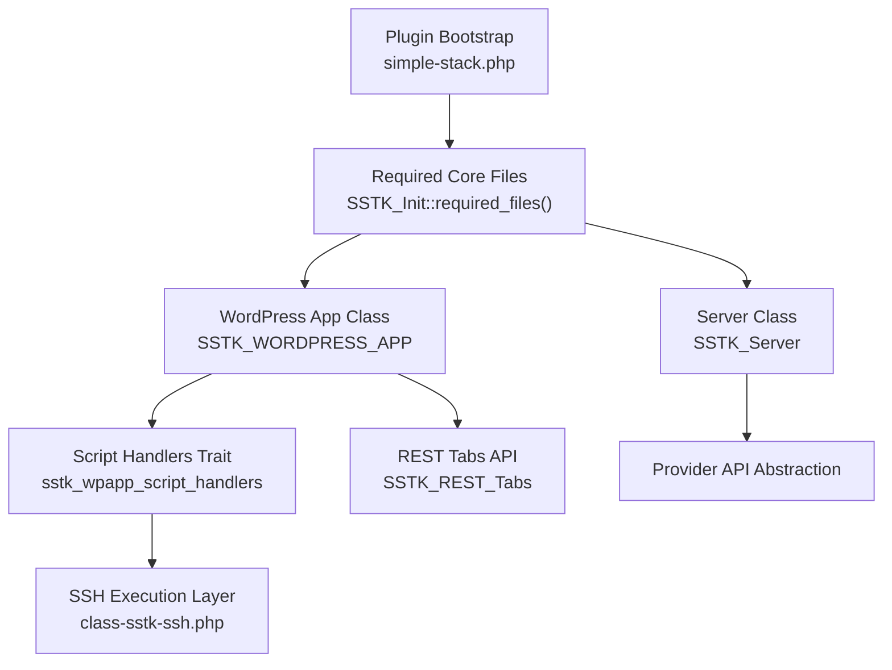
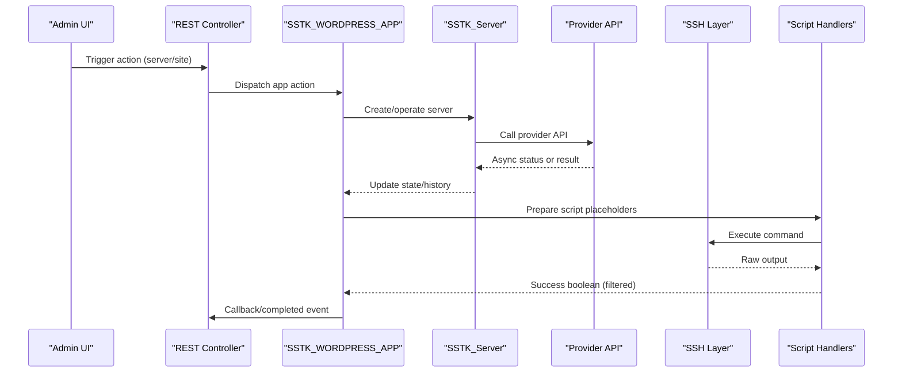
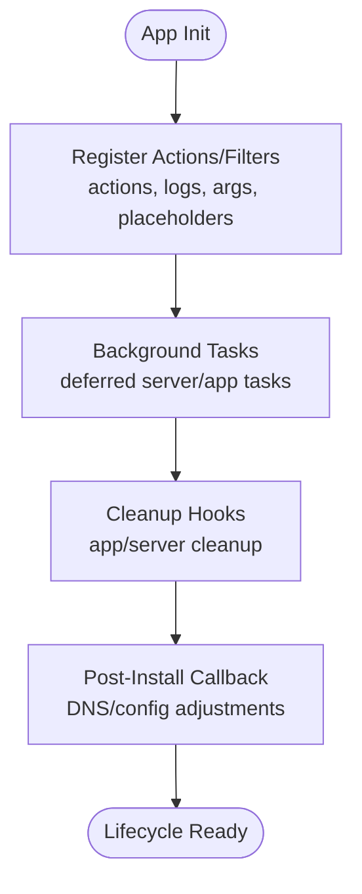
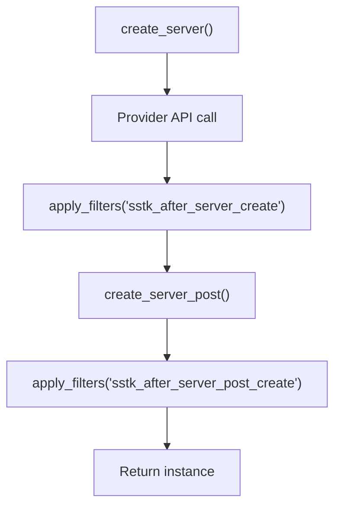
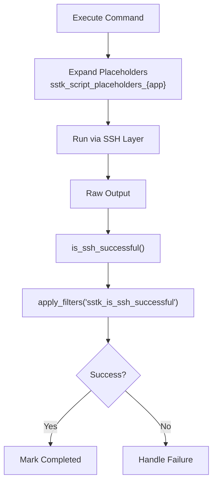
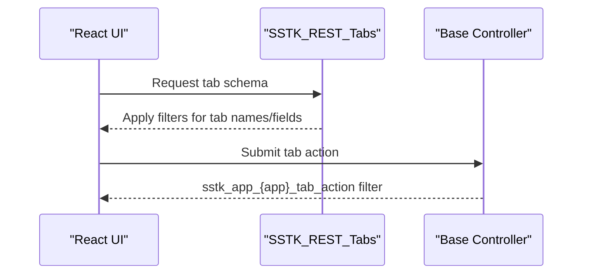
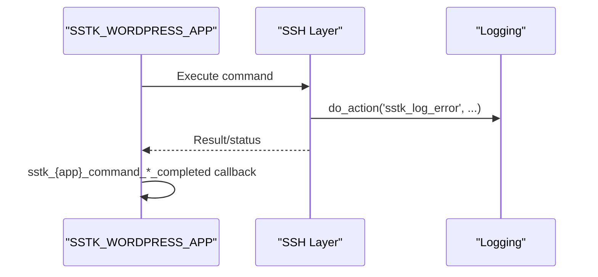
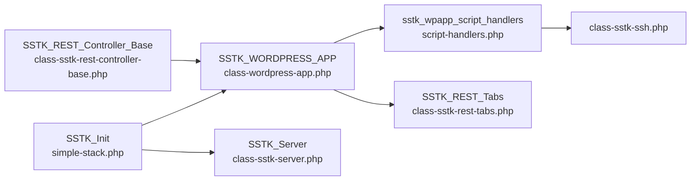

# Hook System & Lifecycle Customization

<cite>
**Referenced Files in This Document**   
- [simple-stack.php](file://simple-stack.php)
- [class-sstk-server.php](file://includes/core/class-sstk-server.php)
- [class-wordpress-app.php](file://includes/core/apps/wordpress-app/class-wordpress-app.php)
- [script-handlers.php](file://includes/core/apps/wordpress-app/traits/traits-for-class-wordpress-app/script-handlers.php)
- [class-sstk-rest-controller-base.php](file://includes/core/api/class-sstk-rest-controller-base.php)
- [class-sstk-rest-tabs.php](file://includes/core/api/class-sstk-rest-tabs.php)
- [class-sstk-ssh.php](file://includes/core/apps/class-sstk-ssh.php)
</cite>

## Table of Contents
1. [Introduction](#introduction)
2. [Project Structure](#project-structure)
3. [Core Components](#core-components)
4. [Architecture Overview](#architecture-overview)
5. [Detailed Component Analysis](#detailed-component-analysis)
6. [Dependency Analysis](#dependency-analysis)
7. [Performance Considerations](#performance-considerations)
8. [Troubleshooting Guide](#troubleshooting-guide)
9. [Conclusion](#conclusion)

## Introduction
This document explains the hook system that enables deep customization of the WordPress application lifecycle in this project. It covers:

- Action and filter hooks across server provisioning, site installation, and operational tasks.
- The script handler system for remote command execution.
- Command execution hooks and event-driven processing patterns.
- Hook priority conventions, parameter passing rules, and error handling within hooks.
- Best practices for safe hook development, debugging techniques, and maintaining compatibility with core updates.

The goal is to help you intercept deployment phases, modify default behaviors, add custom validation or transformation logic, and extend the platform without fragile overrides.

## Project Structure
At a high level, the plugin bootstraps early constants, loads required files, registers REST endpoints, and initializes the main classes. The WordPress App layer provides most lifecycle hooks, while the Server class exposes server provisioning hooks. Script handlers manage remote commands and success detection.

**Diagram sources**
- [simple-stack.php:106-414](file://simple-stack.php#L106-L414)
- [class-wordpress-app.php:62-177](file://includes/core/apps/wordpress-app/class-wordpress-app.php#L62-L177)
- [class-sstk-server.php:24-41](file://includes/core/class-sstk-server.php#L24-L41)
- [script-handlers.php:14-22](file://includes/core/apps/wordpress-app/traits/traits-for-class-wordpress-app/script-handlers.php#L14-L22)
- [class-sstk-rest-tabs.php:76-114](file://includes/core/api/class-sstk-rest-tabs.php#L76-L114)
- [class-sstk-ssh.php:46-241](file://includes/core/apps/class-sstk-ssh.php#L46-L241)

**Section sources**
- [simple-stack.php:106-414](file://simple-stack.php#L106-L414)

## Core Components
- Plugin bootstrap and initialization: defines constants, schedules cron intervals, registers activation/deactivation hooks, and loads core files.
- WordPress App lifecycle: registers app-specific actions/filters, REST controllers, tab schemas, background tasks, and command completion callbacks.
- Server lifecycle: creates, powers on/off, reboots, deletes, and tracks async provider operations; exposes filters for availability and post-creation steps.
- Script handlers: interprets remote command results, maps scripts to placeholders, and exposes filters for placeholder expansion and success evaluation.
- REST API extension points: allows adding tabs, fields, and tab actions per app/server.

Key responsibilities:
- Provide stable extension points for third-party code.
- Keep command execution and result interpretation decoupled from UI.
- Allow per-app customization through dynamic hook names.

**Section sources**
- [simple-stack.php:106-414](file://simple-stack.php#L106-L414)
- [class-wordpress-app.php:62-177](file://includes/core/apps/wordpress-app/class-wordpress-app.php#L62-L177)
- [class-sstk-server.php:84-120](file://includes/core/class-sstk-server.php#L84-L120)
- [script-handlers.php:23-798](file://includes/core/apps/wordpress-app/traits/traits-for-class-wordpress-app/script-handlers.php#L23-L798)

## Architecture Overview
The lifecycle flows through these stages:

1. Plugin bootstrap initializes core components and loads the WordPress App and Server classes.
2. WordPress App registers hooks for admin UI, REST API, background tasks, and command callbacks.
3. Server provisioning triggers provider API calls and posts records, exposing filters around creation and persistence.
4. Site installation and operational tasks execute remote scripts via SSH, with success determined by string matching and filtered by extensible logic.
5. Event-driven callbacks process completed commands and update state.

**Diagram sources**
- [class-sstk-rest-controller-base.php:416-416](file://includes/core/api/class-sstk-rest-controller-base.php#L416-L416)
- [class-wordpress-app.php:118-163](file://includes/core/apps/wordpress-app/class-wordpress-app.php#L118-L163)
- [class-sstk-server.php:84-120](file://includes/core/class-sstk-server.php#L84-L120)
- [script-handlers.php:802-820](file://includes/core/apps/wordpress-app/traits/traits-for-class-wordpress-app/script-handlers.php#L802-L820)
- [class-sstk-ssh.php:46-241](file://includes/core/apps/class-sstk-ssh.php#L46-L241)

## Detailed Component Analysis

### WordPress App Lifecycle Hooks
The WordPress App class centralizes lifecycle hooks:

- App/server action dispatchers: `sstk_server_{app}_action`, `sstk_app_{app}_action`.
- Command log filters and completion actions: `sstk_command_{app}_logs_done`, `sstk_command_{app}_logs_intermed`, `sstk_command_{app}_completed`.
- Script argument filters: `sstk_server_script_args`, `sstk_app_script_args`.
- Placeholder expansion: `sstk_script_placeholders_{app}`.
- Background deferred actions: `sstk_wordpress_deferred_actions_for_server`, `sstk_wordpress_deferred_actions_for_apps`.
- Cleanup hooks: `sstk_cleanup_app_after`, `sstk_cleanup_server_after`.
- Post-installation callback: `sstk_command_{app}_completed_after_cleanup`.

These hooks allow you to:
- Intercept server/site actions before they run.
- Modify script arguments and placeholders.
- Extend logs and handle completion events.
- Add cleanup routines after install or removal.

**Diagram sources**
- [class-wordpress-app.php:118-185](file://includes/core/apps/wordpress-app/class-wordpress-app.php#L118-L185)

**Section sources**
- [class-wordpress-app.php:118-185](file://includes/core/apps/wordpress-app/class-wordpress-app.php#L118-L185)

### Server Provisioning Hooks
The Server class exposes key hooks during provisioning:

- Creation flow:
  - `sstk_after_server_create`: Filter to modify instance data right after provider creation.
  - `sstk_after_server_post_create`: Filter after the server post record is created.
- Availability check:
  - `sstk_is_server_available_for_commands`: Filter to customize when commands can run on a server.
- History and async operations:
  - `add_action_to_history`: Records actions with timestamps.
  - `handle_async_action`: Manages multi-step provider operations and state transitions.

You can use these hooks to:
- Enrich server metadata after provider creation.
- Prevent commands during maintenance windows.
- Integrate external provisioning workflows.

**Diagram sources**
- [class-sstk-server.php:84-120](file://includes/core/class-sstk-server.php#L84-L120)

**Section sources**
- [class-sstk-server.php:84-120](file://includes/core/class-sstk-server.php#L84-L120)
- [class-sstk-server.php:769-782](file://includes/core/class-sstk-server.php#L769-L782)

### Script Handler System
The script handler trait manages remote command execution and success detection:

- Success evaluation:
  - `is_ssh_successful($result, $command, $action = '')` returns a boolean based on expected output strings.
  - Final result is filtered via `sstk_is_ssh_successful($return, $result, $command, $action, $app_name)`.
- Placeholder expansion:
  - Dynamic filter `sstk_script_placeholders_{app}` allows adding or overriding placeholders per script and version.
  - Parameters include script name, version, instance data, command, and additional context.

Best uses:
- Add custom placeholders for secrets, domains, or environment variables.
- Override success logic for new scripts or providers.
- Inject logging or telemetry into command execution.

**Diagram sources**
- [script-handlers.php:23-798](file://includes/core/apps/wordpress-app/traits/traits-for-class-wordpress-app/script-handlers.php#L23-L798)
- [script-handlers.php:802-820](file://includes/core/apps/wordpress-app/traits/traits-for-class-wordpress-app/script-handlers.php#L802-L820)
- [class-sstk-ssh.php:46-241](file://includes/core/apps/class-sstk-ssh.php#L46-L241)

**Section sources**
- [script-handlers.php:23-798](file://includes/core/apps/wordpress-app/traits/traits-for-class-wordpress-app/script-handlers.php#L23-L798)
- [script-handlers.php:802-820](file://includes/core/apps/wordpress-app/traits/traits-for-class-wordpress-app/script-handlers.php#L802-L820)

### REST API Extension Points
The REST layer exposes extension points for tabs, fields, and actions:

- Tab schema filters:
  - `sstk_server_{app}_get_tabnames`, `sstk_server_{app}_get_tabs`
  - `sstk_app_{app}_get_tabnames`, `sstk_app_{app}_get_tabs`
- Tab action filter:
  - `sstk_app_{app}_tab_action(null, $action, $id)` allows intercepting tab actions.

Use cases:
- Add custom tabs and fields for apps/servers.
- Intercept and validate tab actions before execution.
- Extend UI behavior without modifying core controllers.

**Diagram sources**
- [class-sstk-rest-tabs.php:76-114](file://includes/core/api/class-sstk-rest-tabs.php#L76-L114)
- [class-sstk-rest-controller-base.php:416-416](file://includes/core/api/class-sstk-rest-controller-base.php#L416-L416)

**Section sources**
- [class-sstk-rest-tabs.php:76-114](file://includes/core/api/class-sstk-rest-tabs.php#L76-L114)
- [class-sstk-rest-controller-base.php:416-416](file://includes/core/api/class-sstk-rest-controller-base.php#L416-L416)

### Command Execution Hooks and Event-Driven Processing
Command execution integrates with the SSH layer and script handlers:

- SSH execution:
  - Filters for user selection: `sstk_exec_ssh_user`, `sstk_download_ssh_user`, `sstk_upload_ssh_user`.
  - Key pair generation: `sstk_create_ssh_key_pair`.
- Logging and errors:
  - `do_action('sstk_log_error', ...)` throughout SSH operations for diagnostics.

Event-driven patterns:
- Completion callbacks for server and site commands are registered under `sstk_{app}_command_*_completed`.
- Deferred background tasks run periodically to process pending operations.

**Diagram sources**
- [class-sstk-ssh.php:46-241](file://includes/core/apps/class-sstk-ssh.php#L46-L241)
- [class-wordpress-app.php:133-149](file://includes/core/apps/wordpress-app/class-wordpress-app.php#L133-L149)

**Section sources**
- [class-sstk-ssh.php:46-241](file://includes/core/apps/class-sstk-ssh.php#L46-L241)
- [class-wordpress-app.php:133-149](file://includes/core/apps/wordpress-app/class-wordpress-app.php#L133-L149)

## Dependency Analysis
The following diagram shows how major components depend on each other and where hooks are exposed:

**Diagram sources**
- [simple-stack.php:106-414](file://simple-stack.php#L106-L414)
- [class-wordpress-app.php:62-177](file://includes/core/apps/wordpress-app/class-wordpress-app.php#L62-L177)
- [class-sstk-server.php:24-41](file://includes/core/class-sstk-server.php#L24-L41)
- [script-handlers.php:14-22](file://includes/core/apps/wordpress-app/traits/traits-for-class-wordpress-app/script-handlers.php#L14-L22)
- [class-sstk-rest-tabs.php:76-114](file://includes/core/api/class-sstk-rest-tabs.php#L76-L114)
- [class-sstk-rest-controller-base.php:416-416](file://includes/core/api/class-sstk-rest-controller-base.php#L416-L416)
- [class-sstk-ssh.php:46-241](file://includes/core/apps/class-sstk-ssh.php#L46-L241)

**Section sources**
- [simple-stack.php:106-414](file://simple-stack.php#L106-L414)
- [class-wordpress-app.php:62-177](file://includes/core/apps/wordpress-app/class-wordpress-app.php#L62-L177)
- [class-sstk-server.php:24-41](file://includes/core/class-sstk-server.php#L24-L41)
- [script-handlers.php:14-22](file://includes/core/apps/wordpress-app/traits/traits-for-class-wordpress-app/script-handlers.php#L14-L22)
- [class-sstk-rest-tabs.php:76-114](file://includes/core/api/class-sstk-rest-tabs.php#L76-L114)
- [class-sstk-rest-controller-base.php:416-416](file://includes/core/api/class-sstk-rest-controller-base.php#L416-L416)
- [class-sstk-ssh.php:46-241](file://includes/core/apps/class-sstk-ssh.php#L46-L241)

## Performance Considerations
- Hook priority:
  - Use appropriate priorities to ensure your logic runs before or after core behavior. For example, placeholder expansion should occur before command execution; success evaluation should be final.
- Parameter passing:
  - Always respect the documented parameter order for filters/actions. Modifying parameters unexpectedly can break downstream logic.
- Avoid heavy work in hooks:
  - Defer expensive operations to background tasks or scheduled jobs.
- Minimize database writes in hot paths:
  - Batch updates and avoid repeated meta queries inside frequently called hooks.
- Cache where possible:
  - Cache static configuration or computed values used by multiple hooks.

[No sources needed since this section provides general guidance]

## Troubleshooting Guide
Common issues and resolutions:

- Commands not executing:
  - Verify server availability via `sstk_is_server_available_for_commands`.
  - Check SSH credentials and permissions using `sstk_exec_ssh_user`, `sstk_download_ssh_user`, `sstk_upload_ssh_user`.
- Incorrect success detection:
  - Inspect raw output and override success logic via `sstk_is_ssh_successful`.
- Missing placeholders:
  - Ensure your placeholder expansion hook matches the app name and script version.
- REST tab actions failing:
  - Intercept via `sstk_app_{app}_tab_action` to validate inputs and log errors.
- Debugging:
  - Use `do_action('sstk_log_error', ...)` to emit diagnostic messages at critical points.

**Section sources**
- [class-sstk-server.php:769-782](file://includes/core/class-sstk-server.php#L769-L782)
- [class-sstk-ssh.php:46-241](file://includes/core/apps/class-sstk-ssh.php#L46-L241)
- [script-handlers.php:23-798](file://includes/core/apps/wordpress-app/traits/traits-for-class-wordpress-app/script-handlers.php#L23-L798)
- [class-sstk-rest-controller-base.php:416-416](file://includes/core/api/class-sstk-rest-controller-base.php#L416-L416)

## Conclusion
This hook system provides robust extension points across server provisioning, site installation, and operational tasks. By leveraging action and filter hooks—especially around script placeholders, command success evaluation, server creation, and REST tab actions—you can safely customize behavior, integrate external systems, and maintain compatibility with core updates. Follow best practices for hook priorities, parameter handling, and performance to build reliable, maintainable extensions.

[No sources needed since this section summarizes without analyzing specific files]