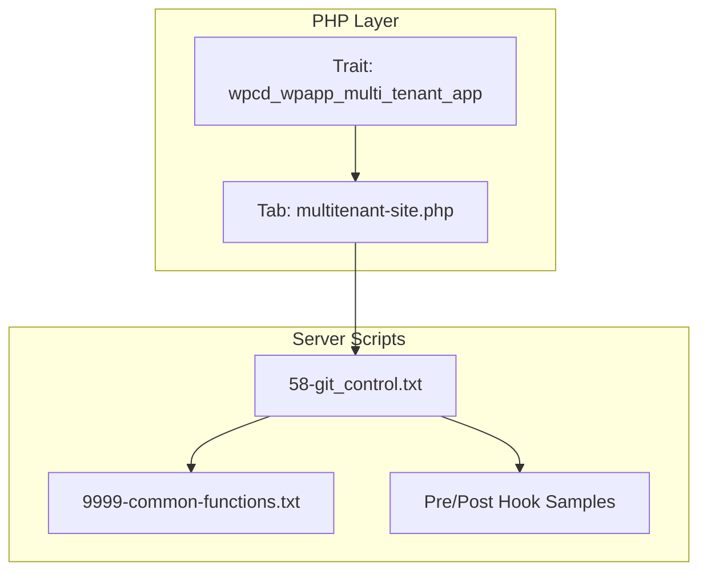
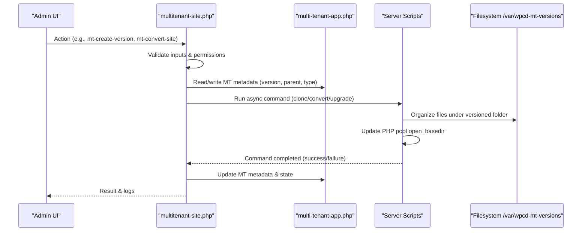
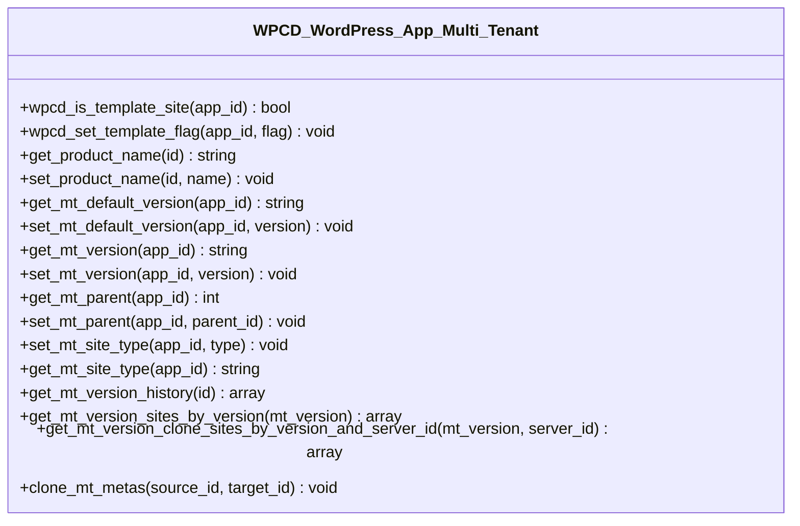
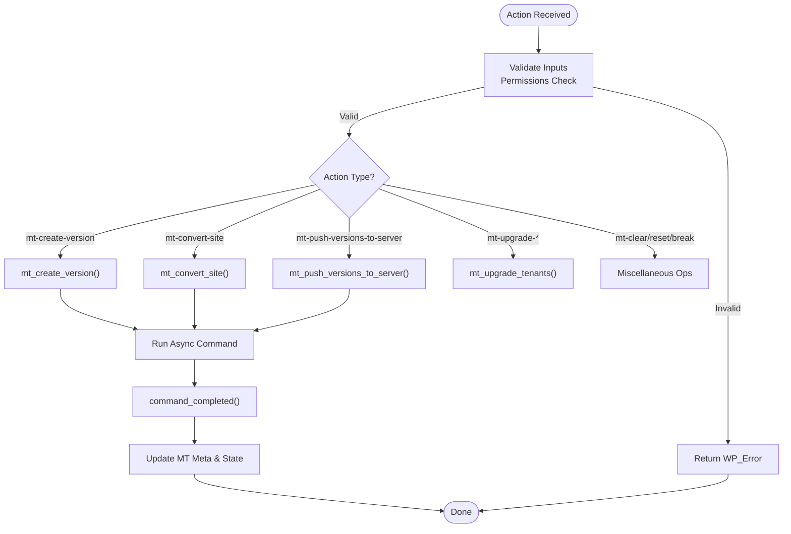
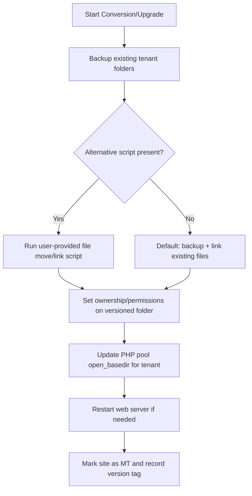
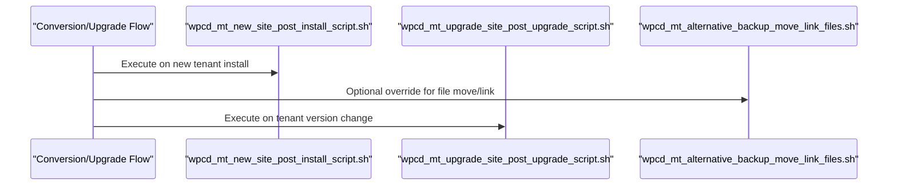
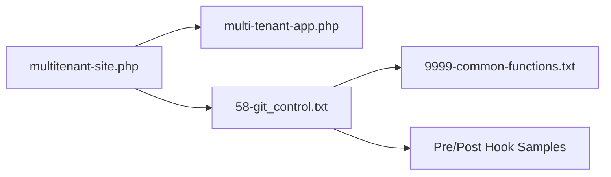

# Multi-Tenant Architecture & Site Isolation

<cite>
**Referenced Files in This Document**
- [multi-tenant-app.php](file://includes/core/apps/wordpress-app/traits/traits-for-class-wordpress-app/multi-tenant-app.php)
- [multitenant-site.php](file://includes/core/apps/wordpress-app/tabs/multitenant-site.php)
- [58-git_control.txt](file://includes/core/apps/wordpress-app/scripts/v1/raw/58-git_control.txt)
- [9999-common-functions.txt](file://includes/core/apps/wordpress-app/scripts/v1/raw/9999-common-functions.txt)
- [readme.txt (v1 samples)](file://includes/core/apps/wordpress-app/scripts/v1/multi-tenant-pre-post-samples/readme.txt)
- [wpcd_mt_new_site_post_install_script.sh](file://includes/core/apps/wordpress-app/scripts/v1/multi-tenant-pre-post-samples/wpcd_mt_new_site_post_install_script.sh)
- [wpcd_mt_upgrade_site_post_upgrade_script.sh](file://includes/core/apps/wordpress-app/scripts/v1/multi-tenant-pre-post-samples/wpcd_mt_upgrade_site_post_upgrade_script.sh)
- [wpcd_mt_alternative_backup_move_link_files.sh](file://includes/core/apps/wordpress-app/scripts/v1/multi-tenant-pre-post-samples/wpcd_mt_alternative_backup_move_link_files.sh)
</cite>

## Table of Contents
1. [Introduction](#introduction)
2. [Project Structure](#project-structure)
3. [Core Components](#core-components)
4. [Architecture Overview](#architecture-overview)
5. [Detailed Component Analysis](#detailed-component-analysis)
6. [Dependency Analysis](#dependency-analysis)
7. [Performance Considerations](#performance-considerations)
8. [Troubleshooting Guide](#troubleshooting-guide)
9. [Conclusion](#conclusion)

## Introduction
This document explains the multi-tenant architecture and site isolation features implemented for the WordPress application within the project. It covers the data model for templates, versions, and tenants; resource allocation strategies such as versioned file storage and PHP open_basedir scoping; security boundaries between sites; pre/post installation hooks for tenant lifecycle events; backup and migration strategies during conversion; and operational workflows for creating versions, converting sites to tenants, upgrading tenants, and pushing versions across servers.

## Project Structure
The multi-tenant functionality is centered around:
- A trait that defines the multi-tenant data model and helpers for template/version/tenant relationships.
- A tab controller that orchestrates multi-tenant operations via UI actions and background commands.
- Bash scripts that perform on-server tasks like cloning, versioning, file linking, and configuration updates.
- Sample pre/post hooks that allow customization at key lifecycle points.

**Diagram sources**
- [multi-tenant-app.php:12-389](file://includes/core/apps/wordpress-app/traits/traits-for-class-wordpress-app/multi-tenant-app.php#L12-L389)
- [multitenant-site.php:15-800](file://includes/core/apps/wordpress-app/tabs/multitenant-site.php#L15-L800)
- [58-git_control.txt:1717-2377](file://includes/core/apps/wordpress-app/scripts/v1/raw/58-git_control.txt#L1717-L2377)
- [9999-common-functions.txt:2008-2050](file://includes/core/apps/wordpress-app/scripts/v1/raw/9999-common-functions.txt#L2008-L2050)
- [readme.txt (v1 samples):1-41](file://includes/core/apps/wordpress-app/scripts/v1/multi-tenant-pre-post-samples/readme.txt#L1-L41)

**Section sources**
- [multi-tenant-app.php:12-389](file://includes/core/apps/wordpress-app/traits/traits-for-class-wordpress-app/multi-tenant-app.php#L12-L389)
- [multitenant-site.php:15-800](file://includes/core/apps/wordpress-app/tabs/multitenant-site.php#L15-L800)
- [58-git_control.txt:1717-2377](file://includes/core/apps/wordpress-app/scripts/v1/raw/58-git_control.txt#L1717-L2377)
- [9999-common-functions.txt:2008-2050](file://includes/core/apps/wordpress-app/scripts/v1/raw/9999-common-functions.txt#L2008-L2050)
- [readme.txt (v1 samples):1-41](file://includes/core/apps/wordpress-app/scripts/v1/multi-tenant-pre-post-samples/readme.txt#L1-L41)

## Core Components
- Multi-tenant data model and helpers are provided by a trait that manages template flags, product names, default versions, version stamps, parent links, site types, and version history. It also clones these metadata fields when duplicating sites.
- The multi-tenant tab provides UI-driven actions: create new version, set template flag, set default version, convert site to tenant, push versions to remote server, upgrade tenants, reset/clear site type, and break parent link. It coordinates async command execution and post-completion state updates.
- Server-side bash scripts handle cloning, git tag resolution, file organization under a versioned directory tree, symlink/linking or alternative file handling, and PHP pool configuration updates for isolation.
- Pre/post hook samples allow customizing behavior at new site install and upgrade/downgrade moments, including optional replacement of built-in file move/link logic.

**Section sources**
- [multi-tenant-app.php:12-389](file://includes/core/apps/wordpress-app/traits/traits-for-class-wordpress-app/multi-tenant-app.php#L12-L389)
- [multitenant-site.php:384-474](file://includes/core/apps/wordpress-app/tabs/multitenant-site.php#L384-L474)
- [58-git_control.txt:2282-2377](file://includes/core/apps/wordpress-app/scripts/v1/raw/58-git_control.txt#L2282-L2377)
- [readme.txt (v1 samples):1-41](file://includes/core/apps/wordpress-app/scripts/v1/multi-tenant-pre-post-samples/readme.txt#L1-L41)

## Architecture Overview
The system separates concerns into three layers:
- PHP orchestration layer: validates inputs, enforces permissions, constructs commands, and updates post meta after successful operations.
- Server script layer: performs actual work on the target server (cloning, git operations, file management, web server restarts).
- Customization layer: user-provided scripts that run at specific lifecycle points to tailor tenant setup or upgrade behavior.

**Diagram sources**
- [multitenant-site.php:476-615](file://includes/core/apps/wordpress-app/tabs/multitenant-site.php#L476-L615)
- [multitenant-site.php:617-728](file://includes/core/apps/wordpress-app/tabs/multitenant-site.php#L617-L728)
- [58-git_control.txt:2282-2377](file://includes/core/apps/wordpress-app/scripts/v1/raw/58-git_control.txt#L2282-L2377)
- [9999-common-functions.txt:2008-2050](file://includes/core/apps/wordpress-app/scripts/v1/raw/9999-common-functions.txt#L2008-L2050)

## Detailed Component Analysis

### Multi-Tenant Data Model (Trait)
The trait defines the canonical multi-tenant metadata and helper methods:
- Template identity and flags
- Product name association
- Default version selection
- Version stamp per site
- Parent relationship to template/version
- Site type classification (standard, template, mt_version, mt_version_clone, mt_tenant, mt_template_clone)
- Version history retrieval
- Query helpers for version sites and clones
- Metadata cloning for copy/staging/sync operations

**Diagram sources**
- [multi-tenant-app.php:12-389](file://includes/core/apps/wordpress-app/traits/traits-for-class-wordpress-app/multi-tenant-app.php#L12-L389)

**Section sources**
- [multi-tenant-app.php:12-389](file://includes/core/apps/wordpress-app/traits/traits-for-class-wordpress-app/multi-tenant-app.php#L12-L389)

### Multi-Tenant Operations Controller (Tab)
The tab exposes actions and handles their lifecycle:
- Create new version: clones site, sets DNS, runs clone control script, then updates version history and metadata.
- Convert site to tenant: prepares arguments, runs conversion control script, updates tenant metadata and pending task state.
- Push versions to server: validates permissions, executes sync to destination, updates version destinations.
- Upgrade tenants: bulk operations with validation and error handling.
- Utility actions: clear/reset site type, break parent link.

**Diagram sources**
- [multitenant-site.php:384-474](file://includes/core/apps/wordpress-app/tabs/multitenant-site.php#L384-L474)
- [multitenant-site.php:476-615](file://includes/core/apps/wordpress-app/tabs/multitenant-site.php#L476-L615)
- [multitenant-site.php:617-728](file://includes/core/apps/wordpress-app/tabs/multitenant-site.php#L617-L728)
- [multitenant-site.php:730-800](file://includes/core/apps/wordpress-app/tabs/multitenant-site.php#L730-L800)

**Section sources**
- [multitenant-site.php:384-474](file://includes/core/apps/wordpress-app/tabs/multitenant-site.php#L384-L474)
- [multitenant-site.php:476-615](file://includes/core/apps/wordpress-app/tabs/multitenant-site.php#L476-L615)
- [multitenant-site.php:617-728](file://includes/core/apps/wordpress-app/tabs/multitenant-site.php#L617-L728)
- [multitenant-site.php:730-800](file://includes/core/apps/wordpress-app/tabs/multitenant-site.php#L730-L800)

### Server-Side File Organization and Security Boundaries
Key responsibilities:
- Back up existing folders before conversion.
- Link or move files from the versioned template store into the tenant’s document root.
- Ensure read-only access to shared versioned content.
- Configure PHP open_basedir to restrict tenant processes to their own directories plus the shared versioned path.

**Diagram sources**
- [58-git_control.txt:1717-1746](file://includes/core/apps/wordpress-app/scripts/v1/raw/58-git_control.txt#L1717-L1746)
- [58-git_control.txt:2282-2377](file://includes/core/apps/wordpress-app/scripts/v1/raw/58-git_control.txt#L2282-L2377)
- [9999-common-functions.txt:2008-2050](file://includes/core/apps/wordpress-app/scripts/v1/raw/9999-common-functions.txt#L2008-L2050)

**Section sources**
- [58-git_control.txt:1717-1746](file://includes/core/apps/wordpress-app/scripts/v1/raw/58-git_control.txt#L1717-L1746)
- [58-git_control.txt:2282-2377](file://includes/core/apps/wordpress-app/scripts/v1/raw/58-git_control.txt#L2282-L2377)
- [9999-common-functions.txt:2008-2050](file://includes/core/apps/wordpress-app/scripts/v1/raw/9999-common-functions.txt#L2008-L2050)

### Pre/Post Installation Hooks for Multi-Tenant Environments
Hooks available in the template root:
- New site post-install hook: runs when a site is converted to a multi-tenant site (e.g., during purchase flow or admin creation).
- Upgrade post-upgrade hook: runs when an existing tenant switches to a new version (supports upgrades and downgrades).
- Alternative file move/link script: replaces built-in backup/move/link functions to customize how plugins/themes are shared or copied per tenant.

These hooks receive variables describing the domain, template domain, versioned folder path, tenant files path, git tag, and restricted web user.

**Diagram sources**
- [readme.txt (v1 samples):1-41](file://includes/core/apps/wordpress-app/scripts/v1/multi-tenant-pre-post-samples/readme.txt#L1-L41)
- [wpcd_mt_new_site_post_install_script.sh:1-40](file://includes/core/apps/wordpress-app/scripts/v1/multi-tenant-pre-post-samples/wpcd_mt_new_site_post_install_script.sh#L1-L40)
- [wpcd_mt_upgrade_site_post_upgrade_script.sh:1-40](file://includes/core/apps/wordpress-app/scripts/v1/multi-tenant-pre-post-samples/wpcd_mt_upgrade_site_post_upgrade_script.sh#L1-L40)
- [wpcd_mt_alternative_backup_move_link_files.sh:1-36](file://includes/core/apps/wordpress-app/scripts/v1/multi-tenant-pre-post-samples/wpcd_mt_alternative_backup_move_link_files.sh#L1-L36)

**Section sources**
- [readme.txt (v1 samples):1-41](file://includes/core/apps/wordpress-app/scripts/v1/multi-tenant-pre-post-samples/readme.txt#L1-L41)
- [wpcd_mt_new_site_post_install_script.sh:1-40](file://includes/core/apps/wordpress-app/scripts/v1/multi-tenant-pre-post-samples/wpcd_mt_new_site_post_install_script.sh#L1-L40)
- [wpcd_mt_upgrade_site_post_upgrade_script.sh:1-40](file://includes/core/apps/wordpress-app/scripts/v1/multi-tenant-pre-post-samples/wpcd_mt_upgrade_site_post_upgrade_script.sh#L1-L40)
- [wpcd_mt_alternative_backup_move_link_files.sh:1-36](file://includes/core/apps/wordpress-app/scripts/v1/multi-tenant-pre-post-samples/wpcd_mt_alternative_backup_move_link_files.sh#L1-L36)

### Tenant Isolation Mechanisms
- Filesystem isolation: each tenant has its own document root; shared code resides under a versioned directory tree.
- Process isolation: PHP pools are configured with open_basedir to limit reads to the tenant’s html directory and the shared versioned folder.
- Ownership and permissions: shared versioned folders are made readable by the web user but not writable, preventing cross-tenant writes.

**Section sources**
- [58-git_control.txt:2299-2304](file://includes/core/apps/wordpress-app/scripts/v1/raw/58-git_control.txt#L2299-L2304)
- [9999-common-functions.txt:2008-2050](file://includes/core/apps/wordpress-app/scripts/v1/raw/9999-common-functions.txt#L2008-L2050)

### Shared Services Configuration
- Versioned template storage path structure is used to serve shared plugins/themes/code across tenants.
- PHP pool configurations are updated to include the versioned path in open_basedir, enabling tenants to read shared resources while remaining isolated from write access.

**Section sources**
- [58-git_control.txt:2299-2304](file://includes/core/apps/wordpress-app/scripts/v1/raw/58-git_control.txt#L2299-L2304)
- [9999-common-functions.txt:2008-2050](file://includes/core/apps/wordpress-app/scripts/v1/raw/9999-common-functions.txt#L2008-L2050)

### Cross-Site Communication Patterns
- Within this implementation, tenants do not directly communicate with each other. They share read-only code via the versioned directory. Any cross-tenant communication should be implemented at the application layer (e.g., external APIs), not through filesystem access.

[No sources needed since this section does not analyze specific files]

### Examples of Customizing Multi-Tenant Behavior
- Use the new site post-install hook to set tenant-specific wp-config options (e.g., post revisions limits, trash cleanup).
- Use the upgrade hook to apply database migrations or feature toggles when switching versions.
- Replace the default file move/link behavior with your own strategy (symlink entire plugin/theme directories or copy per tenant).

**Section sources**
- [wpcd_mt_new_site_post_install_script.sh:20-33](file://includes/core/apps/wordpress-app/scripts/v1/multi-tenant-pre-post-samples/wpcd_mt_new_site_post_install_script.sh#L20-L33)
- [wpcd_mt_upgrade_site_post_upgrade_script.sh:20-33](file://includes/core/apps/wordpress-app/scripts/v1/multi-tenant-pre-post-samples/wpcd_mt_upgrade_site_post_upgrade_script.sh#L20-L33)
- [wpcd_mt_alternative_backup_move_link_files.sh:19-35](file://includes/core/apps/wordpress-app/scripts/v1/multi-tenant-pre-post-samples/wpcd_mt_alternative_backup_move_link_files.sh#L19-L35)

### Managing Shared Resources
- Place shared plugins/themes in the template repository tagged by version.
- On conversion/upgrade, the system links or copies shared assets into the tenant’s environment according to the chosen strategy (default or custom).
- Keep shared assets immutable per version to ensure consistency across tenants.

**Section sources**
- [58-git_control.txt:2282-2377](file://includes/core/apps/wordpress-app/scripts/v1/raw/58-git_control.txt#L2282-L2377)
- [wpcd_mt_alternative_backup_move_link_files.sh:19-35](file://includes/core/apps/wordpress-app/scripts/v1/multi-tenant-pre-post-samples/wpcd_mt_alternative_backup_move_link_files.sh#L19-L35)

## Dependency Analysis

**Diagram sources**
- [multitenant-site.php:15-800](file://includes/core/apps/wordpress-app/tabs/multitenant-site.php#L15-L800)
- [multi-tenant-app.php:12-389](file://includes/core/apps/wordpress-app/traits/traits-for-class-wordpress-app/multi-tenant-app.php#L12-L389)
- [58-git_control.txt:1717-2377](file://includes/core/apps/wordpress-app/scripts/v1/raw/58-git_control.txt#L1717-L2377)
- [9999-common-functions.txt:2008-2050](file://includes/core/apps/wordpress-app/scripts/v1/raw/9999-common-functions.txt#L2008-L2050)
- [readme.txt (v1 samples):1-41](file://includes/core/apps/wordpress-app/scripts/v1/multi-tenant-pre-post-samples/readme.txt#L1-L41)

**Section sources**
- [multitenant-site.php:15-800](file://includes/core/apps/wordpress-app/tabs/multitenant-site.php#L15-L800)
- [multi-tenant-app.php:12-389](file://includes/core/apps/wordpress-app/traits/traits-for-class-wordpress-app/multi-tenant-app.php#L12-L389)
- [58-git_control.txt:1717-2377](file://includes/core/apps/wordpress-app/scripts/v1/raw/58-git_control.txt#L1717-L2377)
- [9999-common-functions.txt:2008-2050](file://includes/core/apps/wordpress-app/scripts/v1/raw/9999-common-functions.txt#L2008-L2050)
- [readme.txt (v1 samples):1-41](file://includes/core/apps/wordpress-app/scripts/v1/multi-tenant-pre-post-samples/readme.txt#L1-L41)

## Performance Considerations
- Prefer symlinking shared plugins/themes rather than copying large assets per tenant to reduce disk usage and improve update propagation.
- Limit concurrent conversions/upgrades to avoid overwhelming SSH/command queues.
- Monitor PHP-FPM pool restarts triggered by open_basedir changes; batch configuration updates where possible.
- Use version pinning and minimal diffs to reduce rsync/clone overhead.

[No sources needed since this section provides general guidance]

## Troubleshooting Guide
Common issues and checks:
- HTTP/2 enabled on nginx prevents creating new versions; disable HTTP/2 before attempting version creation.
- Git not installed or disabled can block multi-tenant operations; verify git availability on the server.
- Permission errors on shared versioned folders: ensure www-data group read access and correct ownership.
- open_basedir misconfiguration: confirm PHP pool configs include the tenant’s html directory and the versioned folder path.
- Early conversion failures: review action hooks for early failure messages and pending task states.

**Section sources**
- [multitenant-site.php:1423-1462](file://includes/core/apps/wordpress-app/tabs/multitenant-site.php#L1423-L1462)
- [58-git_control.txt:2299-2304](file://includes/core/apps/wordpress-app/scripts/v1/raw/58-git_control.txt#L2299-L2304)
- [9999-common-functions.txt:2008-2050](file://includes/core/apps/wordpress-app/scripts/v1/raw/9999-common-functions.txt#L2008-L2050)

## Conclusion
The multi-tenant architecture leverages a clear separation between PHP orchestration and server-side scripting, with robust metadata tracking and strict filesystem/process isolation. Templates and versions are centrally managed and safely shared across tenants. Pre/post hooks provide flexible extension points for tenant-specific configuration and upgrade procedures. By following the outlined patterns and safeguards, operators can scale multi-tenant deployments securely and efficiently.

[No sources needed since this section summarizes without analyzing specific files]