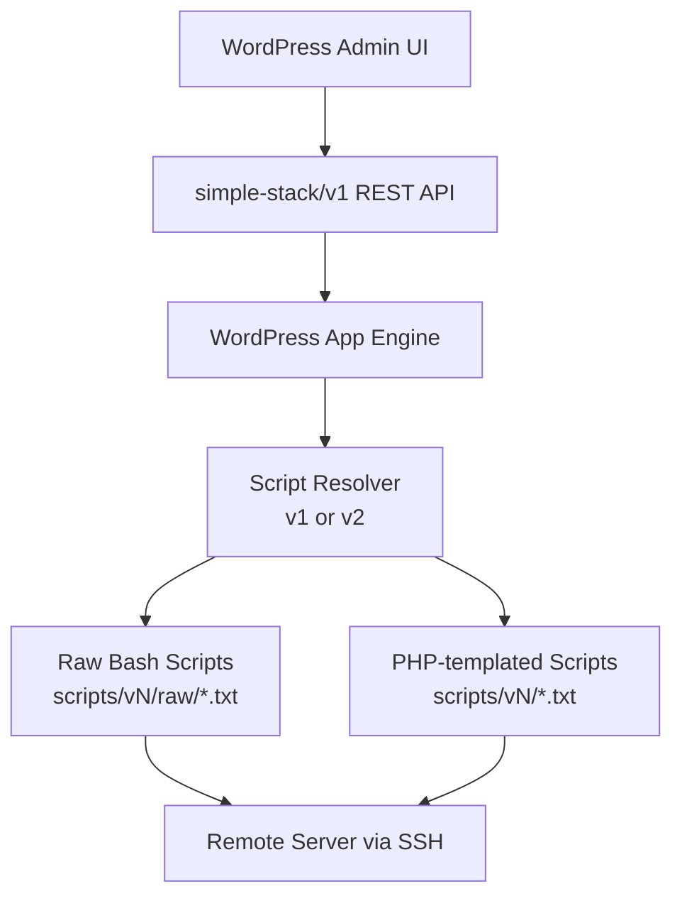
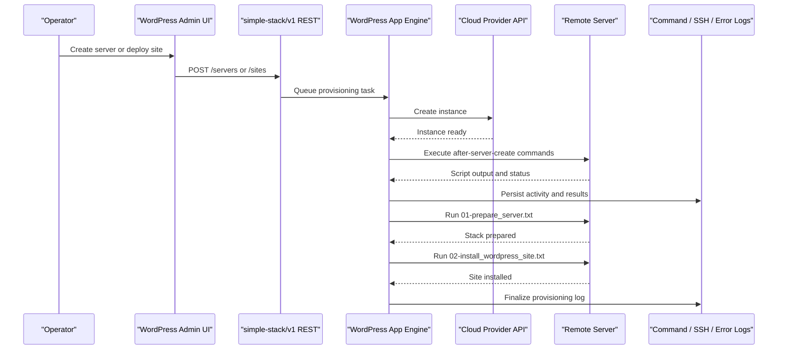
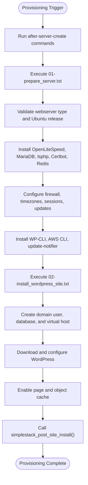
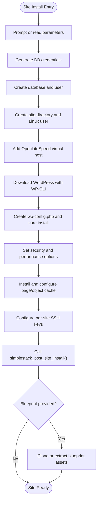
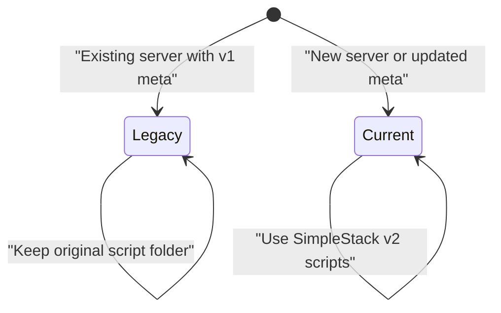
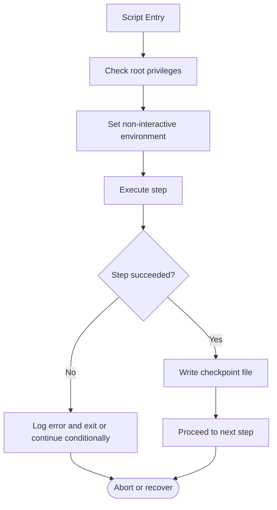
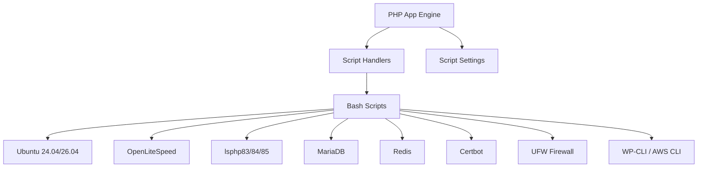

# Provisioning Scripts & Deployment Workflows

<cite>
**Referenced Files in This Document**
- [README.md](file://README.md)
- [SIMPLESTACK.md](file://docs/SIMPLESTACK.md)
- [class-wordpress-app-settings.php](file://includes/core/apps/wordpress-app/class-wordpress-app-settings.php)
- [commands-and-logs.php](file://includes/core/apps/wordpress-app/traits/traits-for-class-wordpress-app/commands-and-logs.php)
- [script-handlers.php](file://includes/core/apps/wordpress-app/traits/traits-for-class-wordpress-app/script-handlers.php)
- [01-prepare_server.txt (v2)](file://includes/core/apps/wordpress-app/scripts/v2/raw/01-prepare_server.txt)
- [02-install_wordpress_site.txt (v2)](file://includes/core/apps/wordpress-app/scripts/v2/raw/02-install_wordpress_site.txt)
- [66-simplestack_post_install.txt](file://includes/core/apps/wordpress-app/scripts/v2/raw/66-simplestack_post_install.txt)
- [9999-common-functions.txt](file://includes/core/apps/wordpress-app/scripts/v2/raw/9999-common-functions.txt)
- [environment variables.txt (v1)](file://includes/core/apps/wordpress-app/scripts/v1/raw/environment%20variables.txt)
- [after-server-create-run-commands.txt (v1)](file://includes/core/apps/wordpress-app/scripts/v1/after-server-create-run-commands.txt)
- [mt_clone_site.txt (v1)](file://includes/core/apps/wordpress-app/scripts/v1/mt_clone_site.txt)
- [class-wpcd-posts-log.php](file://includes/core/class-wpcd-posts-log.php)
</cite>

## Table of Contents
1. [Introduction](#introduction)
2. [Project Structure](#project-structure)
3. [Core Components](#core-components)
4. [Architecture Overview](#architecture-overview)
5. [Detailed Component Analysis](#detailed-component-analysis)
6. [Dependency Analysis](#dependency-analysis)
7. [Performance Considerations](#performance-considerations)
8. [Troubleshooting Guide](#troubleshooting-guide)
9. [Conclusion](#conclusion)
10. [Appendices](#appendices)

## Introduction
This document explains how to create, customize, and maintain provisioning scripts for the WordPress application engine in SimpleStack. It covers the script execution lifecycle, naming conventions, parameter passing, server preparation, WordPress installation, post-deployment configuration, the v1 versus v2 script versions, error handling patterns, logging, and best practices for testing and cloud-provider compatibility.

SimpleStack provisions servers at Vultr and UpCloud, installs OpenLiteSpeed, PHP, MariaDB, Redis, Certbot, firewall rules, and a WordPress site over SSH using Bash scripts under `includes/core/apps/wordpress-app/scripts/`. The default is now v2; v1 remains for legacy servers.

**Section sources**
- [README.md:1-37](file://README.md#L1-L37)
- [SIMPLESTACK.md:154-177](file://docs/SIMPLESTACK.md#L154-L177)

## Project Structure
Provisioning scripts are organized by version and delivery mechanism:

- `scripts/vN/raw/*.txt` — plain Bash scripts downloaded verbatim from `SCRIPT_URL`.
- `scripts/vN/*.txt` outside `raw/` — PHP templates with `##TOKEN##` placeholders substituted before execution.
- `scripts/v2/` — SimpleStack’s current stack: OpenLiteSpeed only, Ubuntu 24.04 (`noble`) and 26.04 (`resolute`), lsphp83/84/85.
- `scripts/v1/` — upstream script set preserved for existing servers.

**Diagram sources**
- [SIMPLESTACK.md:154-170](file://docs/SIMPLESTACK.md#L154-L170)
- [commands-and-logs.php:238-254](file://includes/core/apps/wordpress-app/traits/traits-for-class-wordpress-app/commands-and-logs.php#L238-L254)

**Section sources**
- [README.md:37-37](file://README.md#L37-L37)
- [SIMPLESTACK.md:154-177](file://docs/SIMPLESTACK.md#L154-L177)

## Core Components
The provisioning system connects three layers:

1. **Server-side orchestration:** `01-prepare_server.txt` prepares the OS, web server, PHP versions, database, cache, firewall, and tools.
2. **Site installation:** `02-install_wordpress_site.txt` creates the site user, database, virtual host, WordPress files, configuration, caching, and SSH access.
3. **Post-install hardening:** `66-simplestack_post_install.txt` enforces security defaults and optional plugin activation after the site is fully installed.

Common helpers live in `9999-common-functions.txt`, including webserver detection, PHP version management, restart routines, SSL helpers, and admin IP normalization.

Key PHP integration points:
- `get_after_server_create_commands()` selects the post-provision command wrapper.
- Placeholder substitution and script dispatch are handled through script handlers and filters.
- Settings expose the active script version and administrative controls such as the OLS WebAdmin IP.

**Section sources**
- [01-prepare_server.txt (v2):1-708](file://includes/core/apps/wordpress-app/scripts/v2/raw/01-prepare_server.txt#L1-L708)
- [02-install_wordpress_site.txt (v2):1-324](file://includes/core/apps/wordpress-app/scripts/v2/raw/02-install_wordpress_site.txt#L1-L324)
- [66-simplestack_post_install.txt:1-86](file://includes/core/apps/wordpress-app/scripts/v2/raw/66-simplestack_post_install.txt#L1-L86)
- [9999-common-functions.txt:279-358](file://includes/core/apps/wordpress-app/scripts/v2/raw/9999-common-functions.txt#L279-L358)
- [commands-and-logs.php:238-254](file://includes/core/apps/wordpress-app/traits/traits-for-class-wordpress-app/commands-and-logs.php#L238-L254)
- [script-handlers.php:802-818](file://includes/core/apps/wordpress-app/traits/traits-for-class-wordpress-app/script-handlers.php#L802-L818)
- [class-wordpress-app-settings.php:972-1001](file://includes/core/apps/wordpress-app/class-wordpress-app-settings.php#L972-L1001)

## Architecture Overview
The end-to-end flow starts in the WordPress admin, moves through the REST layer into the app engine, resolves the correct script version, executes commands on the remote server, and records logs.

**Diagram sources**
- [SIMPLESTACK.md:67-91](file://docs/SIMPLESTACK.md#L67-L91)
- [commands-and-logs.php:238-254](file://includes/core/apps/wordpress-app/traits/traits-for-class-wordpress-app/commands-and-logs.php#L238-L254)

## Detailed Component Analysis

### Script Execution Lifecycle
The lifecycle has three major phases:

1. **After server creation:** A wrapper command runs the selected script, writes intermediate logs, renames them on success, and calls a callback URL.
2. **Server preparation:** `01-prepare_server.txt` validates environment, installs OpenLiteSpeed, MariaDB, lsphp83/84/85, Certbot, Redis, AWS CLI, WP-CLI, and firewall rules.
3. **WordPress installation:** `02-install_wordpress_site.txt` creates the site directory, database, user, virtual host, downloads WordPress, configures it, enables caching, and sets up per-site SSH keys.
4. **Post-install hook:** `simplestack_post_site_install` applies hardening and optional security plugins.

**Diagram sources**
- [01-prepare_server.txt (v2):1-708](file://includes/core/apps/wordpress-app/scripts/v2/raw/01-prepare_server.txt#L1-L708)
- [02-install_wordpress_site.txt (v2):1-324](file://includes/core/apps/wordpress-app/scripts/v2/raw/02-install_wordpress_site.txt#L1-L324)
- [66-simplestack_post_install.txt:1-86](file://includes/core/apps/wordpress-app/scripts/v2/raw/66-simplestack_post_install.txt#L1-L86)
- [after-server-create-run-commands.txt (v1):36-41](file://includes/core/apps/wordpress-app/scripts/v1/after-server-create-run-commands.txt#L36-L41)

**Section sources**
- [after-server-create-run-commands.txt (v1):36-41](file://includes/core/apps/wordpress-app/scripts/v1/after-server-create-run-commands.txt#L36-L41)
- [01-prepare_server.txt (v2):1-708](file://includes/core/apps/wordpress-app/scripts/v2/raw/01-prepare_server.txt#L1-L708)
- [02-install_wordpress_site.txt (v2):1-324](file://includes/core/apps/wordpress-app/scripts/v2/raw/02-install_wordpress_site.txt#L1-L324)
- [66-simplestack_post_install.txt:1-86](file://includes/core/apps/wordpress-app/scripts/v2/raw/66-simplestack_post_install.txt#L1-L86)

### Naming Conventions and Script Organization
- Use `scripts/v2/raw/` for raw Bash scripts that are fetched directly.
- Use `scripts/v2/*.txt` for PHP templated scripts where `##TOKEN##` placeholders are replaced before execution.
- Keep shared logic in `9999-common-functions.txt`; call helper functions prefixed with `gf_`.
- Avoid sourcing sibling raw scripts; every dependency must be explicitly fetched by the wrapper.
- Keep script names descriptive and grouped by phase: server preparation, site installation, management actions, and post-install hooks.

**Section sources**
- [SIMPLESTACK.md:154-170](file://docs/SIMPLESTACK.md#L154-L170)
- [9999-common-functions.txt:1-14](file://includes/core/apps/wordpress-app/scripts/v2/raw/9999-common-functions.txt#L1-L14)

### Parameter Passing Mechanisms
Parameters reach scripts through several channels:

| Channel | Purpose | Example |
|---|---|---|
| Environment variables | Runtime configuration passed by the wrapper | `webserver_type`, `name`, `post_id`, `post_processing_script_server`, `post_processing_script_site` |
| Script arguments | Domain, username, webserver type for post-install hook | `$1`, `$2`, `$3` in `simplestack_post_site_install()` |
| PHP template placeholders | Values injected before execution | `##SCRIPT_NAME##`, `##CALLBACK_URL##`, `##SCRIPT_LOGS##` |
| Filter-driven values | Security plugin slugs and other dynamic data | `simplestack_post_site_install_plugins` filter |
| Settings fields | Global configuration for script behavior | `wordpress_app_script_version`, `simplestack_admin_ip` |

The v1 environment variable documentation describes many of these variables, while v2 centralizes validation and normalization in common functions.

**Section sources**
- [environment variables.txt (v1):1-23](file://includes/core/apps/wordpress-app/scripts/v1/raw/environment%20variables.txt#L1-L23)
- [66-simplestack_post_install.txt:13-19](file://includes/core/apps/wordpress-app/scripts/v2/raw/66-simplestack_post_install.txt#L13-L19)
- [script-handlers.php:802-818](file://includes/core/apps/wordpress-app/traits/traits-for-class-wordpress-app/script-handlers.php#L802-L818)
- [class-wordpress-app-settings.php:972-1001](file://includes/core/apps/wordpress-app/class-wordpress-app-settings.php#L972-L1001)

### Custom Server Preparation Scripts
To customize server preparation:

1. Add your steps to `01-prepare_server.txt` or extend `9999-common-functions.txt` with new `gf_*` helpers.
2. Use checkpoint files to make long-running operations resumable.
3. Validate inputs early and fail fast with clear messages.
4. Prefer explicit package installation loops over globs to avoid unexpected repository changes.
5. Keep port 7080 closed by default and open it only for a validated admin IP.

Example customization areas:
- Adding custom software installations after repository setup.
- Installing additional Certbot DNS plugins.
- Configuring unattended upgrades for PPAs.
- Adjusting PHP session paths, memory limits, upload sizes, and opcache settings.

**Section sources**
- [01-prepare_server.txt (v2):109-175](file://includes/core/apps/wordpress-app/scripts/v2/raw/01-prepare_server.txt#L109-L175)
- [01-prepare_server.txt (v2):300-345](file://includes/core/apps/wordpress-app/scripts/v2/raw/01-prepare_server.txt#L300-L345)
- [01-prepare_server.txt (v2):439-544](file://includes/core/apps/wordpress-app/scripts/v2/raw/01-prepare_server.txt#L439-L544)
- [01-prepare_server.txt (v2):616-674](file://includes/core/apps/wordpress-app/scripts/v2/raw/01-prepare_server.txt#L616-L674)
- [9999-common-functions.txt:316-358](file://includes/core/apps/wordpress-app/scripts/v2/raw/9999-common-functions.txt#L316-L358)

### WordPress Installation Procedures
The site installer performs:

- Interactive or environment-driven input for domain, admin credentials, WordPress version, and locale.
- Randomized database name, prefix, user, and password.
- Database creation and WordPress download via WP-CLI.
- Configuration of filesystem method, memory limits, auto-updates, permalink structure, and cache constants.
- Page cache and object cache setup for OpenLiteSpeed.
- Per-site SSH key configuration.
- Blueprint support for deploying themes, plugins, and files from repositories or archives.

**Diagram sources**
- [02-install_wordpress_site.txt (v2):1-324](file://includes/core/apps/wordpress-app/scripts/v2/raw/02-install_wordpress_site.txt#L1-L324)
- [66-simplestack_post_install.txt:1-86](file://includes/core/apps/wordpress-app/scripts/v2/raw/66-simplestack_post_install.txt#L1-L86)

**Section sources**
- [02-install_wordpress_site.txt (v2):20-122](file://includes/core/apps/wordpress-app/scripts/v2/raw/02-install_wordpress_site.txt#L20-L122)
- [02-install_wordpress_site.txt (v2):124-175](file://includes/core/apps/wordpress-app/scripts/v2/raw/02-install_wordpress_site.txt#L124-L175)
- [02-install_wordpress_site.txt (v2):177-222](file://includes/core/apps/wordpress-app/scripts/v2/raw/02-install_wordpress_site.txt#L177-L222)
- [02-install_wordpress_site.txt (v2):248-324](file://includes/core/apps/wordpress-app/scripts/v2/raw/02-install_wordpress_site.txt#L248-L324)

### Post-Deployment Configuration Steps
The post-install hook runs after WordPress and any blueprint assets are applied:

- Sets `DISALLOW_FILE_EDIT true`.
- Installs and activates plugins listed in `SIMPLE_STACK_SECURITY_PLUGINS`.
- Validates each plugin slug against a strict pattern to prevent command injection.
- Returns gracefully when required parameters or `wp-config.php` are missing.

You can extend this hook by adding more hardening steps, running WP-CLI maintenance tasks, seeding content, or applying deployment-specific configuration.

**Section sources**
- [66-simplestack_post_install.txt:16-85](file://includes/core/apps/wordpress-app/scripts/v2/raw/66-simplestack_post_install.txt#L16-L85)
- [SIMPLESTACK.md:247-275](file://docs/SIMPLESTACK.md#L247-L275)

### Script Versioning System: v1 vs v2
Both versions coexist:

- Default setting is `v2`.
- Existing servers retain their recorded `wpcd_server_scripts_version`, so changing the global setting does not retroactively re-provision older servers.
- v2 removes nginx/LEMP branches, pins OpenLiteSpeed tooling, restricts supported Ubuntu releases, and adds hardened admin console handling.
- v1 remains available for legacy workflows and add-ons.

**Diagram sources**
- [SIMPLESTACK.md:172-192](file://docs/SIMPLESTACK.md#L172-L192)
- [class-wordpress-app-settings.php:972-1001](file://includes/core/apps/wordpress-app/class-wordpress-app-settings.php#L972-L1001)

**Section sources**
- [SIMPLESTACK.md:172-192](file://docs/SIMPLESTACK.md#L172-L192)
- [README.md:101-102](file://README.md#L101-L102)
- [class-wordpress-app-settings.php:972-1001](file://includes/core/apps/wordpress-app/class-wordpress-app-settings.php#L972-L1001)

### Error Handling Patterns
Common patterns include:

- Root privilege checks at script entry.
- Non-interactive package installation with `DEBIAN_FRONTEND=noninteractive`.
- Explicit exit codes and readable failure messages.
- Checkpoint files to resume partial runs.
- Optional extension failures reported without aborting the entire provision.
- Callback URLs invoked after successful script completion.
- Log sanitization utilities in PHP for cleaner operator-facing logs.

**Diagram sources**
- [01-prepare_server.txt (v2):1-20](file://includes/core/apps/wordpress-app/scripts/v2/raw/01-prepare_server.txt#L1-L20)
- [01-prepare_server.txt (v2):95-124](file://includes/core/apps/wordpress-app/scripts/v2/raw/01-prepare_server.txt#L95-L124)
- [01-prepare_server.txt (v2):427-544](file://includes/core/apps/wordpress-app/scripts/v2/raw/01-prepare_server.txt#L427-L544)
- [after-server-create-run-commands.txt (v1):36-41](file://includes/core/apps/wordpress-app/scripts/v1/after-server-create-run-commands.txt#L36-L41)
- [class-wpcd-posts-log.php:183-197](file://includes/core/class-wpcd-posts-log.php#L183-L197)

**Section sources**
- [01-prepare_server.txt (v2):1-20](file://includes/core/apps/wordpress-app/scripts/v2/raw/01-prepare_server.txt#L1-L20)
- [01-prepare_server.txt (v2):95-124](file://includes/core/apps/wordpress-app/scripts/v2/raw/01-prepare_server.txt#L95-L124)
- [01-prepare_server.txt (v2):427-544](file://includes/core/apps/wordpress-app/scripts/v2/raw/01-prepare_server.txt#L427-L544)
- [after-server-create-run-commands.txt (v1):36-41](file://includes/core/apps/wordpress-app/scripts/v1/after-server-create-run-commands.txt#L36-L41)
- [mt_clone_site.txt (v1):31-41](file://includes/core/apps/wordpress-app/scripts/v1/mt_clone_site.txt#L31-L41)
- [class-wpcd-posts-log.php:183-197](file://includes/core/class-wpcd-posts-log.php#L183-L197)

### Logging Capabilities
Logging occurs at multiple levels:

- Remote scripts write intermediate logs and rename them to `.log.done` on success.
- Callback URLs report completion back to the control plane.
- PHP stores command, SSH, and error logs accessible through the REST API.
- Log sanitization removes noisy or misleading messages.

Best practices:
- Write human-readable status lines.
- Avoid secrets in logs.
- Use structured checkpoints for long operations.
- Inspect logs through the SimpleStack activity feed or REST endpoints.

**Section sources**
- [after-server-create-run-commands.txt (v1):36-41](file://includes/core/apps/wordpress-app/scripts/v1/after-server-create-run-commands.txt#L36-L41)
- [mt_clone_site.txt (v1):31-41](file://includes/core/apps/wordpress-app/scripts/v1/mt_clone_site.txt#L31-L41)
- [SIMPLESTACK.md:79-91](file://docs/SIMPLESTACK.md#L79-L91)
- [class-wpcd-posts-log.php:183-197](file://includes/core/class-wpcd-posts-log.php#L183-L197)

### Common Customization Scenarios

#### Adding Custom Software Installations
- Extend repository setup and package installation blocks in `01-prepare_server.txt`.
- Use explicit version loops instead of globs.
- Mark optional extensions as non-fatal if they may lag behind core packages.

#### Modifying Server Configurations
- Adjust PHP ini settings, session paths, timezone, and opcache in the configuration block.
- Update unattended upgrade allowed origins for PPAs.
- Harden firewall rules and keep port 7080 restricted.

#### Implementing Deployment Hooks
- Use `post_processing_script_server` for server-level post-provision scripts.
- Use `post_processing_script_site` for site-level post-install scripts.
- Extend `simplestack_post_site_install()` for final site hardening and plugin activation.

**Section sources**
- [01-prepare_server.txt (v2):180-345](file://includes/core/apps/wordpress-app/scripts/v2/raw/01-prepare_server.txt#L180-L345)
- [01-prepare_server.txt (v2):439-544](file://includes/core/apps/wordpress-app/scripts/v2/raw/01-prepare_server.txt#L439-L544)
- [01-prepare_server.txt (v2):616-674](file://includes/core/apps/wordpress-app/scripts/v2/raw/01-prepare_server.txt#L616-L674)
- [01-prepare_server.txt (v2):693-703](file://includes/core/apps/wordpress-app/scripts/v2/raw/01-prepare_server.txt#L693-L703)
- [02-install_wordpress_site.txt (v2):224-234](file://includes/core/apps/wordpress-app/scripts/v2/raw/02-install_wordpress_site.txt#L224-L234)
- [66-simplestack_post_install.txt:48-80](file://includes/core/apps/wordpress-app/scripts/v2/raw/66-simplestack_post_install.txt#L48-L80)

### Best Practices for Script Organization
- Keep raw scripts self-contained; do not rely on implicit sibling includes.
- Centralize shared logic in `9999-common-functions.txt`.
- Prefix helper functions with `gf_` and local variables with `local`.
- Validate all external inputs early.
- Use checkpoints for idempotent, resumable operations.
- Prefer pinned tags and checksum verification for externally fetched code.
- Keep sensitive ports closed by default and open them only for validated addresses.

**Section sources**
- [SIMPLESTACK.md:154-170](file://docs/SIMPLESTACK.md#L154-L170)
- [9999-common-functions.txt:1-14](file://includes/core/apps/wordpress-app/scripts/v2/raw/9999-common-functions.txt#L1-L14)
- [01-prepare_server.txt (v2):205-249](file://includes/core/apps/wordpress-app/scripts/v2/raw/01-prepare_server.txt#L205-L249)
- [01-prepare_server.txt (v2):647-667](file://includes/core/apps/wordpress-app/scripts/v2/raw/01-prepare_server.txt#L647-L667)

### Testing Strategies
Recommended workflow:

1. Run shell linting over raw scripts, wrappers, and gate tools.
2. Validate PHP syntax across the plugin tree.
3. Build and verify the front-end bundle.
4. Test provisioning on a staging provider account.
5. Inspect intermediate logs and `.log.done` markers.
6. Verify firewall rules, service status, and site health after installation.
7. Re-run provisioning to confirm checkpoint resumption.

**Section sources**
- [README.md:79-90](file://README.md#L79-L90)
- [SIMPLESTACK.md:300-313](file://docs/SIMPLESTACK.md#L300-L313)
- [after-server-create-run-commands.txt (v1):36-41](file://includes/core/apps/wordpress-app/scripts/v1/after-server-create-run-commands.txt#L36-L41)

### Maintaining Compatibility Across Cloud Providers
- Rely on provider APIs through the registered provider classes rather than ad-hoc SSH workarounds.
- Keep scripts focused on OS and stack configuration; let providers handle instance lifecycle.
- Preserve provider-specific quirks only when necessary, such as the MariaDB Dpkg option workaround.
- Avoid assumptions about preinstalled tools; detect and install what is needed.
- Keep network rules conservative and allow only required ports.

**Section sources**
- [SIMPLESTACK.md:278-296](file://docs/SIMPLESTACK.md#L278-L296)
- [01-prepare_server.txt (v2):269-276](file://includes/core/apps/wordpress-app/scripts/v2/raw/01-prepare_server.txt#L269-L276)
- [01-prepare_server.txt (v2):616-674](file://includes/core/apps/wordpress-app/scripts/v2/raw/01-prepare_server.txt#L616-L674)

## Dependency Analysis
The provisioning pipeline depends on:

- **PHP layer:** WordPress app engine, REST controllers, settings, and script handlers.
- **Shell layer:** Bash scripts sourced from v1 or v2.
- **External services:** Cloud provider APIs, LiteSpeed repositories, Certbot, WP-CLI, and optional DNS plugins.
- **Local state:** Checkpoint folders, semaphores, and log files on the remote server.

**Diagram sources**
- [SIMPLESTACK.md:15-31](file://docs/SIMPLESTACK.md#L15-L31)
- [01-prepare_server.txt (v2):180-345](file://includes/core/apps/wordpress-app/scripts/v2/raw/01-prepare_server.txt#L180-L345)
- [01-prepare_server.txt (v2):348-410](file://includes/core/apps/wordpress-app/scripts/v2/raw/01-prepare_server.txt#L348-L410)
- [01-prepare_server.txt (v2):547-605](file://includes/core/apps/wordpress-app/scripts/v2/raw/01-prepare_server.txt#L547-L605)
- [01-prepare_server.txt (v2):616-674](file://includes/core/apps/wordpress-app/scripts/v2/raw/01-prepare_server.txt#L616-L674)

**Section sources**
- [SIMPLESTACK.md:15-31](file://docs/SIMPLESTACK.md#L15-L31)
- [01-prepare_server.txt (v2):180-674](file://includes/core/apps/wordpress-app/scripts/v2/raw/01-prepare_server.txt#L180-L674)

## Performance Considerations
- Split long package installations into smaller steps to keep the UI responsive.
- Use explicit version loops to avoid glob failures and unpredictable repository behavior.
- Skip optional extension failures gracefully during initial provisioning.
- Enable unattended upgrades and refresh repositories once.
- Restart services only when necessary and verify status afterward.
- Prefer direct WP-CLI operations under the site user to reduce permission overhead.

[No sources needed since this section provides general guidance]

## Troubleshooting Guide
Common issues and resolutions:

- **Missing common functions:** Ensure `9999-common-functions.sh` is present and sourced.
- **Unsupported webserver or Ubuntu release:** Confirm `webserver_type` is `ols` or `ols-enterprise` and the OS is 24.04 or 26.04.
- **Port 7080 unreachable:** Verify `SIMPLE_STACK_ADMIN_IP` is set correctly and UFW allows it; otherwise use an SSH tunnel.
- **Certbot installation fails:** Check snapd health and retry; Certbot is required for certificate issuance.
- **Partial provisioning:** Inspect checkpoint files and remove incomplete blocks only after understanding the failure point.
- **Log noise:** Use built-in log sanitization and inspect command, SSH, and error logs through the REST API.

**Section sources**
- [01-prepare_server.txt (v2):14-20](file://includes/core/apps/wordpress-app/scripts/v2/raw/01-prepare_server.txt#L14-L20)
- [01-prepare_server.txt (v2):29-46](file://includes/core/apps/wordpress-app/scripts/v2/raw/01-prepare_server.txt#L29-L46)
- [01-prepare_server.txt (v2):48-67](file://includes/core/apps/wordpress-app/scripts/v2/raw/01-prepare_server.txt#L48-L67)
- [01-prepare_server.txt (v2):348-410](file://includes/core/apps/wordpress-app/scripts/v2/raw/01-prepare_server.txt#L348-L410)
- [01-prepare_server.txt (v2):427-544](file://includes/core/apps/wordpress-app/scripts/v2/raw/01-prepare_server.txt#L427-L544)
- [01-prepare_server.txt (v2):647-667](file://includes/core/apps/wordpress-app/scripts/v2/raw/01-prepare_server.txt#L647-L667)
- [class-wpcd-posts-log.php:183-197](file://includes/core/class-wpcd-posts-log.php#L183-L197)

## Conclusion
SimpleStack’s provisioning system centers on predictable, auditable Bash scripts executed over SSH, with strong separation between server preparation, WordPress installation, and post-install hardening. The v2 script set modernizes the stack around OpenLiteSpeed and supported Ubuntu releases, improves security, and introduces safer placeholder and admin IP handling. By following the naming conventions, parameter mechanisms, checkpoint patterns, and testing strategies described here, you can safely extend provisioning workflows, add custom software, modify server configurations, and implement reliable deployment hooks across different cloud providers.

[No sources needed since this section summarizes without analyzing specific files]

## Appendices

### Quick Reference: Key Files and Responsibilities
- `01-prepare_server.txt` — Server stack preparation.
- `02-install_wordpress_site.txt` — WordPress site installation.
- `66-simplestack_post_install.txt` — Post-install hardening hook.
- `9999-common-functions.txt` — Shared helper functions.
- `class-wordpress-app-settings.php` — Script version and admin IP settings.
- `commands-and-logs.php` — After-server-create command selection.
- `script-handlers.php` — Placeholder substitution and script dispatch.

**Section sources**
- [01-prepare_server.txt (v2):1-708](file://includes/core/apps/wordpress-app/scripts/v2/raw/01-prepare_server.txt#L1-L708)
- [02-install_wordpress_site.txt (v2):1-324](file://includes/core/apps/wordpress-app/scripts/v2/raw/02-install_wordpress_site.txt#L1-L324)
- [66-simplestack_post_install.txt:1-86](file://includes/core/apps/wordpress-app/scripts/v2/raw/66-simplestack_post_install.txt#L1-L86)
- [9999-common-functions.txt:279-358](file://includes/core/apps/wordpress-app/scripts/v2/raw/9999-common-functions.txt#L279-L358)
- [class-wordpress-app-settings.php:972-1001](file://includes/core/apps/wordpress-app/class-wordpress-app-settings.php#L972-L1001)
- [commands-and-logs.php:238-254](file://includes/core/apps/wordpress-app/traits/traits-for-class-wordpress-app/commands-and-logs.php#L238-L254)
- [script-handlers.php:802-818](file://includes/core/apps/wordpress-app/traits/traits-for-class-wordpress-app/script-handlers.php#L802-L818)