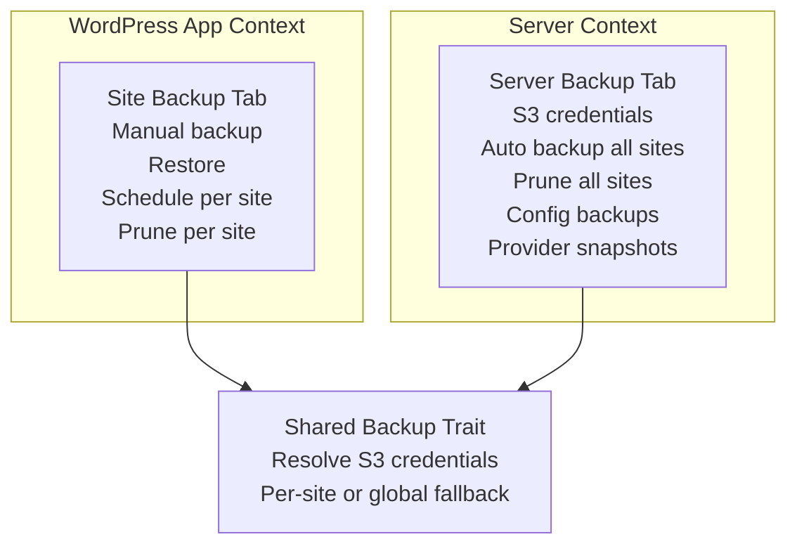
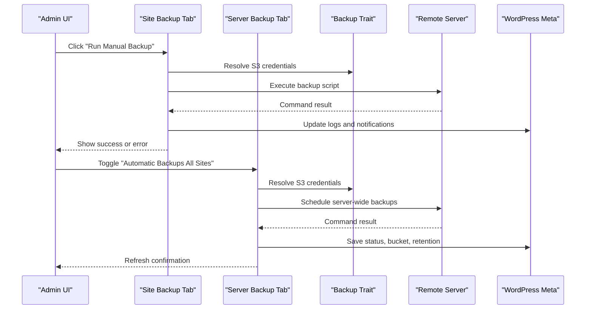
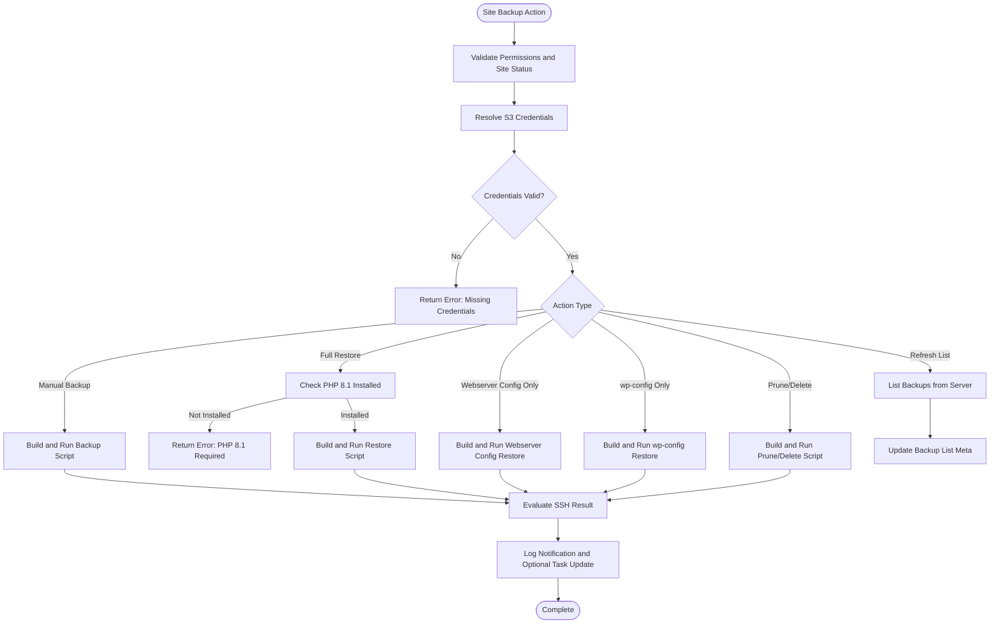
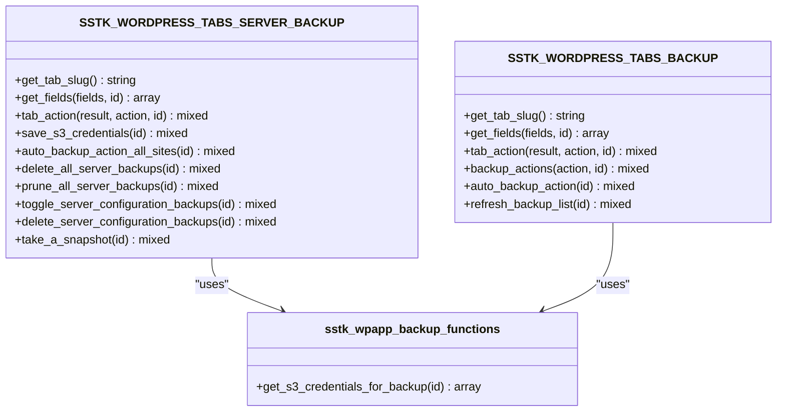
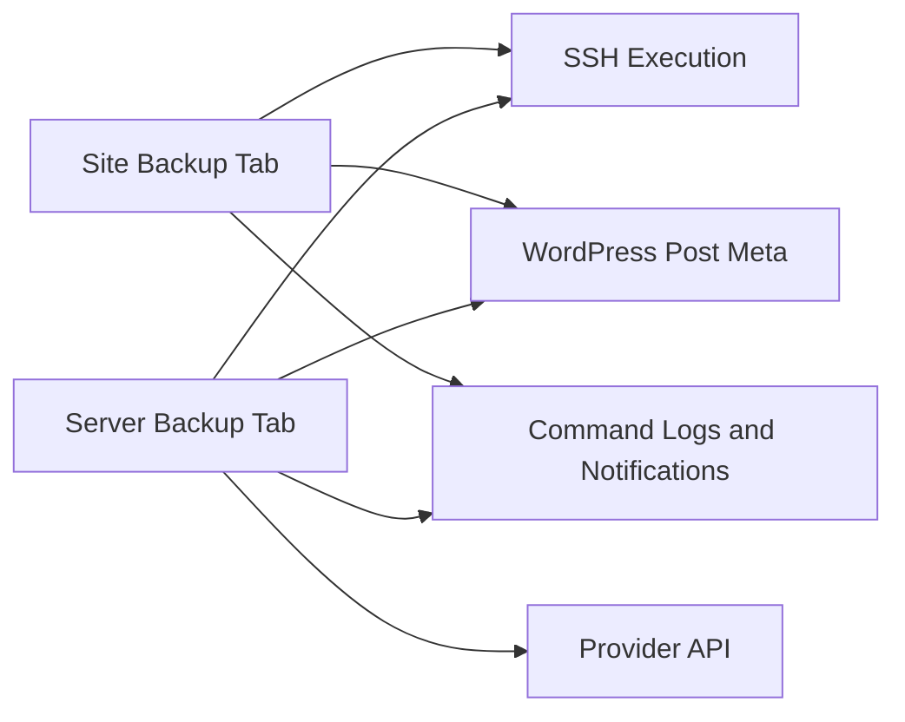

# Backup & Restore Operations

<cite>
**Referenced Files in This Document**   
- [backup.php](file://includes/core/apps/wordpress-app/tabs/backup.php)
- [backup.php](file://includes/core/apps/wordpress-app/tabs-server/backup.php)
- [backup.php](file://includes/core/apps/wordpress-app/traits/traits-for-class-wordpress-app/backup.php)
- [class-sstk-rest-api.php](file://includes/core/api/class-sstk-rest-api.php)
- [class-sstk-rest-sites.php](file://includes/core/api/class-sstk-rest-sites.php)
</cite>

## Table of Contents
1. [Introduction](#introduction)
2. [Project Structure](#project-structure)
3. [Core Components](#core-components)
4. [Architecture Overview](#architecture-overview)
5. [Detailed Component Analysis](#detailed-component-analysis)
6. [Dependency Analysis](#dependency-analysis)
7. [Performance Considerations](#performance-considerations)
8. [Troubleshooting Guide](#troubleshooting-guide)
9. [Conclusion](#conclusion)

## Introduction
This document explains backup and restore operations in Simple Stack for WordPress sites. It covers:
- Site-level backups and restores
- Server-wide automatic backups
- Server configuration backups
- Scheduling, retention, and storage destinations
- Restore procedures for full site recovery and selective restoration
- Customization, external storage integration, verification automation
- Performance optimization, compression options, and troubleshooting failed operations

The implementation is primarily PHP-based tab handlers that orchestrate remote commands on the target server through SSH. The UI exposes actions such as manual backup, automatic scheduling, pruning, credential management, and restore selection.

## Project Structure
Backup functionality is organized around two main tabs:
- Site-level backup tab under the WordPress app context
- Server-level backup tab under the WordPress app server context
- A shared trait for resolving S3 credentials with fallback to global settings

**Diagram sources**
- [backup.php:15-36](file://includes/core/apps/wordpress-app/tabs/backup.php#L15-L36)
- [backup.php:19-38](file://includes/core/apps/wordpress-app/tabs-server/backup.php#L19-L38)
- [backup.php:14-75](file://includes/core/apps/wordpress-app/traits/traits-for-class-wordpress-app/backup.php#L14-L75)

**Section sources**
- [backup.php:15-36](file://includes/core/apps/wordpress-app/tabs/backup.php#L15-L36)
- [backup.php:19-38](file://includes/core/apps/wordpress-app/tabs-server/backup.php#L19-L38)
- [backup.php:14-75](file://includes/core/apps/wordpress-app/traits/traits-for-class-wordpress-app/backup.php#L14-L75)

## Core Components
- Site backup tab class: handles manual backup, restore, schedule toggle, refresh backup list, prune, and delete local backups for a single site.
- Server backup tab class: manages S3 credentials per server, schedules automatic backups for all sites, prunes or deletes server-wide backups, toggles server configuration backups, and triggers provider snapshots.
- Shared backup trait: resolves S3 credentials from server meta or global settings, applies shell escaping, and provides both escaped and unescaped values.

Key responsibilities:
- Validate permissions before executing backup or restore actions.
- Build and execute remote commands via SSH using script templates.
- Persist status flags, bucket names, and retention days in post meta.
- Provide user-facing fields for configuring buckets, retention, and deletion behavior.

**Section sources**
- [backup.php:15-36](file://includes/core/apps/wordpress-app/tabs/backup.php#L15-L36)
- [backup.php:192-401](file://includes/core/apps/wordpress-app/tabs/backup.php#L192-L401)
- [backup.php:939-1042](file://includes/core/apps/wordpress-app/tabs/backup.php#L939-L1042)
- [backup.php:1051-1097](file://includes/core/apps/wordpress-app/tabs/backup.php#L1051-L1097)
- [backup.php:19-38](file://includes/core/apps/wordpress-app/tabs-server/backup.php#L19-L38)
- [backup.php:697-800](file://includes/core/apps/wordpress-app/tabs-server/backup.php#L697-L800)
- [backup.php:812-947](file://includes/core/apps/wordpress-app/tabs-server/backup.php#L812-L947)
- [backup.php:956-1120](file://includes/core/apps/wordpress-app/tabs-server/backup.php#L956-L1120)
- [backup.php:1129-1249](file://includes/core/apps/wordpress-app/tabs-server/backup.php#L1129-L1249)
- [backup.php:14-75](file://includes/core/apps/wordpress-app/traits/traits-for-class-wordpress-app/backup.php#L14-L75)

## Architecture Overview
The backup workflow follows a consistent pattern:
1. Admin interacts with the WordPress admin UI (site or server backup tab).
2. The tab handler validates permissions and builds parameters.
3. Credentials are resolved from server meta or global settings.
4. A remote command is constructed from a script template and executed over SSH.
5. Success/failure is evaluated against expected markers in the output.
6. Post meta is updated to reflect status, bucket name, and retention policy.
7. Notifications or log entries are created for completion or failure.

**Diagram sources**
- [backup.php:192-401](file://includes/core/apps/wordpress-app/tabs/backup.php#L192-L401)
- [backup.php:939-1042](file://includes/core/apps/wordpress-app/tabs/backup.php#L939-L1042)
- [backup.php:812-947](file://includes/core/apps/wordpress-app/tabs-server/backup.php#L812-L947)
- [backup.php:14-75](file://includes/core/apps/wordpress-app/traits/traits-for-class-wordpress-app/backup.php#L14-L75)

## Detailed Component Analysis

### Site-Level Backup and Restore
Responsibilities:
- Manual backup execution
- Full restore, webserver config-only restore, wp-config-only restore
- Automatic backup scheduling per site
- Refreshing the backup list from the server
- Pruning and deleting local backups for a site

Key behaviors:
- Validates user permissions and site enablement.
- Requires valid S3 credentials; returns an error if missing.
- Uses script templates for backup, restore, schedule, and prune operations.
- Updates post meta for auto-backup status, bucket, retention, and delete-remote flag.
- After successful restore, resets cache-related flags and sets default PHP version metadata.

**Diagram sources**
- [backup.php:192-401](file://includes/core/apps/wordpress-app/tabs/backup.php#L192-L401)
- [backup.php:46-133](file://includes/core/apps/wordpress-app/tabs/backup.php#L46-L133)
- [backup.php:1051-1097](file://includes/core/apps/wordpress-app/tabs/backup.php#L1051-L1097)

**Section sources**
- [backup.php:192-401](file://includes/core/apps/wordpress-app/tabs/backup.php#L192-L401)
- [backup.php:46-133](file://includes/core/apps/wordpress-app/tabs/backup.php#L46-L133)
- [backup.php:1051-1097](file://includes/core/apps/wordpress-app/tabs/backup.php#L1051-L1097)

### Server-Level Backup Management
Responsibilities:
- Manage per-server S3 credentials
- Enable/disable automatic backups for all sites on the server
- Delete or prune all server-side local backups
- Toggle server configuration backups (nginx.conf, php.ini, SSL certs, wp-config files)
- Trigger provider snapshots when supported

Key behaviors:
- Credentials can be set per server or fall back to global settings.
- Auto-backup scheduling uses script templates and updates server meta.
- Configuration backups run every four hours when enabled.
- Provider snapshot support depends on the cloud provider API feature flag.

**Diagram sources**
- [backup.php:19-38](file://includes/core/apps/wordpress-app/tabs-server/backup.php#L19-L38)
- [backup.php:697-800](file://includes/core/apps/wordpress-app/tabs-server/backup.php#L697-L800)
- [backup.php:812-947](file://includes/core/apps/wordpress-app/tabs-server/backup.php#L812-L947)
- [backup.php:956-1120](file://includes/core/apps/wordpress-app/tabs-server/backup.php#L956-L1120)
- [backup.php:1129-1249](file://includes/core/apps/wordpress-app/tabs-server/backup.php#L1129-L1249)
- [backup.php:15-36](file://includes/core/apps/wordpress-app/tabs/backup.php#L15-L36)
- [backup.php:14-75](file://includes/core/apps/wordpress-app/traits/traits-for-class-wordpress-app/backup.php#L14-L75)

**Section sources**
- [backup.php:697-800](file://includes/core/apps/wordpress-app/tabs-server/backup.php#L697-L800)
- [backup.php:812-947](file://includes/core/apps/wordpress-app/tabs-server/backup.php#L812-L947)
- [backup.php:956-1120](file://includes/core/apps/wordpress-app/tabs-server/backup.php#L956-L1120)
- [backup.php:1129-1249](file://includes/core/apps/wordpress-app/tabs-server/backup.php#L1129-L1249)
- [backup.php:14-75](file://includes/core/apps/wordpress-app/traits/traits-for-class-wordpress-app/backup.php#L14-L75)

### Credential Resolution and Storage Destinations
Credential resolution logic:
- Per-server credentials take precedence if present.
- If absent, global settings are used.
- Region defaults to a specific value unless overridden by endpoint configuration.
- Values are shell-escaped for safe command-line usage and also stored unescaped where needed.

Storage destinations:
- Remote object storage via S3-compatible endpoints.
- Local server disk for temporary or retained backups depending on retention policy.
- Server configuration backups stored locally on the server with periodic rotation.

**Section sources**
- [backup.php:14-75](file://includes/core/apps/wordpress-app/traits/traits-for-class-wordpress-app/backup.php#L14-L75)
- [backup.php:697-800](file://includes/core/apps/wordpress-app/tabs-server/backup.php#L697-L800)

### Backup Scheduling and Retention Policies
Site-level scheduling:
- Toggle automatic daily backups per site.
- Configure bucket name, retention days, and whether to delete remote backups when pruning local ones.
- Callback domain is passed to scripts for progress reporting.

Server-wide scheduling:
- Toggle automatic daily backups for all current and future sites on the server.
- Configure bucket name, retention days, and remote deletion behavior.
- Default retention days apply if not provided.

Retention policies:
- Zero or blank means no automatic deletion.
- Negative values indicate never keep local backups (not recommended).
- Positive values define how many days to retain local backups.

**Section sources**
- [backup.php:939-1042](file://includes/core/apps/wordpress-app/tabs/backup.php#L939-L1042)
- [backup.php:812-947](file://includes/core/apps/wordpress-app/tabs-server/backup.php#L812-L947)

### Restore Procedures
Types of restore:
- Full site restore: database, files, and configuration.
- Webserver configuration-only restore: replaces web server configuration files.
- wp-config-only restore: replaces the WordPress configuration file.

Preconditions:
- PHP 8.1 must be installed for restore actions.
- A backup item must be selected.
- The system sanitizes and escapes arguments before executing remote commands.

Post-restore cleanup:
- Cache-related flags are reset.
- PHP version metadata is set to default.

**Section sources**
- [backup.php:303-351](file://includes/core/apps/wordpress-app/tabs/backup.php#L303-L351)
- [backup.php:46-133](file://includes/core/apps/wordpress-app/tabs/backup.php#L46-L133)

### Disaster Recovery Scenarios
Recommended approach:
- Use server provider snapshots for infrastructure-level recovery when supported.
- Combine full site restores with server configuration backups for comprehensive recovery.
- Keep retention policies low for local backups and rely on remote storage for long-term retention.
- Verify restore integrity by refreshing the backup list and performing selective restores first.

**Section sources**
- [backup.php:1258-1299](file://includes/core/apps/wordpress-app/tabs-server/backup.php#L1258-L1299)
- [backup.php:1129-1249](file://includes/core/apps/wordpress-app/tabs-server/backup.php#L1129-L1249)

### Customizing Backup Configurations
Customization points:
- Per-site bucket override during manual backup.
- Per-server S3 credentials including endpoint URL for S3-compatible providers.
- Global settings fallback for keys, secrets, region, and bucket.
- Retention days and remote deletion flags for both site and server scopes.

Integration examples:
- Set an alternative S3 endpoint URL for non-AWS providers.
- Use per-server credentials to isolate backups across environments.
- Automate scheduling via hooks exposed by the tab classes.

**Section sources**
- [backup.php:442-456](file://includes/core/apps/wordpress-app/tabs/backup.php#L442-L456)
- [backup.php:239-253](file://includes/core/apps/wordpress-app/tabs-server/backup.php#L239-L253)
- [backup.php:697-800](file://includes/core/apps/wordpress-app/tabs-server/backup.php#L697-L800)
- [backup.php:14-75](file://includes/core/apps/wordpress-app/traits/traits-for-class-wordpress-app/backup.php#L14-L75)

### Automating Backup Verification
Verification strategies:
- Refresh the backup list after scheduling or manual runs to confirm availability.
- Monitor command logs and notifications for success or failure.
- Use pending task hooks to automate manual backup triggers and track completion status.

**Section sources**
- [backup.php:1051-1097](file://includes/core/apps/wordpress-app/tabs/backup.php#L1051-L1097)
- [backup.php:46-133](file://includes/core/apps/wordpress-app/tabs/backup.php#L46-L133)
- [backup.php:1100-1121](file://includes/core/apps/wordpress-app/tabs/backup.php#L1100-L1121)

## Dependency Analysis
Backup components depend on:
- WordPress post meta for storing status, bucket names, and retention policies.
- SSH execution layer for running remote scripts.
- Provider APIs for snapshots when supported.
- REST API registration for Simple Stack admin routes (though backup tabs use legacy tab actions).

**Diagram sources**
- [backup.php:192-401](file://includes/core/apps/wordpress-app/tabs/backup.php#L192-L401)
- [backup.php:812-947](file://includes/core/apps/wordpress-app/tabs-server/backup.php#L812-L947)
- [class-sstk-rest-api.php:21-37](file://includes/core/api/class-sstk-rest-api.php#L21-L37)

**Section sources**
- [backup.php:192-401](file://includes/core/apps/wordpress-app/tabs/backup.php#L192-L401)
- [backup.php:812-947](file://includes/core/apps/wordpress-app/tabs-server/backup.php#L812-L947)
- [class-sstk-rest-api.php:21-37](file://includes/core/api/class-sstk-rest-api.php#L21-L37)

## Performance Considerations
- Prefer remote object storage for large backups to reduce local disk pressure.
- Use reasonable retention days to balance recoverability and storage costs.
- Avoid enabling remote deletion unless you fully understand its impact.
- Ensure PHP versions required for restore operations are installed to prevent failures.
- Monitor command logs to identify slow or failing operations early.

[No sources needed since this section provides general guidance]

## Troubleshooting Guide
Common issues and resolutions:
- Missing credentials: Ensure S3 access key, secret, region, and bucket are configured either per server or globally.
- Restore requires PHP 8.1: Install the required PHP version before attempting restore operations.
- No backup selected: Select a backup item from the refreshed list before restoring.
- Failed SSH execution: Review command logs and verify network connectivity and permissions.
- Unexpected remote deletions: Disable remote deletion if you want to preserve remote backups while pruning local ones.

Operational checks:
- Refresh the backup list to ensure the latest backups are available.
- Confirm that automatic scheduling has been enabled and persisted.
- Inspect notifications and pending task statuses for automated backup workflows.

**Section sources**
- [backup.php:256-265](file://includes/core/apps/wordpress-app/tabs/backup.php#L256-L265)
- [backup.php:303-314](file://includes/core/apps/wordpress-app/tabs/backup.php#L303-L314)
- [backup.php:1051-1097](file://includes/core/apps/wordpress-app/tabs/backup.php#L1051-L1097)
- [backup.php:939-1042](file://includes/core/apps/wordpress-app/tabs/backup.php#L939-L1042)

## Conclusion
Simple Stack’s backup and restore system provides flexible controls at both site and server levels. Administrators can configure S3-compatible storage, schedule automatic backups, manage retention, and perform full or selective restores. Server configuration backups and provider snapshots add layers of resilience. Proper credential setup, retention policies, and monitoring are essential for reliable disaster recovery.

[No sources needed since this section summarizes without analyzing specific files]