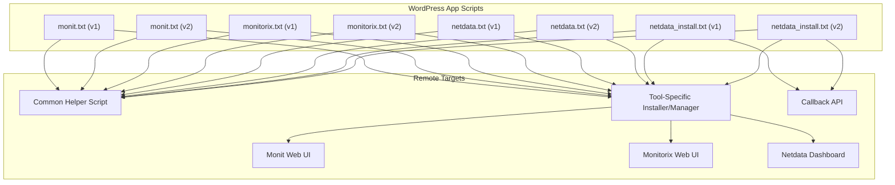
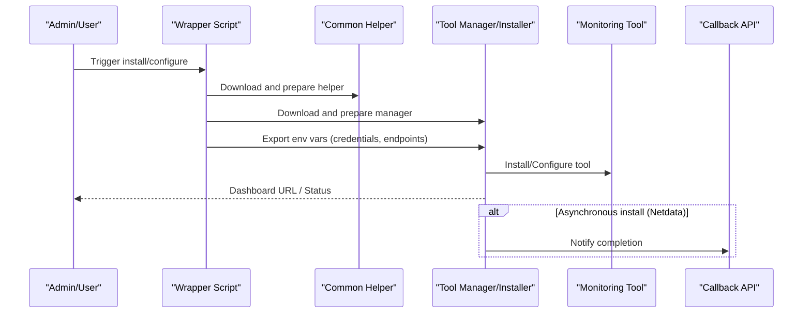
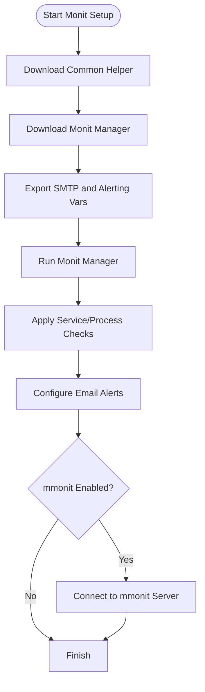
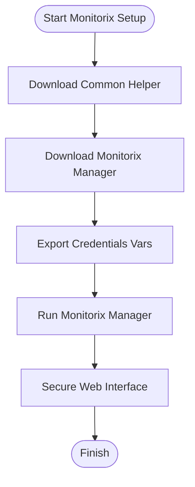
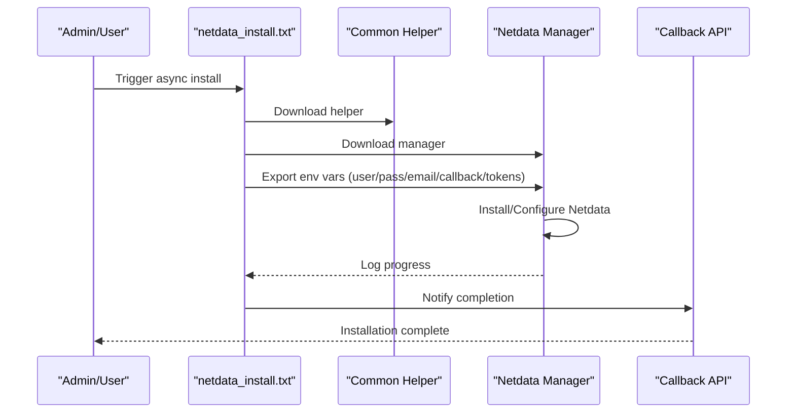
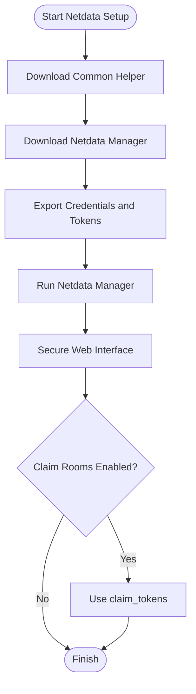
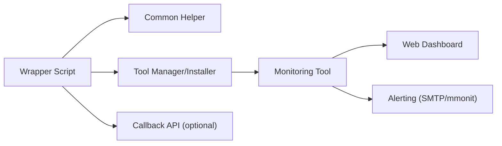

# Monitoring & Health Checks

<cite>
**Referenced Files in This Document**
- [monit.txt (v1)](file://includes/core/apps/wordpress-app/scripts/v1/monit.txt)
- [monit.txt (v2)](file://includes/core/apps/wordpress-app/scripts/v2/monit.txt)
- [monitorix.txt (v1)](file://includes/core/apps/wordpress-app/scripts/v1/monitorix.txt)
- [monitorix.txt (v2)](file://includes/core/apps/wordpress-app/scripts/v2/monitorix.txt)
- [netdata.txt (v1)](file://includes/core/apps/wordpress-app/scripts/v1/netdata.txt)
- [netdata.txt (v2)](file://includes/core/apps/wordpress-app/scripts/v2/netdata.txt)
- [netdata_install.txt (v1)](file://includes/core/apps/wordpress-app/scripts/v1/netdata_install.txt)
- [netdata_install.txt (v2)](file://includes/core/apps/wordpress-app/scripts/v2/netdata_install.txt)
</cite>

## Table of Contents
1. [Introduction](#introduction)
2. [Project Structure](#project-structure)
3. [Core Components](#core-components)
4. [Architecture Overview](#architecture-overview)
5. [Detailed Component Analysis](#detailed-component-analysis)
6. [Dependency Analysis](#dependency-analysis)
7. [Performance Considerations](#performance-considerations)
8. [Troubleshooting Guide](#troubleshooting-guide)
9. [Conclusion](#conclusion)

## Introduction
This document explains how the project integrates monitoring and health check systems for server resource monitoring, application health checks, and performance metrics collection. It covers Monit, Monitorix, Netdata, and AWStats-related workflows as implemented by the provided scripts. It also documents alerting configuration, log analysis tools, dashboard setup, custom monitoring scripts, metric collection patterns, alert escalation procedures, and maintenance practices to avoid monitoring gaps.

## Project Structure
The monitoring integrations are delivered as executable script templates that:
- Download a common helper script and a tool-specific installer/manager script
- Export environment variables with credentials and endpoints
- Execute the target script under sudo
- Optionally perform asynchronous installation with callback notifications

**Diagram sources**
- [monit.txt (v1):1-9](file://includes/core/apps/wordpress-app/scripts/v1/monit.txt#L1-L9)
- [monit.txt (v2):1-9](file://includes/core/apps/wordpress-app/scripts/v2/monit.txt#L1-L9)
- [monitorix.txt (v1):1-9](file://includes/core/apps/wordpress-app/scripts/v1/monitorix.txt#L1-L9)
- [monitorix.txt (v2):1-9](file://includes/core/apps/wordpress-app/scripts/v2/monitorix.txt#L1-L9)
- [netdata.txt (v1):1-9](file://includes/core/apps/wordpress-app/scripts/v1/netdata.txt#L1-L9)
- [netdata.txt (v2):1-9](file://includes/core/apps/wordpress-app/scripts/v2/netdata.txt#L1-L9)
- [netdata_install.txt (v1):1-11](file://includes/core/apps/wordpress-app/scripts/v1/netdata_install.txt#L1-L11)
- [netdata_install.txt (v2):1-11](file://includes/core/apps/wordpress-app/scripts/v2/netdata_install.txt#L1-L11)

**Section sources**
- [monit.txt (v1):1-9](file://includes/core/apps/wordpress-app/scripts/v1/monit.txt#L1-L9)
- [monit.txt (v2):1-9](file://includes/core/apps/wordpress-app/scripts/v2/monit.txt#L1-L9)
- [monitorix.txt (v1):1-9](file://includes/core/apps/wordpress-app/scripts/v1/monitorix.txt#L1-L9)
- [monitorix.txt (v2):1-9](file://includes/core/apps/wordpress-app/scripts/v2/monitorix.txt#L1-L9)
- [netdata.txt (v1):1-9](file://includes/core/apps/wordpress-app/scripts/v1/netdata.txt#L1-L9)
- [netdata.txt (v2):1-9](file://includes/core/apps/wordpress-app/scripts/v2/netdata.txt#L1-L9)
- [netdata_install.txt (v1):1-11](file://includes/core/apps/wordpress-app/scripts/v1/netdata_install.txt#L1-L11)
- [netdata_install.txt (v2):1-11](file://includes/core/apps/wordpress-app/scripts/v2/netdata_install.txt#L1-L11)

## Core Components
- Monit integration: Installs/configures Monit, sets up service/process checks, configures email alerts via SMTP, and optionally integrates with mmonit.
- Monitorix integration: Installs/configures Monitorix, secures its web interface, and exposes system metrics dashboards.
- Netdata integration: Installs/configures Netdata, secures its web interface, supports claim tokens for cloud rooms, and provides real-time metrics dashboards.
- AWStats: While not directly represented by these scripts, AWStats is commonly used alongside these tools for log-based traffic analytics; it can be integrated into the same server stack.

Key responsibilities:
- Server resource monitoring: CPU, memory, disk, network, services.
- Application health checks: Process/service status, HTTP endpoints, SSL certificate validity.
- Performance metrics collection: Real-time and historical metrics via Netdata/Monitorix.
- Alerting: Email notifications via Monit SMTP settings and optional callbacks.

**Section sources**
- [monit.txt (v1):1-9](file://includes/core/apps/wordpress-app/scripts/v1/monit.txt#L1-L9)
- [monit.txt (v2):1-9](file://includes/core/apps/wordpress-app/scripts/v2/monit.txt#L1-L9)
- [monitorix.txt (v1):1-9](file://includes/core/apps/wordpress-app/scripts/v1/monitorix.txt#L1-L9)
- [monitorix.txt (v2):1-9](file://includes/core/apps/wordpress-app/scripts/v2/monitorix.txt#L1-L9)
- [netdata.txt (v1):1-9](file://includes/core/apps/wordpress-app/scripts/v1/netdata.txt#L1-L9)
- [netdata.txt (v2):1-9](file://includes/core/apps/wordpress-app/scripts/v2/netdata.txt#L1-L9)
- [netdata_install.txt (v1):1-11](file://includes/core/apps/wordpress-app/scripts/v1/netdata_install.txt#L1-L11)
- [netdata_install.txt (v2):1-11](file://includes/core/apps/wordpress-app/scripts/v2/netdata_install.txt#L1-L11)

## Architecture Overview
The monitoring architecture follows a consistent pattern across tools:
- A wrapper script downloads a shared helper and a tool-specific manager/installer.
- Environment variables carry credentials, endpoints, and flags.
- The manager script performs installation/configuration and exposes dashboards or alerting.

**Diagram sources**
- [monit.txt (v1):1-9](file://includes/core/apps/wordpress-app/scripts/v1/monit.txt#L1-L9)
- [monitorix.txt (v1):1-9](file://includes/core/apps/wordpress-app/scripts/v1/monitorix.txt#L1-L9)
- [netdata.txt (v1):1-9](file://includes/core/apps/wordpress-app/scripts/v1/netdata.txt#L1-L9)
- [netdata_install.txt (v1):1-11](file://includes/core/apps/wordpress-app/scripts/v1/netdata_install.txt#L1-L11)

## Detailed Component Analysis

### Monit Integration
Purpose:
- Install and configure Monit for process/service monitoring and alerting.
- Configure email notifications using SMTP parameters.
- Optional integration with mmonit for centralized monitoring.

Environment variables:
- action, domain, email, monit_user, monit_password, email_notifications, monit_smtp_server, monit_smtp_port, monit_smtp_user, monit_smtp_pass, monit_alert_email, monit_mmonit_server, callback_url.

Operational flow:
- Downloads helper and Monit manager script.
- Exports SMTP and alerting configuration.
- Executes manager script to set up Monit and apply checks.

**Diagram sources**
- [monit.txt (v1):1-9](file://includes/core/apps/wordpress-app/scripts/v1/monit.txt#L1-L9)
- [monit.txt (v2):1-9](file://includes/core/apps/wordpress-app/scripts/v2/monit.txt#L1-L9)

**Section sources**
- [monit.txt (v1):1-9](file://includes/core/apps/wordpress-app/scripts/v1/monit.txt#L1-L9)
- [monit.txt (v2):1-9](file://includes/core/apps/wordpress-app/scripts/v2/monit.txt#L1-L9)

### Monitorix Integration
Purpose:
- Install and configure Monitorix for system metrics visualization.
- Secure the Monitorix web interface with user credentials.

Environment variables:
- action, domain, email, user, pass.

Operational flow:
- Downloads helper and Monitorix manager script.
- Exposes credentials for securing the web UI.
- Runs manager script to install/configure Monitorix.

**Diagram sources**
- [monitorix.txt (v1):1-9](file://includes/core/apps/wordpress-app/scripts/v1/monitorix.txt#L1-L9)
- [monitorix.txt (v2):1-9](file://includes/core/apps/wordpress-app/scripts/v2/monitorix.txt#L1-L9)

**Section sources**
- [monitorix.txt (v1):1-9](file://includes/core/apps/wordpress-app/scripts/v1/monitorix.txt#L1-L9)
- [monitorix.txt (v2):1-9](file://includes/core/apps/wordpress-app/scripts/v2/monitorix.txt#L1-L9)

### Netdata Integration
Purpose:
- Install and configure Netdata for real-time performance metrics.
- Secure the Netdata web interface with user credentials.
- Support cloud room claims via tokens.
- Provide asynchronous installation with callback notification.

Environment variables:
- action, domain, user, pass, email, callback_url, claim_token, claim_rooms_token.

Asynchronous install flow:
- Wrapper runs in background, logs intermediate output, renames log upon completion, and triggers callback.

**Diagram sources**
- [netdata_install.txt (v1):1-11](file://includes/core/apps/wordpress-app/scripts/v1/netdata_install.txt#L1-L11)
- [netdata_install.txt (v2):1-11](file://includes/core/apps/wordpress-app/scripts/v2/netdata_install.txt#L1-L11)

Interactive setup flow:
- Wrapper downloads helper and manager, exports credentials and tokens, then executes manager to secure UI and configure Netdata.

**Diagram sources**
- [netdata.txt (v1):1-9](file://includes/core/apps/wordpress-app/scripts/v1/netdata.txt#L1-L9)
- [netdata.txt (v2):1-9](file://includes/core/apps/wordpress-app/scripts/v2/netdata.txt#L1-L9)

**Section sources**
- [netdata.txt (v1):1-9](file://includes/core/apps/wordpress-app/scripts/v1/netdata.txt#L1-L9)
- [netdata.txt (v2):1-9](file://includes/core/apps/wordpress-app/scripts/v2/netdata.txt#L1-L9)
- [netdata_install.txt (v1):1-11](file://includes/core/apps/wordpress-app/scripts/v1/netdata_install.txt#L1-L11)
- [netdata_install.txt (v2):1-11](file://includes/core/apps/wordpress-app/scripts/v2/netdata_install.txt#L1-L11)

### AWStats Integration Notes
While AWStats is not directly represented by the provided scripts, it complements the monitoring stack by analyzing web server logs to produce traffic and usage reports. Typical integration points include:
- Configuring AWStats to parse Nginx/Apache access logs.
- Scheduling periodic updates via cron.
- Securing the AWStats web interface.
- Linking AWStats dashboards from the application admin UI.

[No sources needed since this section doesn't analyze specific source files]

## Dependency Analysis
All wrappers follow the same dependency chain:
- Common helper script: Provides shared utilities for download, permissions, and environment preparation.
- Tool-specific manager script: Performs installation, configuration, and exposure of dashboards/alerts.
- External services: SMTP servers for Monit alerts, mmonit server for centralized monitoring, and callback APIs for asynchronous operations.

**Diagram sources**
- [monit.txt (v1):1-9](file://includes/core/apps/wordpress-app/scripts/v1/monit.txt#L1-L9)
- [monitorix.txt (v1):1-9](file://includes/core/apps/wordpress-app/scripts/v1/monitorix.txt#L1-L9)
- [netdata.txt (v1):1-9](file://includes/core/apps/wordpress-app/scripts/v1/netdata.txt#L1-L9)
- [netdata_install.txt (v1):1-11](file://includes/core/apps/wordpress-app/scripts/v1/netdata_install.txt#L1-L11)

**Section sources**
- [monit.txt (v1):1-9](file://includes/core/apps/wordpress-app/scripts/v1/monit.txt#L1-L9)
- [monitorix.txt (v1):1-9](file://includes/core/apps/wordpress-app/scripts/v1/monitorix.txt#L1-L9)
- [netdata.txt (v1):1-9](file://includes/core/apps/wordpress-app/scripts/v1/netdata.txt#L1-L9)
- [netdata_install.txt (v1):1-11](file://includes/core/apps/wordpress-app/scripts/v1/netdata_install.txt#L1-L11)

## Performance Considerations
- Prefer Netdata for high-resolution, real-time metrics; use Monitorix for long-term historical trends.
- Limit Monit check frequency to reduce overhead on busy systems.
- Avoid running heavy log analysis during peak hours; schedule AWStats updates off-peak.
- Secure dashboards behind authentication and restrict network access where possible.
- Use asynchronous installation for Netdata to minimize blocking operations.

[No sources needed since this section provides general guidance]

## Troubleshooting Guide
Common issues and resolutions:
- SMTP delivery failures (Monit): Verify monit_smtp_server, monit_smtp_port, monit_smtp_user, monit_smtp_pass, and monit_alert_email. Ensure outbound SMTP connectivity and correct TLS/port settings.
- Dashboard access denied (Monitorix/Netdata): Confirm user/pass credentials and ensure firewall rules allow access only from trusted networks.
- Netdata installation hangs or fails: Check network access to remote script URLs, verify claim_tokens when enabling cloud rooms, and inspect intermediate logs produced by netdata_install.txt.
- Callback not received: Validate callback_url reachability and server-side handling; ensure no proxies block outgoing requests.

Maintenance checklist:
- Rotate credentials for dashboards and SMTP regularly.
- Update monitoring tools to latest stable versions.
- Review alert thresholds and suppress false positives.
- Back up monitoring configurations and dashboards.
- Periodically validate that all monitored services are covered and no gaps exist.

**Section sources**
- [monit.txt (v1):1-9](file://includes/core/apps/wordpress-app/scripts/v1/monit.txt#L1-L9)
- [monitorix.txt (v1):1-9](file://includes/core/apps/wordpress-app/scripts/v1/monitorix.txt#L1-L9)
- [netdata.txt (v1):1-9](file://includes/core/apps/wordpress-app/scripts/v1/netdata.txt#L1-L9)
- [netdata_install.txt (v1):1-11](file://includes/core/apps/wordpress-app/scripts/v1/netdata_install.txt#L1-L11)

## Conclusion
The repository provides consistent, extensible wrappers to integrate Monit, Monitorix, and Netdata into the server stack. These scripts standardize installation, credential management, and dashboard exposure while supporting alerting and asynchronous operations. By following the outlined flows and best practices, teams can establish robust server resource monitoring, application health checks, and performance metrics collection with clear alerting and maintenance procedures.

[No sources needed since this section summarizes without analyzing specific files]