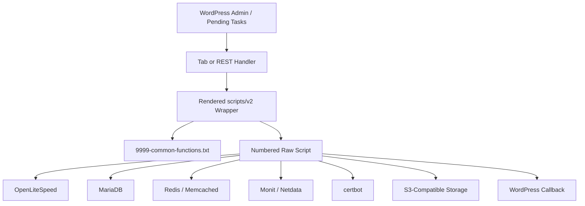
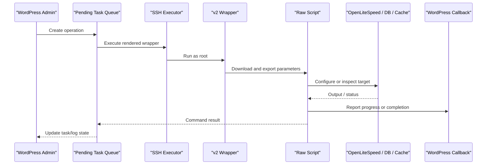

# Operational & Maintenance Scripts

<cite>
**Referenced Files in This Document**
- [README.md](file://README.md)
- [08-backup.txt](file://includes/core/apps/wordpress-app/scripts/v2/raw/08-backup.txt)
- [40-7g_firewall.txt](file://includes/core/apps/wordpress-app/scripts/v2/raw/40-7g_firewall.txt)
- [20-monit.txt](file://includes/core/apps/wordpress-app/scripts/v2/raw/20-monit.txt)
- [43-netdata.txt](file://includes/core/apps/wordpress-app/scripts/v2/raw/43-netdata.txt)
- [04-manage_https.txt](file://includes/core/apps/wordpress-app/scripts/v2/raw/04-manage_https.txt)
- [19-logs.txt](file://includes/core/apps/wordpress-app/scripts/v2/raw/19-logs.txt)
- [53-database-operation.txt](file://includes/core/apps/wordpress-app/scripts/v2/raw/53-database-operation.txt)
- [81-origin-site-sync.txt](file://includes/core/apps/wordpress-app/scripts/v2/raw/81-origin-site-sync.txt)
- [82-destination-site-sync.txt](file://includes/core/apps/wordpress-app/scripts/v2/raw/82-destination-site-sync.txt)
- [9999-common-functions.txt](file://includes/core/apps/wordpress-app/scripts/v2/raw/9999-common-functions.txt)
- [environment variables.txt](file://includes/core/apps/wordpress-app/scripts/v2/raw/environment%20variables.txt)
- [class-sstk-posts-pending-tasks-log.php](file://includes/core/class-sstk-posts-pending-tasks-log.php)
- [callbacks.php](file://includes/core/apps/wordpress-app/tabs-server/callbacks.php)
- [upgrade.php](file://includes/core/apps/wordpress-app/tabs-server/upgrade.php)
</cite>

## Table of Contents
1. [Introduction](#introduction)
2. [Project Structure](#project-structure)
3. [Core Components](#core-components)
4. [Architecture Overview](#architecture-overview)
5. [Detailed Component Analysis](#detailed-component-analysis)
6. [Dependency Analysis](#dependency-analysis)
7. [Performance Considerations](#performance-considerations)
8. [Troubleshooting Guide](#troubleshooting-guide)
9. [Conclusion](#conclusion)
10. [Appendices](#appendices)

## Introduction

Simple Stack executes server operations through Bash templates under `includes/core/apps/wordpress-app/scripts/v2/`. PHP renders a top-level wrapper with validated placeholders, the wrapper downloads shared functions and a raw script, and the raw script performs the remote work over SSH.

The supported target is Ubuntu 24.04/26.04 with OpenLiteSpeed, LSPHP 8.3/8.4/8.5, MariaDB, Redis, Memcached, certbot, and UFW. `scripts/v2/` is the only supported script tree. There is no `scripts/v1/` fallback, Nginx/PHP-FPM branch, 6G WAF, or Monitorix workflow.

## Project Structure

```text
scripts/v2/
├── *.txt                 # PHP-rendered command wrappers
├── raw/
│   ├── 01-prepare_server.txt
│   ├── 02-install_wordpress_site.txt
│   ├── 04-manage_https.txt
│   ├── 08-backup.txt
│   ├── 12-redis.txt
│   ├── 16-memcached.txt
│   ├── 19-logs.txt
│   ├── 20-monit.txt
│   ├── 23-fail2ban.txt
│   ├── 24-server_status.txt
│   ├── 29-server_update.txt
│   ├── 40-7g_firewall.txt
│   ├── 43-netdata.txt
│   ├── 53-database-operation.txt
│   ├── 81-origin-site-sync.txt
│   ├── 82-destination-site-sync.txt
│   ├── 9999-common-functions.txt
│   └── environment variables.txt
├── multi-tenant-pre-post-samples/
└── wp-backup2-helper
```



## Core Components

- **Backup and Restore:** Site/full-server backups, scheduling, retention, deletion, restore, and S3-compatible uploads.
- **7G WAF:** OpenLiteSpeed `.htaccess` rule groups for user agents, referrers, query strings, request URIs, and request methods.
- **Monit:** Service, process, filesystem, and resource checks with optional SMTP alerts and callback reporting.
- **Netdata:** Real-time metrics behind an authenticated OpenLiteSpeed reverse proxy.
- **SSL Management:** certbot-backed HTTPS and HTTP/2 management for OpenLiteSpeed vhosts.
- **Performance Tools:** Redis, Memcached, LSPHP directives, OPcache-related settings, and cache flushing.
- **Scheduled Tasks:** Backup cron helpers, status callbacks, pending-task orchestration, and site synchronization.
- **Database Operations:** Local/remote database switching and copying.
- **Logs and Updates:** Scheduled-task logs, package updates, security updates, and server update callbacks.

## Architecture Overview



## Detailed Component Analysis

### Backup and Restore

The backup script supports:

- Site file, OpenLiteSpeed configuration, and MariaDB dumps.
- Full-server backups and per-site backups.
- AWS S3 or S3-compatible endpoints.
- Scheduled backup helper scripts and cron entries.
- Retention-based pruning and optional remote deletion.
- Restore of files, vhost configuration, databases, and site users.
- Cache cleanup and certificate issuance attempts during restore.

Database dumps are checked for a valid dump header before the script treats the backup as complete. Restore is destructive: it removes the existing site/database before recreating them.

### 7G Firewall

The 7G integration is the only application firewall in the current script set. The raw script enables or disables named blocks in the site `.htaccess` file and restarts OpenLiteSpeed.

The all-rules action includes `CORE` plus the five exposed categories. “Request String” maps to the underlying `REQUEST URI` block. The 6G script and tab are retired; there is no downgrade path.

### Monit

The current Monit script is fail-closed:

- Validates usernames, passwords, SMTP settings, email addresses, callback URLs, and other inputs.
- Writes configuration atomically with explicit ownership and modes.
- Keeps HTTP and SMTP credentials in root-only `0600` include files under `/etc/monit/`.
- Binds the Monit HTTP daemon to `127.0.0.1:48756`.
- Exposes Monit through an OpenLiteSpeed proxy to that loopback listener.
- Runs `monit -t -c /etc/monit/monitrc` before restarting Monit.
- Runs `/usr/local/lsws/bin/lswsctrl configtest` before restarting OpenLiteSpeed.
- Verifies both services are active after restart.
- Stores callback state and the offset file under `/etc/simple-stack/`.
- Requires both a certificate and private-key file before treating SSL setup as successful.

Supported controls include webserver, MySQL, Redis, Memcached, filesystem, all-unit toggles, SMTP updates, callback installation/removal, SSL, activation/deactivation, and removal.

### Netdata

Netdata is retained as an OpenLiteSpeed-only script bridge:

- Requires OpenLiteSpeed to be installed.
- Proxies to `127.0.0.1:19999`.
- Creates a dedicated vhost and optional HTTP basic authentication.
- Supports HTTPS enable/disable, registry mode, registry targets, upgrades, and removal.
- Uses the OpenLiteSpeed certbot helpers.

There is no Nginx reverse-proxy branch or PHP-FPM status integration. Netdata has no dedicated server-tab controller in the current bootstrap; the scripts remain available for script-driven operations.

### SSL Certificate Management

The HTTPS script uses the OpenLiteSpeed certbot helpers to issue and remove certificates, manage HTTPS redirects, update WordPress `home`/`siteurl`, clear caches, and restart OpenLiteSpeed. HTTP/2 is managed through the same OpenLiteSpeed path.

### Performance Optimization

Current performance operations include:

- Redis object caching on `127.0.0.1:6379` with LiteSpeed Cache object kind `1`.
- Memcached object caching on `127.0.0.1:11211` with object kind `0`.
- Installation of the matching LSPHP extension for every managed PHP version.
- Per-site LSPHP directive changes through the vhost and site `.phpini`.
- OPcache-related directive management and cache flushing through shared helpers.

There is no PHP-FPM worker tuner. Redis and Memcached both refuse to replace an existing `object-cache.php` backend; operators must disable the current backend first.

### Scheduled Tasks and Site Synchronization

Backup helpers use cron and callback URLs to report start/completion. Server and site status helpers report health and WordPress update posture. Pending-task posts track long-running operations.

Site synchronization remains active through:

- `81-origin-site-sync.txt`
- `82-destination-site-sync.txt`
- `wp-sync`
- Origin/destination setup and scheduling wrappers

This is distinct from the retired cross-site control-plane data synchronization engine. There is no `class-sstk-sync.php` or `SSTK_SYNC` service in the current tree.

### Database Operations

The database script can switch a site between local and remote database hosts and copy database content in either direction. It validates connectivity before changing `wp-config.php` or replacing a database. These operations are destructive and should be rehearsed against a staging copy.

### Logs

The log viewer tails:

- `/var/log/wp-backup.log`
- `/var/log/wp-full-backup.log`
- `/var/log/wp-sync.log`

### System Updates

The server update flow counts, lists, and installs package updates, including security-only updates, and reports status through callbacks. Upgrade actions are also coordinated through the pending-task queue.

## Dependency Analysis

Operational scripts depend on:

- `9999-common-functions.txt` for shared helpers.
- `environment variables.txt` for action and parameter contracts.
- WordPress pending tasks and callbacks for orchestration.
- SSH/root access on the target server.
- External tools including `mysqldump`, `tar`, `gzip`, AWS CLI, certbot, `systemctl`, `htpasswd`, `dos2unix`, and `fail2ban-client` where applicable.

## Performance Considerations

- Limit backup retention and prune remote copies deliberately.
- Avoid frequent OpenLiteSpeed restarts; batch configuration changes where possible.
- Tune Monit thresholds to the actual CPU, memory, and filesystem layout.
- Use object caching and page caching appropriately, and flush caches after relevant changes.
- Keep logs bounded and monitor free disk space.
- Prefer the vhost LSPHP handler over CLI PHP when determining a site’s effective PHP version.

## Troubleshooting Guide

- Confirm the script runs as root and that `9999-common-functions.txt` was downloaded.
- Validate S3 credentials and endpoint settings for backup failures.
- Test database connectivity before switch/copy operations.
- Inspect backup and site-sync logs before retrying destructive tasks.
- For Monit, run both configuration validators before restarting either service.
- For Netdata, verify the loopback listener and OpenLiteSpeed proxy.
- For 7G, inspect `.htaccess` markers and site ownership.
- For HTTPS, verify DNS, certbot state, and the OpenLiteSpeed vhost configuration.

### Script Download Security

Many current `scripts/v2` wrappers still use `wget --no-check-certificate`, including first-party provisioning assets. This disables TLS certificate verification and must be removed from first-party downloads before release. Operator-supplied post-processing and Git hook URLs require a separate policy decision rather than a blind replacement.

## Conclusion

The operational script library provides backups, 7G filtering, Monit, Netdata, SSL, caching, site synchronization, database operations, logs, and updates for the fixed OpenLiteSpeed stack. All supported execution flows use `scripts/v2/`; retired Nginx, PHP-FPM, 6G, Monitorix, and cross-site control-plane synchronization paths are not part of the current architecture.

## Appendices

### Adding a Custom Operation

1. Add the raw numbered script under `scripts/v2/raw/`.
2. Document its `$action` and parameters in `environment variables.txt`.
3. Add or update the top-level wrapper using `##PLACEHOLDER##` tokens.
4. Wire the tab or REST handler through the shared script-handling pipeline.
5. Validate input in PHP and again in Bash when values reach a shell command.
6. Require TLS verification for first-party downloads.
7. Run `bash bin/lint-sh.sh`, `bash bin/lint-php.sh`, and the relevant focused harness.

### Third-Party Integrations

Use OpenLiteSpeed vhosts and loopback proxy targets. Protect administrative interfaces with authentication and TLS, keep credentials out of logs, and expose configuration through validated wrapper parameters. Do not add Nginx or PHP-FPM branches.

### Monitoring Execution

Use pending-task posts, command/SSH logs, callbacks, and Monit alerts together. Long-running scripts should write bounded intermediate logs and report an explicit terminal status so one operation’s output cannot validate another operation.
