# Operational & Maintenance Scripts

<cite>
**Referenced Files in This Document**   
- [README.md](file://README.md)
- [08-backup.txt](file://includes/core/apps/wordpress-app/scripts/v2/raw/08-backup.txt)
- [15-6g_firewall.txt](file://includes/core/apps/wordpress-app/scripts/v2/raw/15-6g_firewall.txt)
- [40-7g_firewall.txt](file://includes/core/apps/wordpress-app/scripts/v2/raw/40-7g_firewall.txt)
- [20-monit.txt](file://includes/core/apps/wordpress-app/scripts/v2/raw/20-monit.txt)
- [43-netdata.txt](file://includes/core/apps/wordpress-app/scripts/v2/raw/43-netdata.txt)
- [04-manage_https.txt](file://includes/core/apps/wordpress-app/scripts/v2/raw/04-manage_https.txt)
- [19-logs.txt](file://includes/core/apps/wordpress-app/scripts/v2/raw/19-logs.txt)
- [53-database-operation.txt](file://includes/core/apps/wordpress-app/scripts/v2/raw/53-database-operation.txt)
- [9999-common-functions.txt](file://includes/core/apps/wordpress-app/scripts/v2/raw/9999-common-functions.txt)
- [environment variables.txt](file://includes/core/apps/wordpress-app/scripts/v2/raw/environment%20variables.txt)
- [class-wpcd-posts-pending-tasks-log.php](file://includes/core/class-wpcd-posts-pending-tasks-log.php)
- [after-prepare-server.php](file://includes/core/apps/wordpress-app/traits/traits-for-class-wordpress-app/after-prepare-server.php)
- [callbacks.php](file://includes/core/apps/wordpress-app/tabs-server/callbacks.php)
- [upgrade.php](file://includes/core/apps/wordpress-app/tabs-server/upgrade.php)
</cite>

## Table of Contents
1. [Introduction](#introduction)
2. [Project Structure](#project-structure)
3. [Core Components](#core-components)
4. [Architecture Overview](#architecture-overview)
5. [Detailed Component Analysis](#detailed-component-analysis)
6. [Dependency Analysis](#dependency-analysis)
7. [Performance Considerations](#performance-considerations)
8. [Troubleshooting Guide](#troubleshooting-guide)
9. [Conclusion](#conclusion)
10. [Appendices](#appendices)

## Introduction
This document explains the operational and maintenance scripts that keep WordPress sites running reliably on SimpleStack servers. It covers backup and restore, security firewall management (6G/7G), monitoring with Monit and Netdata, SSL certificate management, performance optimization tools, scheduled tasks, automated maintenance, health checks, database operations, cache management, log rotation, and system updates. It also provides guidance for creating custom operational scripts, integrating third-party tools, monitoring script execution, troubleshooting issues, tuning performance, and performing disaster recovery.

SimpleStack provisions Ubuntu servers, installs OpenLiteSpeed, PHP, MariaDB, Redis, certbot, firewall rules, and an OLS vhost, driven by Bash scripts executed over SSH from within the WordPress admin dashboard. The operational scripts live under the WordPress app scripts directory and are versioned per stack release.

**Section sources**
- [README.md:1-25](file://README.md#L1-L25)
- [README.md:27-38](file://README.md#L27-L38)

## Project Structure
Operational scripts are organized by feature and version:
- Versioned script sets under includes/core/apps/wordpress-app/scripts/v2/raw/
- Shared utilities under 9999-common-functions.txt
- Environment variable documentation under environment variables.txt
- WordPress-side orchestration via pending tasks and callbacks

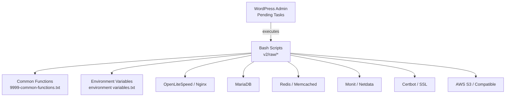

**Diagram sources**
- [README.md:27-38](file://README.md#L27-L38)
- [9999-common-functions.txt:1-75](file://includes/core/apps/wordpress-app/scripts/v2/raw/9999-common-functions.txt#L1-L75)
- [environment variables.txt:1-10](file://includes/core/apps/wordpress-app/scripts/v2/raw/environment%20variables.txt#L1-L10)

**Section sources**
- [README.md:27-38](file://README.md#L27-L38)
- [9999-common-functions.txt:1-75](file://includes/core/apps/wordpress-app/scripts/v2/raw/9999-common-functions.txt#L1-L75)
- [environment variables.txt:1-10](file://includes/core/apps/wordpress-app/scripts/v2/raw/environment%20variables.txt#L1-L10)

## Core Components
- Backup and Restore: Full site backups, configuration backups, database dumps, scheduling, pruning, deletion, and S3 uploads.
- Security Firewall: 6G and 7G rule sets for user agent, referrer, query string, request string, and request method controls.
- Monitoring: Monit service/process/file/disk checks with optional email notifications; Netdata installation, HTTPS, authentication, registry.
- SSL Management: Enable/disable HTTPS and HTTP/2 using certbot and OpenLiteSpeed helpers.
- Database Operations: Switch between local and remote databases, copy data between them.
- Cache Management: Flush page/object caches across multiple caching plugins and object caches.
- Logs and Health: View logs for scheduled backups and sync tasks; server status callbacks.
- System Updates: Count/list/run Linux updates including security-only updates.

**Section sources**
- [08-backup.txt:1-200](file://includes/core/apps/wordpress-app/scripts/v2/raw/08-backup.txt#L1-L200)
- [15-6g_firewall.txt:1-70](file://includes/core/apps/wordpress-app/scripts/v2/raw/15-6g_firewall.txt#L1-L70)
- [40-7g_firewall.txt:1-70](file://includes/core/apps/wordpress-app/scripts/v2/raw/40-7g_firewall.txt#L1-L70)
- [20-monit.txt:1-120](file://includes/core/apps/wordpress-app/scripts/v2/raw/20-monit.txt#L1-L120)
- [43-netdata.txt:1-140](file://includes/core/apps/wordpress-app/scripts/v2/raw/43-netdata.txt#L1-L140)
- [04-manage_https.txt:1-80](file://includes/core/apps/wordpress-app/scripts/v2/raw/04-manage_https.txt#L1-L80)
- [53-database-operation.txt:1-110](file://includes/core/apps/wordpress-app/scripts/v2/raw/53-database-operation.txt#L1-L110)
- [9999-common-functions.txt:125-200](file://includes/core/apps/wordpress-app/scripts/v2/raw/9999-common-functions.txt#L125-L200)
- [19-logs.txt:1-47](file://includes/core/apps/wordpress-app/scripts/v2/raw/19-logs.txt#L1-L47)

## Architecture Overview
The operational flow is orchestrated from WordPress through a pending task queue that executes Bash scripts on target servers. Scripts source shared functions and environment variables to perform actions against the web server, database, cache, monitoring tools, and external services like S3.

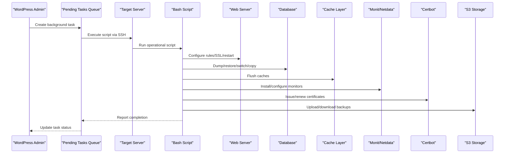

**Diagram sources**
- [class-wpcd-posts-pending-tasks-log.php:801-843](file://includes/core/class-wpcd-posts-pending-tasks-log.php#L801-L843)
- [after-prepare-server.php:208-238](file://includes/core/apps/wordpress-app/traits/traits-for-class-wordpress-app/after-prepare-server.php#L208-L238)
- [callbacks.php:1118-1131](file://includes/core/apps/wordpress-app/tabs-server/callbacks.php#L1118-L1131)
- [08-backup.txt:1-200](file://includes/core/apps/wordpress-app/scripts/v2/raw/08-backup.txt#L1-L200)
- [04-manage_https.txt:1-80](file://includes/core/apps/wordpress-app/scripts/v2/raw/04-manage_https.txt#L1-L80)
- [20-monit.txt:1-120](file://includes/core/apps/wordpress-app/scripts/v2/raw/20-monit.txt#L1-L120)
- [43-netdata.txt:1-140](file://includes/core/apps/wordpress-app/scripts/v2/raw/43-netdata.txt#L1-L140)

## Detailed Component Analysis

### Backup and Restore Procedures
The backup script supports interactive and non-interactive modes, sourcing common functions and environment variables. It can:
- Back up files, web server configuration, and database
- Upload to AWS S3 or compatible endpoints
- Schedule per-site and full-site backups via cron
- Prune old backups locally and optionally on S3
- Delete backups per site or all sites
- Restore site files, web server config, database, and user accounts
- Reset caches and attempt SSL certificate issuance during restore

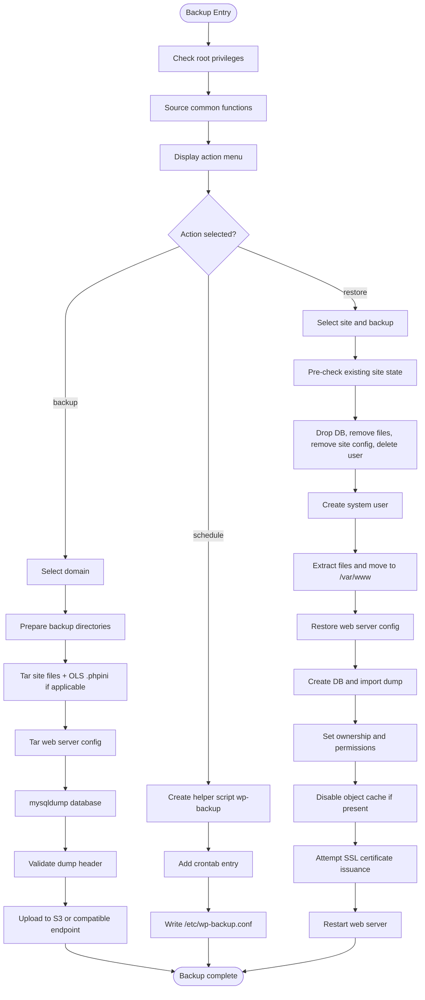

**Diagram sources**
- [08-backup.txt:1-200](file://includes/core/apps/wordpress-app/scripts/v2/raw/08-backup.txt#L1-L200)
- [08-backup.txt:203-423](file://includes/core/apps/wordpress-app/scripts/v2/raw/08-backup.txt#L203-L423)
- [08-backup.txt:426-563](file://includes/core/apps/wordpress-app/scripts/v2/raw/08-backup.txt#L426-L563)
- [08-backup.txt:591-737](file://includes/core/apps/wordpress-app/scripts/v2/raw/08-backup.txt#L591-L737)

**Section sources**
- [08-backup.txt:1-200](file://includes/core/apps/wordpress-app/scripts/v2/raw/08-backup.txt#L1-L200)
- [08-backup.txt:203-423](file://includes/core/apps/wordpress-app/scripts/v2/raw/08-backup.txt#L203-L423)
- [08-backup.txt:426-563](file://includes/core/apps/wordpress-app/scripts/v2/raw/08-backup.txt#L426-L563)
- [08-backup.txt:591-737](file://includes/core/apps/wordpress-app/scripts/v2/raw/08-backup.txt#L591-L737)
- [environment variables.txt:97-183](file://includes/core/apps/wordpress-app/scripts/v2/raw/environment%20variables.txt#L97-L183)

### Security Firewall Management (6G/7G)
Both 6G and 7G firewall scripts provide enable/disable menus for:
- User Agent rules
- Referrer rules
- Query String rules
- Request String rules
- Request Method rules

They modify web server configurations and restart the web server after changes. For OpenLiteSpeed, they call helper functions to enable/disable rule categories.

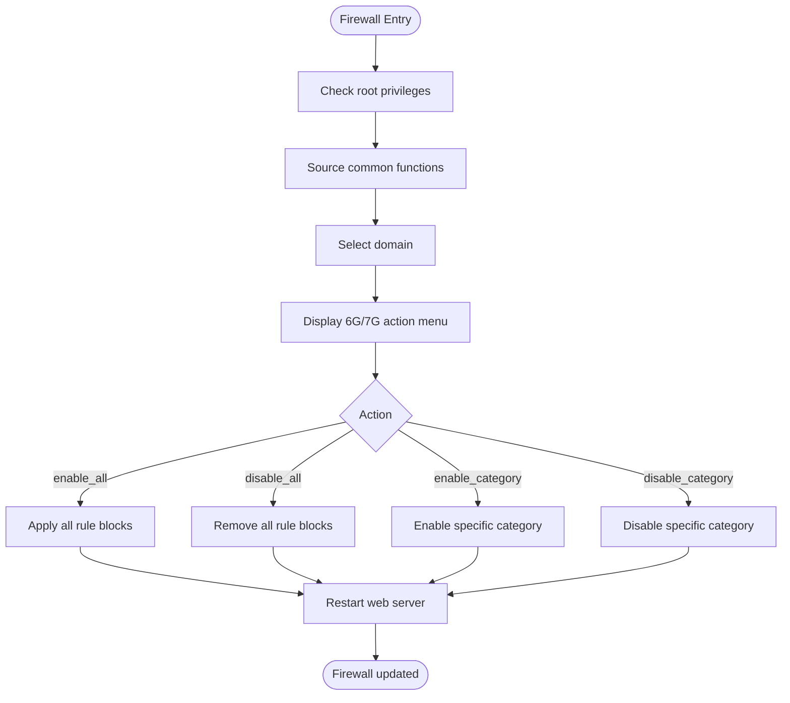

**Diagram sources**
- [15-6g_firewall.txt:1-70](file://includes/core/apps/wordpress-app/scripts/v2/raw/15-6g_firewall.txt#L1-L70)
- [40-7g_firewall.txt:1-70](file://includes/core/apps/wordpress-app/scripts/v2/raw/40-7g_firewall.txt#L1-L70)

**Section sources**
- [15-6g_firewall.txt:1-261](file://includes/core/apps/wordpress-app/scripts/v2/raw/15-6g_firewall.txt#L1-L261)
- [40-7g_firewall.txt:1-260](file://includes/core/apps/wordpress-app/scripts/v2/raw/40-7g_firewall.txt#L1-L260)
- [environment variables.txt:346-350](file://includes/core/apps/wordpress-app/scripts/v2/raw/environment%20variables.txt#L346-L350)

### Monitoring Setup with Monit and Netdata
Monit script:
- Installs Monit and configures it for web server, MySQL, Redis, Memcached, PHP, filesystem, and system resources
- Creates reverse proxy entries for OpenLiteSpeed or Nginx
- Supports enabling/disabling individual monitors and all monitors
- Configures email notifications and optional callback reporting
- Enables/disables HTTPS for the Monit UI

Netdata script:
- Installs Netdata and configures reverse proxy for OpenLiteSpeed or Nginx
- Adds basic HTTP authentication
- Enables/disables HTTPS using certbot
- Sets up registry options and targets
- Configures PHP-FPM status endpoints and Netdata jobs

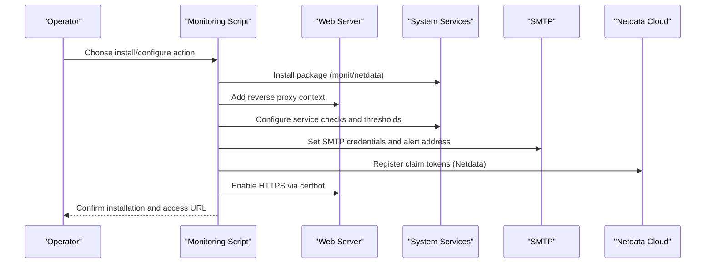

**Diagram sources**
- [20-monit.txt:148-300](file://includes/core/apps/wordpress-app/scripts/v2/raw/20-monit.txt#L148-L300)
- [20-monit.txt:313-516](file://includes/core/apps/wordpress-app/scripts/v2/raw/20-monit.txt#L313-L516)
- [43-netdata.txt:142-313](file://includes/core/apps/wordpress-app/scripts/v2/raw/43-netdata.txt#L142-L313)
- [43-netdata.txt:374-428](file://includes/core/apps/wordpress-app/scripts/v2/raw/43-netdata.txt#L374-L428)

**Section sources**
- [20-monit.txt:1-120](file://includes/core/apps/wordpress-app/scripts/v2/raw/20-monit.txt#L1-L120)
- [20-monit.txt:148-300](file://includes/core/apps/wordpress-app/scripts/v2/raw/20-monit.txt#L148-L300)
- [20-monit.txt:313-516](file://includes/core/apps/wordpress-app/scripts/v2/raw/20-monit.txt#L313-L516)
- [43-netdata.txt:1-140](file://includes/core/apps/wordpress-app/scripts/v2/raw/43-netdata.txt#L1-L140)
- [43-netdata.txt:142-313](file://includes/core/apps/wordpress-app/scripts/v2/raw/43-netdata.txt#L142-L313)
- [43-netdata.txt:374-428](file://includes/core/apps/wordpress-app/scripts/v2/raw/43-netdata.txt#L374-L428)
- [environment variables.txt:386-436](file://includes/core/apps/wordpress-app/scripts/v2/raw/environment%20variables.txt#L386-L436)

### SSL Certificate Management
The HTTPS management script:
- Prompts for an admin email when enabling HTTPS
- Disables any existing HTTPS redirects before issuing certificates
- Uses certbot with OpenLiteSpeed helpers to issue and manage certificates
- Updates WordPress home/siteurl options to HTTPS
- Clears caches and restarts the web server
- Supports enabling/disabling HTTP/2

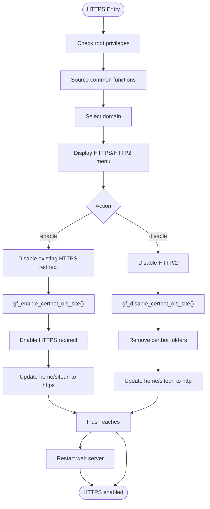

**Diagram sources**
- [04-manage_https.txt:1-80](file://includes/core/apps/wordpress-app/scripts/v2/raw/04-manage_https.txt#L1-L80)
- [04-manage_https.txt:82-127](file://includes/core/apps/wordpress-app/scripts/v2/raw/04-manage_https.txt#L82-L127)

**Section sources**
- [04-manage_https.txt:1-130](file://includes/core/apps/wordpress-app/scripts/v2/raw/04-manage_https.txt#L1-L130)
- [environment variables.txt:33-41](file://includes/core/apps/wordpress-app/scripts/v2/raw/environment%20variables.txt#L33-L41)

### Performance Optimization Tools
- Cache flushing across multiple plugins and object caches via common functions
- Redis and Memcached management scripts referenced in environment variables
- PHP worker and module toggles referenced in environment variables
- Reliable updates and plugin tweaks scripts referenced in environment variables

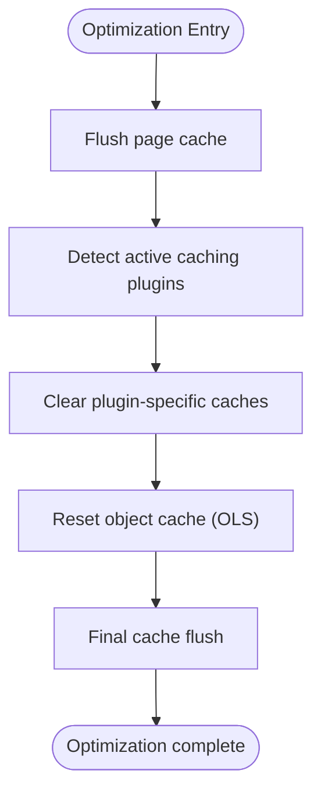

**Diagram sources**
- [9999-common-functions.txt:125-200](file://includes/core/apps/wordpress-app/scripts/v2/raw/9999-common-functions.txt#L125-L200)

**Section sources**
- [9999-common-functions.txt:125-200](file://includes/core/apps/wordpress-app/scripts/v2/raw/9999-common-functions.txt#L125-L200)
- [environment variables.txt:286-293](file://includes/core/apps/wordpress-app/scripts/v2/raw/environment%20variables.txt#L286-L293)
- [environment variables.txt:353-358](file://includes/core/apps/wordpress-app/scripts/v2/raw/environment%20variables.txt#L353-L358)
- [environment variables.txt:546-556](file://includes/core/apps/wordpress-app/scripts/v2/raw/environment%20variables.txt#L546-L556)

### Scheduled Tasks, Automated Maintenance, and Health Checks
- Backup scheduling uses cron entries and helper scripts for per-site and full-site backups
- Callback URLs notify WordPress about backup start/end events
- Pending tasks queue orchestrates background operations and marks tasks complete/failed
- Server status callbacks trigger update routines and report progress

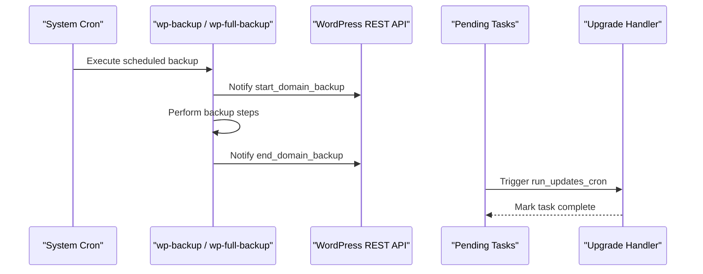

**Diagram sources**
- [08-backup.txt:426-563](file://includes/core/apps/wordpress-app/scripts/v2/raw/08-backup.txt#L426-L563)
- [08-backup.txt:591-737](file://includes/core/apps/wordpress-app/scripts/v2/raw/08-backup.txt#L591-L737)
- [class-wpcd-posts-pending-tasks-log.php:801-843](file://includes/core/class-wpcd-posts-pending-tasks-log.php#L801-L843)
- [upgrade.php:2698-2725](file://includes/core/apps/wordpress-app/tabs-server/upgrade.php#L2698-L2725)

**Section sources**
- [08-backup.txt:426-563](file://includes/core/apps/wordpress-app/scripts/v2/raw/08-backup.txt#L426-L563)
- [08-backup.txt:591-737](file://includes/core/apps/wordpress-app/scripts/v2/raw/08-backup.txt#L591-L737)
- [class-wpcd-posts-pending-tasks-log.php:801-843](file://includes/core/class-wpcd-posts-pending-tasks-log.php#L801-L843)
- [upgrade.php:2698-2725](file://includes/core/apps/wordpress-app/tabs-server/upgrade.php#L2698-L2725)

### Database Optimization and Operations
The database operation script allows:
- Switching a site’s database connection between local and remote hosts
- Copying database content between local and remote servers
- Validating connectivity before making changes

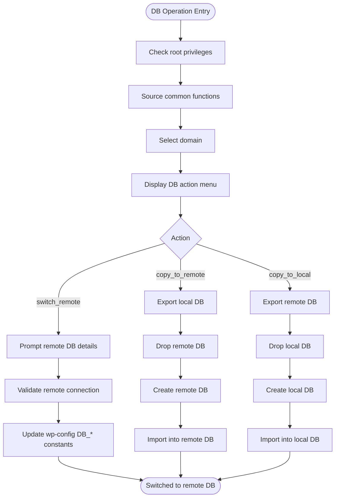

**Diagram sources**
- [53-database-operation.txt:1-110](file://includes/core/apps/wordpress-app/scripts/v2/raw/53-database-operation.txt#L1-L110)
- [53-database-operation.txt:137-212](file://includes/core/apps/wordpress-app/scripts/v2/raw/53-database-operation.txt#L137-L212)

**Section sources**
- [53-database-operation.txt:1-212](file://includes/core/apps/wordpress-app/scripts/v2/raw/53-database-operation.txt#L1-L212)

### Log Rotation and Viewing
Log viewing script displays recent entries for:
- Individual site backups
- Full-site backups
- Site synchronization logs

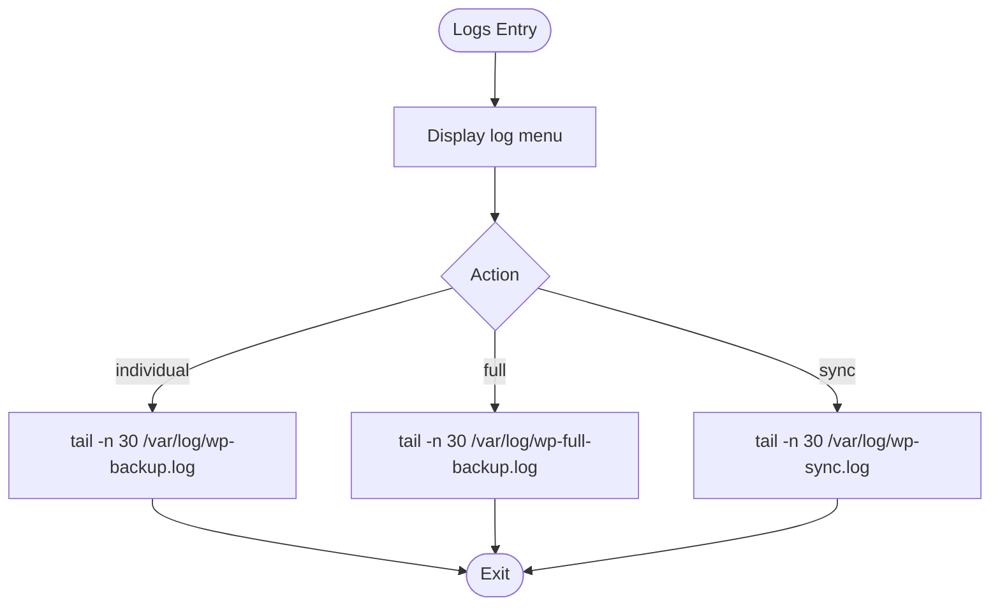

**Diagram sources**
- [19-logs.txt:1-47](file://includes/core/apps/wordpress-app/scripts/v2/raw/19-logs.txt#L1-L47)

**Section sources**
- [19-logs.txt:1-47](file://includes/core/apps/wordpress-app/scripts/v2/raw/19-logs.txt#L1-L47)

### System Updates
System update functionality is exposed via environment variables and hooks:
- Count/list/run updates
- Run updates via cron or security-only updates
- Callbacks to report update status

**Section sources**
- [environment variables.txt:546-556](file://includes/core/apps/wordpress-app/scripts/v2/raw/environment%20variables.txt#L546-L556)
- [upgrade.php:2698-2725](file://includes/core/apps/wordpress-app/tabs-server/upgrade.php#L2698-L2725)

## Dependency Analysis
Scripts depend on:
- Common functions for utility operations (space checks, cache flushing, web server interactions)
- Environment variables for non-interactive configuration
- WordPress pending tasks for orchestration and callbacks
- External tools: mysqldump, tar, gzip, aws CLI, certbot, systemctl, htpasswd

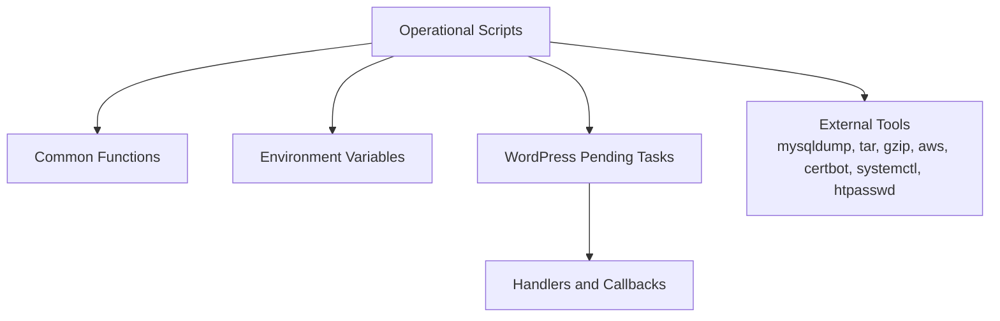

**Diagram sources**
- [9999-common-functions.txt:1-75](file://includes/core/apps/wordpress-app/scripts/v2/raw/9999-common-functions.txt#L1-L75)
- [environment variables.txt:1-10](file://includes/core/apps/wordpress-app/scripts/v2/raw/environment%20variables.txt#L1-L10)
- [class-wpcd-posts-pending-tasks-log.php:801-843](file://includes/core/class-wpcd-posts-pending-tasks-log.php#L801-L843)

**Section sources**
- [9999-common-functions.txt:1-75](file://includes/core/apps/wordpress-app/scripts/v2/raw/9999-common-functions.txt#L1-L75)
- [environment variables.txt:1-10](file://includes/core/apps/wordpress-app/scripts/v2/raw/environment%20variables.txt#L1-L10)
- [class-wpcd-posts-pending-tasks-log.php:801-843](file://includes/core/class-wpcd-posts-pending-tasks-log.php#L801-L843)

## Performance Considerations
- Use object cache and page cache appropriately; ensure cache flushes after configuration changes.
- Tune Monit thresholds based on CPU cores and memory to avoid unnecessary restarts.
- Limit backup retention days to control disk usage; prune regularly.
- Enable HTTP/2 only when beneficial and supported by clients.
- Avoid excessive logging; rotate logs and monitor disk space.

[No sources needed since this section provides general guidance]

## Troubleshooting Guide
- Verify scripts run as root; most scripts exit early if not.
- Ensure common functions file exists and is sourced successfully.
- Check AWS credentials and S3 bucket availability for backups.
- Validate database connectivity before switching or copying databases.
- Inspect logs for backup and sync tasks to diagnose failures.
- Confirm certbot and web server configurations when enabling/disabling HTTPS.
- Review Monit and Netdata configurations for correct reverse proxy and authentication settings.

**Section sources**
- [08-backup.txt:1-20](file://includes/core/apps/wordpress-app/scripts/v2/raw/08-backup.txt#L1-L20)
- [08-backup.txt:51-87](file://includes/core/apps/wordpress-app/scripts/v2/raw/08-backup.txt#L51-L87)
- [53-database-operation.txt:16-41](file://includes/core/apps/wordpress-app/scripts/v2/raw/53-database-operation.txt#L16-L41)
- [19-logs.txt:1-47](file://includes/core/apps/wordpress-app/scripts/v2/raw/19-logs.txt#L1-L47)
- [04-manage_https.txt:44-79](file://includes/core/apps/wordpress-app/scripts/v2/raw/04-manage_https.txt#L44-L79)
- [20-monit.txt:148-300](file://includes/core/apps/wordpress-app/scripts/v2/raw/20-monit.txt#L148-L300)
- [43-netdata.txt:142-313](file://includes/core/apps/wordpress-app/scripts/v2/raw/43-netdata.txt#L142-L313)

## Conclusion
The operational and maintenance scripts provide a comprehensive toolkit for managing WordPress sites on SimpleStack servers. They cover backups, security firewalls, monitoring, SSL, performance optimization, scheduled tasks, database operations, logs, and system updates. By leveraging shared functions, environment variables, and WordPress orchestration, operators can automate routine tasks, maintain security posture, and ensure high availability. Proper configuration, monitoring, and troubleshooting practices are essential for reliable operations.

[No sources needed since this section summarizes without analyzing specific files]

## Appendices

### Creating Custom Operational Scripts
- Follow naming conventions and place scripts under includes/core/apps/wordpress-app/scripts/v2/raw/
- Source common functions at the top of your script
- Support both interactive and non-interactive modes using environment variables documented in environment variables.txt
- Integrate with WordPress pending tasks by triggering appropriate action hooks and callbacks
- Test scripts with bash syntax checks and guard scripts as described in development instructions

**Section sources**
- [environment variables.txt:1-10](file://includes/core/apps/wordpress-app/scripts/v2/raw/environment%20variables.txt#L1-L10)
- [README.md:79-90](file://README.md#L79-L90)

### Integrating Third-Party Tools
- Use existing patterns for installing and configuring tools (e.g., Monit, Netdata)
- Provide reverse proxy configurations for OpenLiteSpeed or Nginx
- Secure tool interfaces with basic auth or HTTPS where appropriate
- Expose configuration via environment variables and support non-interactive setup

**Section sources**
- [20-monit.txt:148-300](file://includes/core/apps/wordpress-app/scripts/v2/raw/20-monit.txt#L148-L300)
- [43-netdata.txt:142-313](file://includes/core/apps/wordpress-app/scripts/v2/raw/43-netdata.txt#L142-L313)

### Monitoring Script Execution
- Use WordPress pending tasks to track background operations
- Implement callbacks to report start/completion of long-running tasks
- Review logs for scheduled tasks and system updates
- Configure Monit alerts for critical services and resource thresholds

**Section sources**
- [class-wpcd-posts-pending-tasks-log.php:801-843](file://includes/core/class-wpcd-posts-pending-tasks-log.php#L801-L843)
- [08-backup.txt:426-563](file://includes/core/apps/wordpress-app/scripts/v2/raw/08-backup.txt#L426-L563)
- [19-logs.txt:1-47](file://includes/core/apps/wordpress-app/scripts/v2/raw/19-logs.txt#L1-L47)
- [20-monit.txt:313-516](file://includes/core/apps/wordpress-app/scripts/v2/raw/20-monit.txt#L313-L516)

### Disaster Recovery Procedures
- Ensure regular backups to S3 or compatible storage
- Validate backup integrity by checking database dump headers
- Practice restores in staging environments
- Maintain separate web server configuration backups
- Keep SSL certificates and DNS records updated and backed up

**Section sources**
- [08-backup.txt:174-198](file://includes/core/apps/wordpress-app/scripts/v2/raw/08-backup.txt#L174-L198)
- [08-backup.txt:203-423](file://includes/core/apps/wordpress-app/scripts/v2/raw/08-backup.txt#L203-L423)
- [04-manage_https.txt:82-127](file://includes/core/apps/wordpress-app/scripts/v2/raw/04-manage_https.txt#L82-L127)