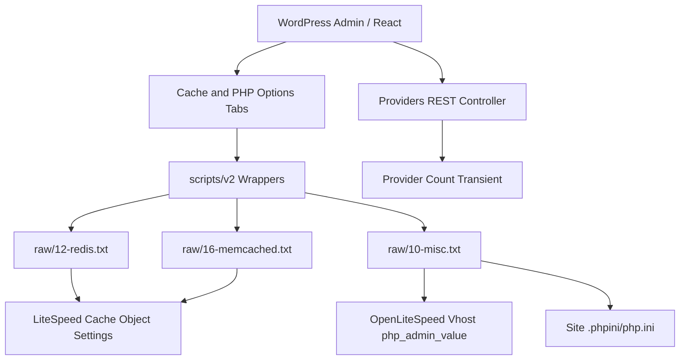

# Performance Optimization Tools

<cite>
**Referenced Files in This Document**
- [class-sstk-rest-providers.php](file://includes/core/api/class-sstk-rest-providers.php)
- [install_redis.txt](file://includes/core/apps/wordpress-app/scripts/v2/install_redis.txt)
- [manage_redis.txt](file://includes/core/apps/wordpress-app/scripts/v2/manage_redis.txt)
- [12-redis.txt](file://includes/core/apps/wordpress-app/scripts/v2/raw/12-redis.txt)
- [install_memcached.txt](file://includes/core/apps/wordpress-app/scripts/v2/install_memcached.txt)
- [manage_memcached.txt](file://includes/core/apps/wordpress-app/scripts/v2/manage_memcached.txt)
- [16-memcached.txt](file://includes/core/apps/wordpress-app/scripts/v2/raw/16-memcached.txt)
- [change_php_option_misc.txt](file://includes/core/apps/wordpress-app/scripts/v2/change_php_option_misc.txt)
- [10-misc.txt](file://includes/core/apps/wordpress-app/scripts/v2/raw/10-misc.txt)
- [php-options.php](file://includes/core/apps/wordpress-app/tabs/php-options.php)
- [01-prepare_server.txt](file://includes/core/apps/wordpress-app/scripts/v2/raw/01-prepare_server.txt)
</cite>

## Introduction

Simple Stack provisions Ubuntu 24.04/26.04 servers with OpenLiteSpeed and `lsphp83`,
`lsphp84` or `lsphp85`. Performance tooling is limited to the fixed `scripts/v2` tree and
includes:

- Redis and Memcached installation, site-level object-cache configuration and service control.
- Per-site PHP directives through the OpenLiteSpeed vhost and site `php.ini`.
- OPcache defaults applied during server preparation and PHP upgrades.
- Short-lived provider metadata caching in the React REST layer.

There is no PHP-FPM worker-pool tuner and no Nginx provisioning path in this release.

## Architecture Overview

## Redis and Memcached

### Installation and service management

The `install_*` wrappers install the service and the matching extensions for every LSPHP version
managed by Simple Stack. The `manage_*` wrappers expose site-level and service-level actions.

| Backend | Supported actions |
|---|---|
| Redis | install, enable for a site, disable for a site, clear, restart, remove |
| Memcached | install, enable for a site, disable for a site, clear, restart, remove |

Installation is idempotent at the service level: an already-installed backend reports that it is
present. Extension-install failures are reported as warnings so one unavailable LSPHP package
does not abort the whole operation.

### Site object-cache configuration

Enabling either backend:

1. Installs and activates the LiteSpeed Cache plugin if needed.
2. Sets `WP_CACHE` to `true`.
3. Configures LiteSpeed Cache to use the local backend.
4. Flushes the site cache.

Redis uses `127.0.0.1:6379` and LiteSpeed Cache object kind `1`. Memcached uses
`127.0.0.1:11211` and object kind `0`. Before enabling Memcached, the script deletes site
transients because the options table can exceed Memcached's per-item size limit.

Only one object-cache backend should be enabled for a site. The scripts refuse to enable a second
backend while `wp-content/object-cache.php` is already present.

## PHP Runtime Configuration

### Per-site directives

The PHP Options tab sends `change_php_option_misc.txt`, which delegates to the
`add_php_param` action in `raw/10-misc.txt`. The script updates both:

- `php_admin_value` entries in the site's OpenLiteSpeed vhost configuration.
- The site's `.phpini/php.ini` override file.

OpenLiteSpeed is restarted after the change. Common options are checked against the tab's
allowlist. Advanced option names and values are shell-escaped before interpolation, but the
operator remains responsible for choosing a valid directive and value.

There is no supported workflow that edits PHP-FPM pool files or reloads PHP-FPM.

### OPcache and LSPHP defaults

Server preparation and the PHP upgrade scripts configure OPcache, session paths, memory limits,
upload limits, execution limits and restricted functions for each supported LSPHP version.
Those defaults are separate from per-site `php_admin_value` overrides.

## Provider Metadata Cache

`GET /simple-stack/v1/settings/providers` returns region and size counts for configured
providers. Counts are stored for 300 seconds in `sstk_provider_counts_<provider>` transients.
Passing `refresh=1` bypasses the cached counts. Provider discovery failures are non-fatal and
return zero advisory counts so the settings screen remains usable.

## Performance Considerations

- Use one object-cache backend per site and monitor its memory use and eviction behavior.
- Keep page caching and object caching responsibilities distinct; purge both after deployments
  when the application requires it.
- Change one PHP directive at a time and validate the site immediately after the OpenLiteSpeed
  restart.
- Monitor LSPHP process memory, CPU, disk I/O and database load rather than PHP-FPM counters.
- Keep provider count transients short-lived; clear them after changing provider credentials.
- Profile slow database queries and add indexes only after confirming the query plan.

## Troubleshooting Guide

- **Redis or Memcached will not start:** inspect the command log, service status and package
  installation result before retrying the wrapper.
- **Object cache is not active:** confirm `WP_CACHE`, the LiteSpeed Cache object settings and
  that no second object-cache backend is installed.
- **PHP directive did not take effect:** inspect the vhost `php_admin_value`, the site
  `.phpini/php.ini`, the served LSPHP version and the OpenLiteSpeed restart result.
- **Provider counts are stale:** request `refresh=1` and check the provider credentials and API
  response in the command log.
- **High memory use:** review LSPHP process memory, OPcache allocation and object-cache size;
  do not apply PHP-FPM `pm.max_children` guidance to this stack.

## Conclusion

Simple Stack's performance tooling is OpenLiteSpeed-specific: local Redis or Memcached object
caching, per-site LSPHP directives, OPcache defaults and bounded provider metadata caching.
Provisioning and management use only `scripts/v2`; PHP-FPM and Nginx tuning instructions do not
apply.
