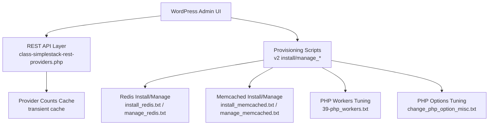
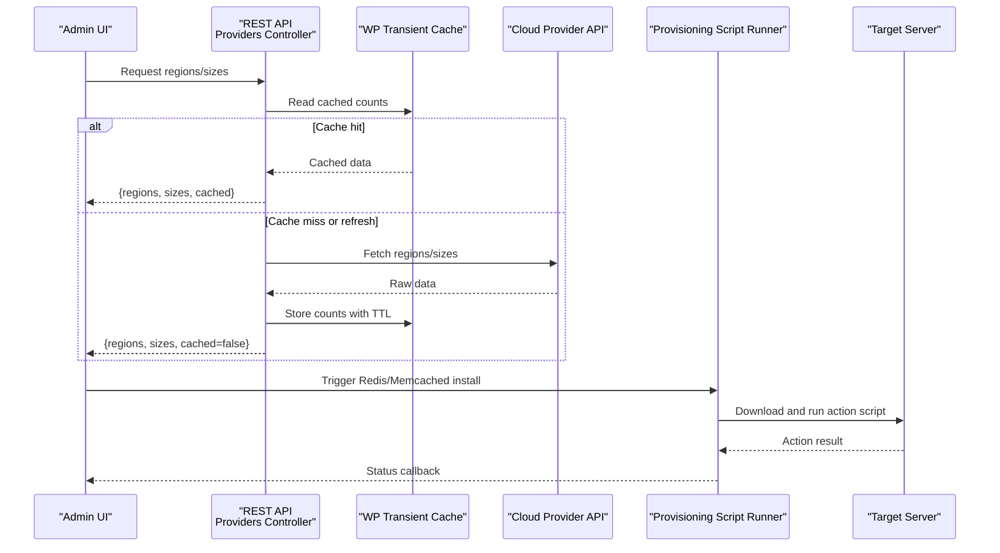
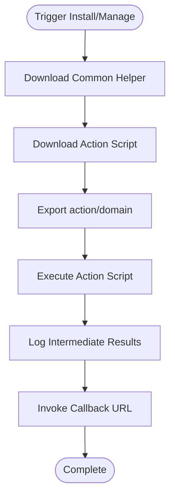
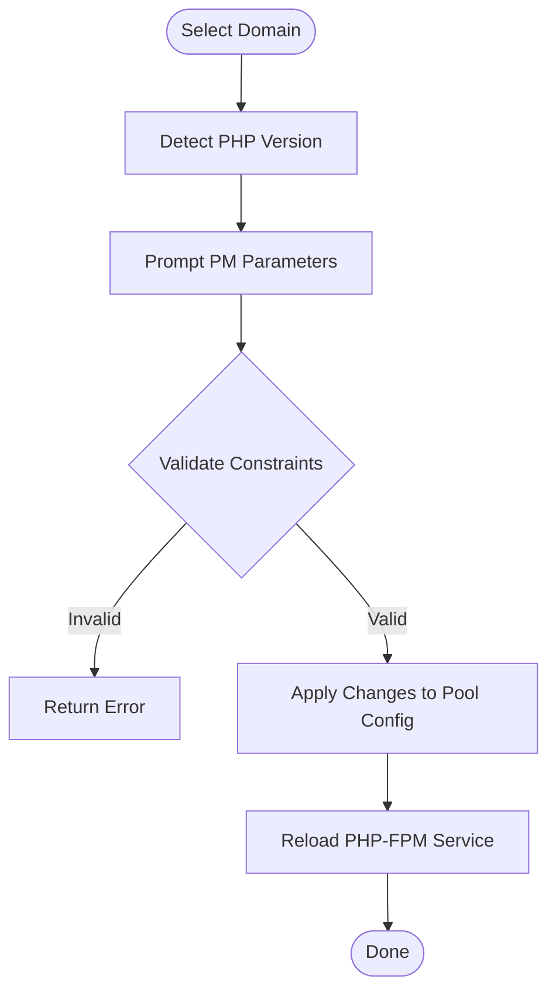
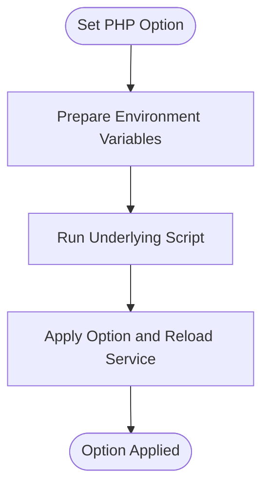
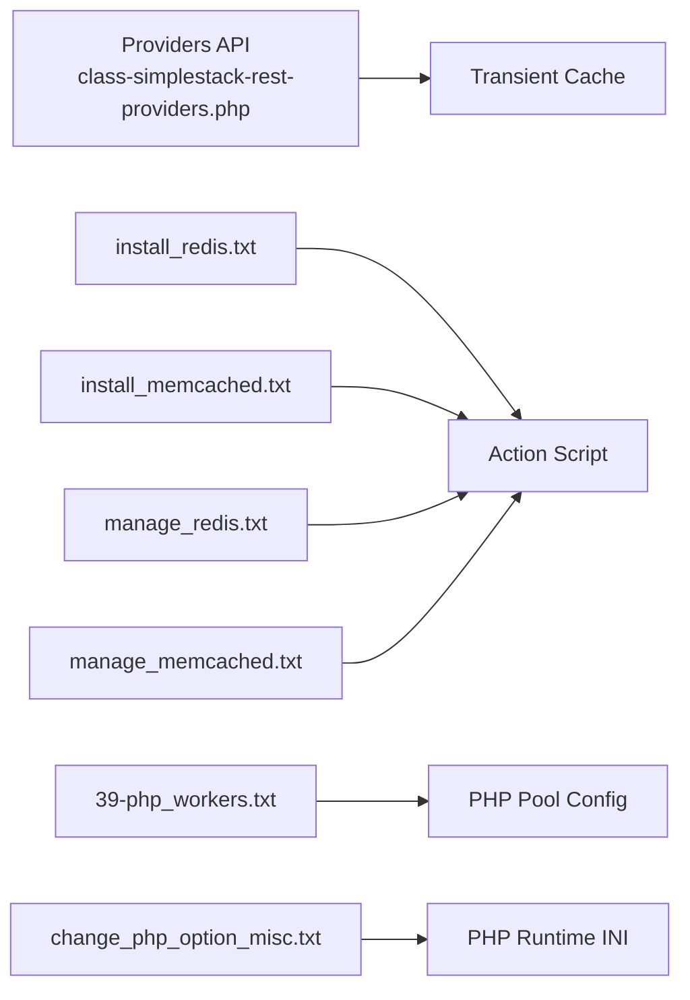

# Performance Optimization Tools

<cite>
**Referenced Files in This Document**
- [README.md](file://README.md)
- [class-simplestack-rest-providers.php](file://includes/core/api/class-simplestack-rest-providers.php)
- [install_redis.txt](file://includes/core/apps/wordpress-app/scripts/v2/install_redis.txt)
- [install_memcached.txt](file://includes/core/apps/wordpress-app/scripts/v2/install_memcached.txt)
- [manage_redis.txt](file://includes/core/apps/wordpress-app/scripts/v2/manage_redis.txt)
- [manage_memcached.txt](file://includes/core/apps/wordpress-app/scripts/v2/manage_memcached.txt)
- [39-php_workers.txt](file://includes/core/apps/wordpress-app/scripts/v1/raw/39-php_workers.txt)
- [change_php_option_misc.txt](file://includes/core/apps/wordpress-app/scripts/v2/change_php_option_misc.txt)
</cite>

## Table of Contents
1. [Introduction](#introduction)
2. [Project Structure](#project-structure)
3. [Core Components](#core-components)
4. [Architecture Overview](#architecture-overview)
5. [Detailed Component Analysis](#detailed-component-analysis)
6. [Dependency Analysis](#dependency-analysis)
7. [Performance Considerations](#performance-considerations)
8. [Troubleshooting Guide](#troubleshooting-guide)
9. [Conclusion](#conclusion)

## Introduction
This document explains how SimpleStack implements performance optimization tools and techniques, focusing on:
- Redis and Memcached caching installation and management
- PHP worker configuration for OpenLiteSpeed (lsphp) environments
- Server performance tuning via provisioning scripts
- Cache strategies, memory optimization, and database query optimization guidance
- Performance monitoring, bottleneck identification, and scaling considerations
- Examples of configuring different caching layers and optimizing PHP settings
- Performance regression testing and troubleshooting slow performance issues

SimpleStack provisions servers at Vultr or UpCloud, installs WordPress with OpenLiteSpeed, PHP, MariaDB, Redis, certbot, firewall, and an OLS vhost, and manages everything from the WordPress admin dashboard. The stack uses Ubuntu 24.04 LTS and 26.04 LTS, OpenLiteSpeed only, lsphp83/lsphp84/lsphp85, and a React-based admin UI. Provisioning is driven by Bash scripts executed over SSH.

**Section sources**
- [README.md:1-38](file://README.md#L1-L38)

## Project Structure
The performance-related code spans two main areas:
- REST API layer that caches provider metadata to reduce external API calls
- Provisioning scripts under includes/core/apps/wordpress-app/scripts that install and manage Redis/Memcached, tune PHP workers, and adjust PHP options

**Diagram sources**
- [class-simplestack-rest-providers.php:286-339](file://includes/core/api/class-simplestack-rest-providers.php#L286-L339)
- [install_redis.txt:1-11](file://includes/core/apps/wordpress-app/scripts/v2/install_redis.txt#L1-L11)
- [install_memcached.txt:1-11](file://includes/core/apps/wordpress-app/scripts/v2/install_memcached.txt#L1-L11)
- [manage_redis.txt:1-9](file://includes/core/apps/wordpress-app/scripts/v2/manage_redis.txt#L1-L9)
- [manage_memcached.txt:1-9](file://includes/core/apps/wordpress-app/scripts/v2/manage_memcached.txt#L1-L9)
- [39-php_workers.txt:1-264](file://includes/core/apps/wordpress-app/scripts/v1/raw/39-php_workers.txt#L1-L264)
- [change_php_option_misc.txt:1-9](file://includes/core/apps/wordpress-app/scripts/v2/change_php_option_misc.txt#L1-L9)

**Section sources**
- [README.md:27-38](file://README.md#L27-L38)

## Core Components
- Provider counts cache: Caches region and size counts returned by cloud providers to avoid repeated API calls. Uses WordPress transients with a configurable TTL and supports bypassing the cache via a refresh flag.
- Redis and Memcached provisioning: Wrapper scripts download and execute action-specific scripts to install or manage Redis/Memcached services on target servers.
- PHP workers and options: Scripts to adjust PHP-FPM pool parameters and general PHP options, enabling fine-tuned concurrency and runtime behavior per site.

Key responsibilities:
- Reduce external API overhead through transient caching
- Provide repeatable, auditable operations for installing and managing caches
- Offer safe, validated changes to PHP worker pools and runtime options

**Section sources**
- [class-simplestack-rest-providers.php:35-35](file://includes/core/api/class-simplestack-rest-providers.php#L35-L35)
- [class-simplestack-rest-providers.php:286-339](file://includes/core/api/class-simplestack-rest-providers.php#L286-L339)
- [install_redis.txt:1-11](file://includes/core/apps/wordpress-app/scripts/v2/install_redis.txt#L1-L11)
- [install_memcached.txt:1-11](file://includes/core/apps/wordpress-app/scripts/v2/install_memcached.txt#L1-L11)
- [manage_redis.txt:1-9](file://includes/core/apps/wordpress-app/scripts/v2/manage_redis.txt#L1-L9)
- [manage_memcached.txt:1-9](file://includes/core/apps/wordpress-app/scripts/v2/manage_memcached.txt#L1-L9)
- [39-php_workers.txt:1-264](file://includes/core/apps/wordpress-app/scripts/v1/raw/39-php_workers.txt#L1-L264)
- [change_php_option_misc.txt:1-9](file://includes/core/apps/wordpress-app/scripts/v2/change_php_option_misc.txt#L1-L9)

## Architecture Overview
The performance optimization flow integrates the admin UI, REST API, and server-side provisioning scripts.

**Diagram sources**
- [class-simplestack-rest-providers.php:286-339](file://includes/core/api/class-simplestack-rest-providers.php#L286-L339)
- [install_redis.txt:1-11](file://includes/core/apps/wordpress-app/scripts/v2/install_redis.txt#L1-L11)
- [install_memcached.txt:1-11](file://includes/core/apps/wordpress-app/scripts/v2/install_memcached.txt#L1-L11)

## Detailed Component Analysis

### Redis and Memcached Caching Implementation
SimpleStack provides wrapper scripts to install and manage Redis and Memcached on provisioned servers. These wrappers:
- Download common helper scripts and action-specific scripts
- Set environment variables such as action and domain
- Execute the action script and log intermediate results
- Invoke a callback URL upon completion

Operational notes:
- Use install scripts for initial setup; use manage scripts for ongoing control (start/stop/restart/configure).
- Ensure the target server has network access to fetch scripts and can reach the callback endpoint.
- Validate that the correct action is passed to avoid unintended service state changes.

**Diagram sources**
- [install_redis.txt:1-11](file://includes/core/apps/wordpress-app/scripts/v2/install_redis.txt#L1-L11)
- [install_memcached.txt:1-11](file://includes/core/apps/wordpress-app/scripts/v2/install_memcached.txt#L1-L11)
- [manage_redis.txt:1-9](file://includes/core/apps/wordpress-app/scripts/v2/manage_redis.txt#L1-L9)
- [manage_memcached.txt:1-9](file://includes/core/apps/wordpress-app/scripts/v2/manage_memcached.txt#L1-L9)

**Section sources**
- [install_redis.txt:1-11](file://includes/core/apps/wordpress-app/scripts/v2/install_redis.txt#L1-L11)
- [install_memcached.txt:1-11](file://includes/core/apps/wordpress-app/scripts/v2/install_memcached.txt#L1-L11)
- [manage_redis.txt:1-9](file://includes/core/apps/wordpress-app/scripts/v2/manage_redis.txt#L1-L9)
- [manage_memcached.txt:1-9](file://includes/core/apps/wordpress-app/scripts/v2/manage_memcached.txt#L1-L9)

### PHP Worker Configuration
PHP worker tuning adjusts the PHP-FPM pool parameters to match workload characteristics. While the provided worker script targets NGINX paths, the same principles apply to OpenLiteSpeed’s lsphp pools managed by SimpleStack. Key parameters include:
- pm (process manager mode): static, dynamic, or ondemand
- pm.max_children: maximum child processes
- pm.start_servers: initial number of child processes
- pm.min_spare_servers: minimum idle child processes
- pm.max_spare_servers: maximum idle child processes

Validation rules enforced by the script:
- pm.min_spare_servers must not exceed pm.max_children
- pm.max_spare_servers must not exceed pm.max_children
- pm.start_servers must be between pm.min_spare_servers and pm.max_spare_servers

Best practices:
- For CPU-bound workloads, prefer static pm with a calculated max_children based on available RAM and per-process memory usage.
- For I/O-bound workloads, dynamic or ondemand may reduce memory footprint while handling bursts.
- Monitor process counts and memory usage after applying changes to ensure stability.

**Diagram sources**
- [39-php_workers.txt:85-100](file://includes/core/apps/wordpress-app/scripts/v1/raw/39-php_workers.txt#L85-L100)
- [39-php_workers.txt:182-260](file://includes/core/apps/wordpress-app/scripts/v1/raw/39-php_workers.txt#L182-L260)

**Section sources**
- [39-php_workers.txt:1-264](file://includes/core/apps/wordpress-app/scripts/v1/raw/39-php_workers.txt#L1-L264)

### Server Performance Tuning via PHP Options
SimpleStack exposes a mechanism to set arbitrary PHP options per site using a wrapper script that exports action, domain, and php_param values before executing the underlying script. This enables targeted tuning such as:
- Increasing memory_limit for large uploads or batch jobs
- Adjusting max_execution_time for long-running tasks
- Enabling/disabling specific extensions or ini directives

Guidance:
- Change one option at a time and validate application behavior.
- Use staging environments to test impact before production rollout.
- Keep a record of applied options for auditability and rollback.

**Diagram sources**
- [change_php_option_misc.txt:1-9](file://includes/core/apps/wordpress-app/scripts/v2/change_php_option_misc.txt#L1-L9)

**Section sources**
- [change_php_option_misc.txt:1-9](file://includes/core/apps/wordpress-app/scripts/v2/change_php_option_misc.txt#L1-L9)

### Cache Strategies and Memory Optimization
Recommended strategies:
- Object caching with Redis for database query results and expensive computations
- Page caching via OpenLiteSpeed built-in mechanisms where appropriate
- Session storage in Redis for scalable session handling across multiple PHP workers
- Memcached for simple key-value caching when Redis features are unnecessary

Memory optimization tips:
- Size Redis appropriately for your dataset; monitor eviction policies if memory pressure occurs
- Tune PHP-FPM pm.max_children to prevent OOM conditions
- Enable OPcache for PHP bytecode caching to reduce CPU overhead
- Prune unused plugins/themes and optimize database tables regularly

[No sources needed since this section provides general guidance]

### Database Query Optimization
- Add appropriate indexes to frequently queried columns
- Avoid SELECT *; select only required fields
- Use pagination and limit clauses to reduce payload sizes
- Leverage object caching to minimize repeated queries
- Analyze slow query logs and refactor heavy joins or subqueries

[No sources needed since this section provides general guidance]

## Dependency Analysis
The following diagram shows dependencies among core components involved in performance optimization.

**Diagram sources**
- [class-simplestack-rest-providers.php:286-339](file://includes/core/api/class-simplestack-rest-providers.php#L286-L339)
- [install_redis.txt:1-11](file://includes/core/apps/wordpress-app/scripts/v2/install_redis.txt#L1-L11)
- [install_memcached.txt:1-11](file://includes/core/apps/wordpress-app/scripts/v2/install_memcached.txt#L1-L11)
- [manage_redis.txt:1-9](file://includes/core/apps/wordpress-app/scripts/v2/manage_redis.txt#L1-L9)
- [manage_memcached.txt:1-9](file://includes/core/apps/wordpress-app/scripts/v2/manage_memcached.txt#L1-L9)
- [39-php_workers.txt:182-260](file://includes/core/apps/wordpress-app/scripts/v1/raw/39-php_workers.txt#L182-L260)
- [change_php_option_misc.txt:1-9](file://includes/core/apps/wordpress-app/scripts/v2/change_php_option_misc.txt#L1-L9)

**Section sources**
- [class-simplestack-rest-providers.php:286-339](file://includes/core/api/class-simplestack-rest-providers.php#L286-L339)
- [install_redis.txt:1-11](file://includes/core/apps/wordpress-app/scripts/v2/install_redis.txt#L1-L11)
- [install_memcached.txt:1-11](file://includes/core/apps/wordpress-app/scripts/v2/install_memcached.txt#L1-L11)
- [manage_redis.txt:1-9](file://includes/core/apps/wordpress-app/scripts/v2/manage_redis.txt#L1-L9)
- [manage_memcached.txt:1-9](file://includes/core/apps/wordpress-app/scripts/v2/manage_memcached.txt#L1-L9)
- [39-php_workers.txt:182-260](file://includes/core/apps/wordpress-app/scripts/v1/raw/39-php_workers.txt#L182-L260)
- [change_php_option_misc.txt:1-9](file://includes/core/apps/wordpress-app/scripts/v2/change_php_option_misc.txt#L1-L9)

## Performance Considerations
- Caching layers:
  - Prefer Redis for complex objects and sessions; Memcached for simple KV caches
  - Combine page/object/session caching for maximum throughput
- PHP runtime:
  - Use OPcache and tune pm settings based on workload type
  - Align PHP version with application requirements (lsphp83/lsphp84/lsphp85)
- Database:
  - Indexing, query simplification, and connection pooling via persistent connections where supported
- Monitoring:
  - Track CPU, memory, disk I/O, and network metrics
  - Monitor Redis/Memcached hit rates and eviction events
  - Observe PHP-FPM process counts and memory usage
- Scaling:
  - Horizontal scaling with multiple PHP workers behind load balancers
  - Vertical scaling by increasing instance size when resource bottlenecks persist

[No sources needed since this section provides general guidance]

## Troubleshooting Guide
Common issues and resolutions:
- Slow provider API responses:
  - Check transient cache TTL and consider increasing it
  - Use refresh flag to force update when necessary
- Redis/Memcached not starting:
  - Verify action script execution logs and permissions
  - Confirm network access to script endpoints and callback URLs
- PHP worker instability:
  - Review pm constraints and adjust max_children to fit available memory
  - Monitor process restarts and memory spikes
- PHP option misconfiguration:
  - Revert recent changes and validate INI syntax
  - Test in staging before applying to production

Diagnostic steps:
- Inspect transient cache entries for provider counts
- Review script logs generated during install/manage actions
- Validate PHP pool config syntax and reload services safely
- Use profiling tools to identify slow queries and hot paths

**Section sources**
- [class-simplestack-rest-providers.php:286-339](file://includes/core/api/class-simplestack-rest-providers.php#L286-L339)
- [install_redis.txt:1-11](file://includes/core/apps/wordpress-app/scripts/v2/install_redis.txt#L1-L11)
- [install_memcached.txt:1-11](file://includes/core/apps/wordpress-app/scripts/v2/install_memcached.txt#L1-L11)
- [manage_redis.txt:1-9](file://includes/core/apps/wordpress-app/scripts/v2/manage_redis.txt#L1-L9)
- [manage_memcached.txt:1-9](file://includes/core/apps/wordpress-app/scripts/v2/manage_memcached.txt#L1-L9)
- [39-php_workers.txt:182-260](file://includes/core/apps/wordpress-app/scripts/v1/raw/39-php_workers.txt#L182-L260)
- [change_php_option_misc.txt:1-9](file://includes/core/apps/wordpress-app/scripts/v2/change_php_option_misc.txt#L1-L9)

## Conclusion
SimpleStack provides robust tooling for performance optimization through:
- Cached provider metadata to reduce external API overhead
- Automated Redis and Memcached installation and management
- Safe, validated PHP worker and option tuning
- A clear architecture that separates concerns between admin UI, REST API, and server-side scripts

Adopting these practices—layered caching, tuned PHP runtime, optimized database queries, and continuous monitoring—will improve responsiveness, scalability, and reliability under varying workloads.

[No sources needed since this section summarizes without analyzing specific files]