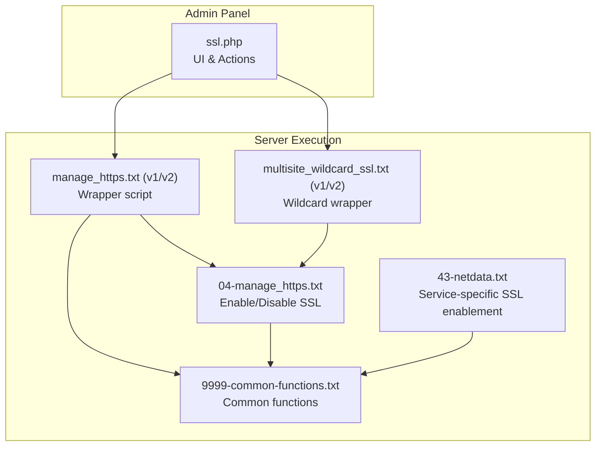
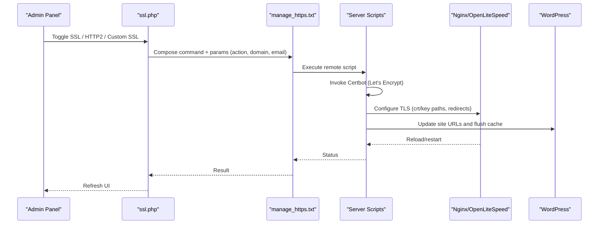
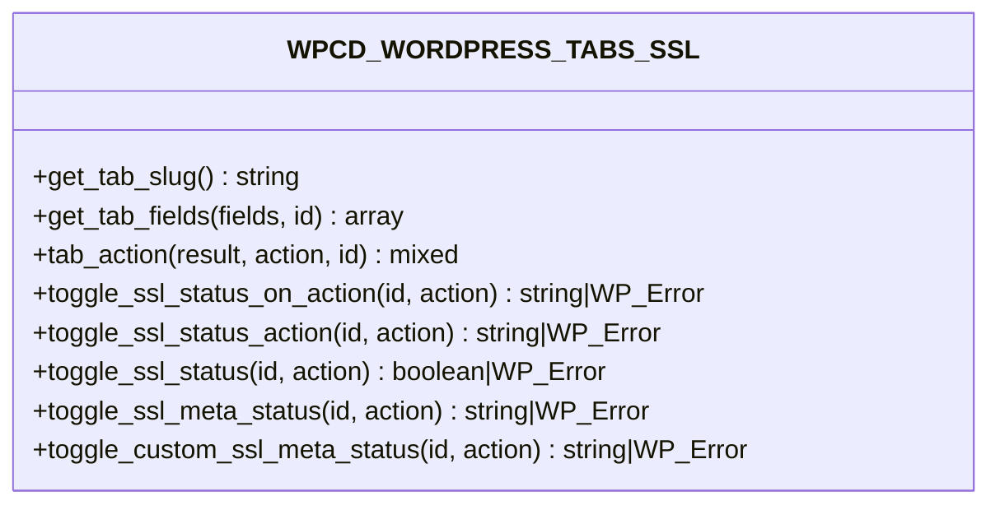
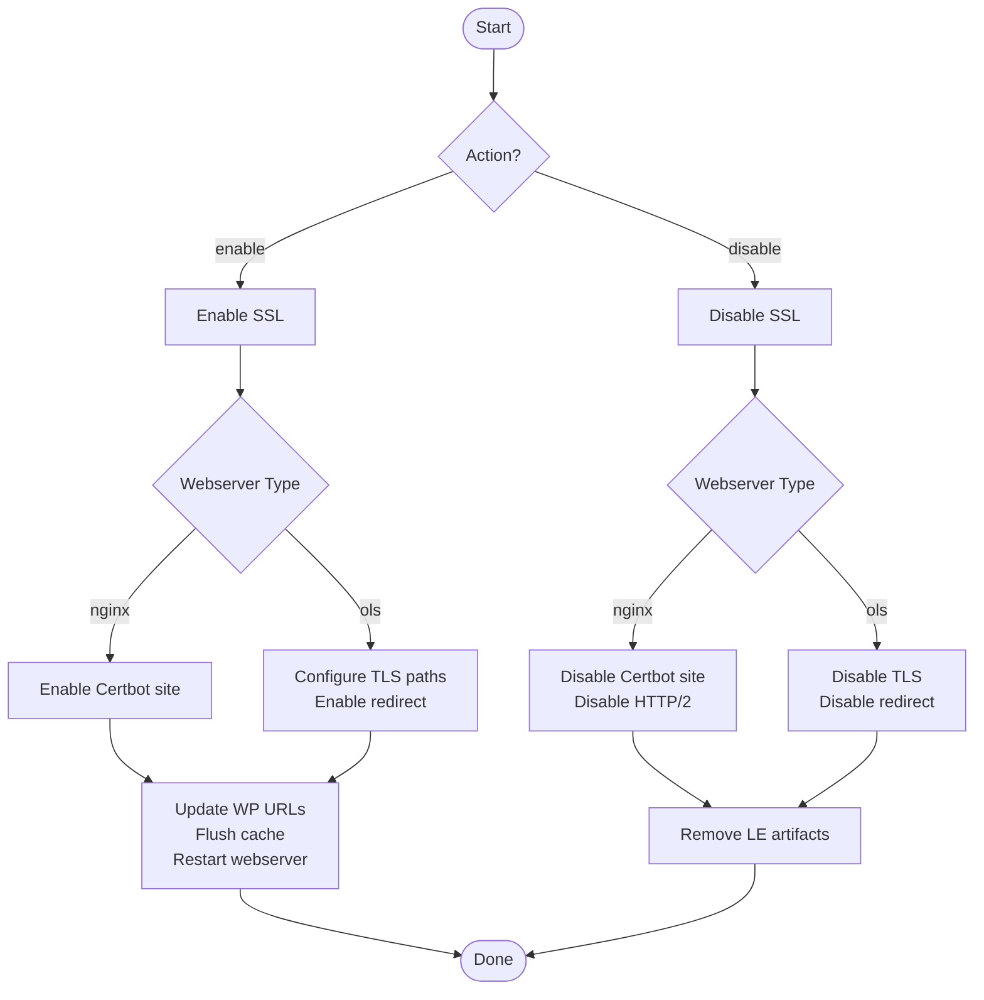
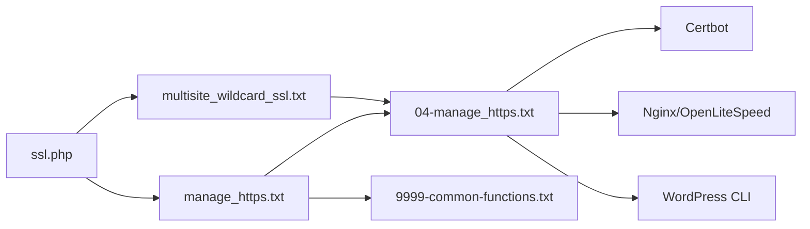

# SSL Certificate Management

<cite>
**Referenced Files in This Document**
- [ssl.php](file://includes/core/apps/wordpress-app/tabs/ssl.php)
- [manage_https.txt (v1)](file://includes/core/apps/wordpress-app/scripts/v1/manage_https.txt)
- [manage_https.txt (v2)](file://includes/core/apps/wordpress-app/scripts/v2/manage_https.txt)
- [multisite_wildcard_ssl.txt (v1)](file://includes/core/apps/wordpress-app/scripts/v1/multisite_wildcard_ssl.txt)
- [multisite_wildcard_ssl.txt (v2)](file://includes/core/apps/wordpress-app/scripts/v2/multisite_wildcard_ssl.txt)
- [04-manage_https.txt](file://includes/core/apps/wordpress-app/scripts/v1/raw/04-manage_https.txt)
- [9999-common-functions.txt](file://includes/core/apps/wordpress-app/scripts/v1/raw/9999-common-functions.txt)
- [43-netdata.txt](file://includes/core/apps/wordpress-app/scripts/v1/raw/43-netdata.txt)
</cite>

## Table of Contents
1. [Introduction](#introduction)
2. [Project Structure](#project-structure)
3. [Core Components](#core-components)
4. [Architecture Overview](#architecture-overview)
5. [Detailed Component Analysis](#detailed-component-analysis)
6. [Dependency Analysis](#dependency-analysis)
7. [Performance Considerations](#performance-considerations)
8. [Troubleshooting Guide](#troubleshooting-guide)
9. [Conclusion](#conclusion)
10. [Appendices](#appendices)

## Introduction
This document explains how SSL certificates are managed and how HTTPS is configured within the application. It covers:
- Let’s Encrypt integration via Certbot for single-domain and multi-domain certificates
- Wildcard certificate handling for multisite environments
- Custom certificate uploads and flag management
- Certificate renewal automation
- Installation, validation, and troubleshooting steps
- Security best practices and compliance considerations

The system integrates with both Nginx and OpenLiteSpeed web servers and uses WordPress meta flags to track SSL state.

## Project Structure
SSL-related functionality is implemented across a PHP admin tab that exposes UI actions and a set of shell scripts executed on the server via SSH. The key files are:
- Admin tab for SSL controls and status
- Script wrappers that download and execute server-side logic
- Server-side scripts that invoke Certbot and configure web servers

**Diagram sources**
- [ssl.php:150-569](file://includes/core/apps/wordpress-app/tabs/ssl.php#L150-L569)
- [manage_https.txt (v1):1-9](file://includes/core/apps/wordpress-app/scripts/v1/manage_https.txt#L1-L9)
- [manage_https.txt (v2):1-9](file://includes/core/apps/wordpress-app/scripts/v2/manage_https.txt#L1-L9)
- [multisite_wildcard_ssl.txt (v1):1-9](file://includes/core/apps/wordpress-app/scripts/v1/multisite_wildcard_ssl.txt#L1-L9)
- [multisite_wildcard_ssl.txt (v2):1-9](file://includes/core/apps/wordpress-app/scripts/v2/multisite_wildcard_ssl.txt#L1-L9)
- [04-manage_https.txt:99-166](file://includes/core/apps/wordpress-app/scripts/v1/raw/04-manage_https.txt#L99-L166)
- [9999-common-functions.txt:621-643](file://includes/core/apps/wordpress-app/scripts/v1/raw/9999-common-functions.txt#L621-L643)
- [43-netdata.txt:384-412](file://includes/core/apps/wordpress-app/scripts/v1/raw/43-netdata.txt#L384-L412)

**Section sources**
- [ssl.php:15-632](file://includes/core/apps/wordpress-app/tabs/ssl.php#L15-L632)
- [manage_https.txt (v1):1-9](file://includes/core/apps/wordpress-app/scripts/v1/manage_https.txt#L1-L9)
- [manage_https.txt (v2):1-9](file://includes/core/apps/wordpress-app/scripts/v2/manage_https.txt#L1-L9)
- [multisite_wildcard_ssl.txt (v1):1-9](file://includes/core/apps/wordpress-app/scripts/v1/multisite_wildcard_ssl.txt#L1-L9)
- [multisite_wildcard_ssl.txt (v2):1-9](file://includes/core/apps/wordpress-app/scripts/v2/multisite_wildcard_ssl.txt#L1-L9)

## Core Components
- SSL Tab Controller (PHP): Provides UI, permissions, toggles for SSL and HTTP/2, and flips for custom SSL flags. It composes commands and executes them over SSH.
- Script Wrappers (Shell): Download common and specific scripts, export parameters, and run them on the target server.
- Server-Side Scripts (Shell): Implement enabling/disabling SSL, invoking Certbot, configuring Nginx/OpenLiteSpeed, updating WordPress options, and restarting services.

Key responsibilities:
- Let’s Encrypt issuance and installation for single domains and multiple domains
- Wildcard certificate provisioning for multisite setups
- Custom certificate mode flagging
- HTTP/2 toggling when applicable
- Certificate renewal orchestration

**Section sources**
- [ssl.php:150-569](file://includes/core/apps/wordpress-app/tabs/ssl.php#L150-L569)
- [manage_https.txt (v1):1-9](file://includes/core/apps/wordpress-app/scripts/v1/manage_https.txt#L1-L9)
- [manage_https.txt (v2):1-9](file://includes/core/apps/wordpress-app/scripts/v2/manage_https.txt#L1-L9)
- [multisite_wildcard_ssl.txt (v1):1-9](file://includes/core/apps/wordpress-app/scripts/v1/multisite_wildcard_ssl.txt#L1-L9)
- [multisite_wildcard_ssl.txt (v2):1-9](file://includes/core/apps/wordpress-app/scripts/v2/multisite_wildcard_ssl.txt#L1-L9)

## Architecture Overview
The SSL workflow is driven from the admin panel and executed remotely on the server.

**Diagram sources**
- [ssl.php:476-569](file://includes/core/apps/wordpress-app/tabs/ssl.php#L476-L569)
- [manage_https.txt (v1):1-9](file://includes/core/apps/wordpress-app/scripts/v1/manage_https.txt#L1-L9)
- [04-manage_https.txt:99-166](file://includes/core/apps/wordpress-app/scripts/v1/raw/04-manage_https.txt#L99-L166)
- [9999-common-functions.txt:621-643](file://includes/core/apps/wordpress-app/scripts/v1/raw/9999-common-functions.txt#L621-L643)

## Detailed Component Analysis

### SSL Tab Controller (PHP)
Responsibilities:
- Exposes actions: enable/disable SSL, toggle HTTP/2, flip SSL/custom SSL flags
- Validates permissions and site state
- Builds and dispatches remote commands via SSH
- Updates WordPress meta to reflect current state

Highlights:
- UI shows warnings about rate limits and firewall/NAT considerations
- Disables changes if HTTP/2 is enabled on Nginx during SSL toggles
- Supports multisite wildcard SSL mode by hiding standard SSL controls

**Diagram sources**
- [ssl.php:15-632](file://includes/core/apps/wordpress-app/tabs/ssl.php#L15-L632)

**Section sources**
- [ssl.php:150-569](file://includes/core/apps/wordpress-app/tabs/ssl.php#L150-L569)

### Script Wrappers (Shell)
Purpose:
- Fetch common and specific scripts onto the server
- Export variables such as action, domain, email, DNS provider tokens
- Execute the main script

Parameters:
- manage_https.txt: action, domain, email
- multisite_wildcard_ssl.txt: action, domain, dns_provider, email, dns_cloudflare_email, dns_cloudflare_api_token, dns_cloudflare_api_key

**Section sources**
- [manage_https.txt (v1):1-9](file://includes/core/apps/wordpress-app/scripts/v1/manage_https.txt#L1-L9)
- [manage_https.txt (v2):1-9](file://includes/core/apps/wordpress-app/scripts/v2/manage_https.txt#L1-L9)
- [multisite_wildcard_ssl.txt (v1):1-9](file://includes/core/apps/wordpress-app/scripts/v1/multisite_wildcard_ssl.txt#L1-L9)
- [multisite_wildcard_ssl.txt (v2):1-9](file://includes/core/apps/wordpress-app/scripts/v2/multisite_wildcard_ssl.txt#L1-L9)

### Server-Side SSL Enable/Disable Logic
Behavior:
- For Nginx: enables or disables Certbot-managed sites and HTTP/2 accordingly
- For OpenLiteSpeed: configures virtual host TLS paths, sets up redirects, restarts service
- Updates WordPress home/siteurl to https and clears caches
- Removes Let’s Encrypt artifacts when disabling

**Diagram sources**
- [04-manage_https.txt:99-166](file://includes/core/apps/wordpress-app/scripts/v1/raw/04-manage_https.txt#L99-L166)
- [9999-common-functions.txt:621-643](file://includes/core/apps/wordpress-app/scripts/v1/raw/9999-common-functions.txt#L621-L643)

**Section sources**
- [04-manage_https.txt:99-166](file://includes/core/apps/wordpress-app/scripts/v1/raw/04-manage_https.txt#L99-L166)
- [9999-common-functions.txt:621-643](file://includes/core/apps/wordpress-app/scripts/v1/raw/9999-common-functions.txt#L621-L643)

### Wildcard SSL for Multisite
- Dedicated wrapper script passes DNS provider credentials to automate DNS-01 challenges
- UI hides standard SSL controls when multisite wildcard SSL is active

Operational notes:
- Ensure DNS provider configuration is correct before enabling
- After successful issuance, apply wildcard certificate to all relevant subdomains

**Section sources**
- [multisite_wildcard_ssl.txt (v1):1-9](file://includes/core/apps/wordpress-app/scripts/v1/multisite_wildcard_ssl.txt#L1-L9)
- [multisite_wildcard_ssl.txt (v2):1-9](file://includes/core/apps/wordpress-app/scripts/v2/multisite_wildcard_ssl.txt#L1-L9)
- [ssl.php:159-174](file://includes/core/apps/wordpress-app/tabs/ssl.php#L159-L174)

### Service-Specific SSL Enablement Example
- Demonstrates enabling SSL for a service (e.g., Netdata) using Certbot with either Nginx or OpenLiteSpeed backends

**Section sources**
- [43-netdata.txt:384-412](file://includes/core/apps/wordpress-app/scripts/v1/raw/43-netdata.txt#L384-L412)

## Dependency Analysis
- ssl.php depends on:
  - WordPress post meta for domain, email, and SSL flags
  - SSH execution utilities to run remote scripts
  - Web server type detection to choose appropriate commands
- Remote scripts depend on:
  - Certbot availability and network access to Let’s Encrypt
  - Web server configuration tools (Nginx/OpenLiteSpeed)
  - WordPress CLI for option updates and cache flushing

**Diagram sources**
- [ssl.php:476-569](file://includes/core/apps/wordpress-app/tabs/ssl.php#L476-L569)
- [manage_https.txt (v1):1-9](file://includes/core/apps/wordpress-app/scripts/v1/manage_https.txt#L1-L9)
- [multisite_wildcard_ssl.txt (v1):1-9](file://includes/core/apps/wordpress-app/scripts/v1/multisite_wildcard_ssl.txt#L1-L9)
- [04-manage_https.txt:99-166](file://includes/core/apps/wordpress-app/scripts/v1/raw/04-manage_https.txt#L99-L166)
- [9999-common-functions.txt:621-643](file://includes/core/apps/wordpress-app/scripts/v1/raw/9999-common-functions.txt#L621-L643)

**Section sources**
- [ssl.php:476-569](file://includes/core/apps/wordpress-app/tabs/ssl.php#L476-L569)

## Performance Considerations
- Avoid frequent SSL toggles to prevent Let’s Encrypt rate limiting
- Keep HTTP/2 disabled while changing SSL settings on Nginx to reduce reconfiguration overhead
- Use caching strategies that invalidate after certificate changes to avoid serving stale content

[No sources needed since this section provides general guidance]

## Troubleshooting Guide
Common issues and resolutions:
- Firewall/NAT blocking port 443:
  - Ensure HTTPS is allowed through cloud provider firewalls before enabling SSL
- Proxy interference:
  - Temporarily disable proxy services (e.g., CloudFlare) if they block Let’s Encrypt verification
- HTTP/2 conflicts on Nginx:
  - Disable HTTP/2 before enabling/disabling SSL
- Let’s Encrypt errors:
  - Review logs under SSH LOG menu; check domain resolution and ACME challenge endpoints
- Custom SSL mode:
  - If custom SSL is flagged, standard Let’s Encrypt issuance is blocked until the flag is cleared

Operational checks:
- Verify certificate files exist at expected paths
- Confirm web server reload/restart succeeded
- Validate WordPress site URLs updated to https and caches flushed

**Section sources**
- [ssl.php:262-291](file://includes/core/apps/wordpress-app/tabs/ssl.php#L262-L291)
- [ssl.php:538-543](file://includes/core/apps/wordpress-app/tabs/ssl.php#L538-L543)
- [04-manage_https.txt:119-136](file://includes/core/apps/wordpress-app/scripts/v1/raw/04-manage_https.txt#L119-L136)
- [9999-common-functions.txt:626-643](file://includes/core/apps/wordpress-app/scripts/v1/raw/9999-common-functions.txt#L626-L643)

## Conclusion
The SSL subsystem provides a robust, automated approach to managing HTTPS across Nginx and OpenLiteSpeed. It supports single-domain and multi-domain certificates, wildcard certificates for multisite environments, and custom certificate modes. Administrators can control SSL and HTTP/2 from the UI, while server-side scripts handle Let’s Encrypt issuance, web server configuration, and WordPress updates. Proper firewall configuration, DNS setup, and adherence to rate limits ensure reliable operation.

[No sources needed since this section summarizes without analyzing specific files]

## Appendices

### Automated Certificate Deployment
- Use the SSL tab to toggle SSL; the system will:
  - Run Certbot to obtain certificates
  - Configure the web server
  - Update WordPress URLs and clear caches
  - Restart the web server

Reference:
- [ssl.php:476-569](file://includes/core/apps/wordpress-app/tabs/ssl.php#L476-L569)
- [04-manage_https.txt:99-166](file://includes/core/apps/wordpress-app/scripts/v1/raw/04-manage_https.txt#L99-L166)

### Manual Certificate Management
- To manually install a certificate:
  - Place your certificate and private key at the expected path
  - Set the custom SSL flag via the UI to indicate custom certificate usage
  - Ensure web server configuration points to your certificate files

References:
- [ssl.php:387-431](file://includes/core/apps/wordpress-app/tabs/ssl.php#L387-L431)
- [9999-common-functions.txt:626-643](file://includes/core/apps/wordpress-app/scripts/v1/raw/9999-common-functions.txt#L626-L643)

### Certificate Renewal Automation
- While not shown explicitly here, typical renewal involves:
  - Running Certbot renewals via system cron
  - Validating and reloading the web server after renewal
  - Ensuring WordPress caches are refreshed if necessary

[No sources needed since this section provides general guidance]

### Security Best Practices and Compliance
- Restrict access to sensitive directories and keys
- Use strong passphrases for private keys where applicable
- Monitor certificate expiration and automate renewals
- Follow organizational policies for certificate lifecycle and audit trails

[No sources needed since this section provides general guidance]