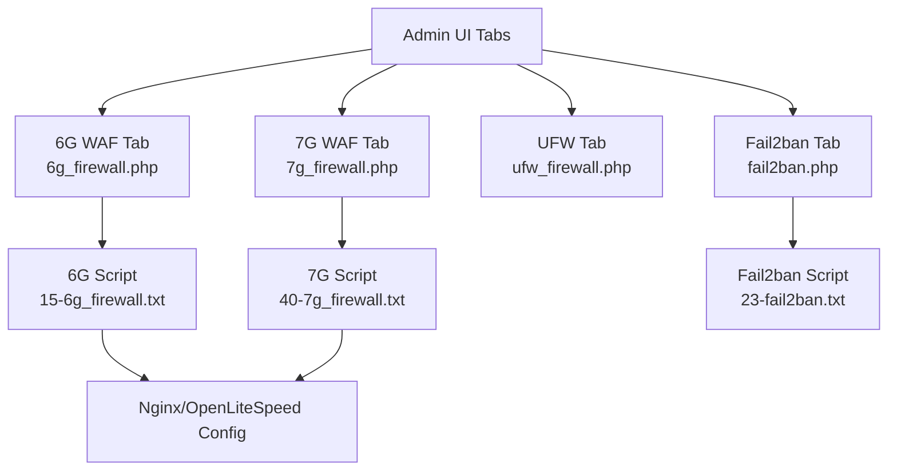
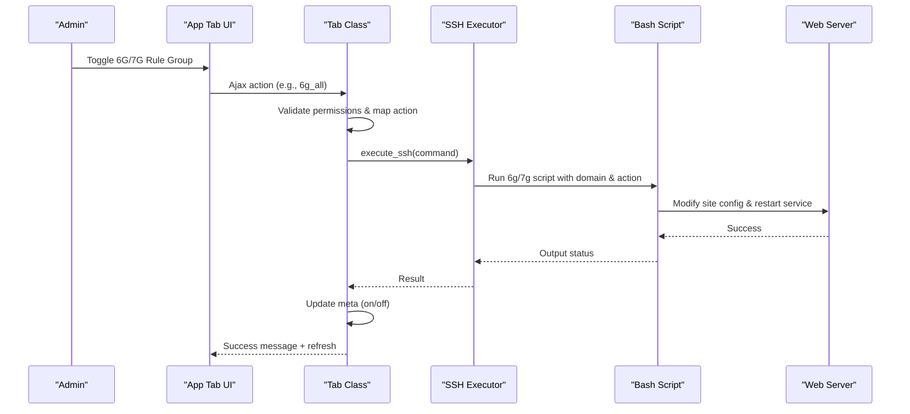
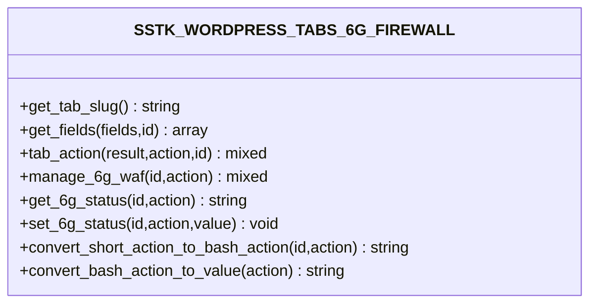
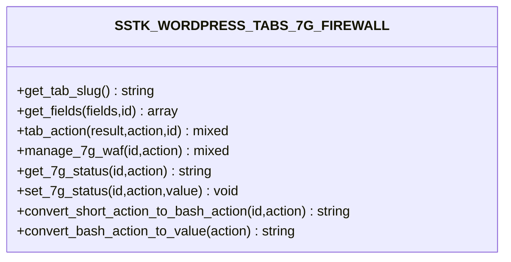
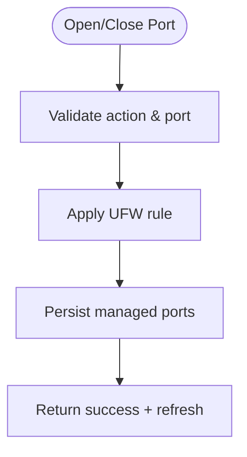
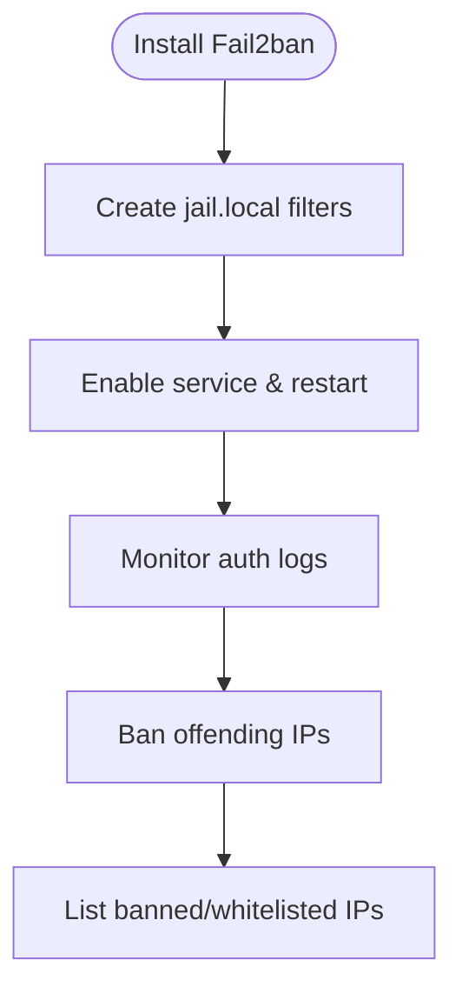
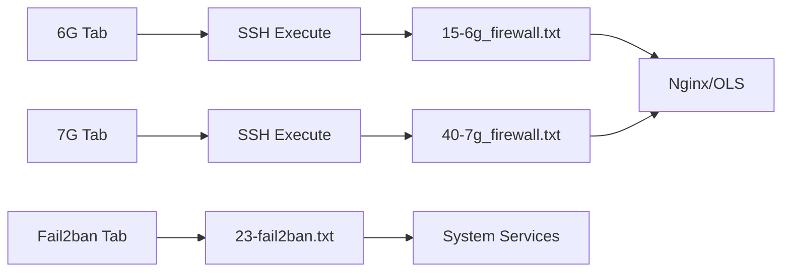

# Security & Firewall Management

<cite>
**Referenced Files in This Document**
- [6g_firewall.php](file://includes/core/apps/wordpress-app/tabs/6g_firewall.php)
- [7g_firewall.php](file://includes/core/apps/wordpress-app/tabs/7g_firewall.php)
- [15-6g_firewall.txt](file://includes/core/apps/wordpress-app/scripts/v1/raw/15-6g_firewall.txt)
- [40-7g_firewall.txt](file://includes/core/apps/wordpress-app/scripts/v1/raw/40-7g_firewall.txt)
- [1060-upgrade_7g_firewall.txt](file://includes/core/apps/wordpress-app/scripts/v1/raw/1060-upgrade_7g_firewall.txt)
- [1120-remove_6g_firewall.txt](file://includes/core/apps/wordpress-app/scripts/v1/raw/1120-remove_6g_firewall.txt)
- [ufw_firewall.php](file://includes/core/apps/wordpress-app/tabs-server/ufw_firewall.php)
- [fail2ban.php](file://includes/core/apps/wordpress-app/tabs-server/fail2ban.php)
- [23-fail2ban.txt](file://includes/core/apps/wordpress-app/scripts/v1/raw/23-fail2ban.txt)
</cite>

## Table of Contents
1. [Introduction](#introduction)
2. [Project Structure](#project-structure)
3. [Core Components](#core-components)
4. [Architecture Overview](#architecture-overview)
5. [Detailed Component Analysis](#detailed-component-analysis)
6. [Dependency Analysis](#dependency-analysis)
7. [Performance Considerations](#performance-considerations)
8. [Troubleshooting Guide](#troubleshooting-guide)
9. [Conclusion](#conclusion)

## Introduction
This document explains how the application manages security firewalls, focusing on 6G and 7G Web Application Firewalls (WAFs), host-level firewall controls via UFW, and intrusion detection/response with Fail2ban. It covers rule configuration, attack prevention mechanisms, hardening procedures, differences between 6G and 7G, customization and whitelisting, monitoring blocked requests, performance tuning, and troubleshooting access issues.

## Project Structure
The firewall management is implemented as:
- WordPress App tabs for WAF toggles (6G and 7G)
- Bash scripts that modify Nginx or OpenLiteSpeed configurations
- Server tabs for UFW port management and Fail2ban integration

**Diagram sources**
- [6g_firewall.php:15-26](file://includes/core/apps/wordpress-app/tabs/6g_firewall.php#L15-L26)
- [7g_firewall.php:15-26](file://includes/core/apps/wordpress-app/tabs/7g_firewall.php#L15-L26)
- [15-6g_firewall.txt:1-21](file://includes/core/apps/wordpress-app/scripts/v1/raw/15-6g_firewall.txt#L1-L21)
- [40-7g_firewall.txt:1-21](file://includes/core/apps/wordpress-app/scripts/v1/raw/40-7g_firewall.txt#L1-L21)
- [ufw_firewall.php:15-27](file://includes/core/apps/wordpress-app/tabs-server/ufw_firewall.php#L15-L27)
- [fail2ban.php:1047-1117](file://includes/core/apps/wordpress-app/tabs-server/fail2ban.php#L1047-L1117)
- [23-fail2ban.txt:78-119](file://includes/core/apps/wordpress-app/scripts/v1/raw/23-fail2ban.txt#L78-L119)

**Section sources**
- [6g_firewall.php:15-26](file://includes/core/apps/wordpress-app/tabs/6g_firewall.php#L15-L26)
- [7g_firewall.php:15-26](file://includes/core/apps/wordpress-app/tabs/7g_firewall.php#L15-L26)
- [ufw_firewall.php:15-27](file://includes/core/apps/wordpress-app/tabs-server/ufw_firewall.php#L15-L27)

## Core Components
- 6G WAF tab: Provides toggles to enable/disable groups of rules (all, user agent, referrer, query string, request string, request method). Persists state in app meta and executes a bash script to update web server config.
- 7G WAF tab: Same UX model as 6G but uses updated rule sets and variables.
- UFW tab: Opens/closes ports on the host using UFW.
- Fail2ban tab: Installs/configures Fail2ban, defines default protocols, and tracks banned/whitelisted IPs.

Key responsibilities:
- UI rendering and permission checks
- Action routing and validation
- SSH execution of server-side scripts
- State persistence and feedback

**Section sources**
- [6g_firewall.php:139-189](file://includes/core/apps/wordpress-app/tabs/6g_firewall.php#L139-L189)
- [7g_firewall.php:129-179](file://includes/core/apps/wordpress-app/tabs/7g_firewall.php#L129-L179)
- [ufw_firewall.php:117-139](file://includes/core/apps/wordpress-app/tabs-server/ufw_firewall.php#L117-L139)
- [fail2ban.php:1047-1117](file://includes/core/apps/wordpress-app/tabs-server/fail2ban.php#L1047-L1117)

## Architecture Overview
End-to-end flow for enabling/disabling WAF rules:

**Diagram sources**
- [6g_firewall.php:139-189](file://includes/core/apps/wordpress-app/tabs/6g_firewall.php#L139-L189)
- [7g_firewall.php:129-179](file://includes/core/apps/wordpress-app/tabs/7g_firewall.php#L129-L179)
- [15-6g_firewall.txt:49-70](file://includes/core/apps/wordpress-app/scripts/v1/raw/15-6g_firewall.txt#L49-L70)
- [40-7g_firewall.txt:49-70](file://includes/core/apps/wordpress-app/scripts/v1/raw/40-7g_firewall.txt#L49-L70)

## Detailed Component Analysis

### 6G WAF Component
- Purpose: Manage legacy 6G WAF rule groups at the web server level.
- Controls: All rules, User Agent, Referrer, Query String, Request String, Request Method.
- Persistence: Stores per-group status in app meta; “All” updates all groups uniformly.
- Execution: Converts UI actions to bash actions, runs script, restarts web server, updates meta.

**Diagram sources**
- [6g_firewall.php:15-608](file://includes/core/apps/wordpress-app/tabs/6g_firewall.php#L15-L608)

Operational notes:
- For Nginx, the script inserts conditional blocks into the site config and restarts Nginx.
- For OpenLiteSpeed, it calls helper functions to enable/disable specific rule categories.

**Section sources**
- [6g_firewall.php:139-189](file://includes/core/apps/wordpress-app/tabs/6g_firewall.php#L139-L189)
- [6g_firewall.php:498-606](file://includes/core/apps/wordpress-app/tabs/6g_firewall.php#L498-L606)
- [15-6g_firewall.txt:49-260](file://includes/core/apps/wordpress-app/scripts/v1/raw/15-6g_firewall.txt#L49-L260)

### 7G WAF Component
- Purpose: Manage updated 7G WAF rule groups with improved patterns and categories.
- Controls: Same group model as 6G, but uses 7G-specific variables and categories (including CORE and REQUEST URI).
- Persistence and execution: Mirrors 6G behavior with 7G-specific mappings.

**Diagram sources**
- [7g_firewall.php:15-592](file://includes/core/apps/wordpress-app/tabs/7g_firewall.php#L15-L592)

Operational notes:
- The 7G script writes a comprehensive set of map blocks for query strings, request URIs, user agents, referers, and methods.
- For OpenLiteSpeed, it enables CORE, USER AGENT, HTTP REFERRER, QUERY STRING, REQUEST URI, REQUEST METHOD.

**Section sources**
- [7g_firewall.php:129-179](file://includes/core/apps/wordpress-app/tabs/7g_firewall.php#L129-L179)
- [7g_firewall.php:484-592](file://includes/core/apps/wordpress-app/tabs/7g_firewall.php#L484-L592)
- [40-7g_firewall.txt:49-260](file://includes/core/apps/wordpress-app/scripts/v1/raw/40-7g_firewall.txt#L49-L260)

### UFW Host Firewall Component
- Purpose: Provide simple open/close operations for TCP/UDP ports on the host via UFW.
- Actions: ufw-open-port, ufw-close-port.
- Integration: Exposed in server details tab; persists managed ports metadata.

**Diagram sources**
- [ufw_firewall.php:117-139](file://includes/core/apps/wordpress-app/tabs-server/ufw_firewall.php#L117-L139)
- [ufw_firewall.php:350-367](file://includes/core/apps/wordpress-app/tabs-server/ufw_firewall.php#L350-L367)

**Section sources**
- [ufw_firewall.php:117-139](file://includes/core/apps/wordpress-app/tabs-server/ufw_firewall.php#L117-L139)
- [ufw_firewall.php:350-367](file://includes/core/apps/wordpress-app/tabs-server/ufw_firewall.php#L350-L367)

### Fail2ban Intrusion Detection Component
- Purpose: Install and configure Fail2ban, define default jails for SSH and Nginx, manage whitelist/ban lists, and integrate with WordPress plugin where applicable.
- Defaults: Ban time, find time, max retry, whitelist IPs, protocol-specific jails.
- Operations: Install/remove/purge, list banned/whitelisted IPs, install WP plugin for log parsing.

**Diagram sources**
- [23-fail2ban.txt:78-119](file://includes/core/apps/wordpress-app/scripts/v1/raw/23-fail2ban.txt#L78-L119)
- [23-fail2ban.txt:460-504](file://includes/core/apps/wordpress-app/scripts/v1/raw/23-fail2ban.txt#L460-L504)
- [fail2ban.php:1047-1117](file://includes/core/apps/wordpress-app/tabs-server/fail2ban.php#L1047-L1117)

**Section sources**
- [fail2ban.php:1047-1117](file://includes/core/apps/wordpress-app/tabs-server/fail2ban.php#L1047-L1117)
- [23-fail2ban.txt:78-119](file://includes/core/apps/wordpress-app/scripts/v1/raw/23-fail2ban.txt#L78-L119)
- [23-fail2ban.txt:460-504](file://includes/core/apps/wordpress-app/scripts/v1/raw/23-fail2ban.txt#L460-L504)

## Dependency Analysis
- UI tabs depend on helper methods to get instance details, domain name, web server type, and SSH execution.
- Scripts depend on common functions and web server helpers to apply changes safely and restart services.
- Fail2ban depends on system packages and log files; WP plugin integration requires WP CLI availability.

**Diagram sources**
- [6g_firewall.php:139-189](file://includes/core/apps/wordpress-app/tabs/6g_firewall.php#L139-L189)
- [7g_firewall.php:129-179](file://includes/core/apps/wordpress-app/tabs/7g_firewall.php#L129-L179)
- [15-6g_firewall.txt:49-70](file://includes/core/apps/wordpress-app/scripts/v1/raw/15-6g_firewall.txt#L49-L70)
- [40-7g_firewall.txt:49-70](file://includes/core/apps/wordpress-app/scripts/v1/raw/40-7g_firewall.txt#L49-L70)
- [23-fail2ban.txt:78-119](file://includes/core/apps/wordpress-app/scripts/v1/raw/23-fail2ban.txt#L78-L119)

**Section sources**
- [6g_firewall.php:139-189](file://includes/core/apps/wordpress-app/tabs/6g_firewall.php#L139-L189)
- [7g_firewall.php:129-179](file://includes/core/apps/wordpress-app/tabs/7g_firewall.php#L129-L179)
- [23-fail2ban.txt:78-119](file://includes/core/apps/wordpress-app/scripts/v1/raw/23-fail2ban.txt#L78-L119)

## Performance Considerations
- Prefer 7G over 6G for new sites due to updated rule sets and better coverage.
- Use selective toggling to minimize false positives while maintaining protection.
- If using a proxy like CloudFlare, consider disabling local WAF to avoid redundant filtering.
- Keep web server configs minimal and avoid excessive regex-heavy rules.
- Monitor blocked requests and tune rules based on observed traffic patterns.

[No sources needed since this section provides general guidance]

## Troubleshooting Guide

### Common Access Issues
- Symptom: Legitimate requests are blocked after enabling WAF rules.
  - Action: Disable the specific rule group causing the issue (User Agent, Referrer, Query String, Request String, Request Method).
  - Verify web server config changes and restart if necessary.
  - Reference paths:
    - [6g_firewall.php:139-189](file://includes/core/apps/wordpress-app/tabs/6g_firewall.php#L139-L189)
    - [15-6g_firewall.txt:98-260](file://includes/core/apps/wordpress-app/scripts/v1/raw/15-6g_firewall.txt#L98-L260)
    - [7g_firewall.php:129-179](file://includes/core/apps/wordpress-app/tabs/7g_firewall.php#L129-L179)
    - [40-7g_firewall.txt:100-260](file://includes/core/apps/wordpress-app/scripts/v1/raw/40-7g_firewall.txt#L100-L260)

- Symptom: UFW port not accessible.
  - Action: Confirm port is opened via the UFW tab and persisted correctly.
  - Reference path:
    - [ufw_firewall.php:117-139](file://includes/core/apps/wordpress-app/tabs-server/ufw_firewall.php#L117-L139)
    - [ufw_firewall.php:350-367](file://includes/core/apps/wordpress-app/tabs-server/ufw_firewall.php#L350-L367)

- Symptom: Fail2ban not banning attackers.
  - Action: Ensure Fail2ban is installed, service enabled, and jails configured. Check logs and whitelist settings.
  - Reference paths:
    - [23-fail2ban.txt:78-119](file://includes/core/apps/wordpress-app/scripts/v1/raw/23-fail2ban.txt#L78-L119)
    - [fail2ban.php:1047-1117](file://includes/core/apps/wordpress-app/tabs-server/fail2ban.php#L1047-L1117)

### Upgrading and Cleaning Up
- Upgrade 7G to latest version:
  - Path: [1060-upgrade_7g_firewall.txt:1-156](file://includes/core/apps/wordpress-app/scripts/v1/raw/1060-upgrade_7g_firewall.txt#L1-L156)
- Remove 6G configuration:
  - Path: [1120-remove_6g_firewall.txt:1-39](file://includes/core/apps/wordpress-app/scripts/v1/raw/1120-remove_6g_firewall.txt#L1-L39)

**Section sources**
- [6g_firewall.php:139-189](file://includes/core/apps/wordpress-app/tabs/6g_firewall.php#L139-L189)
- [7g_firewall.php:129-179](file://includes/core/apps/wordpress-app/tabs/7g_firewall.php#L129-L179)
- [15-6g_firewall.txt:98-260](file://includes/core/apps/wordpress-app/scripts/v1/raw/15-6g_firewall.txt#L98-L260)
- [40-7g_firewall.txt:100-260](file://includes/core/apps/wordpress-app/scripts/v1/raw/40-7g_firewall.txt#L100-L260)
- [ufw_firewall.php:117-139](file://includes/core/apps/wordpress-app/tabs-server/ufw_firewall.php#L117-L139)
- [ufw_firewall.php:350-367](file://includes/core/apps/wordpress-app/tabs-server/ufw_firewall.php#L350-L367)
- [23-fail2ban.txt:78-119](file://includes/core/apps/wordpress-app/scripts/v1/raw/23-fail2ban.txt#L78-L119)
- [fail2ban.php:1047-1117](file://includes/core/apps/wordpress-app/tabs-server/fail2ban.php#L1047-L1117)
- [1060-upgrade_7g_firewall.txt:1-156](file://includes/core/apps/wordpress-app/scripts/v1/raw/1060-upgrade_7g_firewall.txt#L1-L156)
- [1120-remove_6g_firewall.txt:1-39](file://includes/core/apps/wordpress-app/scripts/v1/raw/1120-remove_6g_firewall.txt#L1-L39)

## Conclusion
Use 7G WAF by default for stronger protection, falling back to 6G only when compatibility issues arise. Combine WAFs with host-level firewall controls (UFW) and intrusion detection (Fail2ban) for layered defense. Customize rules selectively, monitor blocked requests, and maintain clean configurations. When integrating with external systems such as proxies or IDS, ensure rule overlap is understood to avoid conflicts and performance degradation.

[No sources needed since this section summarizes without analyzing specific files]