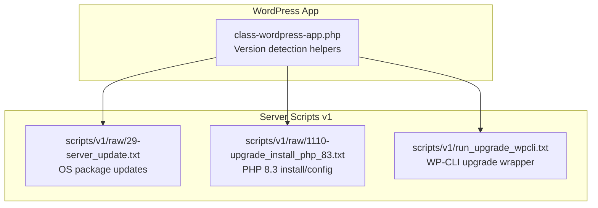
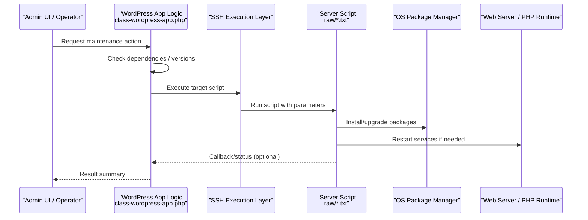
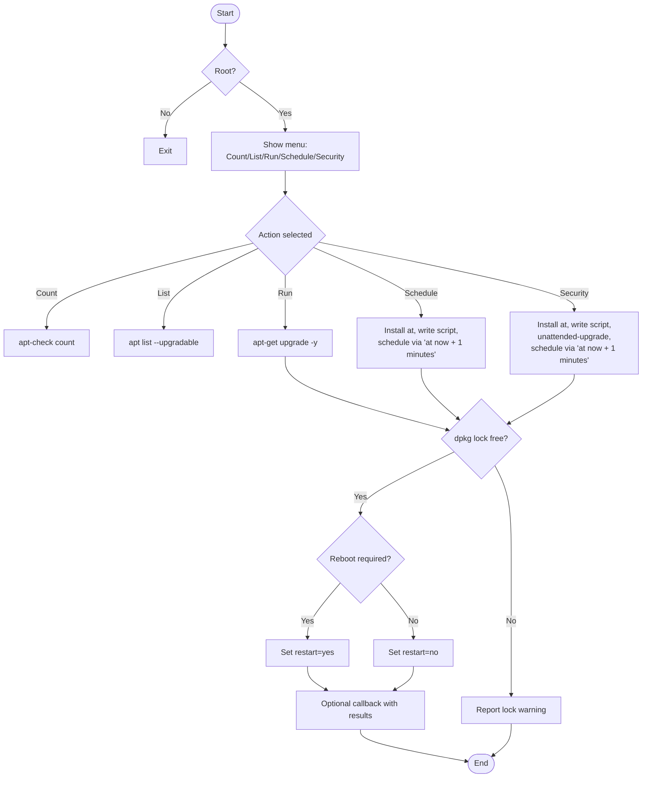
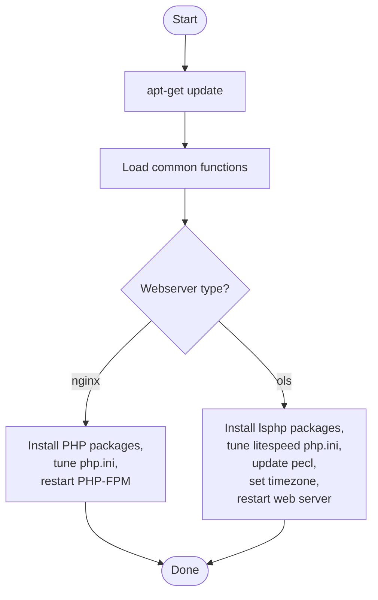
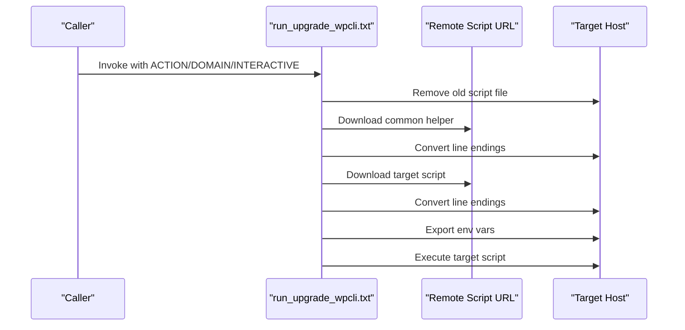
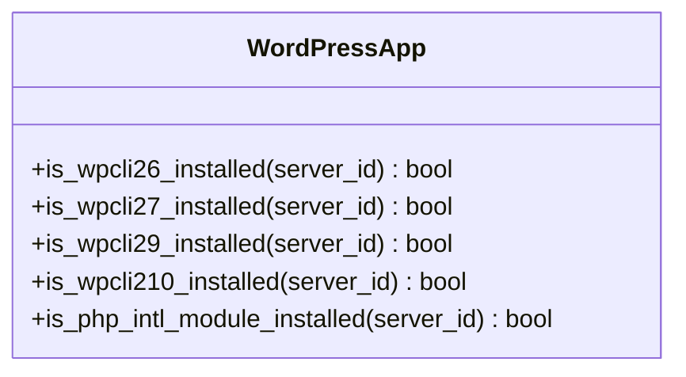
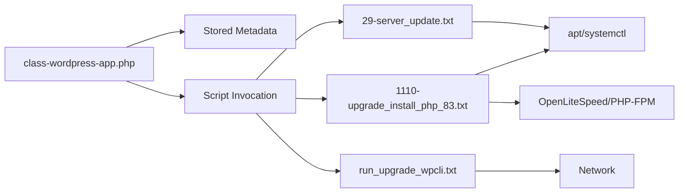

# System Maintenance & Updates

<cite>
**Referenced Files in This Document**
- [README.md](file://README.md)
- [class-wordpress-app.php](file://includes/core/apps/wordpress-app/class-wordpress-app.php)
- [run_upgrade_wpcli.txt](file://includes/core/apps/wordpress-app/scripts/v1/run_upgrade_wpcli.txt)
- [29-server_update.txt](file://includes/core/apps/wordpress-app/scripts/v1/raw/29-server_update.txt)
- [1110-upgrade_install_php_83.txt](file://includes/core/apps/wordpress-app/scripts/v1/raw/1110-upgrade_install_php_83.txt)
</cite>

## Table of Contents
1. [Introduction](#introduction)
2. [Project Structure](#project-structure)
3. [Core Components](#core-components)
4. [Architecture Overview](#architecture-overview)
5. [Detailed Component Analysis](#detailed-component-analysis)
6. [Dependency Analysis](#dependency-analysis)
7. [Performance Considerations](#performance-considerations)
8. [Troubleshooting Guide](#troubleshooting-guide)
9. [Conclusion](#conclusion)

## Introduction
This document provides comprehensive maintenance and update procedures for the system, focusing on:
- Server package updates (OS-level)
- PHP version upgrades (OpenLiteSpeed and standard PHP stacks)
- WordPress CLI maintenance
- Dependency management and compatibility checks
- Update scheduling and rollback strategies
- System health checks, log rotation, and cleanup tasks
- Custom maintenance scripts and automation patterns
- Failure recovery and stability during maintenance windows

The guidance is grounded in the repository’s provisioning scripts and application logic that orchestrate server operations over SSH.

## Project Structure
Maintenance-related functionality is primarily implemented as:
- Bash scripts under the WordPress app scripts directories for OS and PHP updates
- PHP classes that detect installed components and versions
- A wrapper script to fetch and execute remote maintenance actions

**Diagram sources**
- [class-wordpress-app.php:1450-1611](file://includes/core/apps/wordpress-app/class-wordpress-app.php#L1450-L1611)
- [29-server_update.txt:1-165](file://includes/core/apps/wordpress-app/scripts/v1/raw/29-server_update.txt#L1-L165)
- [1110-upgrade_install_php_83.txt:1-127](file://includes/core/apps/wordpress-app/scripts/v1/raw/1110-upgrade_install_php_83.txt#L1-L127)
- [run_upgrade_wpcli.txt:1-9](file://includes/core/apps/wordpress-app/scripts/v1/run_upgrade_wpcli.txt#L1-L9)

**Section sources**
- [README.md:27-38](file://README.md#L27-L38)

## Core Components
- Server package updates: Orchestrated by a bash script that lists, counts, runs, or schedules OS updates via apt, with optional callback reporting and reboot detection.
- PHP version upgrades: Dedicated scripts install and configure specific PHP versions for both OpenLiteSpeed and standard PHP stacks, including module installation and php.ini tuning.
- WordPress CLI maintenance: A wrapper downloads and executes a remote script to update WP-CLI safely.
- Compatibility checks: PHP class methods determine whether specific WP-CLI versions or PHP modules are present based on stored metadata and plugin initial versions.

Key responsibilities:
- Detect current state (versions, modules)
- Execute safe update sequences
- Provide feedback via callbacks or logs
- Support background execution and scheduling

**Section sources**
- [29-server_update.txt:1-165](file://includes/core/apps/wordpress-app/scripts/v1/raw/29-server_update.txt#L1-L165)
- [1110-upgrade_install_php_83.txt:1-127](file://includes/core/apps/wordpress-app/scripts/v1/raw/1110-upgrade_install_php_83.txt#L1-L127)
- [run_upgrade_wpcli.txt:1-9](file://includes/core/apps/wordpress-app/scripts/v1/run_upgrade_wpcli.txt#L1-L9)
- [class-wordpress-app.php:1450-1611](file://includes/core/apps/wordpress-app/class-wordpress-app.php#L1450-L1611)

## Architecture Overview
The maintenance workflow combines PHP-side decision logic with server-side Bash scripts executed over SSH. The PHP layer determines prerequisites and triggers appropriate scripts; the scripts perform OS and runtime changes and report status back when configured.

**Diagram sources**
- [class-wordpress-app.php:1450-1611](file://includes/core/apps/wordpress-app/class-wordpress-app.php#L1450-L1611)
- [29-server_update.txt:1-165](file://includes/core/apps/wordpress-app/scripts/v1/raw/29-server_update.txt#L1-L165)
- [1110-upgrade_install_php_83.txt:1-127](file://includes/core/apps/wordpress-app/scripts/v1/raw/1110-upgrade_install_php_83.txt#L1-L127)

## Detailed Component Analysis

### Server Package Updates
Purpose:
- Count pending updates
- List available updates
- Run updates immediately
- Schedule updates in background using at
- Run security-only updates in background

Key behaviors:
- Requires root privileges
- Checks dpkg lock to avoid concurrent package manager usage
- Detects reboot requirements
- Supports optional callback URL to report status and update details

Scheduling options:
- Immediate run
- Background run via at scheduler
- Security-only background run

**Diagram sources**
- [29-server_update.txt:1-165](file://includes/core/apps/wordpress-app/scripts/v1/raw/29-server_update.txt#L1-L165)

Operational notes:
- Use immediate runs during maintenance windows with low traffic.
- Prefer scheduled runs for non-critical updates outside peak hours.
- Security-only updates can be scheduled more frequently.

**Section sources**
- [29-server_update.txt:1-165](file://includes/core/apps/wordpress-app/scripts/v1/raw/29-server_update.txt#L1-L165)

### PHP Version Upgrades
Purpose:
- Install and configure specific PHP versions for both OpenLiteSpeed and standard PHP stacks
- Set performance and upload limits
- Enable opcache and timezone settings
- Restart services after configuration

Key behaviors:
- Sources common functions before proceeding
- Installs required PHP packages and extensions
- Adjusts php.ini for memory, uploads, execution time, opcache, and disable_functions
- Restarts web server or PHP-FPM as needed

**Diagram sources**
- [1110-upgrade_install_php_83.txt:1-127](file://includes/core/apps/wordpress-app/scripts/v1/raw/1110-upgrade_install_php_83.txt#L1-L127)

Compatibility considerations:
- Ensure required extensions are available for your stack.
- Validate php.ini changes align with application needs.
- Confirm service restart does not disrupt active connections.

**Section sources**
- [1110-upgrade_install_php_83.txt:1-127](file://includes/core/apps/wordpress-app/scripts/v1/raw/1110-upgrade_install_php_83.txt#L1-L127)

### WordPress CLI Maintenance
Purpose:
- Safely update WP-CLI to the latest stable version

Mechanism:
- Wrapper script downloads a common helper and the target script, ensures correct line endings, sets environment variables, and executes the script.

**Diagram sources**
- [run_upgrade_wpcli.txt:1-9](file://includes/core/apps/wordpress-app/scripts/v1/run_upgrade_wpcli.txt#L1-L9)

Best practices:
- Always validate the source URLs before execution.
- Use interactive=false for automated runs.
- Capture output for auditability.

**Section sources**
- [run_upgrade_wpcli.txt:1-9](file://includes/core/apps/wordpress-app/scripts/v1/run_upgrade_wpcli.txt#L1-L9)

### Dependency Management and Compatibility Checking
Purpose:
- Determine whether specific WP-CLI versions or PHP modules are installed on servers
- Base decisions on stored metadata and plugin initial versions

Implementation highlights:
- Methods check stored plugin initial versions and per-server upgrade flags
- Return booleans indicating presence of WP-CLI 2.6/2.7/2.8/2.9/2.10 or PHP INTL module

**Diagram sources**
- [class-wordpress-app.php:1450-1611](file://includes/core/apps/wordpress-app/class-wordpress-app.php#L1450-L1611)

Usage guidance:
- Gate feature rollouts on these checks to ensure compatibility.
- Combine with preflight validation before running upgrades.

**Section sources**
- [class-wordpress-app.php:1450-1611](file://includes/core/apps/wordpress-app/class-wordpress-app.php#L1450-L1611)

## Dependency Analysis
- PHP logic depends on stored server metadata and plugin initial versions to infer installed components.
- Bash scripts depend on OS package managers (apt), service managers (systemctl), and web server configurations (OpenLiteSpeed).
- The WP-CLI wrapper depends on network access to download helper and target scripts.

**Diagram sources**
- [class-wordpress-app.php:1450-1611](file://includes/core/apps/wordpress-app/class-wordpress-app.php#L1450-L1611)
- [29-server_update.txt:1-165](file://includes/core/apps/wordpress-app/scripts/v1/raw/29-server_update.txt#L1-L165)
- [1110-upgrade_install_php_83.txt:1-127](file://includes/core/apps/wordpress-app/scripts/v1/raw/1110-upgrade_install_php_83.txt#L1-L127)
- [run_upgrade_wpcli.txt:1-9](file://includes/core/apps/wordpress-app/scripts/v1/run_upgrade_wpcli.txt#L1-L9)

**Section sources**
- [README.md:27-38](file://README.md#L27-L38)

## Performance Considerations
- Avoid running heavy updates during peak traffic; prefer scheduled background runs.
- Limit parallelism by checking dpkg locks to prevent contention.
- Tune PHP memory and execution time conservatively during upgrades to reduce timeouts.
- Use non-interactive modes for automated runs to minimize human intervention delays.

[No sources needed since this section provides general guidance]

## Troubleshooting Guide
Common issues and resolutions:
- APT lock conflicts: Wait for other processes to finish or kill stale lock files carefully.
- Missing common functions: Ensure the common functions file exists before running PHP upgrade scripts.
- Service restart failures: Verify service names and permissions; confirm web server and PHP-FPM are enabled.
- Network errors when updating WP-CLI: Validate connectivity and certificate trust; retry with retries and logging.
- Reboot required: After critical kernel or library updates, schedule a controlled reboot post-maintenance.

Recovery steps:
- Roll back PHP version by installing the previous version and switching the active vhost configuration.
- Re-run failed update steps idempotently where possible.
- Use callbacks to capture and review update outcomes for diagnostics.

**Section sources**
- [29-server_update.txt:1-165](file://includes/core/apps/wordpress-app/scripts/v1/raw/29-server_update.txt#L1-L165)
- [1110-upgrade_install_php_83.txt:1-127](file://includes/core/apps/wordpress-app/scripts/v1/raw/1110-upgrade_install_php_83.txt#L1-L127)
- [run_upgrade_wpcli.txt:1-9](file://includes/core/apps/wordpress-app/scripts/v1/run_upgrade_wpcli.txt#L1-L9)

## Conclusion
The system’s maintenance model relies on clear separation between PHP-side orchestration and server-side Bash scripts. By leveraging dependency checks, scheduled updates, and robust error handling, operators can maintain system stability while performing routine updates. Follow the procedures outlined here to manage server packages, PHP versions, and WP-CLI safely, and use the provided patterns to build custom maintenance scripts tailored to your environment.

[No sources needed since this section summarizes without analyzing specific files]