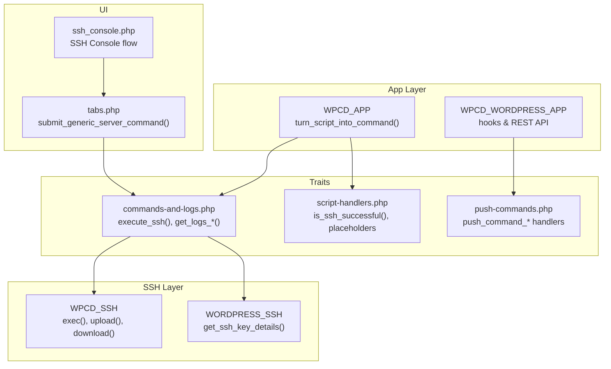
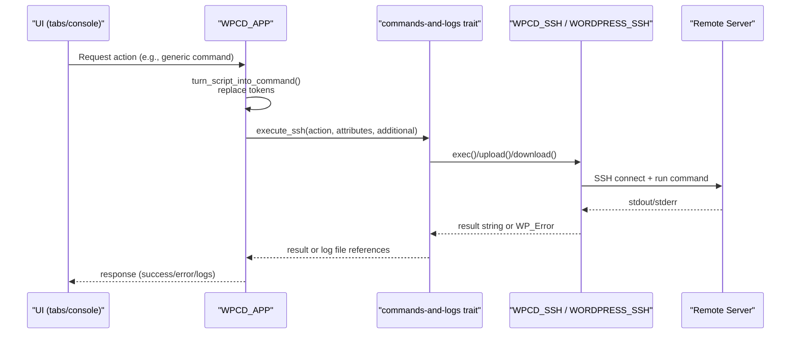
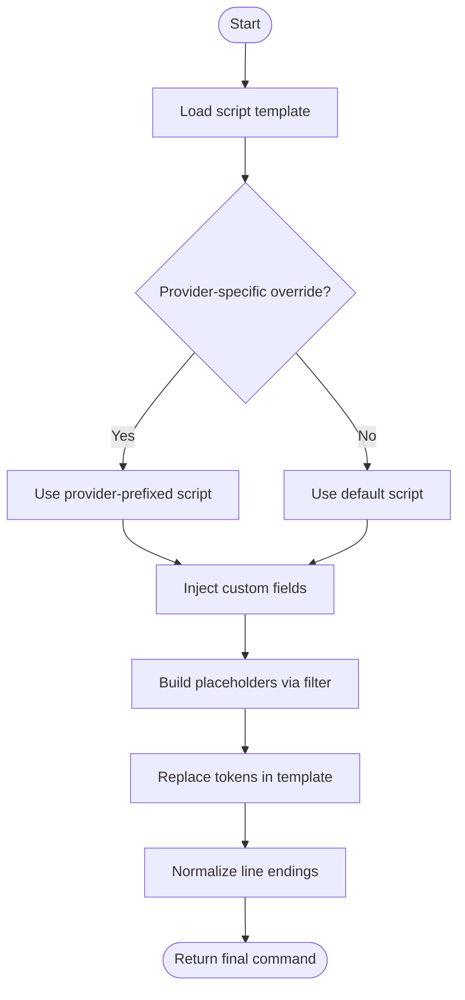
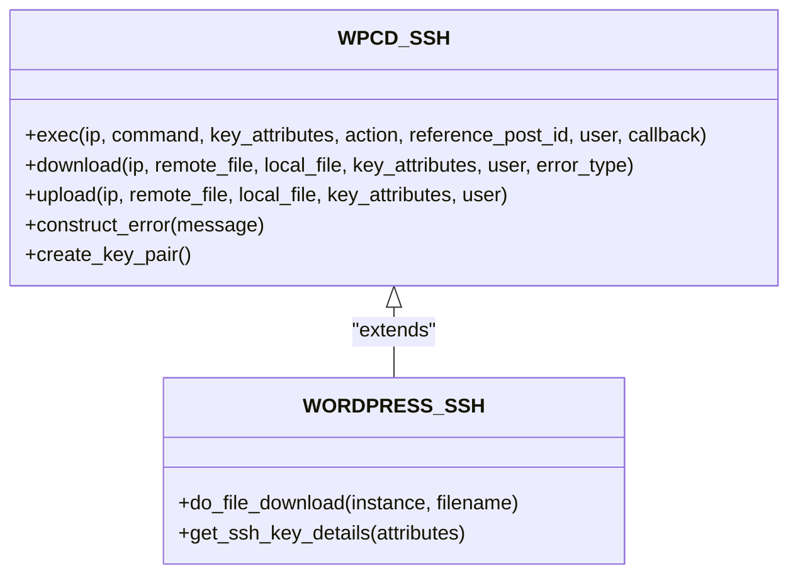
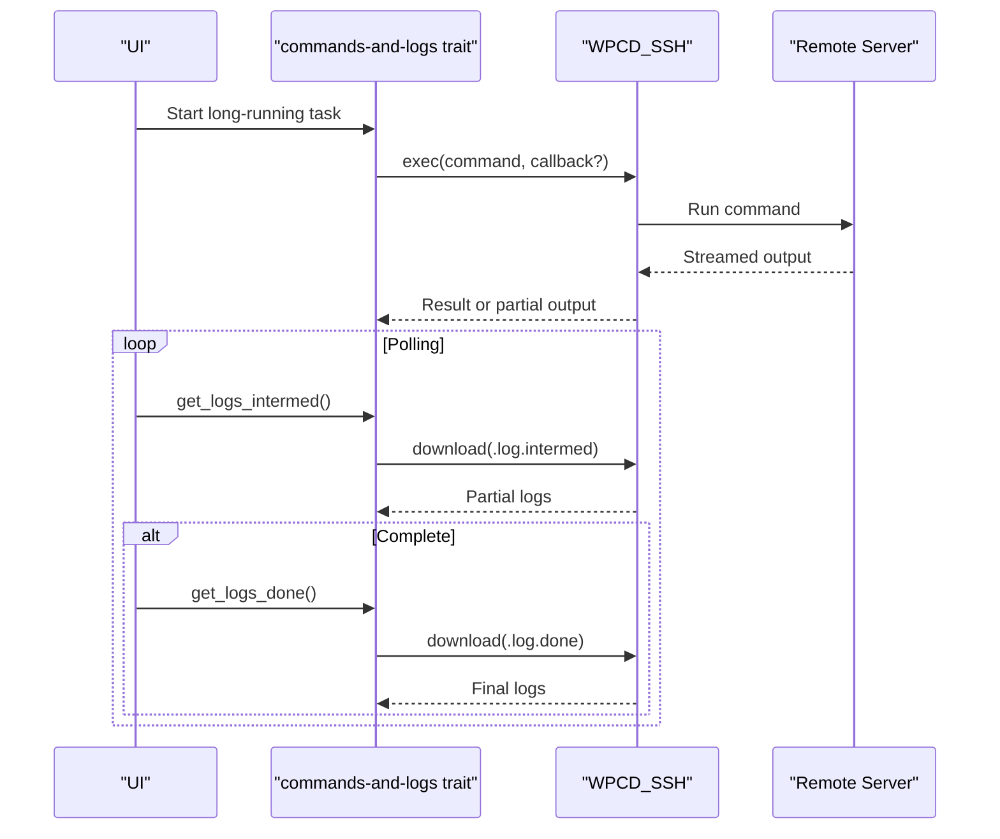
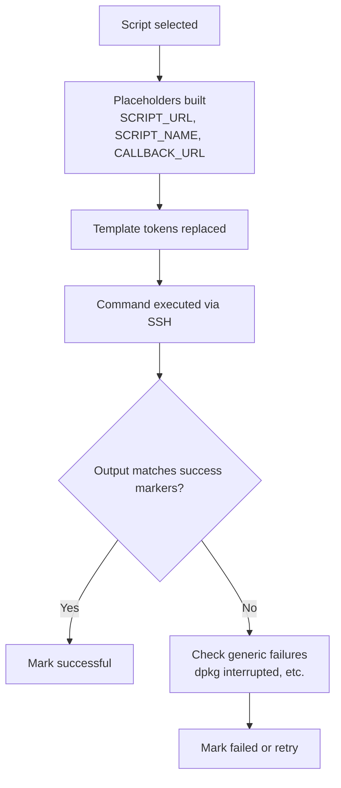
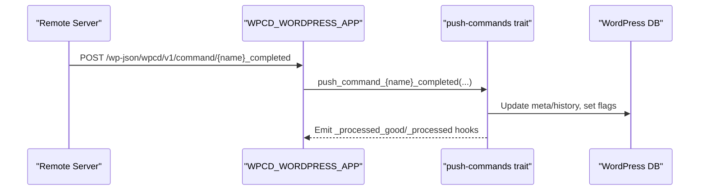
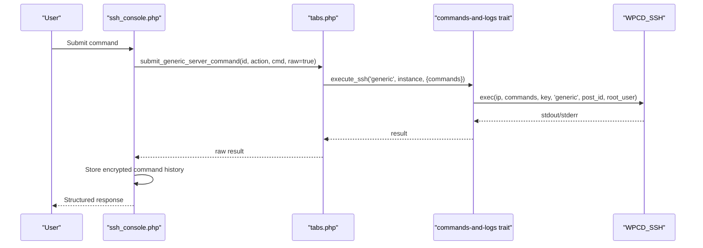
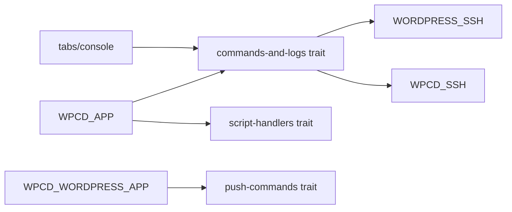

# Script Execution Engine

<cite>
**Referenced Files in This Document**
- [class-wpcd-app.php](file://includes/core/apps/class-wpcd-app.php)
- [commands-and-logs.php](file://includes/core/apps/wordpress-app/traits/traits-for-class-wordpress-app/commands-and-logs.php)
- [script-handlers.php](file://includes/core/apps/wordpress-app/traits/traits-for-class-wordpress-app/script-handlers.php)
- [push-commands.php](file://includes/core/apps/wordpress-app/traits/traits-for-class-wordpress-app/push-commands.php)
- [class-wpcd-ssh.php](file://includes/core/apps/class-wpcd-ssh.php)
- [class-wordpress-ssh.php](file://includes/core/apps/wordpress-app/class-wordpress-ssh.php)
- [tabs.php](file://includes/core/apps/wordpress-app/tabs/tabs.php)
- [ssh_console.php](file://includes/core/apps/wordpress-app/tabs-server/ssh_console.php)
- [class-wordpress-app.php](file://includes/core/apps/wordpress-app/class-wordpress-app.php)
</cite>

## Table of Contents
1. [Introduction](#introduction)
2. [Project Structure](#project-structure)
3. [Core Components](#core-components)
4. [Architecture Overview](#architecture-overview)
5. [Detailed Component Analysis](#detailed-component-analysis)
6. [Dependency Analysis](#dependency-analysis)
7. [Performance Considerations](#performance-considerations)
8. [Troubleshooting Guide](#troubleshooting-guide)
9. [Conclusion](#conclusion)
10. [Appendices](#appendices)

## Introduction
This document explains the script execution engine that manages the lifecycle of shell scripts across remote servers. It covers:
- Command queuing and background processing
- SSH connection management and SFTP operations
- Asynchronous execution patterns with callbacks and progress tracking
- Script handler architecture, including pre/post hooks, environment variable injection, and output capture
- Push commands system for inbound server-to-host notifications
- Security considerations, credential management, and audit logging

## Project Structure
The engine is implemented as a set of PHP classes and traits within the WordPress application layer:
- Base app class provides command construction and token replacement
- Traits implement SSH orchestration, script handling, and push command handlers
- Dedicated SSH classes encapsulate connection and transport logic
- Tabs provide UI entry points to execute generic commands and manage console history

**Diagram sources**
- [class-wpcd-app.php:1408-1468](file://includes/core/apps/class-wpcd-app.php#L1408-L1468)
- [commands-and-logs.php:269-310](file://includes/core/apps/wordpress-app/traits/traits-for-class-wordpress-app/commands-and-logs.php#L269-L310)
- [script-handlers.php:23-800](file://includes/core/apps/wordpress-app/traits/traits-for-class-wordpress-app/script-handlers.php#L23-L800)
- [push-commands.php:33-176](file://includes/core/apps/wordpress-app/traits/traits-for-class-wordpress-app/push-commands.php#L33-L176)
- [class-wpcd-ssh.php:45-151](file://includes/core/apps/class-wpcd-ssh.php#L45-L151)
- [class-wordpress-ssh.php:78-136](file://includes/core/apps/wordpress-app/class-wordpress-ssh.php#L78-L136)
- [tabs.php:107-132](file://includes/core/apps/wordpress-app/tabs/tabs.php#L107-L132)
- [ssh_console.php:351-406](file://includes/core/apps/wordpress-app/tabs-server/ssh_console.php#L351-L406)

**Section sources**
- [class-wpcd-app.php:1408-1468](file://includes/core/apps/class-wpcd-app.php#L1408-L1468)
- [commands-and-logs.php:269-310](file://includes/core/apps/wordpress-app/traits/traits-for-class-wordpress-app/commands-and-logs.php#L269-L310)
- [script-handlers.php:23-800](file://includes/core/apps/wordpress-app/traits/traits-for-class-wordpress-app/script-handlers.php#L23-L800)
- [push-commands.php:33-176](file://includes/core/apps/wordpress-app/traits/traits-for-class-wordpress-app/push-commands.php#L33-L176)
- [class-wpcd-ssh.php:45-151](file://includes/core/apps/class-wpcd-ssh.php#L45-L151)
- [class-wordpress-ssh.php:78-136](file://includes/core/apps/wordpress-app/class-wordpress-ssh.php#L78-L136)
- [tabs.php:107-132](file://includes/core/apps/wordpress-app/tabs/tabs.php#L107-L132)
- [ssh_console.php:351-406](file://includes/core/apps/wordpress-app/tabs-server/ssh_console.php#L351-L406)

## Core Components
- WPCD_APP: Builds final shell commands from templates, replaces tokens, and applies filters for customization.
- commands-and-logs.php (trait): Orchestrates SSH execution, logs intermediate/done files, and defers background actions.
- script-handlers.php (trait): Determines success based on script output and defines placeholder mappings for scripts.
- push-commands.php (trait): Handles inbound server status, site status, apt-get status, posttypes, malware scans, restarts, monit alerts, and backups.
- WPCD_SSH: Encapsulates SSH/SFTP operations, timeouts, error formatting, and key pair generation.
- WORDPRESS_SSH: Resolves SSH credentials and IP from server/provider data.
- tabs.php: Provides submit_generic_server_command for ad-hoc command execution via UI.
- ssh_console.php: Implements an interactive SSH console flow with command history.

**Section sources**
- [class-wpcd-app.php:1408-1468](file://includes/core/apps/class-wpcd-app.php#L1408-L1468)
- [commands-and-logs.php:269-310](file://includes/core/apps/wordpress-app/traits/traits-for-class-wordpress-app/commands-and-logs.php#L269-L310)
- [script-handlers.php:23-800](file://includes/core/apps/wordpress-app/traits/traits-for-class-wordpress-app/script-handlers.php#L23-L800)
- [push-commands.php:33-176](file://includes/core/apps/wordpress-app/traits/traits-for-class-wordpress-app/push-commands.php#L33-L176)
- [class-wpcd-ssh.php:45-151](file://includes/core/apps/class-wpcd-ssh.php#L45-L151)
- [class-wordpress-ssh.php:78-136](file://includes/core/apps/wordpress-app/class-wordpress-ssh.php#L78-L136)
- [tabs.php:107-132](file://includes/core/apps/wordpress-app/tabs/tabs.php#L107-L132)
- [ssh_console.php:351-406](file://includes/core/apps/wordpress-app/tabs-server/ssh_console.php#L351-L406)

## Architecture Overview
The engine composes multiple layers:
- UI triggers actions (tabs or console).
- App layer builds and injects variables into shell scripts.
- Trait layer executes commands over SSH and captures logs.
- SSH layer handles authentication, timeouts, and transport.
- Push handlers process inbound callbacks from remote servers.

**Diagram sources**
- [class-wpcd-app.php:1408-1468](file://includes/core/apps/class-wpcd-app.php#L1408-L1468)
- [commands-and-logs.php:269-310](file://includes/core/apps/wordpress-app/traits/traits-for-class-wordpress-app/commands-and-logs.php#L269-L310)
- [class-wpcd-ssh.php:45-151](file://includes/core/apps/class-wpcd-ssh.php#L45-L151)

## Detailed Component Analysis

### Command Construction and Token Replacement
- The base app constructs the final command by loading script templates, applying provider-specific overrides, injecting custom fields, and replacing placeholders.
- Placeholders are provided by app-specific handlers and can include SCRIPT_URL, SCRIPT_NAME, CALLBACK_URL, and more.

**Diagram sources**
- [class-wpcd-app.php:1408-1468](file://includes/core/apps/class-wpcd-app.php#L1408-L1468)
- [script-handlers.php:1697-1739](file://includes/core/apps/wordpress-app/traits/traits-for-class-wordpress-app/script-handlers.php#L1697-L1739)

**Section sources**
- [class-wpcd-app.php:1408-1468](file://includes/core/apps/class-wpcd-app.php#L1408-L1468)
- [script-handlers.php:1697-1739](file://includes/core/apps/wordpress-app/traits/traits-for-class-wordpress-app/script-handlers.php#L1697-L1739)

### SSH Connection Management and Execution
- Credentials are resolved per server/provider using WORDPRESS_SSH::get_ssh_key_details().
- WPCD_SSH::exec() establishes SSH connections, sets timeouts, runs commands, logs results, and returns captured output.
- SFTP methods support upload/download with consistent error handling.

**Diagram sources**
- [class-wpcd-ssh.php:45-151](file://includes/core/apps/class-wpcd-ssh.php#L45-L151)
- [class-wpcd-ssh.php:165-244](file://includes/core/apps/class-wpcd-ssh.php#L165-L244)
- [class-wordpress-ssh.php:35-62](file://includes/core/apps/wordpress-app/class-wordpress-ssh.php#L35-L62)
- [class-wordpress-ssh.php:78-136](file://includes/core/apps/wordpress-app/class-wordpress-ssh.php#L78-L136)

**Section sources**
- [class-wpcd-ssh.php:45-151](file://includes/core/apps/class-wpcd-ssh.php#L45-L151)
- [class-wpcd-ssh.php:165-244](file://includes/core/apps/class-wpcd-ssh.php#L165-L244)
- [class-wordpress-ssh.php:35-62](file://includes/core/apps/wordpress-app/class-wordpress-ssh.php#L35-L62)
- [class-wordpress-ssh.php:78-136](file://includes/core/apps/wordpress-app/class-wordpress-ssh.php#L78-L136)

### Asynchronous Execution Patterns and Progress Tracking
- Intermediate and done log files are polled to track progress and completion.
- Deferred actions are processed in background cycles, enabling long-running tasks without blocking web requests.

**Diagram sources**
- [commands-and-logs.php:364-432](file://includes/core/apps/wordpress-app/traits/traits-for-class-wordpress-app/commands-and-logs.php#L364-L432)
- [commands-and-logs.php:445-459](file://includes/core/apps/wordpress-app/traits/traits-for-class-wordpress-app/commands-and-logs.php#L445-L459)

**Section sources**
- [commands-and-logs.php:364-432](file://includes/core/apps/wordpress-app/traits/traits-for-class-wordpress-app/commands-and-logs.php#L364-L432)
- [commands-and-logs.php:445-459](file://includes/core/apps/wordpress-app/traits/traits-for-class-wordpress-app/commands-and-logs.php#L445-L459)

### Script Handler Architecture (Pre/Post Hooks, Environment Injection, Output Capture)
- Pre-execution: Placeholder mapping adds SCRIPT_URL, SCRIPT_NAME, CALLBACK_URL, and other environment variables.
- Post-execution: Success detection inspects output strings for expected markers; generic failure checks avoid false positives.
- Output capture: SSH exec returns captured stdout; logs are downloaded via SFTP for progress and completion.

**Diagram sources**
- [script-handlers.php:23-800](file://includes/core/apps/wordpress-app/traits/traits-for-class-wordpress-app/script-handlers.php#L23-L800)
- [script-handlers.php:1697-1739](file://includes/core/apps/wordpress-app/traits/traits-for-class-wordpress-app/script-handlers.php#L1697-L1739)

**Section sources**
- [script-handlers.php:23-800](file://includes/core/apps/wordpress-app/traits/traits-for-class-wordpress-app/script-handlers.php#L23-L800)
- [script-handlers.php:1697-1739](file://includes/core/apps/wordpress-app/traits/traits-for-class-wordpress-app/script-handlers.php#L1697-L1739)

### Push Commands System (Inbound Notifications)
- Handlers receive server-side reports via HTTP callbacks and update server/site metadata, histories, and notifications.
- Examples include server status, sites status, apt-get status, posttypes, malware scan results, restart events, monit alerts, and backup lifecycle.

**Diagram sources**
- [class-wordpress-app.php:133-148](file://includes/core/apps/wordpress-app/class-wordpress-app.php#L133-L148)
- [push-commands.php:33-176](file://includes/core/apps/wordpress-app/traits/traits-for-class-wordpress-app/push-commands.php#L33-L176)
- [push-commands.php:190-299](file://includes/core/apps/wordpress-app/traits/traits-for-class-wordpress-app/push-commands.php#L190-L299)
- [push-commands.php:406-470](file://includes/core/apps/wordpress-app/traits/traits-for-class-wordpress-app/push-commands.php#L406-L470)
- [push-commands.php:541-603](file://includes/core/apps/wordpress-app/traits/traits-for-class-wordpress-app/push-commands.php#L541-L603)
- [push-commands.php:617-680](file://includes/core/apps/wordpress-app/traits/traits-for-class-wordpress-app/push-commands.php#L617-L680)
- [push-commands.php:694-750](file://includes/core/apps/wordpress-app/traits/traits-for-class-wordpress-app/push-commands.php#L694-L750)
- [push-commands.php:765-800](file://includes/core/apps/wordpress-app/traits/traits-for-class-wordpress-app/push-commands.php#L765-L800)

**Section sources**
- [class-wordpress-app.php:133-148](file://includes/core/apps/wordpress-app/class-wordpress-app.php#L133-L148)
- [push-commands.php:33-176](file://includes/core/apps/wordpress-app/traits/traits-for-class-wordpress-app/push-commands.php#L33-L176)
- [push-commands.php:190-299](file://includes/core/apps/wordpress-app/traits/traits-for-class-wordpress-app/push-commands.php#L190-L299)
- [push-commands.php:406-470](file://includes/core/apps/wordpress-app/traits/traits-for-class-wordpress-app/push-commands.php#L406-L470)
- [push-commands.php:541-603](file://includes/core/apps/wordpress-app/traits/traits-for-class-wordpress-app/push-commands.php#L541-L603)
- [push-commands.php:617-680](file://includes/core/apps/wordpress-app/traits/traits-for-class-wordpress-app/push-commands.php#L617-L680)
- [push-commands.php:694-750](file://includes/core/apps/wordpress-app/traits/traits-for-class-wordpress-app/push-commands.php#L694-L750)
- [push-commands.php:765-800](file://includes/core/apps/wordpress-app/traits/traits-for-class-wordpress-app/push-commands.php#L765-L800)

### Generic Command Submission and SSH Console Flow
- Generic commands are submitted through a helper that resolves instance details and calls execute_ssh('generic', ...).
- The SSH console parses raw input safely, executes commands, records history, and returns structured responses.

**Diagram sources**
- [ssh_console.php:351-406](file://includes/core/apps/wordpress-app/tabs-server/ssh_console.php#L351-L406)
- [tabs.php:107-132](file://includes/core/apps/wordpress-app/tabs/tabs.php#L107-L132)
- [commands-and-logs.php:269-310](file://includes/core/apps/wordpress-app/traits/traits-for-class-wordpress-app/commands-and-logs.php#L269-L310)
- [class-wpcd-ssh.php:45-151](file://includes/core/apps/class-wpcd-ssh.php#L45-L151)

**Section sources**
- [ssh_console.php:351-406](file://includes/core/apps/wordpress-app/tabs-server/ssh_console.php#L351-L406)
- [tabs.php:107-132](file://includes/core/apps/wordpress-app/tabs/tabs.php#L107-L132)
- [commands-and-logs.php:269-310](file://includes/core/apps/wordpress-app/traits/traits-for-class-wordpress-app/commands-and-logs.php#L269-L310)
- [class-wpcd-ssh.php:45-151](file://includes/core/apps/class-wpcd-ssh.php#L45-L151)

## Dependency Analysis
- WPCD_APP depends on traits for SSH orchestration and script handling.
- commands-and-logs trait depends on WORDPRESS_SSH for credential resolution and WPCD_SSH for transport.
- push-commands trait relies on WPCD_WORDPRESS_APP hooks to route inbound callbacks.
- UI components depend on tabs helper which delegates to execute_ssh.

**Diagram sources**
- [class-wpcd-app.php:1408-1468](file://includes/core/apps/class-wpcd-app.php#L1408-L1468)
- [commands-and-logs.php:269-310](file://includes/core/apps/wordpress-app/traits/traits-for-class-wordpress-app/commands-and-logs.php#L269-L310)
- [script-handlers.php:23-800](file://includes/core/apps/wordpress-app/traits/traits-for-class-wordpress-app/script-handlers.php#L23-L800)
- [push-commands.php:33-176](file://includes/core/apps/wordpress-app/traits/traits-for-class-wordpress-app/push-commands.php#L33-L176)
- [class-wordpress-ssh.php:78-136](file://includes/core/apps/wordpress-app/class-wordpress-ssh.php#L78-L136)
- [class-wpcd-ssh.php:45-151](file://includes/core/apps/class-wpcd-ssh.php#L45-L151)
- [tabs.php:107-132](file://includes/core/apps/wordpress-app/tabs/tabs.php#L107-L132)

**Section sources**
- [class-wpcd-app.php:1408-1468](file://includes/core/apps/class-wpcd-app.php#L1408-L1468)
- [commands-and-logs.php:269-310](file://includes/core/apps/wordpress-app/traits/traits-for-class-wordpress-app/commands-and-logs.php#L269-L310)
- [script-handlers.php:23-800](file://includes/core/apps/wordpress-app/traits/traits-for-class-wordpress-app/script-handlers.php#L23-L800)
- [push-commands.php:33-176](file://includes/core/apps/wordpress-app/traits/traits-for-class-wordpress-app/push-commands.php#L33-L176)
- [class-wordpress-ssh.php:78-136](file://includes/core/apps/wordpress-app/class-wordpress-ssh.php#L78-L136)
- [class-wpcd-ssh.php:45-151](file://includes/core/apps/class-wpcd-ssh.php#L45-L151)
- [tabs.php:107-132](file://includes/core/apps/wordpress-app/tabs/tabs.php#L107-L132)

## Performance Considerations
- Timeouts: SSH timeout adapts to PHP max_execution_time when no callback is used; shorter timeouts are applied when callbacks are present to improve responsiveness.
- Web server limits: Comments indicate configuring fastcgi/proxy timeouts to match long-running tasks.
- Background processing: Deferred actions allow offloading work to cron-like cycles, reducing request latency.
- Logging: Intermediate and done logs enable efficient polling without heavy payloads.

[No sources needed since this section provides general guidance]

## Troubleshooting Guide
- Authentication failures: Check SSH key resolution and provider settings; errors are logged and formatted for display.
- No output: Some commands produce no stdout; append echo statements to ensure feedback.
- Lock conflicts: Certain package managers return lock errors; handle accordingly.
- Log retrieval: If .log.intermed is missing, fallback to .log.done; login issues yield specific messages.
- Push endpoints: Validate incoming parameters and sanitize inputs; check action routing and hook registration.

**Section sources**
- [class-wpcd-ssh.php:45-151](file://includes/core/apps/class-wpcd-ssh.php#L45-L151)
- [commands-and-logs.php:364-432](file://includes/core/apps/wordpress-app/traits/traits-for-class-wordpress-app/commands-and-logs.php#L364-L432)

## Conclusion
The script execution engine provides a robust, extensible framework for managing remote shell scripts. It combines secure SSH operations, flexible command construction, asynchronous execution, and comprehensive inbound callback handling. By leveraging traits and hooks, it supports rich customization while maintaining clear separation of concerns across UI, app logic, and transport layers.

[No sources needed since this section summarizes without analyzing specific files]

## Appendices

### Adding Custom Script Handlers
- Extend placeholder mapping to include new variables like SCRIPT_URL, SCRIPT_NAME, CALLBACK_URL, and any environment variables required by your script.
- Implement success detection in is_ssh_successful for your script’s expected output markers.

**Section sources**
- [script-handlers.php:1697-1739](file://includes/core/apps/wordpress-app/traits/traits-for-class-wordpress-app/script-handlers.php#L1697-L1739)
- [script-handlers.php:23-800](file://includes/core/apps/wordpress-app/traits/traits-for-class-wordpress-app/script-handlers.php#L23-L800)

### Implementing Retry Logic
- Wrap execute_ssh calls with retry loops, honoring exponential backoff and respecting SSH timeouts.
- For long-running tasks, rely on deferred actions and log polling rather than immediate retries.

**Section sources**
- [commands-and-logs.php:269-310](file://includes/core/apps/wordpress-app/traits/traits-for-class-wordpress-app/commands-and-logs.php#L269-L310)
- [class-wpcd-ssh.php:68-93](file://includes/core/apps/class-wpcd-ssh.php#L68-L93)

### Monitoring Script Execution in Real-Time
- Poll get_logs_intermed during execution to stream progress.
- On completion, fetch get_logs_done to retrieve final logs.

**Section sources**
- [commands-and-logs.php:364-432](file://includes/core/apps/wordpress-app/traits/traits-for-class-wordpress-app/commands-and-logs.php#L364-L432)

### Security Considerations and Credential Management
- Use SSH keys loaded via PublicKeyLoader; never store plaintext private keys.
- Sanitize all inbound parameters in push handlers; validate post types and IDs.
- Audit logging: All SSH attempts and results are logged; use these logs for compliance and troubleshooting.

**Section sources**
- [class-wpcd-ssh.php:45-151](file://includes/core/apps/class-wpcd-ssh.php#L45-L151)
- [push-commands.php:33-176](file://includes/core/apps/wordpress-app/traits/traits-for-class-wordpress-app/push-commands.php#L33-L176)