# Operational Management Scripts

<cite>
**Referenced Files in This Document**
- [backup_restore.txt](file://includes/core/apps/wordpress-app/scripts/v1/backup_restore.txt)
- [fail2ban.txt](file://includes/core/apps/wordpress-app/scripts/v1/fail2ban.txt)
- [monit.txt](file://includes/core/apps/wordpress-app/scripts/v1/monit.txt)
- [netdata.txt](file://includes/core/apps/wordpress-app/scripts/v1/netdata.txt)
- [install_redis.txt](file://includes/core/apps/wordpress-app/scripts/v1/install_redis.txt)
- [install_memcached.txt](file://includes/core/apps/wordpress-app/scripts/v1/install_memcached.txt)
- [renew_all_certificates.txt](file://includes/core/apps/wordpress-app/scripts/v1/renew_all_certificates.txt)
- [6g_firewall.txt](file://includes/core/apps/wordpress-app/scripts/v1/6g_firewall.txt)
- [7g_firewall.txt](file://includes/core/apps/wordpress-app/scripts/v1/7g_firewall.txt)
- [server_update.txt](file://includes/core/apps/wordpress-app/scripts/v1/server_update.txt)
- [site_sync_origin_setup.txt](file://includes/core/apps/wordpress-app/scripts/v1/site_sync_origin_setup.txt)
- [site_sync_destination_setup.txt](file://includes/core/apps/wordpress-app/scripts/v1/site_sync_destination_setup.txt)
- [site_sync.txt](file://includes/core/apps/wordpress-app/scripts/v1/site_sync.txt)
- [manage_redis.txt](file://includes/core/apps/wordpress-app/scripts/v1/manage_redis.txt)
- [manage_memcached.txt](file://includes/core/apps/wordpress-app/scripts/v1/manage_memcached.txt)
- [manage_https.txt](file://includes/core/apps/wordpress-app/scripts/v1/manage_https.txt)
- [backup_config_files.txt](file://includes/core/apps/wordpress-app/scripts/v1/backup_config_files.txt)
- [backup_restore_schedule.txt](file://includes/core/apps/wordpress-app/scripts/v1/backup_restore_schedule.txt)
- [backup_restore_save_credentials.txt](file://includes/core/apps/wordpress-app/scripts/v1/backup_restore_save_credentials.txt)
- [backup_restore_refresh_backup_list.txt](file://includes/core/apps/wordpress-app/scripts/v1/backup_restore_refresh_backup_list.txt)
- [backup_restore_delete_and_prune.txt](file://includes/core/apps/wordpress-app/scripts/v1/backup_restore_delete_and_prune.txt)
- [backup_restore_delete_and_prune_server.txt](file://includes/core/apps/wordpress-app/scripts/v1/backup_restore_delete_and_prune_server.txt)
</cite>

## Table of Contents
1. [Introduction](#introduction)
2. [Project Structure](#project-structure)
3. [Core Components](#core-components)
4. [Architecture Overview](#architecture-overview)
5. [Detailed Component Analysis](#detailed-component-analysis)
6. [Dependency Analysis](#dependency-analysis)
7. [Performance Considerations](#performance-considerations)
8. [Troubleshooting Guide](#troubleshooting-guide)
9. [Conclusion](#conclusion)
10. [Appendices](#appendices)

## Introduction
This document explains the operational management scripts that handle ongoing server maintenance, security, and monitoring tasks. It focuses on:
- Backup and restore operations (database dumps, file synchronization, cloud storage integration)
- Firewall management with 6G/7G rules
- Intrusion detection using fail2ban
- Monitoring setup with Monit and Netdata
- Cache management for Redis and Memcached
- SSL certificate renewal processes
- Automated security updates
It also provides guidance for creating custom operational scripts, integrating third-party tools, and configuring alerting and notification systems.

## Project Structure
Operational scripts are organized under the WordPress app scripts directory. Each script is a self-contained unit invoked by the application to perform specific maintenance or configuration tasks. Key areas include:
- Security: firewall rules, intrusion detection, HTTPS management
- Backups: database dumps, file sync, scheduling, credential management, retention policies
- Monitoring: system health via Monit and Netdata
- Caching: Redis and Memcached installation and management
- Maintenance: automated updates and certificate renewals

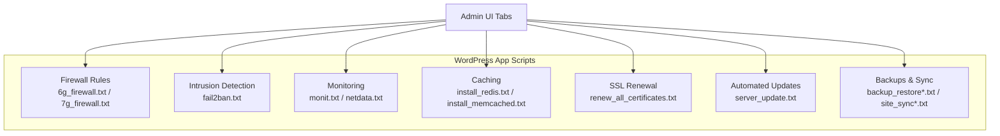

**Diagram sources**
- [6g_firewall.txt:1-50](file://includes/core/apps/wordpress-app/scripts/v1/6g_firewall.txt#L1-L50)
- [7g_firewall.txt:1-50](file://includes/core/apps/wordpress-app/scripts/v1/7g_firewall.txt#L1-L50)
- [fail2ban.txt:1-50](file://includes/core/apps/wordpress-app/scripts/v1/fail2ban.txt#L1-L50)
- [monit.txt:1-50](file://includes/core/apps/wordpress-app/scripts/v1/monit.txt#L1-L50)
- [netdata.txt:1-50](file://includes/core/apps/wordpress-app/scripts/v1/netdata.txt#L1-L50)
- [install_redis.txt:1-50](file://includes/core/apps/wordpress-app/scripts/v1/install_redis.txt#L1-L50)
- [install_memcached.txt:1-50](file://includes/core/apps/wordpress-app/scripts/v1/install_memcached.txt#L1-L50)
- [renew_all_certificates.txt:1-50](file://includes/core/apps/wordpress-app/scripts/v1/renew_all_certificates.txt#L1-L50)
- [server_update.txt:1-50](file://includes/core/apps/wordpress-app/scripts/v1/server_update.txt#L1-L50)
- [backup_restore.txt:1-50](file://includes/core/apps/wordpress-app/scripts/v1/backup_restore.txt#L1-L50)
- [site_sync_origin_setup.txt:1-50](file://includes/core/apps/wordpress-app/scripts/v1/site_sync_origin_setup.txt#L1-L50)
- [site_sync_destination_setup.txt:1-50](file://includes/core/apps/wordpress-app/scripts/v1/site_sync_destination_setup.txt#L1-L50)

**Section sources**
- [6g_firewall.txt:1-50](file://includes/core/apps/wordpress-app/scripts/v1/6g_firewall.txt#L1-L50)
- [7g_firewall.txt:1-50](file://includes/core/apps/wordpress-app/scripts/v1/7g_firewall.txt#L1-L50)
- [fail2ban.txt:1-50](file://includes/core/apps/wordpress-app/scripts/v1/fail2ban.txt#L1-L50)
- [monit.txt:1-50](file://includes/core/apps/wordpress-app/scripts/v1/monit.txt#L1-L50)
- [netdata.txt:1-50](file://includes/core/apps/wordpress-app/scripts/v1/netdata.txt#L1-L50)
- [install_redis.txt:1-50](file://includes/core/apps/wordpress-app/scripts/v1/install_redis.txt#L1-L50)
- [install_memcached.txt:1-50](file://includes/core/apps/wordpress-app/scripts/v1/install_memcached.txt#L1-L50)
- [renew_all_certificates.txt:1-50](file://includes/core/apps/wordpress-app/scripts/v1/renew_all_certificates.txt#L1-L50)
- [server_update.txt:1-50](file://includes/core/apps/wordpress-app/scripts/v1/server_update.txt#L1-L50)
- [backup_restore.txt:1-50](file://includes/core/apps/wordpress-app/scripts/v1/backup_restore.txt#L1-L50)
- [site_sync_origin_setup.txt:1-50](file://includes/core/apps/wordpress-app/scripts/v1/site_sync_origin_setup.txt#L1-L50)
- [site_sync_destination_setup.txt:1-50](file://includes/core/apps/wordpress-app/scripts/v1/site_sync_destination_setup.txt#L1-L50)

## Core Components
- Backup and Restore: Orchestrates database dumps, file backups, remote storage credentials, scheduled jobs, and retention pruning.
- Firewall Management: Applies and upgrades 6G/7G rule sets to harden HTTP traffic.
- Intrusion Detection: Installs and configures fail2ban to block malicious IPs based on logs.
- Monitoring: Sets up Monit for service health checks and Netdata for real-time metrics.
- Cache Management: Installs and manages Redis and Memcached services and PHP integrations.
- SSL Certificate Renewal: Automates certificate lifecycle management.
- Automated Updates: Performs secure system and package updates.

**Section sources**
- [backup_restore.txt:1-50](file://includes/core/apps/wordpress-app/scripts/v1/backup_restore.txt#L1-L50)
- [6g_firewall.txt:1-50](file://includes/core/apps/wordpress-app/scripts/v1/6g_firewall.txt#L1-L50)
- [7g_firewall.txt:1-50](file://includes/core/apps/wordpress-app/scripts/v1/7g_firewall.txt#L1-L50)
- [fail2ban.txt:1-50](file://includes/core/apps/wordpress-app/scripts/v1/fail2ban.txt#L1-L50)
- [monit.txt:1-50](file://includes/core/apps/wordpress-app/scripts/v1/monit.txt#L1-L50)
- [netdata.txt:1-50](file://includes/core/apps/wordpress-app/scripts/v1/netdata.txt#L1-L50)
- [install_redis.txt:1-50](file://includes/core/apps/wordpress-app/scripts/v1/install_redis.txt#L1-L50)
- [install_memcached.txt:1-50](file://includes/core/apps/wordpress-app/scripts/v1/install_memcached.txt#L1-L50)
- [renew_all_certificates.txt:1-50](file://includes/core/apps/wordpress-app/scripts/v1/renew_all_certificates.txt#L1-L50)
- [server_update.txt:1-50](file://includes/core/apps/wordpress-app/scripts/v1/server_update.txt#L1-L50)

## Architecture Overview
The operational scripts are invoked by the application’s admin UI tabs and background task runners. They execute privileged commands on the target server to configure services, manage data, and enforce security policies.

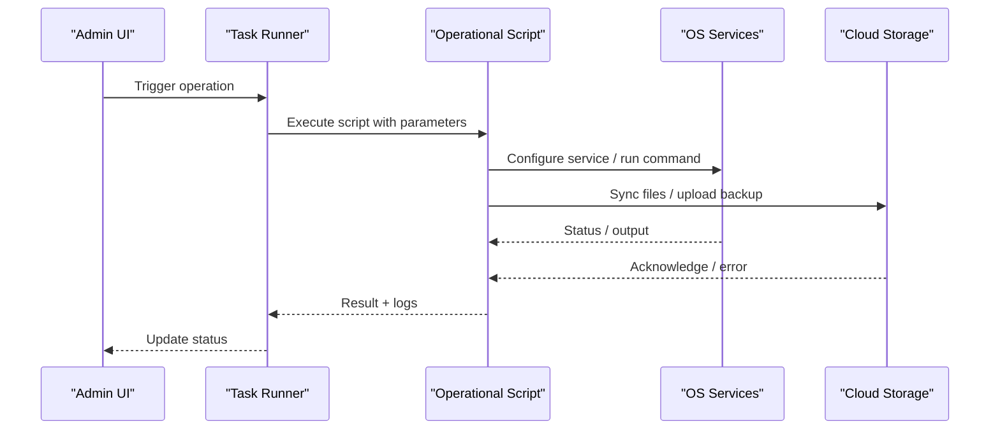

[No sources needed since this diagram shows conceptual workflow, not actual code structure]

## Detailed Component Analysis

### Backup and Restore Operations
This component handles:
- Database dumps and file backups
- Remote storage credential management
- Scheduling and automation
- Refreshing backup inventories
- Retention policy enforcement and pruning

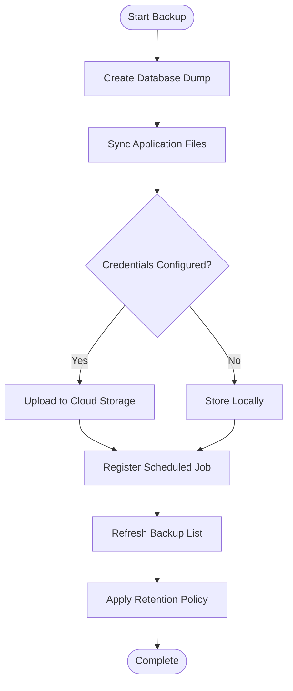

**Diagram sources**
- [backup_restore.txt:1-50](file://includes/core/apps/wordpress-app/scripts/v1/backup_restore.txt#L1-L50)
- [backup_restore_save_credentials.txt:1-50](file://includes/core/apps/wordpress-app/scripts/v1/backup_restore_save_credentials.txt#L1-L50)
- [backup_restore_schedule.txt:1-50](file://includes/core/apps/wordpress-app/scripts/v1/backup_restore_schedule.txt#L1-L50)
- [backup_restore_refresh_backup_list.txt:1-50](file://includes/core/apps/wordpress-app/scripts/v1/backup_restore_refresh_backup_list.txt#L1-L50)
- [backup_restore_delete_and_prune.txt:1-50](file://includes/core/apps/wordpress-app/scripts/v1/backup_restore_delete_and_prune.txt#L1-L50)
- [backup_restore_delete_and_prune_server.txt:1-50](file://includes/core/apps/wordpress-app/scripts/v1/backup_restore_delete_and_prune_server.txt#L1-L50)

Key responsibilities and references:
- Database dumps and file synchronization: [backup_restore.txt:1-50](file://includes/core/apps/wordpress-app/scripts/v1/backup_restore.txt#L1-L50)
- Cloud storage integration and credential management: [backup_restore_save_credentials.txt:1-50](file://includes/core/apps/wordpress-app/scripts/v1/backup_restore_save_credentials.txt#L1-L50)
- Scheduling backups: [backup_restore_schedule.txt:1-50](file://includes/core/apps/wordpress-app/scripts/v1/backup_restore_schedule.txt#L1-L50)
- Inventory refresh: [backup_restore_refresh_backup_list.txt:1-50](file://includes/core/apps/wordpress-app/scripts/v1/backup_restore_refresh_backup_list.txt#L1-L50)
- Retention and pruning: [backup_restore_delete_and_prune.txt:1-50](file://includes/core/apps/wordpress-app/scripts/v1/backup_restore_delete_and_prune.txt#L1-L50), [backup_restore_delete_and_prune_server.txt:1-50](file://includes/core/apps/wordpress-app/scripts/v1/backup_restore_delete_and_prune_server.txt#L1-L50)

**Section sources**
- [backup_restore.txt:1-50](file://includes/core/apps/wordpress-app/scripts/v1/backup_restore.txt#L1-L50)
- [backup_restore_save_credentials.txt:1-50](file://includes/core/apps/wordpress-app/scripts/v1/backup_restore_save_credentials.txt#L1-L50)
- [backup_restore_schedule.txt:1-50](file://includes/core/apps/wordpress-app/scripts/v1/backup_restore_schedule.txt#L1-L50)
- [backup_restore_refresh_backup_list.txt:1-50](file://includes/core/apps/wordpress-app/scripts/v1/backup_restore_refresh_backup_list.txt#L1-L50)
- [backup_restore_delete_and_prune.txt:1-50](file://includes/core/apps/wordpress-app/scripts/v1/backup_restore_delete_and_prune.txt#L1-L50)
- [backup_restore_delete_and_prune_server.txt:1-50](file://includes/core/apps/wordpress-app/scripts/v1/backup_restore_delete_and_prune_server.txt#L1-L50)

### Site Synchronization
Site sync supports origin-to-destination workflows for both sites and servers, enabling consistent environments and offloading backups or staging.

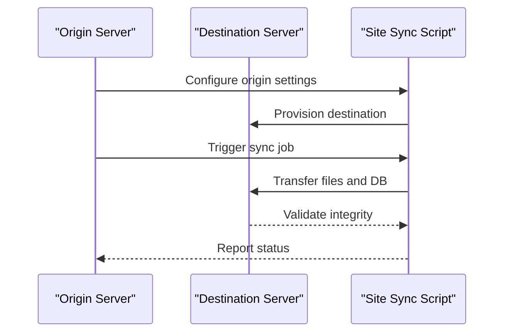

**Diagram sources**
- [site_sync_origin_setup.txt:1-50](file://includes/core/apps/wordpress-app/scripts/v1/site_sync_origin_setup.txt#L1-L50)
- [site_sync_destination_setup.txt:1-50](file://includes/core/apps/wordpress-app/scripts/v1/site_sync_destination_setup.txt#L1-L50)
- [site_sync.txt:1-50](file://includes/core/apps/wordpress-app/scripts/v1/site_sync.txt#L1-L50)

**Section sources**
- [site_sync_origin_setup.txt:1-50](file://includes/core/apps/wordpress-app/scripts/v1/site_sync_origin_setup.txt#L1-L50)
- [site_sync_destination_setup.txt:1-50](file://includes/core/apps/wordpress-app/scripts/v1/site_sync_destination_setup.txt#L1-L50)
- [site_sync.txt:1-50](file://includes/core/apps/wordpress-app/scripts/v1/site_sync.txt#L1-L50)

### Firewall Management (6G/7G)
The firewall scripts apply and upgrade rule sets designed to mitigate common web attacks and improve HTTP request filtering.

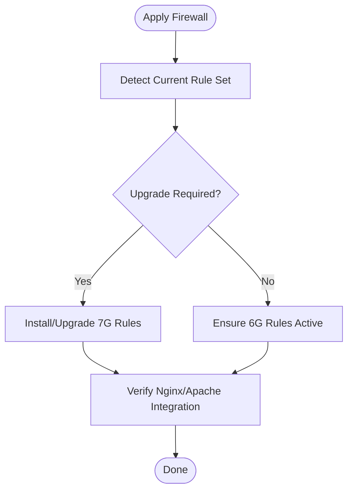

**Diagram sources**
- [6g_firewall.txt:1-50](file://includes/core/apps/wordpress-app/scripts/v1/6g_firewall.txt#L1-L50)
- [7g_firewall.txt:1-50](file://includes/core/apps/wordpress-app/scripts/v1/7g_firewall.txt#L1-L50)

**Section sources**
- [6g_firewall.txt:1-50](file://includes/core/apps/wordpress-app/scripts/v1/6g_firewall.txt#L1-L50)
- [7g_firewall.txt:1-50](file://includes/core/apps/wordpress-app/scripts/v1/7g_firewall.txt#L1-L50)

### Intrusion Detection with fail2ban
fail2ban monitors logs and blocks abusive IPs. The script installs, configures jails, and integrates with web servers and applications.

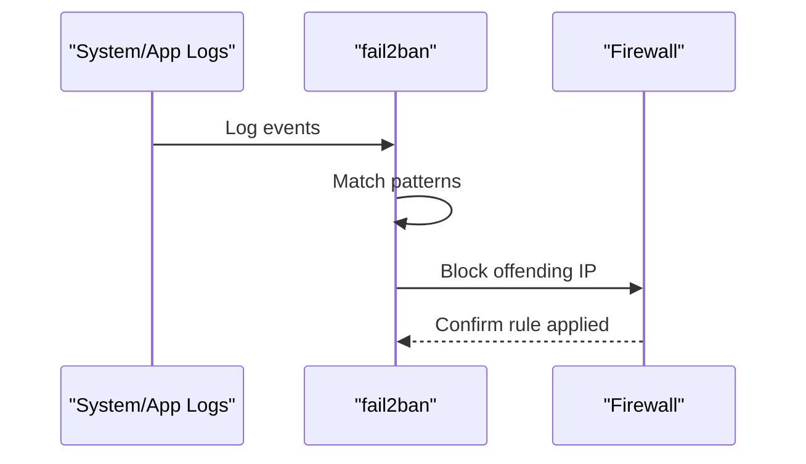

**Diagram sources**
- [fail2ban.txt:1-50](file://includes/core/apps/wordpress-app/scripts/v1/fail2ban.txt#L1-L50)

**Section sources**
- [fail2ban.txt:1-50](file://includes/core/apps/wordpress-app/scripts/v1/fail2ban.txt#L1-L50)

### Monitoring Setup (Monit and Netdata)
Monit performs service health checks and restarts failed components; Netdata provides real-time dashboards and alerts.

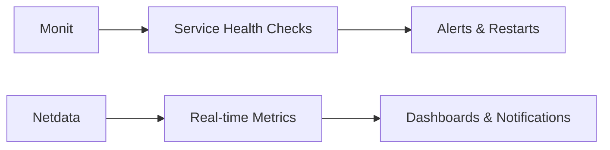

**Diagram sources**
- [monit.txt:1-50](file://includes/core/apps/wordpress-app/scripts/v1/monit.txt#L1-L50)
- [netdata.txt:1-50](file://includes/core/apps/wordpress-app/scripts/v1/netdata.txt#L1-L50)

**Section sources**
- [monit.txt:1-50](file://includes/core/apps/wordpress-app/scripts/v1/monit.txt#L1-L50)
- [netdata.txt:1-50](file://includes/core/apps/wordpress-app/scripts/v1/netdata.txt#L1-L50)

### Cache Management (Redis and Memcached)
Scripts install and manage caching layers for improved performance.

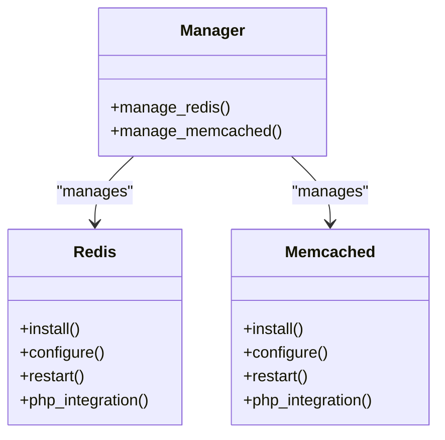

**Diagram sources**
- [install_redis.txt:1-50](file://includes/core/apps/wordpress-app/scripts/v1/install_redis.txt#L1-L50)
- [install_memcached.txt:1-50](file://includes/core/apps/wordpress-app/scripts/v1/install_memcached.txt#L1-L50)
- [manage_redis.txt:1-50](file://includes/core/apps/wordpress-app/scripts/v1/manage_redis.txt#L1-L50)
- [manage_memcached.txt:1-50](file://includes/core/apps/wordpress-app/scripts/v1/manage_memcached.txt#L1-L50)

**Section sources**
- [install_redis.txt:1-50](file://includes/core/apps/wordpress-app/scripts/v1/install_redis.txt#L1-L50)
- [install_memcached.txt:1-50](file://includes/core/apps/wordpress-app/scripts/v1/install_memcached.txt#L1-L50)
- [manage_redis.txt:1-50](file://includes/core/apps/wordpress-app/scripts/v1/manage_redis.txt#L1-L50)
- [manage_memcached.txt:1-50](file://includes/core/apps/wordpress-app/scripts/v1/manage_memcached.txt#L1-L50)

### SSL Certificate Renewal Processes
Automated renewal ensures HTTPS continuity without manual intervention.

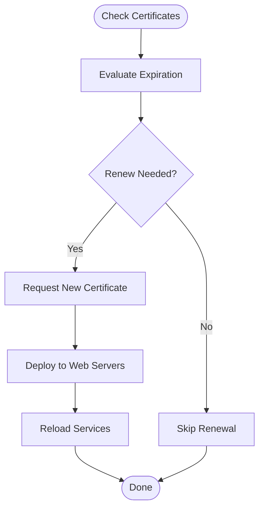

**Diagram sources**
- [renew_all_certificates.txt:1-50](file://includes/core/apps/wordpress-app/scripts/v1/renew_all_certificates.txt#L1-L50)
- [manage_https.txt:1-50](file://includes/core/apps/wordpress-app/scripts/v1/manage_https.txt#L1-L50)

**Section sources**
- [renew_all_certificates.txt:1-50](file://includes/core/apps/wordpress-app/scripts/v1/renew_all_certificates.txt#L1-L50)
- [manage_https.txt:1-50](file://includes/core/apps/wordpress-app/scripts/v1/manage_https.txt#L1-L50)

### Automated Security Updates
Securely update packages and core components to maintain a hardened environment.

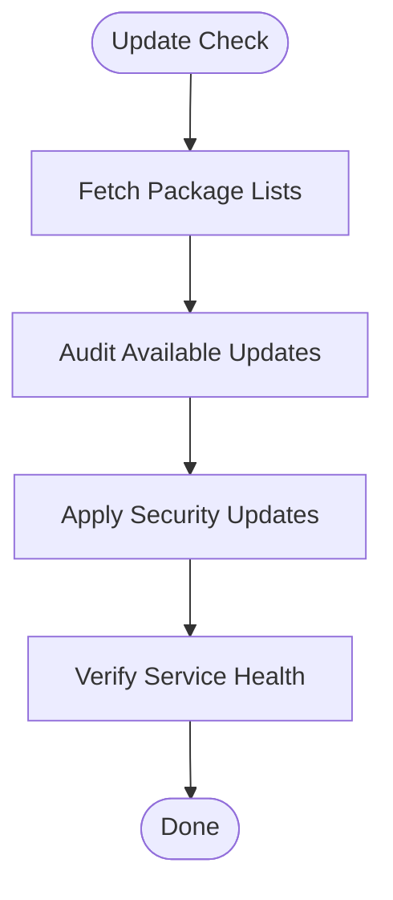

**Diagram sources**
- [server_update.txt:1-50](file://includes/core/apps/wordpress-app/scripts/v1/server_update.txt#L1-L50)

**Section sources**
- [server_update.txt:1-50](file://includes/core/apps/wordpress-app/scripts/v1/server_update.txt#L1-L50)

### Configuration Backup
Backup configuration files separately from application data to streamline recovery and auditing.

**Section sources**
- [backup_config_files.txt:1-50](file://includes/core/apps/wordpress-app/scripts/v1/backup_config_files.txt#L1-L50)

## Dependency Analysis
Operational scripts depend on OS-level services and external tools. The following diagram maps key dependencies among scripts and services.

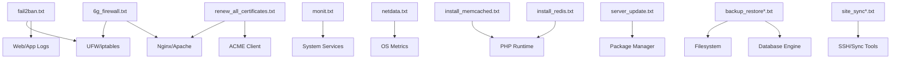

**Diagram sources**
- [6g_firewall.txt:1-50](file://includes/core/apps/wordpress-app/scripts/v1/6g_firewall.txt#L1-L50)
- [7g_firewall.txt:1-50](file://includes/core/apps/wordpress-app/scripts/v1/7g_firewall.txt#L1-L50)
- [fail2ban.txt:1-50](file://includes/core/apps/wordpress-app/scripts/v1/fail2ban.txt#L1-L50)
- [monit.txt:1-50](file://includes/core/apps/wordpress-app/scripts/v1/monit.txt#L1-L50)
- [netdata.txt:1-50](file://includes/core/apps/wordpress-app/scripts/v1/netdata.txt#L1-L50)
- [install_redis.txt:1-50](file://includes/core/apps/wordpress-app/scripts/v1/install_redis.txt#L1-L50)
- [install_memcached.txt:1-50](file://includes/core/apps/wordpress-app/scripts/v1/install_memcached.txt#L1-L50)
- [renew_all_certificates.txt:1-50](file://includes/core/apps/wordpress-app/scripts/v1/renew_all_certificates.txt#L1-L50)
- [server_update.txt:1-50](file://includes/core/apps/wordpress-app/scripts/v1/server_update.txt#L1-L50)
- [backup_restore.txt:1-50](file://includes/core/apps/wordpress-app/scripts/v1/backup_restore.txt#L1-L50)
- [site_sync_origin_setup.txt:1-50](file://includes/core/apps/wordpress-app/scripts/v1/site_sync_origin_setup.txt#L1-L50)
- [site_sync_destination_setup.txt:1-50](file://includes/core/apps/wordpress-app/scripts/v1/site_sync_destination_setup.txt#L1-L50)

**Section sources**
- [6g_firewall.txt:1-50](file://includes/core/apps/wordpress-app/scripts/v1/6g_firewall.txt#L1-L50)
- [7g_firewall.txt:1-50](file://includes/core/apps/wordpress-app/scripts/v1/7g_firewall.txt#L1-L50)
- [fail2ban.txt:1-50](file://includes/core/apps/wordpress-app/scripts/v1/fail2ban.txt#L1-L50)
- [monit.txt:1-50](file://includes/core/apps/wordpress-app/scripts/v1/monit.txt#L1-L50)
- [netdata.txt:1-50](file://includes/core/apps/wordpress-app/scripts/v1/netdata.txt#L1-L50)
- [install_redis.txt:1-50](file://includes/core/apps/wordpress-app/scripts/v1/install_redis.txt#L1-L50)
- [install_memcached.txt:1-50](file://includes/core/apps/wordpress-app/scripts/v1/install_memcached.txt#L1-L50)
- [renew_all_certificates.txt:1-50](file://includes/core/apps/wordpress-app/scripts/v1/renew_all_certificates.txt#L1-L50)
- [server_update.txt:1-50](file://includes/core/apps/wordpress-app/scripts/v1/server_update.txt#L1-L50)
- [backup_restore.txt:1-50](file://includes/core/apps/wordpress-app/scripts/v1/backup_restore.txt#L1-L50)
- [site_sync_origin_setup.txt:1-50](file://includes/core/apps/wordpress-app/scripts/v1/site_sync_origin_setup.txt#L1-L50)
- [site_sync_destination_setup.txt:1-50](file://includes/core/apps/wordpress-app/scripts/v1/site_sync_destination_setup.txt#L1-L50)

## Performance Considerations
- Prefer incremental backups and selective file sync to reduce I/O pressure during peak hours.
- Schedule heavy operations (updates, full backups) during low-traffic windows.
- Tune cache sizes for Redis/Memcached based on workload characteristics.
- Monitor CPU, memory, and disk usage via Netdata to identify bottlenecks.
- Use connection pooling and keep-alive where applicable for database and cache clients.

[No sources needed since this section provides general guidance]

## Troubleshooting Guide
Common issues and resolutions:
- Backup failures:
  - Validate database connectivity and permissions.
  - Ensure remote storage credentials are correctly saved and accessible.
  - Review scheduled job logs and cron entries.
  - References: [backup_restore.txt:1-50](file://includes/core/apps/wordpress-app/scripts/v1/backup_restore.txt#L1-L50), [backup_restore_save_credentials.txt:1-50](file://includes/core/apps/wordpress-app/scripts/v1/backup_restore_save_credentials.txt#L1-L50), [backup_restore_schedule.txt:1-50](file://includes/core/apps/wordpress-app/scripts/v1/backup_restore_schedule.txt#L1-L50)
- Firewall misconfiguration:
  - Reapply 6G/7G rules and verify web server integration.
  - References: [6g_firewall.txt:1-50](file://includes/core/apps/wordpress-app/scripts/v1/6g_firewall.txt#L1-L50), [7g_firewall.txt:1-50](file://includes/core/apps/wordpress-app/scripts/v1/7g_firewall.txt#L1-L50)
- fail2ban not blocking IPs:
  - Confirm log paths and pattern matches.
  - Verify firewall rules are being applied.
  - Reference: [fail2ban.txt:1-50](file://includes/core/apps/wordpress-app/scripts/v1/fail2ban.txt#L1-L50)
- Monitoring gaps:
  - Ensure Monit and Netdata services are running and configured.
  - References: [monit.txt:1-50](file://includes/core/apps/wordpress-app/scripts/v1/monit.txt#L1-L50), [netdata.txt:1-50](file://includes/core/apps/wordpress-app/scripts/v1/netdata.txt#L1-L50)
- Cache connectivity issues:
  - Validate Redis/Memcached service status and PHP extensions.
  - References: [install_redis.txt:1-50](file://includes/core/apps/wordpress-app/scripts/v1/install_redis.txt#L1-L50), [install_memcached.txt:1-50](file://includes/core/apps/wordpress-app/scripts/v1/install_memcached.txt#L1-L50), [manage_redis.txt:1-50](file://includes/core/apps/wordpress-app/scripts/v1/manage_redis.txt#L1-L50), [manage_memcached.txt:1-50](file://includes/core/apps/wordpress-app/scripts/v1/manage_memcached.txt#L1-L50)
- SSL errors after renewal:
  - Confirm certificate deployment and service reloads.
  - Reference: [renew_all_certificates.txt:1-50](file://includes/core/apps/wordpress-app/scripts/v1/renew_all_certificates.txt#L1-L50), [manage_https.txt:1-50](file://includes/core/apps/wordpress-app/scripts/v1/manage_https.txt#L1-L50)
- Update failures:
  - Check package manager locks and repository availability.
  - Reference: [server_update.txt:1-50](file://includes/core/apps/wordpress-app/scripts/v1/server_update.txt#L1-L50)

**Section sources**
- [backup_restore.txt:1-50](file://includes/core/apps/wordpress-app/scripts/v1/backup_restore.txt#L1-L50)
- [backup_restore_save_credentials.txt:1-50](file://includes/core/apps/wordpress-app/scripts/v1/backup_restore_save_credentials.txt#L1-L50)
- [backup_restore_schedule.txt:1-50](file://includes/core/apps/wordpress-app/scripts/v1/backup_restore_schedule.txt#L1-L50)
- [6g_firewall.txt:1-50](file://includes/core/apps/wordpress-app/scripts/v1/6g_firewall.txt#L1-L50)
- [7g_firewall.txt:1-50](file://includes/core/apps/wordpress-app/scripts/v1/7g_firewall.txt#L1-L50)
- [fail2ban.txt:1-50](file://includes/core/apps/wordpress-app/scripts/v1/fail2ban.txt#L1-L50)
- [monit.txt:1-50](file://includes/core/apps/wordpress-app/scripts/v1/monit.txt#L1-L50)
- [netdata.txt:1-50](file://includes/core/apps/wordpress-app/scripts/v1/netdata.txt#L1-L50)
- [install_redis.txt:1-50](file://includes/core/apps/wordpress-app/scripts/v1/install_redis.txt#L1-L50)
- [install_memcached.txt:1-50](file://includes/core/apps/wordpress-app/scripts/v1/install_memcached.txt#L1-L50)
- [manage_redis.txt:1-50](file://includes/core/apps/wordpress-app/scripts/v1/manage_redis.txt#L1-L50)
- [manage_memcached.txt:1-50](file://includes/core/apps/wordpress-app/scripts/v1/manage_memcached.txt#L1-L50)
- [renew_all_certificates.txt:1-50](file://includes/core/apps/wordpress-app/scripts/v1/renew_all_certificates.txt#L1-L50)
- [manage_https.txt:1-50](file://includes/core/apps/wordpress-app/scripts/v1/manage_https.txt#L1-L50)
- [server_update.txt:1-50](file://includes/core/apps/wordpress-app/scripts/v1/server_update.txt#L1-L50)

## Conclusion
The operational management scripts provide a comprehensive toolkit for maintaining secure, performant, and reliable servers. By leveraging these scripts for backups, firewall hardening, intrusion detection, monitoring, caching, SSL management, and automated updates, administrators can standardize best practices and reduce operational risk. Extending the system with custom scripts and third-party integrations further enhances control and observability.

[No sources needed since this section summarizes without analyzing specific files]

## Appendices

### Creating Custom Operational Scripts
Guidelines:
- Follow the existing naming and location conventions under the WordPress app scripts directory.
- Accept standardized parameters for idempotent execution.
- Log all actions and outcomes for auditability.
- Integrate with existing utilities (package managers, web servers, databases).
- Provide clear error handling and rollback strategies where applicable.

[No sources needed since this section provides general guidance]

### Integrating Third-Party Tools
Approach:
- Wrap tool-specific commands in dedicated scripts mirroring the existing structure.
- Use environment variables for secrets and configuration.
- Coordinate with existing monitoring and alerting pipelines.
- Validate compatibility with current OS and service versions.

[No sources needed since this section provides general guidance]

### Configuring Alerting and Notification Systems
Recommendations:
- Use Monit for service-level alerts and automatic recovery.
- Leverage Netdata for metric-based alerts and dashboards.
- Centralize notifications via email or webhook integrations.
- Define thresholds aligned with SLAs and capacity planning.

[No sources needed since this section provides general guidance]