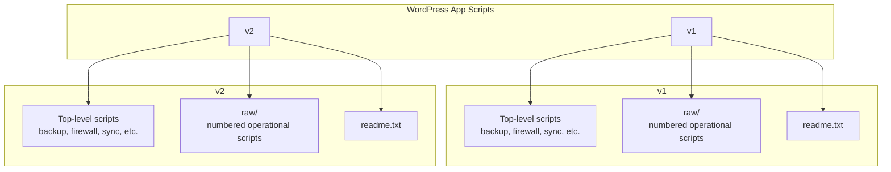
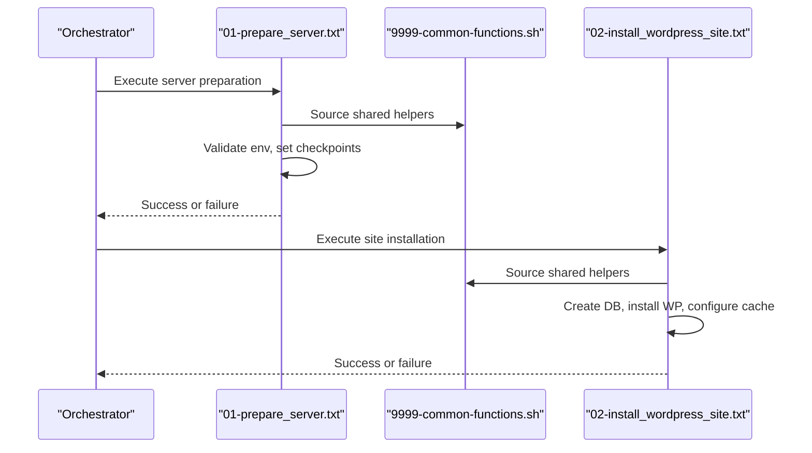
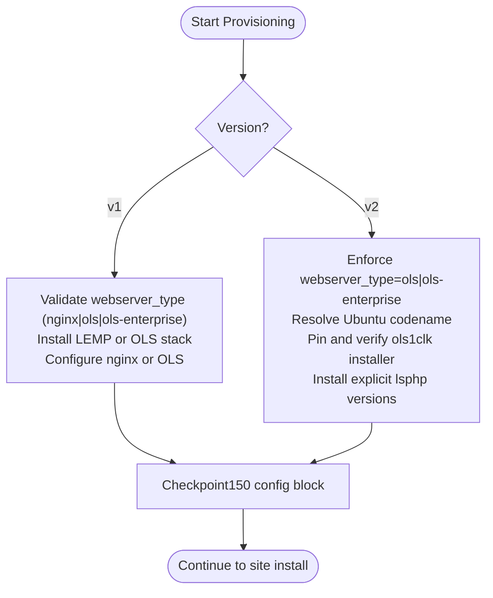
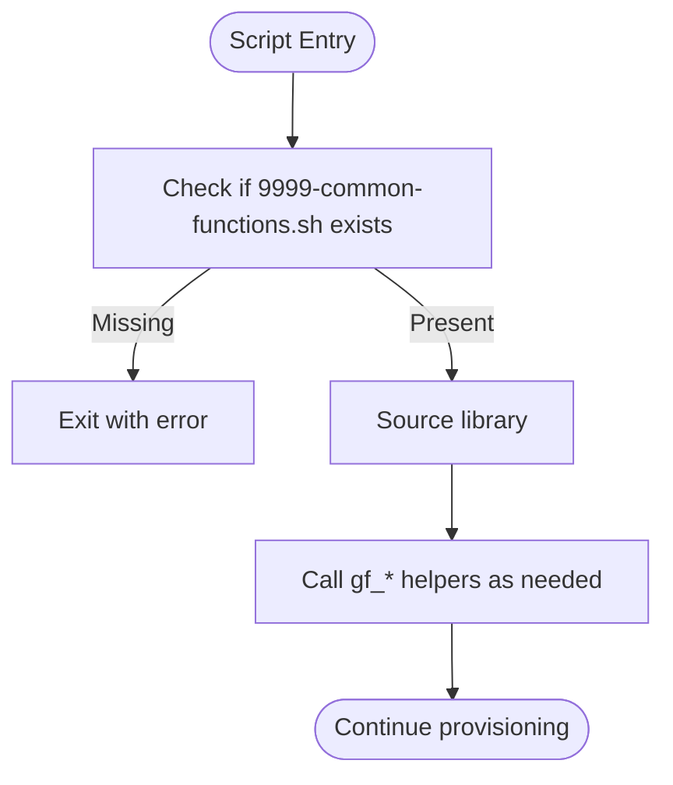
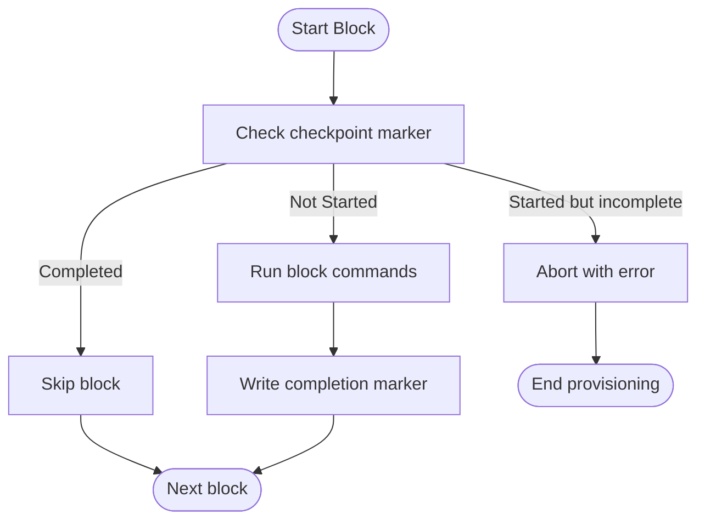
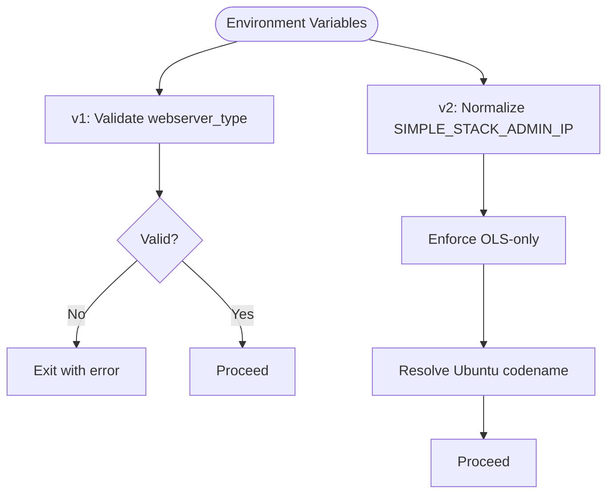
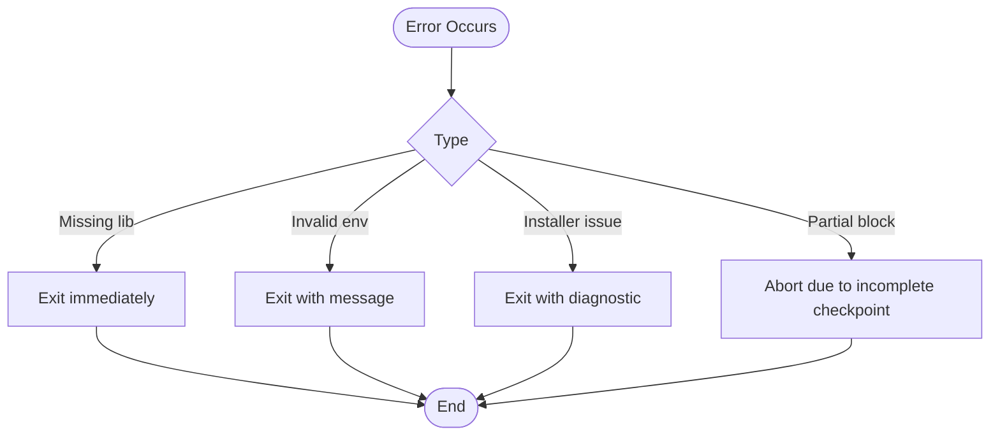
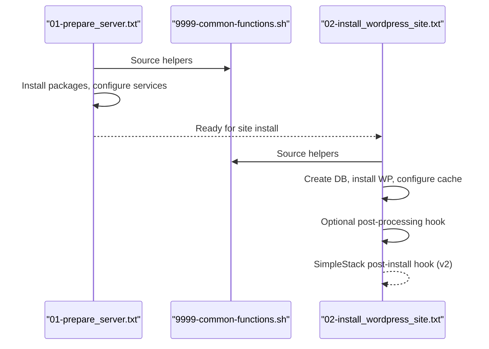
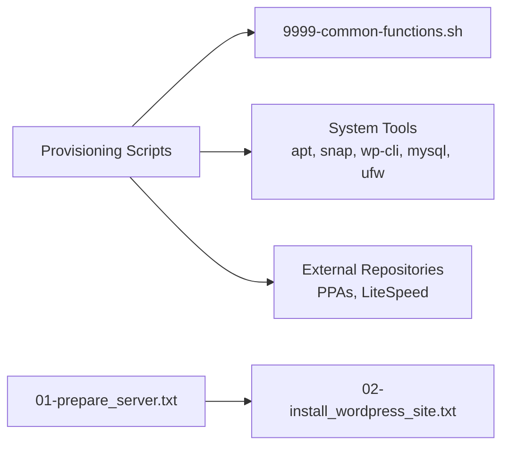

# Script Architecture & Versioning

<cite>
**Referenced Files in This Document**
- [01-prepare_server.txt](file://includes/core/apps/wordpress-app/scripts/v1/raw/01-prepare_server.txt)
- [02-install_wordpress_site.txt](file://includes/core/apps/wordpress-app/scripts/v1/raw/02-install_wordpress_site.txt)
- [01-prepare_server.txt](file://includes/core/apps/wordpress-app/scripts/v2/raw/01-prepare_server.txt)
- [02-install_wordpress_site.txt](file://includes/core/apps/wordpress-app/scripts/v2/raw/02-install_wordpress_site.txt)
- [readme.txt](file://includes/core/apps/wordpress-app/scripts/v1/readme.txt)
- [readme.txt](file://includes/core/apps/wordpress-app/scripts/v2/readme.txt)
</cite>

## Table of Contents
1. [Introduction](#introduction)
2. [Project Structure](#project-structure)
3. [Core Components](#core-components)
4. [Architecture Overview](#architecture-overview)
5. [Detailed Component Analysis](#detailed-component-analysis)
6. [Dependency Analysis](#dependency-analysis)
7. [Performance Considerations](#performance-considerations)
8. [Troubleshooting Guide](#troubleshooting-guide)
9. [Conclusion](#conclusion)
10. [Appendices](#appendices)

## Introduction
This document explains the provisioning script architecture and versioning system for the WordPress app scripts. It focuses on:
- The v1 vs v2 script structure differences
- The common functions library (9999-common-functions.sh) and how scripts depend on it
- How scripts are organized and executed
- The checkpoint system for resumable provisioning
- Environment variable handling and error recovery mechanisms
- The script execution pipeline, dependency management between scripts, and how to integrate new scripts
- Examples of extending the common functions library and creating custom provisioning phases

The goal is to make these concepts accessible while providing precise references to the actual script files.

## Project Structure
Provisioning scripts are grouped by version under each app’s scripts directory:
- v1: legacy stack supporting nginx and OpenLiteSpeed
- v2: SimpleStack-focused stack supporting only OpenLiteSpeed

Each version contains:
- Top-level helper scripts (e.g., backup, firewall, site sync)
- A raw/ folder with numbered operational scripts that run in a defined order
- A readme file describing post-provisioning command behavior

**Diagram sources**
- [readme.txt:1-3](file://includes/core/apps/wordpress-app/scripts/v1/readme.txt#L1-L3)
- [readme.txt:1-3](file://includes/core/apps/wordpress-app/scripts/v2/readme.txt#L1-L3)

**Section sources**
- [readme.txt:1-3](file://includes/core/apps/wordpress-app/scripts/v1/readme.txt#L1-L3)
- [readme.txt:1-3](file://includes/core/apps/wordpress-app/scripts/v2/readme.txt#L1-L3)

## Core Components
- Common functions library (9999-common-functions.sh): Each script sources this file to access shared helpers such as webserver checks, restarts, database creation, and OLS configuration helpers.
- Operational scripts: Numbered scripts in raw/ define discrete provisioning steps (e.g., server preparation, WordPress installation).
- Checkpoint folder (.wpcd-server-provision-checkpoints): Used to resume provisioning after interruptions.
- Environment variables: Passed from the command wrapper; used to configure behavior (e.g., webserver type, admin IP).

Key responsibilities:
- 01-prepare_server.txt: Prepares the OS, installs packages, configures services, sets up checkpoints, and performs hardening.
- 02-install_wordpress_site.txt: Creates sites, installs WordPress, configures caching, and runs optional post-processing hooks.

**Section sources**
- [01-prepare_server.txt:8-14](file://includes/core/apps/wordpress-app/scripts/v1/raw/01-prepare_server.txt#L8-L14)
- [02-install_wordpress_site.txt:9-15](file://includes/core/apps/wordpress-app/scripts/v1/raw/02-install_wordpress_site.txt#L9-L15)
- [01-prepare_server.txt:14-20](file://includes/core/apps/wordpress-app/scripts/v2/raw/01-prepare_server.txt#L14-L20)
- [02-install_wordpress_site.txt:9-15](file://includes/core/apps/wordpress-app/scripts/v2/raw/02-install_wordpress_site.txt#L9-L15)

## Architecture Overview
At runtime, the provisioning pipeline executes a sequence of scripts. Each script:
- Validates environment and prerequisites
- Sources the common functions library
- Performs its task
- Writes checkpoints to enable resumption
- Exits non-zero on fatal errors

**Diagram sources**
- [01-prepare_server.txt:8-14](file://includes/core/apps/wordpress-app/scripts/v1/raw/01-prepare_server.txt#L8-L14)
- [02-install_wordpress_site.txt:9-15](file://includes/core/apps/wordpress-app/scripts/v1/raw/02-install_wordpress_site.txt#L9-L15)
- [01-prepare_server.txt:14-20](file://includes/core/apps/wordpress-app/scripts/v2/raw/01-prepare_server.txt#L14-L20)
- [02-install_wordpress_site.txt:9-15](file://includes/core/apps/wordpress-app/scripts/v2/raw/02-install_wordpress_site.txt#L9-L15)

## Detailed Component Analysis

### v1 vs v2 Script Structure Differences
- Webserver support:
  - v1 supports both nginx and OpenLiteSpeed (ols, ols-enterprise), with branching logic for each.
  - v2 enforces OpenLiteSpeed-only operation and rejects unsupported webserver types early.
- Ubuntu compatibility:
  - v1 checks specific versions and may fail on unsupported combinations.
  - v2 resolves supported Ubuntu codenames explicitly and fails fast with clear messages if unsupported.
- Package installation strategy:
  - v1 installs multiple PHP versions via apt and uses update-alternatives.
  - v2 pins the LiteSpeed installer tag, verifies syntax and checksum when configured, and installs explicit lsphp versions with deterministic loops.
- Security posture:
  - v2 adds strict checks for downloaded installer content and restricts OpenLiteSpeed WebAdmin port exposure to an allowed admin IP.
- Configuration blocks:
  - Both versions use a large configuration block guarded by checkpoint150 to ensure idempotency and recoverability.

**Diagram sources**
- [01-prepare_server.txt:16-35](file://includes/core/apps/wordpress-app/scripts/v1/raw/01-prepare_server.txt#L16-L35)
- [01-prepare_server.txt:214-302](file://includes/core/apps/wordpress-app/scripts/v1/raw/01-prepare_server.txt#L214-L302)
- [01-prepare_server.txt:381-543](file://includes/core/apps/wordpress-app/scripts/v1/raw/01-prepare_server.txt#L381-L543)
- [01-prepare_server.txt:29-46](file://includes/core/apps/wordpress-app/scripts/v2/raw/01-prepare_server.txt#L29-L46)
- [01-prepare_server.txt:48-67](file://includes/core/apps/wordpress-app/scripts/v2/raw/01-prepare_server.txt#L48-L67)
- [01-prepare_server.txt:185-251](file://includes/core/apps/wordpress-app/scripts/v2/raw/01-prepare_server.txt#L185-L251)
- [01-prepare_server.txt:427-543](file://includes/core/apps/wordpress-app/scripts/v2/raw/01-prepare_server.txt#L427-L543)

**Section sources**
- [01-prepare_server.txt:16-35](file://includes/core/apps/wordpress-app/scripts/v1/raw/01-prepare_server.txt#L16-L35)
- [01-prepare_server.txt:214-302](file://includes/core/apps/wordpress-app/scripts/v1/raw/01-prepare_server.txt#L214-L302)
- [01-prepare_server.txt:381-543](file://includes/core/apps/wordpress-app/scripts/v1/raw/01-prepare_server.txt#L381-L543)
- [01-prepare_server.txt:29-46](file://includes/core/apps/wordpress-app/scripts/v2/raw/01-prepare_server.txt#L29-L46)
- [01-prepare_server.txt:48-67](file://includes/core/apps/wordpress-app/scripts/v2/raw/01-prepare_server.txt#L48-L67)
- [01-prepare_server.txt:185-251](file://includes/core/apps/wordpress-app/scripts/v2/raw/01-prepare_server.txt#L185-L251)
- [01-prepare_server.txt:427-543](file://includes/core/apps/wordpress-app/scripts/v2/raw/01-prepare_server.txt#L427-L543)

### Common Functions Library (9999-common-functions.sh)
- Purpose: Provides reusable helpers for provisioning tasks such as:
  - Checking and restarting the webserver
  - Creating databases
  - Adding webserver configurations (nginx or OLS)
  - Managing OLS-specific settings
- Usage pattern:
  - Scripts check for the presence of the file and source it before proceeding.
  - Helpers are invoked throughout scripts to perform consistent operations.

**Diagram sources**
- [01-prepare_server.txt:8-14](file://includes/core/apps/wordpress-app/scripts/v1/raw/01-prepare_server.txt#L8-L14)
- [02-install_wordpress_site.txt:9-15](file://includes/core/apps/wordpress-app/scripts/v1/raw/02-install_wordpress_site.txt#L9-L15)
- [01-prepare_server.txt:14-20](file://includes/core/apps/wordpress-app/scripts/v2/raw/01-prepare_server.txt#L14-L20)
- [02-install_wordpress_site.txt:9-15](file://includes/core/apps/wordpress-app/scripts/v2/raw/02-install_wordpress_site.txt#L9-L15)

**Section sources**
- [01-prepare_server.txt:8-14](file://includes/core/apps/wordpress-app/scripts/v1/raw/01-prepare_server.txt#L8-L14)
- [02-install_wordpress_site.txt:9-15](file://includes/core/apps/wordpress-app/scripts/v1/raw/02-install_wordpress_site.txt#L9-L15)
- [01-prepare_server.txt:14-20](file://includes/core/apps/wordpress-app/scripts/v2/raw/01-prepare_server.txt#L14-L20)
- [02-install_wordpress_site.txt:9-15](file://includes/core/apps/wordpress-app/scripts/v2/raw/02-install_wordpress_site.txt#L9-L15)

### Checkpoint System for Resumable Provisioning
- Location: .wpcd-server-provision-checkpoints
- Mechanism:
  - Before starting, scripts create the checkpoint folder and mark that the script has run at least once.
  - Major blocks are guarded by checkpoint markers (e.g., checkpoint05-end.txt, checkpoint10-end.txt, checkpoint20-end.txt, checkpoint100-end.txt, checkpoint150-end.txt).
  - If a block has already completed, the script skips it; if started but not completed, the script can abort with a clear message to prevent partial state.

**Diagram sources**
- [01-prepare_server.txt:67-86](file://includes/core/apps/wordpress-app/scripts/v1/raw/01-prepare_server.txt#L67-L86)
- [01-prepare_server.txt:92-117](file://includes/core/apps/wordpress-app/scripts/v1/raw/01-prepare_server.txt#L92-L117)
- [01-prepare_server.txt:120-171](file://includes/core/apps/wordpress-app/scripts/v1/raw/01-prepare_server.txt#L120-L171)
- [01-prepare_server.txt:306-364](file://includes/core/apps/wordpress-app/scripts/v1/raw/01-prepare_server.txt#L306-L364)
- [01-prepare_server.txt:381-391](file://includes/core/apps/wordpress-app/scripts/v1/raw/01-prepare_server.txt#L381-L391)
- [01-prepare_server.txt:427-437](file://includes/core/apps/wordpress-app/scripts/v2/raw/01-prepare_server.txt#L427-L437)

**Section sources**
- [01-prepare_server.txt:67-86](file://includes/core/apps/wordpress-app/scripts/v1/raw/01-prepare_server.txt#L67-L86)
- [01-prepare_server.txt:92-117](file://includes/core/apps/wordpress-app/scripts/v1/raw/01-prepare_server.txt#L92-L117)
- [01-prepare_server.txt:120-171](file://includes/core/apps/wordpress-app/scripts/v1/raw/01-prepare_server.txt#L120-L171)
- [01-prepare_server.txt:306-364](file://includes/core/apps/wordpress-app/scripts/v1/raw/01-prepare_server.txt#L306-L364)
- [01-prepare_server.txt:381-391](file://includes/core/apps/wordpress-app/scripts/v1/raw/01-prepare_server.txt#L381-L391)
- [01-prepare_server.txt:427-437](file://includes/core/apps/wordpress-app/scripts/v2/raw/01-prepare_server.txt#L427-L437)

### Environment Variable Handling
- v1:
  - Requires webserver_type to be set before execution; validates against nginx, ols, ols-enterprise.
  - Uses environment variables like name and post_id to set server metadata.
- v2:
  - Normalizes SIMPLE_STACK_ADMIN_IP and exports it for later use (firewall rules, WebAdmin binding).
  - Enforces webserver_type to be ols or ols-enterprise; otherwise exits immediately.
  - Resolves GV_UBUNTU_CODENAME based on supported versions.

**Diagram sources**
- [01-prepare_server.txt:16-35](file://includes/core/apps/wordpress-app/scripts/v1/raw/01-prepare_server.txt#L16-L35)
- [01-prepare_server.txt:63-66](file://includes/core/apps/wordpress-app/scripts/v1/raw/01-prepare_server.txt#L63-L66)
- [01-prepare_server.txt:22-27](file://includes/core/apps/wordpress-app/scripts/v2/raw/01-prepare_server.txt#L22-L27)
- [01-prepare_server.txt:29-46](file://includes/core/apps/wordpress-app/scripts/v2/raw/01-prepare_server.txt#L29-L46)
- [01-prepare_server.txt:48-67](file://includes/core/apps/wordpress-app/scripts/v2/raw/01-prepare_server.txt#L48-L67)

**Section sources**
- [01-prepare_server.txt:16-35](file://includes/core/apps/wordpress-app/scripts/v1/raw/01-prepare_server.txt#L16-L35)
- [01-prepare_server.txt:63-66](file://includes/core/apps/wordpress-app/scripts/v1/raw/01-prepare_server.txt#L63-L66)
- [01-prepare_server.txt:22-27](file://includes/core/apps/wordpress-app/scripts/v2/raw/01-prepare_server.txt#L22-L27)
- [01-prepare_server.txt:29-46](file://includes/core/apps/wordpress-app/scripts/v2/raw/01-prepare_server.txt#L29-L46)
- [01-prepare_server.txt:48-67](file://includes/core/apps/wordpress-app/scripts/v2/raw/01-prepare_server.txt#L48-L67)

### Error Recovery Mechanisms
- Fatal errors:
  - Missing common functions library causes immediate exit.
  - Unsupported webserver_type or Ubuntu version triggers early termination with readable messages.
  - Installer download failures or checksum mismatches stop provisioning.
- Partial progress:
  - Checkpoint markers allow skipping completed blocks.
  - Incomplete blocks (started but not finished) cause abort to prevent inconsistent state.

**Diagram sources**
- [01-prepare_server.txt:8-14](file://includes/core/apps/wordpress-app/scripts/v1/raw/01-prepare_server.txt#L8-L14)
- [01-prepare_server.txt:16-35](file://includes/core/apps/wordpress-app/scripts/v1/raw/01-prepare_server.txt#L16-L35)
- [01-prepare_server.txt:29-46](file://includes/core/apps/wordpress-app/scripts/v2/raw/01-prepare_server.txt#L29-L46)
- [01-prepare_server.txt:185-251](file://includes/core/apps/wordpress-app/scripts/v2/raw/01-prepare_server.txt#L185-L251)
- [01-prepare_server.txt:381-391](file://includes/core/apps/wordpress-app/scripts/v1/raw/01-prepare_server.txt#L381-L391)
- [01-prepare_server.txt:427-437](file://includes/core/apps/wordpress-app/scripts/v2/raw/01-prepare_server.txt#L427-L437)

**Section sources**
- [01-prepare_server.txt:8-14](file://includes/core/apps/wordpress-app/scripts/v1/raw/01-prepare_server.txt#L8-L14)
- [01-prepare_server.txt:16-35](file://includes/core/apps/wordpress-app/scripts/v1/raw/01-prepare_server.txt#L16-L35)
- [01-prepare_server.txt:29-46](file://includes/core/apps/wordpress-app/scripts/v2/raw/01-prepare_server.txt#L29-L46)
- [01-prepare_server.txt:185-251](file://includes/core/apps/wordpress-app/scripts/v2/raw/01-prepare_server.txt#L185-L251)
- [01-prepare_server.txt:381-391](file://includes/core/apps/wordpress-app/scripts/v1/raw/01-prepare_server.txt#L381-L391)
- [01-prepare_server.txt:427-437](file://includes/core/apps/wordpress-app/scripts/v2/raw/01-prepare_server.txt#L427-L437)

### Script Execution Pipeline and Dependency Management
- Execution order:
  - Server preparation (01-prepare_server.txt) must complete successfully before site installation.
  - Site installation (02-install_wordpress_site.txt) depends on a prepared server and available helpers.
- Dependencies:
  - All scripts depend on 9999-common-functions.sh for shared functionality.
  - Site installation relies on webserver configuration helpers and database creation helpers provided by the common library.
- Post-processing hooks:
  - Both versions support pulling and executing custom post-processing scripts for server and site phases.

**Diagram sources**
- [01-prepare_server.txt:8-14](file://includes/core/apps/wordpress-app/scripts/v1/raw/01-prepare_server.txt#L8-L14)
- [02-install_wordpress_site.txt:9-15](file://includes/core/apps/wordpress-app/scripts/v1/raw/02-install_wordpress_site.txt#L9-L15)
- [01-prepare_server.txt:14-20](file://includes/core/apps/wordpress-app/scripts/v2/raw/01-prepare_server.txt#L14-L20)
- [02-install_wordpress_site.txt:9-15](file://includes/core/apps/wordpress-app/scripts/v2/raw/02-install_wordpress_site.txt#L9-L15)
- [02-install_wordpress_site.txt:224-234](file://includes/core/apps/wordpress-app/scripts/v1/raw/02-install_wordpress_site.txt#L224-L234)
- [02-install_wordpress_site.txt:236-240](file://includes/core/apps/wordpress-app/scripts/v2/raw/02-install_wordpress_site.txt#L236-L240)

**Section sources**
- [01-prepare_server.txt:8-14](file://includes/core/apps/wordpress-app/scripts/v1/raw/01-prepare_server.txt#L8-L14)
- [02-install_wordpress_site.txt:9-15](file://includes/core/apps/wordpress-app/scripts/v1/raw/02-install_wordpress_site.txt#L9-L15)
- [01-prepare_server.txt:14-20](file://includes/core/apps/wordpress-app/scripts/v2/raw/01-prepare_server.txt#L14-L20)
- [02-install_wordpress_site.txt:9-15](file://includes/core/apps/wordpress-app/scripts/v2/raw/02-install_wordpress_site.txt#L9-L15)
- [02-install_wordpress_site.txt:224-234](file://includes/core/apps/wordpress-app/scripts/v1/raw/02-install_wordpress_site.txt#L224-L234)
- [02-install_wordpress_site.txt:236-240](file://includes/core/apps/wordpress-app/scripts/v2/raw/02-install_wordpress_site.txt#L236-L240)

### Extending the Common Functions Library
To extend the common functions library:
- Add new helper functions to 9999-common-functions.sh following existing naming conventions (gf_*).
- Ensure helpers are idempotent and safe to call multiple times.
- Update relevant scripts to invoke the new helpers where appropriate.
- Test across both v1 and v2 paths if the helper affects both stacks.

Best practices:
- Validate inputs and return meaningful status codes.
- Log actions clearly for troubleshooting.
- Avoid side effects that cannot be reversed safely.

[No sources needed since this section provides general guidance]

### Creating Custom Provisioning Phases
To add a new phase:
- Place a new numbered script in raw/ within the desired version (v1 or v2).
- Follow the established pattern:
  - Check root privileges
  - Source 9999-common-functions.sh
  - Validate environment variables
  - Implement idempotent logic with checkpoints
  - Exit non-zero on fatal errors
- Integrate into the orchestration flow by ensuring the orchestrator calls your script in the correct order.

Example integration points:
- After server preparation (before site installation)
- After site installation (post-processing hook)

[No sources needed since this section provides general guidance]

## Dependency Analysis
- Scripts depend on:
  - 9999-common-functions.sh for shared helpers
  - System tools (apt-get, snap, wp-cli, mysql, ufw)
  - External repositories (PPAs, LiteSpeed repo)
- Inter-script dependencies:
  - 02-install_wordpress_site.txt depends on 01-prepare_server.txt having installed required services and configured the environment.
- External integrations:
  - Certbot plugins installed via snap
  - AWS CLI installation
  - OpenLiteSpeed one-click installer (v2)

**Diagram sources**
- [01-prepare_server.txt:8-14](file://includes/core/apps/wordpress-app/scripts/v1/raw/01-prepare_server.txt#L8-L14)
- [02-install_wordpress_site.txt:9-15](file://includes/core/apps/wordpress-app/scripts/v1/raw/02-install_wordpress_site.txt#L9-L15)
- [01-prepare_server.txt:185-251](file://includes/core/apps/wordpress-app/scripts/v2/raw/01-prepare_server.txt#L185-L251)

**Section sources**
- [01-prepare_server.txt:8-14](file://includes/core/apps/wordpress-app/scripts/v1/raw/01-prepare_server.txt#L8-L14)
- [02-install_wordpress_site.txt:9-15](file://includes/core/apps/wordpress-app/scripts/v1/raw/02-install_wordpress_site.txt#L9-L15)
- [01-prepare_server.txt:185-251](file://includes/core/apps/wordpress-app/scripts/v2/raw/01-prepare_server.txt#L185-L251)

## Performance Considerations
- Idempotent operations reduce redundant work and speed up retries.
- Chunked package installations avoid long-running UI updates.
- Deterministic loops for PHP version installation improve reliability and performance.
- Skipping completed blocks via checkpoints minimizes rework.

[No sources needed since this section provides general guidance]

## Troubleshooting Guide
Common issues and resolutions:
- Missing common functions library:
  - Ensure 9999-common-functions.sh is present and sourced correctly.
- Unsupported webserver or Ubuntu version:
  - Verify environment variables and supported versions.
- Installer download or checksum mismatch:
  - Check network connectivity and SIMPLE_STACK_OLS1CLK_SHA256 configuration.
- Incomplete checkpoint block:
  - Review checkpoint markers and consider resetting the server state if necessary.

**Section sources**
- [01-prepare_server.txt:8-14](file://includes/core/apps/wordpress-app/scripts/v1/raw/01-prepare_server.txt#L8-L14)
- [01-prepare_server.txt:16-35](file://includes/core/apps/wordpress-app/scripts/v1/raw/01-prepare_server.txt#L16-L35)
- [01-prepare_server.txt:29-46](file://includes/core/apps/wordpress-app/scripts/v2/raw/01-prepare_server.txt#L29-L46)
- [01-prepare_server.txt:185-251](file://includes/core/apps/wordpress-app/scripts/v2/raw/01-prepare_server.txt#L185-L251)
- [01-prepare_server.txt:381-391](file://includes/core/apps/wordpress-app/scripts/v1/raw/01-prepare_server.txt#L381-L391)
- [01-prepare_server.txt:427-437](file://includes/core/apps/wordpress-app/scripts/v2/raw/01-prepare_server.txt#L427-L437)

## Conclusion
The provisioning system is structured around versioned script sets with a strong emphasis on idempotency, resilience, and security. v1 supports multiple webservers, while v2 focuses on OpenLiteSpeed with stricter validation and improved safety measures. The common functions library centralizes shared logic, and the checkpoint system ensures resumable provisioning. By following the patterns outlined here, you can extend the common functions library and integrate new scripts seamlessly.

[No sources needed since this section summarizes without analyzing specific files]

## Appendices
- Post-provisioning command behavior:
  - The readme files describe that after-server-create-run-commands.txt contains commands sent to a server after provisioning.

**Section sources**
- [readme.txt:1-3](file://includes/core/apps/wordpress-app/scripts/v1/readme.txt#L1-L3)
- [readme.txt:1-3](file://includes/core/apps/wordpress-app/scripts/v2/readme.txt#L1-L3)