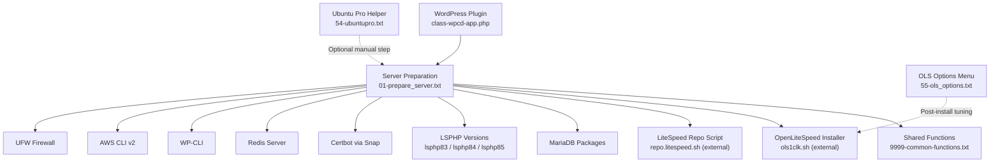
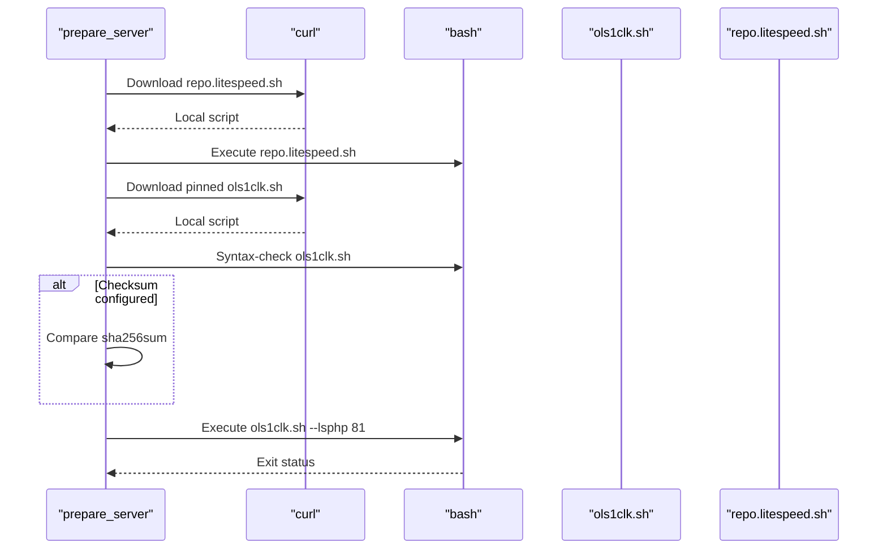
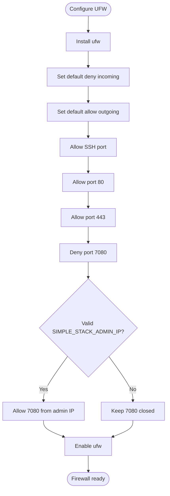
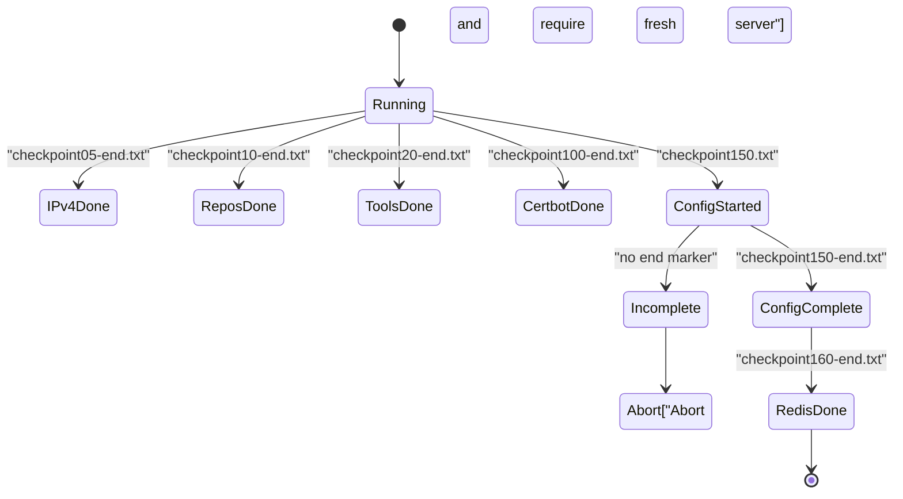
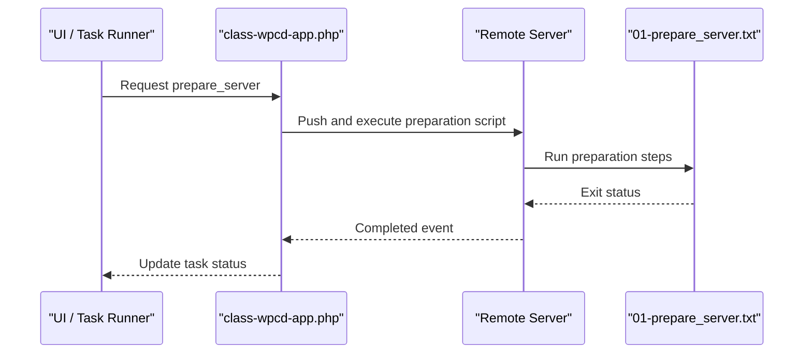
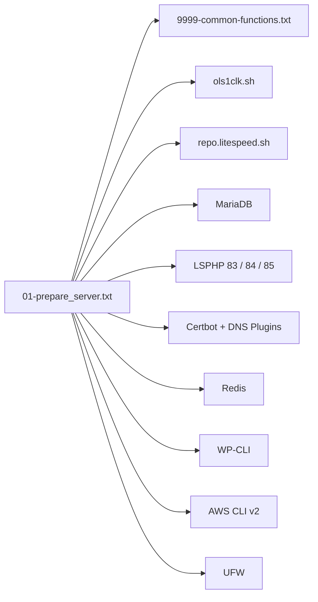

# Server Preparation Scripts

<cite>
**Referenced Files in This Document**   
- [01-prepare_server.txt](file://includes/core/apps/wordpress-app/scripts/v2/raw/01-prepare_server.txt)
- [9999-common-functions.txt](file://includes/core/apps/wordpress-app/scripts/v2/raw/9999-common-functions.txt)
- [54-ubuntupro.txt](file://includes/core/apps/wordpress-app/scripts/v2/raw/54-ubuntupro.txt)
- [55-ols_options.txt](file://includes/core/apps/wordpress-app/scripts/v2/raw/55-ols_options.txt)
- [class-wpcd-app.php](file://includes/core/apps/class-wpcd-app.php)
- [SIMPLESTACK.md](file://docs/SIMPLESTACK.md)
</cite>

## Table of Contents
1. [Introduction](#introduction)
2. [Project Structure](#project-structure)
3. [Core Components](#core-components)
4. [Architecture Overview](#architecture-overview)
5. [Detailed Component Analysis](#detailed-component-analysis)
6. [Dependency Analysis](#dependency-analysis)
7. [Performance Considerations](#performance-considerations)
8. [Troubleshooting Guide](#troubleshooting-guide)
9. [Conclusion](#conclusion)
10. [Appendices](#appendices)

## Introduction
This document explains the server preparation phase used by SimpleStack to provision Ubuntu servers for OpenLiteSpeed-based WordPress hosting. It covers:

- Ubuntu version validation and supported release mapping.
- Repository management, package installation, and dependency setup.
- OpenLiteSpeed one-click installer integration with security pinning.
- PHP version management, session configuration, opcache tuning, and function restrictions.
- Firewall hardening, including strict control of the OpenLiteSpeed WebAdmin console.
- The checkpoint system that enables resumable provisioning.
- Error handling strategies and common failure points.
- Guidance for modifying system configurations and adding custom preparation steps.

The preparation scripts are designed for unattended execution, fail fast on critical errors, and leave the system in a safe state when interrupted.

## Project Structure
The preparation logic lives under the WordPress app script collection. The key files are:

| File | Responsibility |
|---|---|
| `includes/core/apps/wordpress-app/scripts/v2/raw/01-prepare_server.txt` | Main server preparation script. Handles OS checks, repositories, OpenLiteSpeed, MariaDB, PHP, Certbot, Redis, WP-CLI, AWS CLI, UFW firewall, and post-processing hooks. |
| `includes/core/apps/wordpress-app/scripts/v2/raw/9999-common-functions.txt` | Shared functions and global variables, including Ubuntu version detection, LSPHP defaults, webserver detection, default PHP selection, admin IP normalisation, and restart helpers. |
| `includes/core/apps/wordpress-app/scripts/v2/raw/54-ubuntupro.txt` | Interactive helper to attach or detach an Ubuntu Pro token. Not part of the automated preparation flow. |
| `includes/core/apps/wordpress-app/scripts/v2/raw/55-ols_options.txt` | Interactive OpenLiteSpeed options menu covering compression, HTTP/2, browser cache, XML-RPC, REST API, security headers, CSP, HSTS, XSS protection, and more. |
| `includes/core/apps/class-wpcd-app.php` | WordPress plugin code that routes commands such as `prepare_server`, logs completion events, and exposes hooks for extensions. |
| `docs/SIMPLESTACK.md` | High-level documentation describing SimpleStack’s scope, supported stack, and important security notes about port 7080. |

**Diagram sources**
- [class-wpcd-app.php:866-950](file://includes/core/apps/class-wpcd-app.php#L866-L950)
- [01-prepare_server.txt:180-345](file://includes/core/apps/wordpress-app/scripts/v2/raw/01-prepare_server.txt#L180-L345)
- [9999-common-functions.txt:16-70](file://includes/core/apps/wordpress-app/scripts/v2/raw/9999-common-functions.txt#L16-L70)
- [55-ols_options.txt:109-160](file://includes/core/apps/wordpress-app/scripts/v2/raw/55-ols_options.txt#L109-L160)
- [54-ubuntupro.txt:16-31](file://includes/core/apps/wordpress-app/scripts/v2/raw/54-ubuntupro.txt#L16-L31)

**Section sources**
- [01-prepare_server.txt:1-708](file://includes/core/apps/wordpress-app/scripts/v2/raw/01-prepare_server.txt#L1-L708)
- [9999-common-functions.txt:16-70](file://includes/core/apps/wordpress-app/scripts/v2/raw/9999-common-functions.txt#L16-L70)
- [54-ubuntupro.txt:1-82](file://includes/core/apps/wordpress-app/scripts/v2/raw/54-ubuntupro.txt#L1-L82)
- [55-ols_options.txt:1-160](file://includes/core/apps/wordpress-app/scripts/v2/raw/55-ols_options.txt#L1-L160)
- [class-wpcd-app.php:866-950](file://includes/core/apps/class-wpcd-app.php#L866-L950)
- [SIMPLESTACK.md:181-195](file://docs/SIMPLESTACK.md#L181-L195)

## Core Components
The preparation phase is driven by a single main script that coordinates multiple subsystems through shared helper functions.

### Main Preparation Script
- Requires root execution.
- Forces noninteractive package installation.
- Loads shared functions from the common functions file.
- Normalises the administration IP before firewall rules are applied.
- Validates the webserver type; SimpleStack only supports OpenLiteSpeed and LiteSpeed Enterprise.
- Validates the Ubuntu release against supported versions.
- Creates a checkpoint directory for resumable runs.
- Installs OpenLiteSpeed, MariaDB, LSPHP versions, Certbot, Redis, WP-CLI, AWS CLI, and configures UFW.
- Applies PHP session paths, opcache settings, timezone defaults, restricted function lists, and cron-based `.htaccess` monitoring.
- Supports optional post-processing scripts.

### Shared Functions and Globals
- Detects Ubuntu version and codename.
- Defines supported Ubuntu releases: 24.04 (`noble`) and 26.04 (`resolute`).
- Tracks installed LSPHP versions and the default short PHP version.
- Detects whether OpenLiteSpeed, LiteSpeed Enterprise, or another webserver is present.
- Sets the default `php`, `phar`, `pecl`, and `pear` alternatives to a chosen LSPHP binary.
- Lists installed LSPHP versions.
- Normalises the `SIMPLE_STACK_ADMIN_IP` value so invalid inputs cannot accidentally open the WebAdmin console.
- Restarts the appropriate webserver safely.

### Optional Helpers
- **Ubuntu Pro helper**: interactive script to attach or remove an Ubuntu Pro token.
- **OLS options menu**: interactive script to adjust OpenLiteSpeed site and server options after provisioning.

**Section sources**
- [01-prepare_server.txt:1-46](file://includes/core/apps/wordpress-app/scripts/v2/raw/01-prepare_server.txt#L1-L46)
- [01-prepare_server.txt:48-67](file://includes/core/apps/wordpress-app/scripts/v2/raw/01-prepare_server.txt#L48-L67)
- [01-prepare_server.txt:74-93](file://includes/core/apps/wordpress-app/scripts/v2/raw/01-prepare_server.txt#L74-L93)
- [01-prepare_server.txt:180-345](file://includes/core/apps/wordpress-app/scripts/v2/raw/01-prepare_server.txt#L180-L345)
- [01-prepare_server.txt:450-544](file://includes/core/apps/wordpress-app/scripts/v2/raw/01-prepare_server.txt#L450-L544)
- [01-prepare_server.txt:616-674](file://includes/core/apps/wordpress-app/scripts/v2/raw/01-prepare_server.txt#L616-L674)
- [9999-common-functions.txt:16-70](file://includes/core/apps/wordpress-app/scripts/v2/raw/9999-common-functions.txt#L16-L70)
- [9999-common-functions.txt:279-358](file://includes/core/apps/wordpress-app/scripts/v2/raw/9999-common-functions.txt#L279-L358)
- [9999-common-functions.txt:378-411](file://includes/core/apps/wordpress-app/scripts/v2/raw/9999-common-functions.txt#L378-L411)
- [9999-common-functions.txt:487-513](file://includes/core/apps/wordpress-app/scripts/v2/raw/9999-common-functions.txt#L487-L513)
- [54-ubuntupro.txt:16-31](file://includes/core/apps/wordpress-app/scripts/v2/raw/54-ubuntupro.txt#L16-L31)
- [55-ols_options.txt:109-160](file://includes/core/apps/wordpress-app/scripts/v2/raw/55-ols_options.txt#L109-L160)

## Architecture Overview
The preparation workflow is sequential but checkpointed. Critical failures stop provisioning; noncritical warnings may allow continuation where explicitly designed.

```mermaid
flowchart TD
Start(["Start prepare_server"]) --> RootCheck["Verify root user"]
RootCheck --> LoadCommon["Load shared functions"]
LoadCommon --> ValidateWebserver["Validate webserver_type"]
ValidateWebserver --> ValidateUbuntu["Validate Ubuntu version"]
ValidateUbuntu --> Checkpoints["Create checkpoint folder"]
Checkpoints --> IPv4Pref["Force IPv4 preference"]
IPv4Pref --> RefreshRepos["Refresh APT repositories"]
RefreshRepos --> AddRepos["Add software-properties and PHP PPA"]
AddRepos --> InstallBase["Install curl and net-tools"]
InstallBase --> AddLiteSpeedRepo["Download and run repo.litespeed.sh"]
AddLiteSpeedRepo --> FetchOLS1CLK["Fetch pinned ols1clk.sh"]
FetchOLS1CLK --> SyntaxCheck["Syntax-check downloaded installer"]
SyntaxCheck --> ChecksumVerify["Optionally verify SHA-256"]
ChecksumVerify --> RunOLS1CLK["Run ols1clk.sh with lsphp81"]
RunOLS1CLK --> InstallMariaDB["Install MariaDB and utilities"]
InstallMariaDB --> BuildEssentials["Install build dependencies"]
BuildEssentials --> InstallLSPHP["Install lsphp83, lsphp84, lsphp85"]
InstallLSPHP --> SetDefaultPHP["Set default PHP to lsphp84"]
SetDefaultPHP --> InstallCertbot["Install snapd and certbot plugins"]
InstallCertbot --> ConfigurePHP["Configure PHP sessions, opcache, timezone, restrictions"]
ConfigurePHP --> InstallRedis["Install and configure Redis"]
InstallRedis --> InstallWPCLI["Install WP-CLI"]
InstallWPCLI --> InstallAWSCLI["Install AWS CLI v2"]
InstallAWSCLI --> ConfigureUFW["Configure UFW firewall"]
ConfigureUFW --> PostProcess["Run optional post-processing script"]
PostProcess --> End(["Installation completed"])
```

**Diagram sources**
- [01-prepare_server.txt:1-11](file://includes/core/apps/wordpress-app/scripts/v2/raw/01-prepare_server.txt#L1-L11)
- [01-prepare_server.txt:29-46](file://includes/core/apps/wordpress-app/scripts/v2/raw/01-prepare_server.txt#L29-L46)
- [01-prepare_server.txt:48-67](file://includes/core/apps/wordpress-app/scripts/v2/raw/01-prepare_server.txt#L48-L67)
- [01-prepare_server.txt:180-345](file://includes/core/apps/wordpress-app/scripts/v2/raw/01-prepare_server.txt#L180-L345)
- [01-prepare_server.txt:348-410](file://includes/core/apps/wordpress-app/scripts/v2/raw/01-prepare_server.txt#L348-L410)
- [01-prepare_server.txt:450-544](file://includes/core/apps/wordpress-app/scripts/v2/raw/01-prepare_server.txt#L450-L544)
- [01-prepare_server.txt:547-605](file://includes/core/apps/wordpress-app/scripts/v2/raw/01-prepare_server.txt#L547-L605)
- [01-prepare_server.txt:616-674](file://includes/core/apps/wordpress-app/scripts/v2/raw/01-prepare_server.txt#L616-L674)
- [01-prepare_server.txt:693-703](file://includes/core/apps/wordpress-app/scripts/v2/raw/01-prepare_server.txt#L693-L703)

## Detailed Component Analysis

### Ubuntu Version Validation
The shared functions detect the running Ubuntu release and codename, then define the supported releases:

- Supported versions: 24.04 (`noble`) and 26.04 (`resolute`).
- The preparation script compares the detected version against the supported list.
- Unsupported releases produce a clear error and exit immediately.

This prevents later package manager failures caused by unsupported distributions.

**Section sources**
- [9999-common-functions.txt:16-27](file://includes/core/apps/wordpress-app/scripts/v2/raw/9999-common-functions.txt#L16-L27)
- [01-prepare_server.txt:48-67](file://includes/core/apps/wordpress-app/scripts/v2/raw/01-prepare_server.txt#L48-L67)

### Repository Management
The script manages repositories in stages:

1. Exports `DEBIAN_FRONTEND=noninteractive` to avoid interactive prompts during unattended provisioning.
2. Refreshes existing APT repositories.
3. Installs `software-properties-common`.
4. Adds the Ondřej Surý PHP PPA.
5. Deliberately avoids adding the nginx PPA because SimpleStack provisions OpenLiteSpeed only.
6. Installs `curl` and `net-tools`.
7. Downloads and executes `repo.litespeed.sh` to add the official LiteSpeed repository.
8. Runs `apt-get update` again after adding the LiteSpeed repository.

Repository failures are treated as fatal at early stages because they block all subsequent package installations.

**Section sources**
- [01-prepare_server.txt:8-11](file://includes/core/apps/wordpress-app/scripts/v2/raw/01-prepare_server.txt#L8-L11)
- [01-prepare_server.txt:109-175](file://includes/core/apps/wordpress-app/scripts/v2/raw/01-prepare_server.txt#L109-L175)
- [01-prepare_server.txt:185-203](file://includes/core/apps/wordpress-app/scripts/v2/raw/01-prepare_server.txt#L185-L203)

### Package Installation Process
The installation process is split into logical blocks:

| Stage | Packages / Actions | Notes |
|---|---|---|
| OpenLiteSpeed baseline | LiteSpeed repository, `ols1clk.sh` with `--lsphp 81` | Pins installer tag and optionally verifies checksum. |
| Database | `mariadb-server`, `mariadb-client`, `apache2-utils`, `unzip`, `rename`, `bubblewrap` | Uses `--force-confnew` to handle provider-specific config conflicts. |
| Build tools | `libmagickwand-dev`, `pkg-config`, `build-essential`, `snmp`, `openssl`, `libssl-dev`, `autoconf`, `automake`, `libtool`, `libxml2-dev` | Split into two install calls to keep UI updates responsive. |
| PHP runtime | Explicit loop over `g_php_versions=(83 84 85)` installing core and extension packages | Extensions missing from the repo are warned but do not abort provisioning. |
| Default PHP | Sets `php`, `phar`, `pecl`, `pear` to `lsphp84` | Updates OLS web config and symlink as needed. |
| Certbot | Installs `snapd`, `certbot`, DNS plugins | Fails if Certbot cannot be installed because certificate issuance depends on it. |
| Redis | Installs `redis-server`, sets systemd supervision, installs per-PHP redis extension | Verifies `/etc/redis/redis.conf` exists. |
| Utilities | WP-CLI, AWS CLI v2, `update-notifier-common`, `libxmlb2` | AWS CLI detects ARM vs x86_64. |

**Section sources**
- [01-prepare_server.txt:180-345](file://includes/core/apps/wordpress-app/scripts/v2/raw/01-prepare_server.txt#L180-L345)
- [01-prepare_server.txt:348-410](file://includes/core/apps/wordpress-app/scripts/v2/raw/01-prepare_server.txt#L348-L410)
- [01-prepare_server.txt:547-605](file://includes/core/apps/wordpress-app/scripts/v2/raw/01-prepare_server.txt#L547-L605)
- [9999-common-functions.txt:65-70](file://includes/core/apps/wordpress-app/scripts/v2/raw/9999-common-functions.txt#L65-L70)
- [9999-common-functions.txt:316-358](file://includes/core/apps/wordpress-app/scripts/v2/raw/9999-common-functions.txt#L316-L358)

### OpenLiteSpeed One-Click Installer Integration
The script integrates the official OpenLiteSpeed one-click installer securely:

- Downloads `ols1clk.sh` from a tagged release URL.
- Performs a syntax check with `bash -n`.
- Optionally verifies the SHA-256 checksum using `SIMPLE_STACK_OLS1CLK_SHA256`.
- Runs the installer with `--lsphp 81` to establish the OpenLiteSpeed baseline.
- Later installs additional LSPHP versions explicitly rather than relying on repository globs.

This approach reduces supply-chain risk compared to piping an unpinned `master` branch directly into a shell.

**Diagram sources**
- [01-prepare_server.txt:185-256](file://includes/core/apps/wordpress-app/scripts/v2/raw/01-prepare_server.txt#L185-L256)

**Section sources**
- [01-prepare_server.txt:185-256](file://includes/core/apps/wordpress-app/scripts/v2/raw/01-prepare_server.txt#L185-L256)

### PHP Version Management
SimpleStack installs three LSPHP versions:

- `lsphp83`
- `lsphp84`
- `lsphp85`

`lsphp84` is set as the default PHP binary and the version OpenLiteSpeed serves out of the box. The shared function `gf_set_default_php` centralises alternative management for `php`, `phar`, `pecl`, and `pear`.

Extension packages are installed per PHP version. Missing optional extensions produce warnings instead of failing the entire provisioning run, which improves resilience when the LiteSpeed repository lags behind core package availability.

**Section sources**
- [01-prepare_server.txt:300-345](file://includes/core/apps/wordpress-app/scripts/v2/raw/01-prepare_server.txt#L300-L345)
- [9999-common-functions.txt:65-70](file://includes/core/apps/wordpress-app/scripts/v2/raw/9999-common-functions.txt#L65-L70)
- [9999-common-functions.txt:316-358](file://includes/core/apps/wordpress-app/scripts/v2/raw/9999-common-functions.txt#L316-L358)

### Security Hardening and PHP Configuration
During the configuration block, the script applies several security-related changes:

- Creates per-PHP session directories under `/var/lib/lsphp/session/...` with restrictive permissions.
- Sets `session.save_path` for each LSPHP version.
- Enables and tunes opcache across LSPHP versions.
- Sets `date.timezone = UTC` for each LSPHP version.
- Applies a restricted function list for newer PHP versions.
- Allows `proc_open` and `proc_close` globally for OpenLiteSpeed operation while keeping other dangerous functions disabled.
- Installs a cron job that monitors `.htaccess` changes and restarts OpenLiteSpeed when needed.
- Symlinks OpenLiteSpeed logs to `/var/log/lsws` for conventional access.
- Updates PECL channels for each LSPHP version.

Function restriction policy is intentionally conservative: dangerous functions are disabled, but OpenLiteSpeed requires specific process-control functions to remain available.

**Section sources**
- [01-prepare_server.txt:450-544](file://includes/core/apps/wordpress-app/scripts/v2/raw/01-prepare_server.txt#L450-L544)
- [55-ols_options.txt:148-149](file://includes/core/apps/wordpress-app/scripts/v2/raw/55-ols_options.txt#L148-L149)
- [9999-common-functions.txt:72-75](file://includes/core/apps/wordpress-app/scripts/v2/raw/9999-common-functions.txt#L72-L75)

### Firewall Configuration
The firewall is configured with a deny-by-default strategy:

- Installs `ufw`.
- Denies incoming traffic by default.
- Allows outgoing traffic by default.
- Opens SSH based on `/etc/ssh/sshd_config`.
- Opens ports 80 and 443 for HTTP and HTTPS.
- Denies port 7080, the OpenLiteSpeed WebAdmin console, by default.
- If `SIMPLE_STACK_ADMIN_IP` is set and valid, opens port 7080 only for that address.
- Enables UFW.

The admin IP is normalised before use. Invalid values, empty strings, or unreplaced placeholders collapse to an empty string, keeping port 7080 closed. This is a deliberate fail-closed security measure.

**Diagram sources**
- [01-prepare_server.txt:616-674](file://includes/core/apps/wordpress-app/scripts/v2/raw/01-prepare_server.txt#L616-L674)
- [9999-common-functions.txt:378-411](file://includes/core/apps/wordpress-app/scripts/v2/raw/9999-common-functions.txt#L378-L411)

**Section sources**
- [01-prepare_server.txt:616-674](file://includes/core/apps/wordpress-app/scripts/v2/raw/01-prepare_server.txt#L616-L674)
- [9999-common-functions.txt:378-411](file://includes/core/apps/wordpress-app/scripts/v2/raw/9999-common-functions.txt#L378-L411)
- [SIMPLESTACK.md:181-195](file://docs/SIMPLESTACK.md#L181-L195)

### Checkpoint System for Resumable Installations
The preparation script uses a `.wpcd-server-provision-checkpoints` directory to track progress:

| Checkpoint | Purpose |
|---|---|
| `script-ran-once.txt` | Indicates the script has been executed at least once. |
| `checkpoint05-end.txt` | IPv4 preference configuration. |
| `checkpoint10-end.txt` | Repository refresh. |
| `checkpoint20-end.txt` | Common repositories and base tools. |
| `checkpoint100-end.txt` | Certbot installation. |
| `checkpoint150.txt` / `checkpoint150-end.txt` | Large configuration block; incomplete completion forces recovery guidance. |
| `checkpoint160-end.txt` | Redis installation. |

If a large configuration block starts but does not complete, the script refuses to resume and instructs the operator to start over with a new server. This protects against partially applied configuration states.

**Diagram sources**
- [01-prepare_server.txt:74-93](file://includes/core/apps/wordpress-app/scripts/v2/raw/01-prepare_server.txt#L74-L93)
- [01-prepare_server.txt:95-106](file://includes/core/apps/wordpress-app/scripts/v2/raw/01-prepare_server.txt#L95-L106)
- [01-prepare_server.txt:109-175](file://includes/core/apps/wordpress-app/scripts/v2/raw/01-prepare_server.txt#L109-L175)
- [01-prepare_server.txt:348-410](file://includes/core/apps/wordpress-app/scripts/v2/raw/01-prepare_server.txt#L348-L410)
- [01-prepare_server.txt:419-544](file://includes/core/apps/wordpress-app/scripts/v2/raw/01-prepare_server.txt#L419-L544)
- [01-prepare_server.txt:547-577](file://includes/core/apps/wordpress-app/scripts/v2/raw/01-prepare_server.txt#L547-L577)

**Section sources**
- [01-prepare_server.txt:74-93](file://includes/core/apps/wordpress-app/scripts/v2/raw/01-prepare_server.txt#L74-L93)
- [01-prepare_server.txt:419-544](file://includes/core/apps/wordpress-app/scripts/v2/raw/01-prepare_server.txt#L419-L544)

### Error Handling Strategies
The preparation script follows consistent error-handling patterns:

- **Root check**: exits immediately if not run as root.
- **Missing shared functions**: exits before proceeding.
- **Unsupported webserver type**: fails fast with a readable message.
- **Unsupported Ubuntu version**: fails fast with supported versions listed.
- **Package installation failures**: prints a failure message and exits.
- **Optional extension failures**: warns and continues.
- **Incomplete configuration block**: refuses to resume and requires a fresh server.
- **Firewall rule failures**: warns but continues, allowing operators to inspect rules manually.
- **Certbot installation failure**: treats as fatal because certificate issuance depends on it.

These strategies balance automation safety with operational flexibility.

**Section sources**
- [01-prepare_server.txt:1-6](file://includes/core/apps/wordpress-app/scripts/v2/raw/01-prepare_server.txt#L1-L6)
- [01-prepare_server.txt:14-20](file://includes/core/apps/wordpress-app/scripts/v2/raw/01-prepare_server.txt#L14-L20)
- [01-prepare_server.txt:29-46](file://includes/core/apps/wordpress-app/scripts/v2/raw/01-prepare_server.txt#L29-L46)
- [01-prepare_server.txt:48-67](file://includes/core/apps/wordpress-app/scripts/v2/raw/01-prepare_server.txt#L48-L67)
- [01-prepare_server.txt:115-124](file://includes/core/apps/wordpress-app/scripts/v2/raw/01-prepare_server.txt#L115-L124)
- [01-prepare_server.txt:136-175](file://includes/core/apps/wordpress-app/scripts/v2/raw/01-prepare_server.txt#L136-L175)
- [01-prepare_server.txt:320-331](file://includes/core/apps/wordpress-app/scripts/v2/raw/01-prepare_server.txt#L320-L331)
- [01-prepare_server.txt:427-434](file://includes/core/apps/wordpress-app/scripts/v2/raw/01-prepare_server.txt#L427-L434)
- [01-prepare_server.txt:620-674](file://includes/core/apps/wordpress-app/scripts/v2/raw/01-prepare_server.txt#L620-L674)
- [01-prepare_server.txt:375-384](file://includes/core/apps/wordpress-app/scripts/v2/raw/01-prepare_server.txt#L375-L384)

### Command Routing and Completion Hooks
The WordPress plugin routes the `prepare_server` command and emits completion events. This allows the UI and external integrations to react when provisioning finishes.

**Diagram sources**
- [class-wpcd-app.php:866-950](file://includes/core/apps/class-wpcd-app.php#L866-L950)

**Section sources**
- [class-wpcd-app.php:866-950](file://includes/core/apps/class-wpcd-app.php#L866-L950)

## Dependency Analysis
The preparation scripts have both internal and external dependencies.

| Dependency Type | Items | Notes |
|---|---|---|
| Internal shared code | `9999-common-functions.txt` | Provides Ubuntu detection, LSPHP defaults, webserver detection, restart helpers, and admin IP normalisation. |
| External installer | `ols1clk.sh` | Official OpenLiteSpeed one-click installer; pinned by tag and optionally verified by checksum. |
| External repository script | `repo.litespeed.sh` | Adds the LiteSpeed package repository. |
| System services | OpenLiteSpeed, MariaDB, Redis, UFW, snapd/certbot | Installed and configured during preparation. |
| PHP runtime | LSPHP 83, 84, 85 | Installed explicitly; 84 is default. |
| Utilities | WP-CLI, AWS CLI v2, curl, net-tools, unzip, rename, bubblewrap | Supporting tools for site operations and provisioning. |

**Diagram sources**
- [01-prepare_server.txt:180-345](file://includes/core/apps/wordpress-app/scripts/v2/raw/01-prepare_server.txt#L180-L345)
- [01-prepare_server.txt:348-410](file://includes/core/apps/wordpress-app/scripts/v2/raw/01-prepare_server.txt#L348-L410)
- [01-prepare_server.txt:547-605](file://includes/core/apps/wordpress-app/scripts/v2/raw/01-prepare_server.txt#L547-L605)
- [01-prepare_server.txt:616-674](file://includes/core/apps/wordpress-app/scripts/v2/raw/01-prepare_server.txt#L616-L674)
- [9999-common-functions.txt:16-70](file://includes/core/apps/wordpress-app/scripts/v2/raw/9999-common-functions.txt#L16-L70)

**Section sources**
- [01-prepare_server.txt:180-674](file://includes/core/apps/wordpress-app/scripts/v2/raw/01-prepare_server.txt#L180-L674)
- [9999-common-functions.txt:16-70](file://includes/core/apps/wordpress-app/scripts/v2/raw/9999-common-functions.txt#L16-L70)

## Performance Considerations
- **Split long package installs**: Build essentials and LSPHP extension installs are split into multiple `apt-get` calls to keep the UI responsive.
- **Deterministic PHP installation**: Explicit loops over known LSPHP versions avoid unpredictable glob expansion and silent failures.
- **Opcache enabled**: Opcache is enabled and tuned for each LSPHP version to improve PHP execution performance.
- **Session storage**: Dedicated session directories per PHP version reduce contention and improve reliability.
- **Timezone defaulting**: Setting `date.timezone = UTC` avoids time-related performance and logging issues.
- **PECL channel updates**: Updating PECL channels per LSPHP version helps extension installs succeed faster.

[No sources needed since this section provides general guidance]

## Troubleshooting Guide

### Common Provisioning Failures

| Symptom | Likely Cause | Recommended Action |
|---|---|---|
| Provisioning stops early with “unsupported webserver” | `webserver_type` is not `ols` or `ols-enterprise` | Ensure the environment supplies a supported webserver type. |
| Provisioning stops with unsupported Ubuntu version | Running on an unsupported distribution | Use Ubuntu 24.04 or 26.04. |
| Repository refresh fails | Network or APT configuration issue | Check connectivity, DNS, and APT configuration before retrying. |
| LiteSpeed repository script fails | Network or repository URL issue | Verify TLS connectivity and the LiteSpeed repository URL. |
| `ols1clk.sh` syntax check fails | Corrupted or incompatible downloaded installer | Inspect the downloaded script and ensure the pinned tag matches expectations. |
| Checksum verification fails | `SIMPLE_STACK_OLS1CLK_SHA256` does not match the fetched script | Update the expected checksum or fetch the intended tagged release. |
| Certbot installation fails | `snapd` unhealthy or network issue | Check `systemctl status snapd`, network access, and retry. |
| Redis config missing after install | Partial Redis installation | Reinstall Redis and verify `/etc/redis/redis.conf`. |
| Port 7080 unreachable | Admin IP not configured or blocked by firewall | Provide a valid `SIMPLE_STACK_ADMIN_IP`; otherwise expect port 7080 to stay closed. |
| Firewall rules look wrong | Non-fatal firewall rule errors occurred | Manually inspect UFW rules and correct them if necessary. |
| Configuration block resumes incorrectly | `checkpoint150.txt` exists without `checkpoint150-end.txt` | Do not resume; provision a fresh server as instructed. |

### Debugging Tips
- Confirm root execution before running preparation scripts.
- Check the checkpoint directory for partial progress markers.
- Review UFW rules with `ufw status`.
- Verify OpenLiteSpeed service status and logs.
- Confirm LSPHP binaries exist under `/usr/local/lsws/lsphp*`.
- Validate Certbot installation with `snap list certbot`.
- Use the OpenLiteSpeed options menu for post-install tuning.
- Use the Ubuntu Pro helper only when you need Ubuntu Pro features.

**Section sources**
- [01-prepare_server.txt:1-6](file://includes/core/apps/wordpress-app/scripts/v2/raw/01-prepare_server.txt#L1-L6)
- [01-prepare_server.txt:29-46](file://includes/core/apps/wordpress-app/scripts/v2/raw/01-prepare_server.txt#L29-L46)
- [01-prepare_server.txt:48-67](file://includes/core/apps/wordpress-app/scripts/v2/raw/01-prepare_server.txt#L48-L67)
- [01-prepare_server.txt:375-384](file://includes/core/apps/wordpress-app/scripts/v2/raw/01-prepare_server.txt#L375-L384)
- [01-prepare_server.txt:427-434](file://includes/core/apps/wordpress-app/scripts/v2/raw/01-prepare_server.txt#L427-L434)
- [01-prepare_server.txt:620-674](file://includes/core/apps/wordpress-app/scripts/v2/raw/01-prepare_server.txt#L620-L674)
- [55-ols_options.txt:109-160](file://includes/core/apps/wordpress-app/scripts/v2/raw/55-ols_options.txt#L109-L160)
- [54-ubuntupro.txt:16-31](file://includes/core/apps/wordpress-app/scripts/v2/raw/54-ubuntupro.txt#L16-L31)

## Conclusion
The SimpleStack server preparation phase is a hardened, checkpointed provisioning pipeline focused on OpenLiteSpeed and Ubuntu 24.04/26.04. It validates the operating system, manages repositories securely, installs OpenLiteSpeed through a pinned one-click installer, configures multiple LSPHP versions, enforces restrictive PHP settings, and applies a deny-by-default firewall with explicit exceptions for SSH, HTTP, HTTPS, and optionally the OpenLiteSpeed WebAdmin console.

For operators extending the system:

- Prefer modifying shared functions in the common functions file for reusable behaviour.
- Add new preparation steps only after careful error handling and checkpoint placement.
- Never expose port 7080 broadly; always validate the admin IP.
- Treat incomplete configuration checkpoints as reasons to rebuild rather than resume.
- Use the OpenLiteSpeed options menu and Ubuntu Pro helper for post-install tasks rather than editing core preparation scripts.

[No sources needed since this section summarizes without analyzing specific files]

## Appendices

### Modifying System Configurations
- **Change supported Ubuntu versions**: Update the supported version constants in the shared functions file.
- **Change default PHP version**: Update the default LSPHP short version and the explicit installation loop in the preparation script.
- **Adjust PHP restrictions**: Modify the restricted function list in the shared functions file and the PHP configuration block in the preparation script.
- **Change firewall rules**: Edit the UFW configuration block in the preparation script, ensuring port 7080 remains closed unless explicitly allowed for a validated admin IP.
- **Add custom preparation steps**: Insert a new checkpointed block in the preparation script and call shared functions where possible.

**Section sources**
- [9999-common-functions.txt:16-27](file://includes/core/apps/wordpress-app/scripts/v2/raw/9999-common-functions.txt#L16-L27)
- [9999-common-functions.txt:65-70](file://includes/core/apps/wordpress-app/scripts/v2/raw/9999-common-functions.txt#L65-L70)
- [9999-common-functions.txt:72-75](file://includes/core/apps/wordpress-app/scripts/v2/raw/9999-common-functions.txt#L72-L75)
- [01-prepare_server.txt:300-345](file://includes/core/apps/wordpress-app/scripts/v2/raw/01-prepare_server.txt#L300-L345)
- [01-prepare_server.txt:450-544](file://includes/core/apps/wordpress-app/scripts/v2/raw/01-prepare_server.txt#L450-L544)
- [01-prepare_server.txt:616-674](file://includes/core/apps/wordpress-app/scripts/v2/raw/01-prepare_server.txt#L616-L674)

### Adding Custom Preparation Steps
Recommended pattern:

1. Create a new checkpoint marker near the desired stage.
2. Wrap the new logic in a conditional block that skips if the end marker exists.
3. Handle errors explicitly: print a meaningful message and exit on fatal failures.
4. Use shared functions for repeated actions such as restarting the webserver or detecting the webserver type.
5. Place the end marker only after successful completion.
6. Test the checkpoint behavior by creating and removing the marker files.

**Section sources**
- [01-prepare_server.txt:74-93](file://includes/core/apps/wordpress-app/scripts/v2/raw/01-prepare_server.txt#L74-L93)
- [01-prepare_server.txt:109-175](file://includes/core/apps/wordpress-app/scripts/v2/raw/01-prepare_server.txt#L109-L175)
- [01-prepare_server.txt:419-544](file://includes/core/apps/wordpress-app/scripts/v2/raw/01-prepare_server.txt#L419-L544)
- [01-prepare_server.txt:547-577](file://includes/core/apps/wordpress-app/scripts/v2/raw/01-prepare_server.txt#L547-L577)