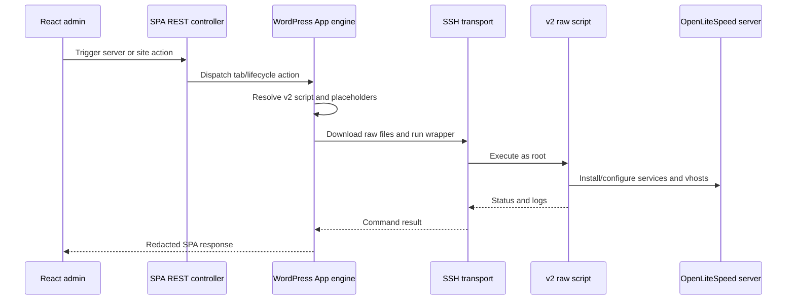

# Server Provisioning Scripts

<cite>
**Referenced Files in This Document**
- [Script architecture](file://includes/core/apps/wordpress-app/scripts/v2/readme.txt)
- [Server preparation](file://includes/core/apps/wordpress-app/scripts/v2/raw/01-prepare_server.txt)
- [Common functions](file://includes/core/apps/wordpress-app/scripts/v2/raw/9999-common-functions.txt)
- [WordPress installation](file://includes/core/apps/wordpress-app/scripts/v2/raw/02-install_wordpress_site.txt)
- [HTTPS management](file://includes/core/apps/wordpress-app/scripts/v2/raw/04-manage_https.txt)
- [PHP version management](file://includes/core/apps/wordpress-app/scripts/v2/raw/38-server_php_version.txt)
- [Netdata](file://includes/core/apps/wordpress-app/scripts/v2/raw/43-netdata.txt)
- [OLS WebAdmin](file://includes/core/apps/wordpress-app/scripts/v2/raw/56-ols_manage_admin_console.txt)
</cite>

## Purpose

The v2 scripts install and manage the supported OpenLiteSpeed stack on Ubuntu 24.04/26.04. PHP
builds commands, substitutes secrets and identifiers into wrappers, sends them over SSH and records
command output. Bash performs the remote work.

There is one runtime script family. The working tree has no v1 scripts and no version-selection
fallback.

## Execution model

## Important scripts

| Script | Responsibility |
|---|---|
| `01-prepare_server.txt` | OS validation, repositories, OLS/LSPHP install, MariaDB, firewall and base hardening |
| `02-install_wordpress_site.txt` | Site database, WordPress install, OLS vhost and post-processing |
| `04-manage_https.txt` | OLS vhost SSL and certbot lifecycle |
| `38-server_php_version.txt` | Default PHP selection through shared helpers |
| `43-netdata.txt` | OLS-only Netdata installation and proxy vhost |
| `56-ols_manage_admin_console.txt` | Fail-closed WebAdmin bind address and port 7080 rules |
| `66-sstk_post_install.txt` | Optional site-hardening hook |
| `9999-common-functions.txt` | Shared OLS, database, PHP, HTTPS and site helpers |

## Security properties

- Only `webserver_type=ols` is accepted.
- Only Ubuntu 24.04 and 26.04 pass the release guard.
- PHP 8.3, 8.4 and 8.5 are installed explicitly; 8.4 is default.
- `ols1clk.sh` is pinned to `v3.1`, fetched with certificate verification and syntax-checked.
- `SSTK_OLS1CLK_SHA256` enables an additional checksum gate when configured.
- Port 7080 is denied by default and never allowed from `0.0.0.0/0` or `::/0`.
- Vhost hardening denies sensitive files, upload PHP execution, backup directories and dotfiles
  while preserving the ACME challenge path.
- Destructive database identifiers are validated before SQL is issued.

## Idempotency and recovery

Server preparation uses checkpoint marker files. OLS configuration helpers are designed to be
idempotent, and `gf_harden_ols_conf()` returns without rewriting a vhost that already has the
hardened context and rules.

A failed wrapper should stop before later dependent commands. Raw scripts exit non-zero on fatal
errors and write diagnostic output for the command log.

## Monitoring

Netdata is integrated through the OLS-only v2 script and an OLS proxy vhost. Monitorix is not part
of the active provisioning or tab implementation. Use the built-in statistics tab, Monit or
Netdata for current monitoring workflows.

## Troubleshooting

- **Unsupported web server or Ubuntu release:** inspect the early guard output; do not bypass it.
- **Installer checksum mismatch:** verify the pinned tag and supply the reviewed
  `SSTK_OLS1CLK_SHA256` value.
- **WebAdmin unreachable:** confirm whether an admin IP is configured; otherwise use the printed SSH
  tunnel command.
- **Provisioning resumes unexpectedly:** inspect `.sstk-server-provision-checkpoints` before
  clearing anything.
- **Site probe reports the wrong PHP:** confirm the vhost `lsapi:lsphpXX` handler; the security probe
  prefers it over CLI PHP.
- **Wrapper syntax failure:** run `bash bin/lint-sh.sh`, which renders placeholders before checking
  wrapper syntax.
