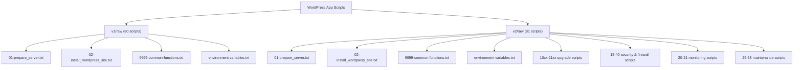
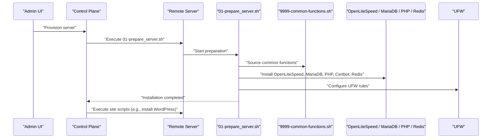
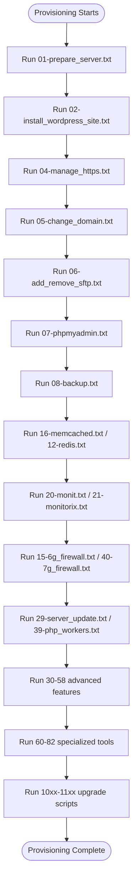
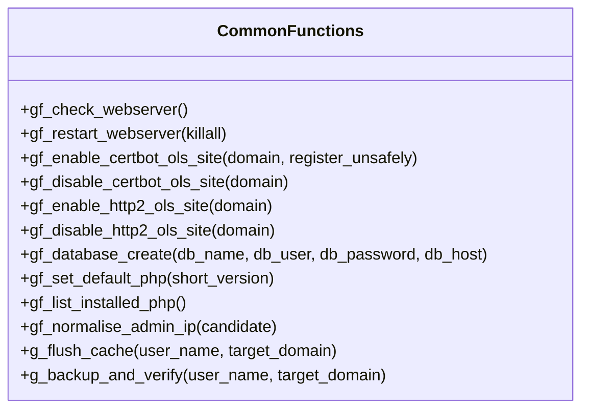
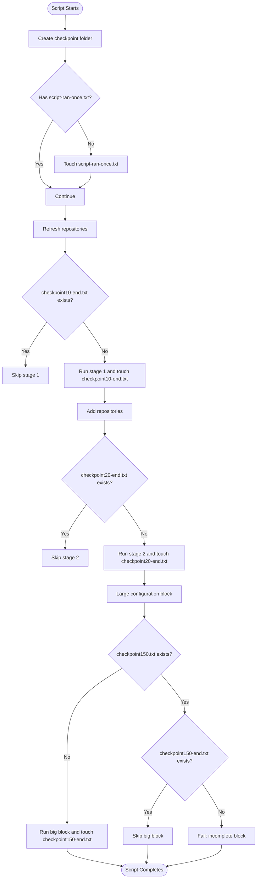
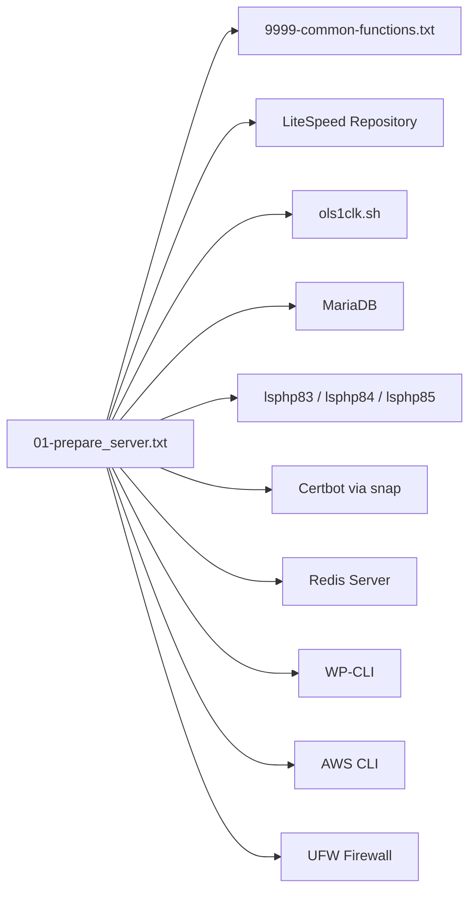

# Server Provisioning Scripts

<cite>
**Referenced Files in This Document**
- [README.md](file://README.md)
- [01-prepare_server.txt (v1)](file://includes/core/apps/wordpress-app/scripts/v1/raw/01-prepare_server.txt)
- [01-prepare_server.txt (v2)](file://includes/core/apps/wordpress-app/scripts/v2/raw/01-prepare_server.txt)
- [9999-common-functions.txt (v1)](file://includes/core/apps/wordpress-app/scripts/v1/raw/9999-common-functions.txt)
- [9999-common-functions.txt (v2)](file://includes/core/apps/wordpress-app/scripts/v2/raw/9999-common-functions.txt)
- [environment variables.txt (v1)](file://includes/core/apps/wordpress-app/scripts/v1/raw/environment%20variables.txt)
- [environment variables.txt (v2)](file://includes/core/apps/wordpress-app/scripts/v2/raw/environment%20variables.txt)
</cite>

## Update Summary
**Changes Made**
- Updated script architecture documentation to reflect the new v2 system with over 60 individual script files
- Enhanced coverage of server preparation, site installation, backup management, security configurations, and maintenance tasks
- Added detailed analysis of the expanded v2 script ecosystem including upgrade scripts, monitoring tools, and security utilities
- Updated common functions library documentation to include new v2 features like admin IP validation and PHP version management
- Expanded environment variable documentation to cover all 81+ scripts in the v2 architecture

## Table of Contents
1. [Introduction](#introduction)
2. [Project Structure](#project-structure)
3. [Core Components](#core-components)
4. [Architecture Overview](#architecture-overview)
5. [Detailed Component Analysis](#detailed-component-analysis)
6. [Dependency Analysis](#dependency-analysis)
7. [Performance Considerations](#performance-considerations)
8. [Troubleshooting Guide](#troubleshooting-guide)
9. [Conclusion](#conclusion)
10. [Appendices](#appendices)

## Introduction
This document explains the server provisioning script system that automates OpenLiteSpeed setup, PHP configuration, database installation, and WordPress deployment. The system has evolved into a comprehensive architecture with over 60 individual script files covering server preparation, site installation, backup management, security configurations, and maintenance tasks. It covers:
- Script versioning strategy between v1 and v2.
- Execution order and dependency management across the expanded script ecosystem.
- The common functions library and environment variable handling.
- Error recovery mechanisms and checkpoint-based resume behavior.
- Preparation phase scripts for system optimization, security hardening, and service installation.
- Examples for creating custom provisioning scripts, modifying existing ones, and debugging execution.
- Performance optimization techniques, parallel execution strategies, and rollback procedures.

The repository provisions servers at cloud providers, installs OpenLiteSpeed, PHP, MariaDB, Redis, Certbot, firewall rules, and a WordPress site through shell scripts executed over SSH. SimpleStack is OpenLiteSpeed only; nginx support was removed from v2.

**Section sources**
- [README.md:1-37](file://README.md#L1-L37)

## Project Structure
Provisioning scripts live under `includes/core/apps/wordpress-app/scripts/`. There are two major versions:
- `scripts/v1/raw/` — legacy scripts used by servers provisioned before the fork.
- `scripts/v2/raw/` — current scripts used by new servers with over 60 individual script files.

Each version contains:
- A numbered preparation and feature script set (for example, `01-prepare_server.txt`, `02-install_wordpress_site.txt`, etc.).
- A shared function library named `9999-common-functions.txt`.
- An `environment variables.txt` file describing expected inputs.

**Diagram sources**
- [01-prepare_server.txt (v1):1-20](file://includes/core/apps/wordpress-app/scripts/v1/raw/01-prepare_server.txt#L1-L20)
- [01-prepare_server.txt (v2):1-20](file://includes/core/apps/wordpress-app/scripts/v2/raw/01-prepare_server.txt#L1-L20)
- [9999-common-functions.txt (v1):1-14](file://includes/core/apps/wordpress-app/scripts/v1/raw/9999-common-functions.txt#L1-L14)
- [9999-common-functions.txt (v2):1-14](file://includes/core/apps/wordpress-app/scripts/v2/raw/9999-common-functions.txt#L1-L14)
- [environment variables.txt (v1):1-13](file://includes/core/apps/wordpress-app/scripts/v1/raw/environment%20variables.txt#L1-L13)
- [environment variables.txt (v2):1-13](file://includes/core/apps/wordpress-app/scripts/v2/raw/environment%20variables.txt#L1-L13)

**Section sources**
- [README.md:37-102](file://README.md#L37-L102)

## Core Components
The provisioning system is built around three core components:

1. **Preparation script (`01-prepare_server.txt`)**
   - Validates privileges and environment.
   - Sources the common functions library.
   - Normalizes admin IP and webserver type.
   - Resolves supported Ubuntu releases.
   - Installs OpenLiteSpeed, MariaDB, PHP versions, Certbot, Redis, WP-CLI, AWS CLI, UFW, and optional post-processing hooks.
   - Configures unattended upgrades, PHP settings, session paths, cron scanning, logs symlink, pecl channels, timezone defaults, firewall rules, and semaphore directories.

2. **Common functions library (`9999-common-functions.txt`)**
   - Provides reusable functions prefixed with `gf_` or `f_`.
   - Detects webserver type, manages OLS/Nginx restarts, handles SSL via Certbot, configures HTTP/2, creates databases, sets default LSPHP versions, lists installed PHP versions, and normalises the admin IP.
   - Includes cache flushing helpers and backup helpers.

3. **Environment variable documentation (`environment variables.txt`)**
   - Documents all expected variables per script, including `webserver_type`, `domain`, `action`, credentials, callback URLs, and operational flags.

These components work together to make provisioning deterministic, auditable, and recoverable.

**Section sources**
- [01-prepare_server.txt (v1):1-20](file://includes/core/apps/wordpress-app/scripts/v1/raw/01-prepare_server.txt#L1-L20)
- [01-prepare_server.txt (v2):1-28](file://includes/core/apps/wordpress-app/scripts/v2/raw/01-prepare_server.txt#L1-L28)
- [9999-common-functions.txt (v1):16-74](file://includes/core/apps/wordpress-app/scripts/v1/raw/9999-common-functions.txt#L16-L74)
- [9999-common-functions.txt (v2):16-74](file://includes/core/apps/wordpress-app/scripts/v2/raw/9999-common-functions.txt#L16-L74)
- [environment variables.txt (v1):1-13](file://includes/core/apps/wordpress-app/scripts/v1/raw/environment%20variables.txt#L1-L13)
- [environment variables.txt (v2):1-13](file://includes/core/apps/wordpress-app/scripts/v2/raw/environment%20variables.txt#L1-L13)

## Architecture Overview
At a high level, the control plane sends commands to a remote server over SSH. Each command maps to a script under `scripts/v1/raw` or `scripts/v2/raw`. The preparation script runs first, then site-specific scripts follow.

**Diagram sources**
- [01-prepare_server.txt (v2):14-27](file://includes/core/apps/wordpress-app/scripts/v2/raw/01-prepare_server.txt#L14-L27)
- [01-prepare_server.txt (v2):180-345](file://includes/core/apps/wordpress-app/scripts/v2/raw/01-prepare_server.txt#L180-L345)
- [01-prepare_server.txt (v2):348-410](file://includes/core/apps/wordpress-app/scripts/v2/raw/01-prepare_server.txt#L348-L410)
- [01-prepare_server.txt (v2):547-577](file://includes/core/apps/wordpress-app/scripts/v2/raw/01-prepare_server.txt#L547-L577)
- [01-prepare_server.txt (v2):616-674](file://includes/core/apps/wordpress-app/scripts/v2/raw/01-prepare_server.txt#L616-L674)

## Detailed Component Analysis

### Script Versioning Strategy: v1 vs v2
- v1 supports both nginx and OpenLiteSpeed stacks. It installs multiple PHP versions through ondrej PPAs and includes nginx tuning and firewall rule files.
- v2 is OpenLiteSpeed only with over 60 individual script files. It pins the One-Click Installer to a tagged release, performs syntax checks, optionally verifies checksums, installs explicit LSPHP versions, centralises default PHP selection, validates Ubuntu codenames, removes nginx configuration branches, and adds stricter admin IP validation.

Key differences include:
- Default PHP version: v1 uses lsphp81; v2 uses lsphp84.
- Supported Ubuntu releases: v2 explicitly supports noble and resolute.
- Security posture: v2 downloads and validates the installer rather than piping raw master content directly into bash.
- Package management: v2 installs LSPHP versions explicitly instead of relying on globs.
- Admin IP handling: v2 introduces `gf_normalise_admin_ip` and fails closed if the value is invalid.
- Script expansion: v2 includes additional upgrade scripts (10xx-11xx), security scripts (15-40), monitoring scripts (20-21), and maintenance scripts (29-58).

**Section sources**
- [01-prepare_server.txt (v1):214-302](file://includes/core/apps/wordpress-app/scripts/v1/raw/01-prepare_server.txt#L214-L302)
- [01-prepare_server.txt (v2):29-67](file://includes/core/apps/wordpress-app/scripts/v2/raw/01-prepare_server.txt#L29-L67)
- [01-prepare_server.txt (v2):185-251](file://includes/core/apps/wordpress-app/scripts/v2/raw/01-prepare_server.txt#L185-L251)
- [01-prepare_server.txt (v2):300-345](file://includes/core/apps/wordpress-app/scripts/v2/raw/01-prepare_server.txt#L300-L345)
- [9999-common-functions.txt (v1):56-74](file://includes/core/apps/wordpress-app/scripts/v1/raw/9999-common-functions.txt#L56-L74)
- [9999-common-functions.txt (v2):59-74](file://includes/core/apps/wordpress-app/scripts/v2/raw/9999-common-functions.txt#L59-L74)

### Execution Order and Dependency Management
Scripts are numbered to enforce execution order across the expanded v2 ecosystem:
- `01-prepare_server.txt` prepares the OS, packages, services, and firewall.
- `02-install_wordpress_site.txt` installs WordPress.
- `03-09` handle site management, HTTPS, domains, SFTP, phpMyAdmin, backups, and cloning.
- `10-29` provide miscellaneous operations, user management, caching, logging, monitoring, and server updates.
- `30-58` offer advanced features like database operations, security tools, Git control, and file management.
- `60-82` include specialized tools like Netdata, WPSecurity, and site synchronization.
- `10xx-11xx` contain upgrade scripts for various versions and features.

Dependencies are managed by:
- Numbered filenames.
- Checkpoint folders that prevent re-running completed blocks.
- Environment variables documented per script.
- Shared functions loaded once from `9999-common-functions.txt`.

**Diagram sources**
- [environment variables.txt (v2):5-13](file://includes/core/apps/wordpress-app/scripts/v2/raw/environment%20variables.txt#L5-L13)
- [environment variables.txt (v2):16-23](file://includes/core/apps/wordpress-app/scripts/v2/raw/environment%20variables.txt#L16-L23)
- [environment variables.txt (v2):34-40](file://includes/core/apps/wordpress-app/scripts/v2/raw/environment%20variables.txt#L34-L40)
- [environment variables.txt (v2):44-48](file://includes/core/apps/wordpress-app/scripts/v2/raw/environment%20variables.txt#L44-L48)
- [environment variables.txt (v2):52-76](file://includes/core/apps/wordpress-app/scripts/v2/raw/environment%20variables.txt#L52-L76)
- [environment variables.txt (v2):80-93](file://includes/core/apps/wordpress-app/scripts/v2/raw/environment%20variables.txt#L80-L93)
- [environment variables.txt (v2):97-182](file://includes/core/apps/wordpress-app/scripts/v2/raw/environment%20variables.txt#L97-L182)
- [environment variables.txt (v2):287-292](file://includes/core/apps/wordpress-app/scripts/v2/raw/environment%20variables.txt#L287-L292)
- [environment variables.txt (v2):353-358](file://includes/core/apps/wordpress-app/scripts/v2/raw/environment%20variables.txt#L353-L358)
- [environment variables.txt (v2):386-435](file://includes/core/apps/wordpress-app/scripts/v2/raw/environment%20variables.txt#L386-L435)
- [environment variables.txt (v2):438-458](file://includes/core/apps/wordpress-app/scripts/v2/raw/environment%20variables.txt#L438-L458)
- [environment variables.txt (v2):346-349](file://includes/core/apps/wordpress-app/scripts/v2/raw/environment%20variables.txt#L346-L349)
- [environment variables.txt (v2):542-555](file://includes/core/apps/wordpress-app/scripts/v2/raw/environment%20variables.txt#L542-L555)

**Section sources**
- [environment variables.txt (v2):1-13](file://includes/core/apps/wordpress-app/scripts/v2/raw/environment%20variables.txt#L1-L13)

### Common Functions Library
The common functions library provides reusable operations across scripts. Important responsibilities include:
- Webserver detection and restart logic.
- SSL certificate enablement and disabling for OLS and nginx.
- HTTP/2 enablement and disablement for OLS.
- Database creation helper.
- Default LSPHP selection helper in v2.
- Admin IP normalisation helper in v2.
- Cache flushing helpers for multiple WordPress cache plugins.
- Backup helpers that verify disk space and call backup scripts.

**Diagram sources**
- [9999-common-functions.txt (v1):265-285](file://includes/core/apps/wordpress-app/scripts/v1/raw/9999-common-functions.txt#L265-L285)
- [9999-common-functions.txt (v1):365-387](file://includes/core/apps/wordpress-app/scripts/v1/raw/9999-common-functions.txt#L365-L387)
- [9999-common-functions.txt (v1):595-643](file://includes/core/apps/wordpress-app/scripts/v1/raw/9999-common-functions.txt#L595-L643)
- [9999-common-functions.txt (v1):657-706](file://includes/core/apps/wordpress-app/scripts/v1/raw/9999-common-functions.txt#L657-L706)
- [9999-common-functions.txt (v1):739-755](file://includes/core/apps/wordpress-app/scripts/v1/raw/9999-common-functions.txt#L739-L755)
- [9999-common-functions.txt (v2):279-299](file://includes/core/apps/wordpress-app/scripts/v2/raw/9999-common-functions.txt#L279-L299)
- [9999-common-functions.txt (v2):316-358](file://includes/core/apps/wordpress-app/scripts/v2/raw/9999-common-functions.txt#L316-L358)
- [9999-common-functions.txt (v2):367-375](file://includes/core/apps/wordpress-app/scripts/v2/raw/9999-common-functions.txt#L367-L375)
- [9999-common-functions.txt (v2):390-411](file://includes/core/apps/wordpress-app/scripts/v2/raw/9999-common-functions.txt#L390-L411)
- [9999-common-functions.txt (v2):491-513](file://includes/core/apps/wordpress-app/scripts/v2/raw/9999-common-functions.txt#L491-L513)
- [9999-common-functions.txt (v2):518-531](file://includes/core/apps/wordpress-app/scripts/v2/raw/9999-common-functions.txt#L518-L531)
- [9999-common-functions.txt (v2):721-769](file://includes/core/apps/wordpress-app/scripts/v2/raw/9999-common-functions.txt#L721-L769)
- [9999-common-functions.txt (v2):783-806](file://includes/core/apps/wordpress-app/scripts/v2/raw/9999-common-functions.txt#L783-L806)

**Section sources**
- [9999-common-functions.txt (v1):1-14](file://includes/core/apps/wordpress-app/scripts/v1/raw/9999-common-functions.txt#L1-L14)
- [9999-common-functions.txt (v2):1-14](file://includes/core/apps/wordpress-app/scripts/v2/raw/9999-common-functions.txt#L1-L14)

### Environment Variable Handling
Environment variables are passed into scripts by the command wrapper. Key variables include:
- `interactive`: controls whether the script prompts before starting.
- `webserver_type`: must be `ols` or `ols-enterprise` in v2.
- `name` and `post_id`: server metadata.
- `post_processing_script_server`: optional URL to a post-processing script.
- `SIMPLE_STACK_ADMIN_IP`: validated and exported by v2 to restrict OpenLiteSpeed WebAdmin access.

The environment documentation file describes variables per script, such as domain, action, credentials, callbacks, DNS provider tokens, and operational flags.

**Section sources**
- [environment variables.txt (v2):5-13](file://includes/core/apps/wordpress-app/scripts/v2/raw/environment%20variables.txt#L5-L13)
- [environment variables.txt (v2):16-23](file://includes/core/apps/wordpress-app/scripts/v2/raw/environment%20variables.txt#L16-L23)
- [environment variables.txt (v2):34-40](file://includes/core/apps/wordpress-app/scripts/v2/raw/environment%20variables.txt#L34-L40)
- [environment variables.txt (v2):44-48](file://includes/core/apps/wordpress-app/scripts/v2/raw/environment%20variables.txt#L44-L48)
- [environment variables.txt (v2):52-76](file://includes/core/apps/wordpress-app/scripts/v2/raw/environment%20variables.txt#L52-L76)
- [environment variables.txt (v2):80-93](file://includes/core/apps/wordpress-app/scripts/v2/raw/environment%20variables.txt#L80-L93)
- [environment variables.txt (v2):97-182](file://includes/core/apps/wordpress-app/scripts/v2/raw/environment%20variables.txt#L97-L182)
- [environment variables.txt (v2):287-292](file://includes/core/apps/wordpress-app/scripts/v2/raw/environment%20variables.txt#L287-L292)
- [environment variables.txt (v2):353-358](file://includes/core/apps/wordpress-app/scripts/v2/raw/environment%20variables.txt#L353-L358)
- [environment variables.txt (v2):386-435](file://includes/core/apps/wordpress-app/scripts/v2/raw/environment%20variables.txt#L386-L435)
- [environment variables.txt (v2):438-458](file://includes/core/apps/wordpress-app/scripts/v2/raw/environment%20variables.txt#L438-L458)
- [environment variables.txt (v2):461-492](file://includes/core/apps/wordpress-app/scripts/v2/raw/environment%20variables.txt#L461-L492)
- [environment variables.txt (v2):542-555](file://includes/core/apps/wordpress-app/scripts/v2/raw/environment%20variables.txt#L542-L555)
- [environment variables.txt (v2):558-598](file://includes/core/apps/wordpress-app/scripts/v2/raw/environment%20variables.txt#L558-L598)
- [environment variables.txt (v2):601-605](file://includes/core/apps/wordpress-app/scripts/v2/raw/environment%20variables.txt#L601-L605)
- [environment variables.txt (v2):608-774](file://includes/core/apps/wordpress-app/scripts/v2/raw/environment%20variables.txt#L608-L774)
- [environment variables.txt (v2):778-795](file://includes/core/apps/wordpress-app/scripts/v2/raw/environment%20variables.txt#L778-L795)

### Error Recovery and Checkpoint Mechanisms
Both v1 and v2 use a checkpoint folder `.wpcd-server-provision-checkpoints` to resume interrupted runs:
- `script-ran-once.txt` indicates the script has been run before.
- Block-level checkpoints such as `checkpoint10-end.txt`, `checkpoint20-end.txt`, `checkpoint100-end.txt`, and `checkpoint150-end.txt` mark completed stages.
- Large configuration blocks use paired start/end markers so an incomplete block can fail fast with a clear message.

**Diagram sources**
- [01-prepare_server.txt (v1):67-99](file://includes/core/apps/wordpress-app/scripts/v1/raw/01-prepare_server.txt#L67-L99)
- [01-prepare_server.txt (v1):102-171](file://includes/core/apps/wordpress-app/scripts/v1/raw/01-prepare_server.txt#L102-L171)
- [01-prepare_server.txt (v1):373-391](file://includes/core/apps/wordpress-app/scripts/v1/raw/01-prepare_server.txt#L373-L391)
- [01-prepare_server.txt (v2):74-106](file://includes/core/apps/wordpress-app/scripts/v2/raw/01-prepare_server.txt#L74-L106)
- [01-prepare_server.txt (v2):109-175](file://includes/core/apps/wordpress-app/scripts/v2/raw/01-prepare_server.txt#L109-L175)
- [01-prepare_server.txt (v2):419-444](file://includes/core/apps/wordpress-app/scripts/v2/raw/01-prepare_server.txt#L419-L444)

**Section sources**
- [01-prepare_server.txt (v1):67-99](file://includes/core/apps/wordpress-app/scripts/v1/raw/01-prepare_server.txt#L67-L99)
- [01-prepare_server.txt (v1):373-391](file://includes/core/apps/wordpress-app/scripts/v1/raw/01-prepare_server.txt#L373-L391)
- [01-prepare_server.txt (v2):74-106](file://includes/core/apps/wordpress-app/scripts/v2/raw/01-prepare_server.txt#L74-L106)
- [01-prepare_server.txt (v2):419-444](file://includes/core/apps/wordpress-app/scripts/v2/raw/01-prepare_server.txt#L419-L444)

### Preparation Phase: System Optimization, Security Hardening, and Service Installation
The preparation phase performs:
- Privilege and environment validation.
- Ubuntu release validation.
- Repository refresh and PPA addition.
- OpenLiteSpeed installation using a pinned and verified one-click installer.
- MariaDB installation.
- Explicit LSPHP version installation and default PHP selection.
- Certbot installation via snap with DNS plugin support.
- Unattended-upgrades configuration.
- PHP session path setup, opcache tuning, timezone defaults, and restricted function lists.
- Redis installation and extension installation.
- WP-CLI and AWS CLI installation.
- UFW firewall configuration with strict defaults and controlled OpenLiteSpeed WebAdmin access.
- Optional post-processing script execution.

Security hardening highlights:
- Port 7080 is denied by default.
- Only a validated admin IP may access port 7080.
- Snap-based Certbot installation is required for certificate management.
- Restricted PHP functions are configured per LSPHP version.

**Section sources**
- [01-prepare_server.txt (v2):1-28](file://includes/core/apps/wordpress-app/scripts/v2/raw/01-prepare_server.txt#L1-L28)
- [01-prepare_server.txt (v2):48-67](file://includes/core/apps/wordpress-app/scripts/v2/raw/01-prepare_server.txt#L48-L67)
- [01-prepare_server.txt (v2):109-175](file://includes/core/apps/wordpress-app/scripts/v2/raw/01-prepare_server.txt#L109-L175)
- [01-prepare_server.txt (v2):180-345](file://includes/core/apps/wordpress-app/scripts/v2/raw/01-prepare_server.txt#L180-L345)
- [01-prepare_server.txt (v2):348-410](file://includes/core/apps/wordpress-app/scripts/v2/raw/01-prepare_server.txt#L348-L410)
- [01-prepare_server.txt (v2):419-544](file://includes/core/apps/wordpress-app/scripts/v2/raw/01-prepare_server.txt#L419-L544)
- [01-prepare_server.txt (v2):547-577](file://includes/core/apps/wordpress-app/scripts/v2/raw/01-prepare_server.txt#L547-L577)
- [01-prepare_server.txt (v2):579-605](file://includes/core/apps/wordpress-app/scripts/v2/raw/01-prepare_server.txt#L579-L605)
- [01-prepare_server.txt (v2):616-674](file://includes/core/apps/wordpress-app/scripts/v2/raw/01-prepare_server.txt#L616-L674)
- [01-prepare_server.txt (v2):693-703](file://includes/core/apps/wordpress-app/scripts/v2/raw/01-prepare_server.txt#L693-L703)

### Creating Custom Provisioning Scripts
To create a custom provisioning script:
1. Add a new numbered script under `scripts/v2/raw/`.
2. Source `9999-common-functions.sh` after copying it from the common library.
3. Use environment variables documented in `environment variables.txt`.
4. Follow the naming convention: `NN-name_of_task.txt`.
5. Implement idempotent logic where possible.
6. Use checkpoint markers if the task is large and should resume safely.
7. Test with `bash -n` and review output carefully.

Example pattern:
- Create `99-custom-task.txt`.
- Read `$domain`, `$action`, and other variables from the environment.
- Call `gf_*` helpers for webserver, PHP, database, and cache operations.
- Log actions and return non-zero status on failure.

**Section sources**
- [environment variables.txt (v2):1-13](file://includes/core/apps/wordpress-app/scripts/v2/raw/environment%20variables.txt#L1-L13)
- [9999-common-functions.txt (v2):1-14](file://includes/core/apps/wordpress-app/scripts/v2/raw/9999-common-functions.txt#L1-L14)

### Modifying Existing Scripts
When modifying existing scripts:
- Prefer updating v2 unless you must maintain compatibility with pre-fork servers.
- Keep changes idempotent and safe to rerun.
- Avoid changing global state without logging and checkpointing.
- Update `environment variables.txt` when adding or changing variables.
- Validate syntax with `bash -n`.
- Review security-sensitive sections such as firewall rules, Certbot usage, and admin IP handling.

**Section sources**
- [README.md:101-102](file://README.md#L101-L102)
- [environment variables.txt (v2):1-13](file://includes/core/apps/wordpress-app/scripts/v2/raw/environment%20variables.txt#L1-L13)
- [01-prepare_server.txt (v2):616-674](file://includes/core/apps/wordpress-app/scripts/v2/raw/01-prepare_server.txt#L616-L674)

### Debugging Script Execution
Useful debugging steps:
- Run `bash -n script.txt` to check syntax.
- Inspect the checkpoint folder `.wpcd-server-provision-checkpoints` to see which stages completed.
- Check `/var/log/lsws` for OpenLiteSpeed logs.
- Verify UFW rules with `ufw status`.
- Confirm LSPHP versions with `gf_list_installed_php` and default PHP with `gf_set_default_php`.
- Validate Certbot installation and DNS plugins.
- Review environment variables passed to the script wrapper.

**Section sources**
- [README.md:79-90](file://README.md#L79-L90)
- [01-prepare_server.txt (v2):505-507](file://includes/core/apps/wordpress-app/scripts/v2/raw/01-prepare_server.txt#L505-L507)
- [01-prepare_server.txt (v2):616-674](file://includes/core/apps/wordpress-app/scripts/v2/raw/01-prepare_server.txt#L616-L674)
- [9999-common-functions.txt (v2):367-375](file://includes/core/apps/wordpress-app/scripts/v2/raw/9999-common-functions.txt#L367-L375)
- [9999-common-functions.txt (v2):316-358](file://includes/core/apps/wordpress-app/scripts/v2/raw/9999-common-functions.txt#L316-L358)

## Dependency Analysis
The preparation script depends on:
- The common functions library.
- Ubuntu package manager.
- OpenLiteSpeed repository and one-click installer.
- MariaDB packages.
- LSPHP packages and extensions.
- Certbot and snapd.
- Redis server and PHP Redis extension.
- WP-CLI and AWS CLI.
- UFW firewall.

**Diagram sources**
- [01-prepare_server.txt (v2):14-20](file://includes/core/apps/wordpress-app/scripts/v2/raw/01-prepare_server.txt#L14-L20)
- [01-prepare_server.txt (v2):185-251](file://includes/core/apps/wordpress-app/scripts/v2/raw/01-prepare_server.txt#L185-L251)
- [01-prepare_server.txt (v2):269-281](file://includes/core/apps/wordpress-app/scripts/v2/raw/01-prepare_server.txt#L269-L281)
- [01-prepare_server.txt (v2):300-345](file://includes/core/apps/wordpress-app/scripts/v2/raw/01-prepare_server.txt#L300-L345)
- [01-prepare_server.txt (v2):348-410](file://includes/core/apps/wordpress-app/scripts/v2/raw/01-prepare_server.txt#L348-L410)
- [01-prepare_server.txt (v2):547-577](file://includes/core/apps/wordpress-app/scripts/v2/raw/01-prepare_server.txt#L547-L577)
- [01-prepare_server.txt (v2):579-605](file://includes/core/apps/wordpress-app/scripts/v2/raw/01-prepare_server.txt#L579-L605)
- [01-prepare_server.txt (v2):616-674](file://includes/core/apps/wordpress-app/scripts/v2/raw/01-prepare_server.txt#L616-L674)

**Section sources**
- [01-prepare_server.txt (v2):14-20](file://includes/core/apps/wordpress-app/scripts/v2/raw/01-prepare_server.txt#L14-L20)
- [01-prepare_server.txt (v2):180-345](file://includes/core/apps/wordpress-app/scripts/v2/raw/01-prepare_server.txt#L180-L345)
- [01-prepare_server.txt (v2):348-410](file://includes/core/apps/wordpress-app/scripts/v2/raw/01-prepare_server.txt#L348-L410)
- [01-prepare_server.txt (v2):547-674](file://includes/core/apps/wordpress-app/scripts/v2/raw/01-prepare_server.txt#L547-L674)

## Performance Considerations
Optimization techniques present in the scripts include:
- Enabling opcache for LSPHP versions.
- Increasing memory limits, upload sizes, and execution time for PHP.
- Setting session save paths per LSPHP version.
- Installing Redis and Memcached extensions.
- Using WP-CLI for efficient WordPress operations.
- Tuning OpenLiteSpeed and PHP defaults during preparation.
- Restricting unnecessary PHP functions globally.

Parallel execution strategies:
- The scripts themselves are sequential and checkpointed.
- Parallelism is best achieved by running independent site provisioning tasks concurrently at the control plane layer, not inside a single script.
- For long-running package installations, split them into smaller steps and report progress, as seen in the "part 1 of 2" and "part 2 of 2" patterns.

Rollback procedures:
- There is no automatic rollback mechanism.
- Use checkpoints to resume partial runs.
- Before destructive operations, use backup scripts to capture filesystem, database, and configuration state.
- If a large configuration block fails, the script reports that recovery is not possible and recommends starting over.

**Section sources**
- [01-prepare_server.txt (v2):450-544](file://includes/core/apps/wordpress-app/scripts/v2/raw/01-prepare_server.txt#L450-L544)
- [01-prepare_server.txt (v2):300-345](file://includes/core/apps/wordpress-app/scripts/v2/raw/01-prepare_server.txt#L300-L345)
- [01-prepare_server.txt (v2):547-577](file://includes/core/apps/wordpress-app/scripts/v2/raw/01-prepare_server.txt#L547-L577)
- [9999-common-functions.txt (v2):133-200](file://includes/core/apps/wordpress-app/scripts/v2/raw/9999-common-functions.txt#L133-L200)
- [9999-common-functions.txt (v2):211-242](file://includes/core/apps/wordpress-app/scripts/v2/raw/9999-common-functions.txt#L211-L242)

## Troubleshooting Guide
Common issues and resolutions:
- **Ubuntu version unsupported**: v2 only supports noble and resolute. Upgrade or rebuild the server with a supported release.
- **Admin IP not working**: Ensure `SIMPLE_STACK_ADMIN_IP` is a valid IPv4/IPv6 address or CIDR. Invalid values keep port 7080 closed.
- **OpenLiteSpeed WebAdmin unreachable**: Port 7080 is denied by default. Configure `SIMPLE_STACK_ADMIN_IP` to allow access from your admin address.
- **Certbot installation fails**: Check snapd health and network connectivity. Certbot is required for certificate management.
- **LSPHP version mismatch**: Use `gf_set_default_php` and `gf_list_installed_php` to align shell and webserver PHP versions.
- **Checkpoint stuck**: Inspect `.wpcd-server-provision-checkpoints` for missing end markers. Incomplete large blocks require a fresh server.
- **Firewall misconfiguration**: Review UFW rules and ensure SSH, HTTP, HTTPS, and optionally port 7080 are correctly allowed.

**Section sources**
- [01-prepare_server.txt (v2):29-67](file://includes/core/apps/wordpress-app/scripts/v2/raw/01-prepare_server.txt#L29-L67)
- [01-prepare_server.txt (v2):616-674](file://includes/core/apps/wordpress-app/scripts/v2/raw/01-prepare_server.txt#L616-L674)
- [01-prepare_server.txt (v2):348-410](file://includes/core/apps/wordpress-app/scripts/v2/raw/01-prepare_server.txt#L348-L410)
- [9999-common-functions.txt (v2):316-358](file://includes/core/apps/wordpress-app/scripts/v2/raw/9999-common-functions.txt#L316-L358)
- [9999-common-functions.txt (v2):367-375](file://includes/core/apps/wordpress-app/scripts/v2/raw/9999-common-functions.txt#L367-L375)
- [01-prepare_server.txt (v2):419-444](file://includes/core/apps/wordpress-app/scripts/v2/raw/01-prepare_server.txt#L419-L444)

## Conclusion
The SimpleStack provisioning system provides a robust, secure, and deterministic way to prepare servers and deploy WordPress. v2 improves security, determinism, and maintainability by pinning external dependencies, validating environments, centralising PHP version management, and enforcing strict firewall rules. With over 60 individual script files covering server preparation, site installation, backup management, security configurations, and maintenance tasks, operators should prefer v2 for new deployments, use checkpoints for resilience, back up before destructive changes, and rely on the common functions library for consistent operations.

## Appendices

### Quick Reference: Key Environment Variables
- `interactive`: Controls interactive mode.
- `webserver_type`: Must be `ols` or `ols-enterprise` in v2.
- `name`, `post_id`: Server metadata.
- `post_processing_script_server`: Optional post-processing hook URL.
- `SIMPLE_STACK_ADMIN_IP`: Validated admin IP for OpenLiteSpeed WebAdmin.
- `domain`, `action`, credentials, callbacks: Per-script variables documented in `environment variables.txt`.

**Section sources**
- [environment variables.txt (v2):5-13](file://includes/core/apps/wordpress-app/scripts/v2/raw/environment%20variables.txt#L5-L13)
- [environment variables.txt (v2):16-23](file://includes/core/apps/wordpress-app/scripts/v2/raw/environment%20variables.txt#L16-L23)
- [environment variables.txt (v2):34-40](file://includes/core/apps/wordpress-app/scripts/v2/raw/environment%20variables.txt#L34-L40)
- [environment variables.txt (v2):44-48](file://includes/core/apps/wordpress-app/scripts/v2/raw/environment%20variables.txt#L44-L48)
- [environment variables.txt (v2):52-76](file://includes/core/apps/wordpress-app/scripts/v2/raw/environment%20variables.txt#L52-L76)
- [environment variables.txt (v2):80-93](file://includes/core/apps/wordpress-app/scripts/v2/raw/environment%20variables.txt#L80-L93)
- [environment variables.txt (v2):97-182](file://includes/core/apps/wordpress-app/scripts/v2/raw/environment%20variables.txt#L97-L182)
- [environment variables.txt (v2):287-292](file://includes/core/apps/wordpress-app/scripts/v2/raw/environment%20variables.txt#L287-L292)
- [environment variables.txt (v2):353-358](file://includes/core/apps/wordpress-app/scripts/v2/raw/environment%20variables.txt#L353-L358)
- [environment variables.txt (v2):386-435](file://includes/core/apps/wordpress-app/scripts/v2/raw/environment%20variables.txt#L386-L435)
- [environment variables.txt (v2):438-458](file://includes/core/apps/wordpress-app/scripts/v2/raw/environment%20variables.txt#L438-L458)
- [environment variables.txt (v2):461-492](file://includes/core/apps/wordpress-app/scripts/v2/raw/environment%20variables.txt#L461-L492)
- [environment variables.txt (v2):542-555](file://includes/core/apps/wordpress-app/scripts/v2/raw/environment%20variables.txt#L542-L555)
- [environment variables.txt (v2):558-598](file://includes/core/apps/wordpress-app/scripts/v2/raw/environment%20variables.txt#L558-L598)
- [environment variables.txt (v2):601-605](file://includes/core/apps/wordpress-app/scripts/v2/raw/environment%20variables.txt#L601-L605)
- [environment variables.txt (v2):608-774](file://includes/core/apps/wordpress-app/scripts/v2/raw/environment%20variables.txt#L608-L774)
- [environment variables.txt (v2):778-795](file://includes/core/apps/wordpress-app/scripts/v2/raw/environment%20variables.txt#L778-L795)