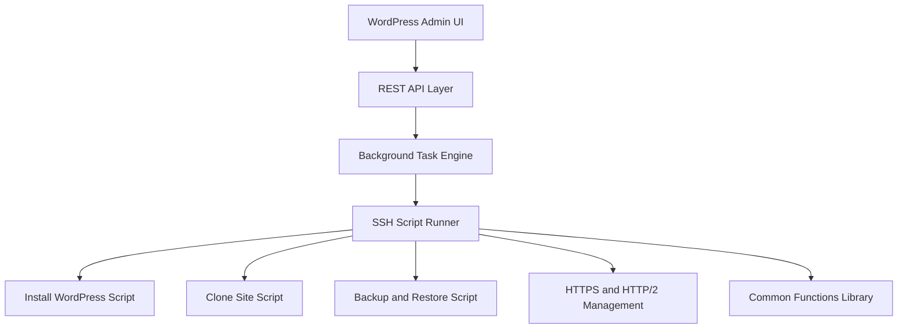
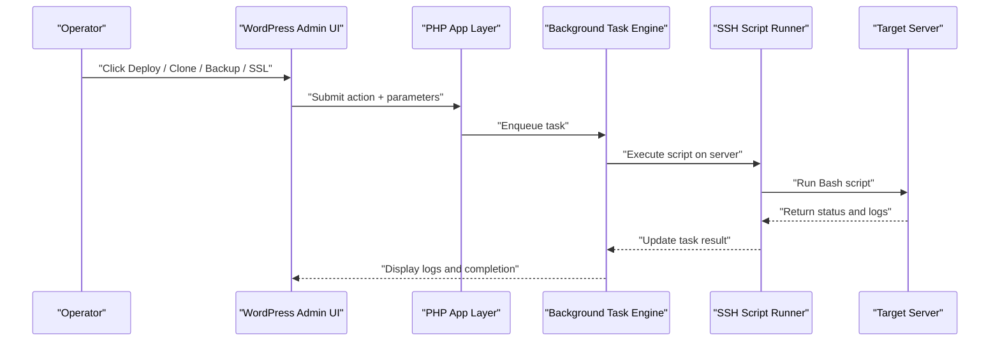
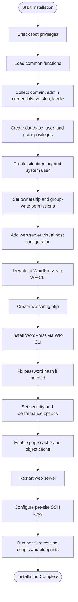
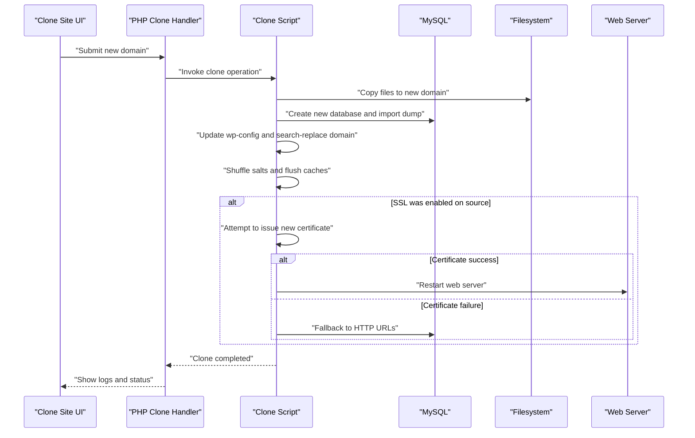
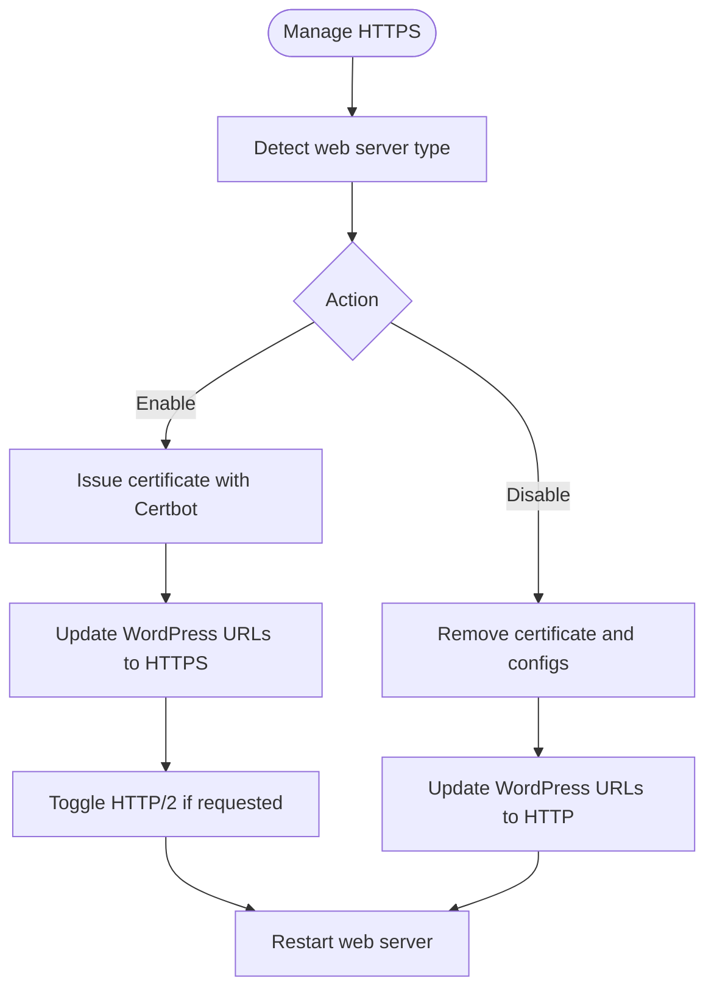
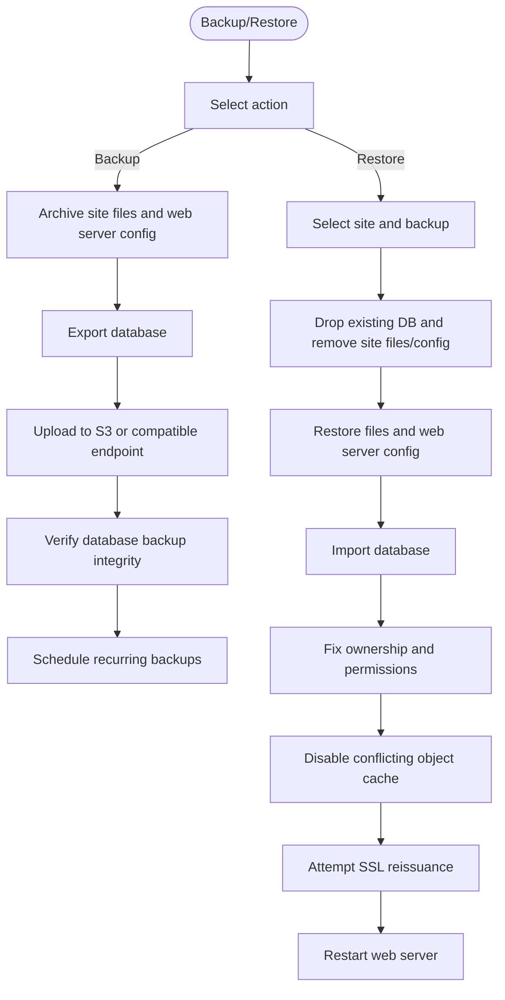
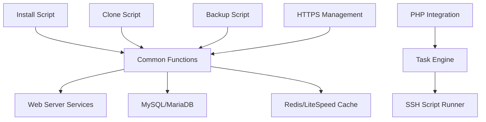

# WordPress Deployment Scripts

<cite>
**Referenced Files in This Document**   
- [README.md](file://README.md)
- [02-install_wordpress_site.txt](file://includes/core/apps/wordpress-app/scripts/v1/raw/02-install_wordpress_site.txt)
- [04-manage_https.txt](file://includes/core/apps/wordpress-app/scripts/v1/raw/04-manage_https.txt)
- [08-backup.txt](file://includes/core/apps/wordpress-app/scripts/v1/raw/08-backup.txt)
- [09-clone_site.txt](file://includes/core/apps/wordpress-app/scripts/v1/raw/09-clone_site.txt)
- [environment variables.txt](file://includes/core/apps/wordpress-app/scripts/v1/raw/environment%20variables.txt)
- [9999-common-functions.txt](file://includes/core/apps/wordpress-app/scripts/v1/raw/9999-common-functions.txt)
- [clone-site.php](file://includes/core/apps/wordpress-app/tabs/clone-site.php)
- [after-prepare-server.php](file://includes/core/apps/wordpress-app/traits/traits-for-class-wordpress-app/after-prepare-server.php)
</cite>

## Table of Contents
1. [Introduction](#introduction)
2. [Project Structure](#project-structure)
3. [Core Components](#core-components)
4. [Architecture Overview](#architecture-overview)
5. [Detailed Component Analysis](#detailed-component-analysis)
6. [Dependency Analysis](#dependency-analysis)
7. [Performance Considerations](#performance-considerations)
8. [Troubleshooting Guide](#troubleshooting-guide)
9. [Conclusion](#conclusion)
10. [Appendices](#appendices)

## Introduction
This document explains the WordPress deployment automation provided by the project. It focuses on how sites are installed, configured, secured, cloned, backed up, and maintained through a combination of PHP application logic and Bash provisioning scripts executed over SSH. The system provisions servers, installs OpenLiteSpeed or Nginx with PHP, MariaDB, Redis, firewall rules, and certificate management, then manages each WordPress site from the WordPress admin dashboard.

The core installation path uses WP-CLI to download WordPress, create configuration, install the site, set security-related options, enable caching, and prepare per-site users and web server virtual hosts. Backup, restore, cloning, SSL, HTTP/2, monitoring, and maintenance tasks are implemented as reusable shell scripts and PHP hooks that integrate with the plugin’s task system.

## Project Structure
At a high level:
- The plugin is activated inside WordPress and exposes an admin UI for managing servers and sites.
- Site operations are driven by Bash scripts under `includes/core/apps/wordpress-app/scripts/v1/raw/`.
- Common functions used across scripts live in a shared helper file.
- PHP classes and tabs expose UI actions that trigger script execution via background tasks.

**Diagram sources**
- [README.md:11-25](file://README.md#L11-L25)
- [02-install_wordpress_site.txt:1-15](file://includes/core/apps/wordpress-app/scripts/v1/raw/02-install_wordpress_site.txt#L1-L15)
- [09-clone_site.txt:1-27](file://includes/core/apps/wordpress-app/scripts/v1/raw/09-clone_site.txt#L1-L27)
- [08-backup.txt:1-15](file://includes/core/apps/wordpress-app/scripts/v1/raw/08-backup.txt#L1-L15)
- [04-manage_https.txt:1-14](file://includes/core/apps/wordpress-app/scripts/v1/raw/04-manage_https.txt#L1-L14)
- [9999-common-functions.txt:1-14](file://includes/core/apps/wordpress-app/scripts/v1/raw/9999-common-functions.txt#L1-L14)

**Section sources**
- [README.md:11-37](file://README.md#L11-L37)

## Core Components
- WordPress installation script: creates database credentials, sets up site directories and permissions, configures web server virtual hosts, downloads and installs WordPress using WP-CLI, applies security and performance settings, enables page cache and object cache where available, and supports post-installation customization.
- HTTPS and HTTP/2 management script: enables or disables Let’s Encrypt certificates, updates WordPress URLs, restarts the web server, and toggles HTTP/2 depending on the detected web server type.
- Backup and restore script: archives files, web server configuration, and database; uploads backups to AWS S3 or compatible services; schedules and prunes backups; restores sites including database, files, ownership, and optional SSL reissuance.
- Site cloning script: copies files, creates a new database, updates configuration, performs search-and-replace for domains, handles SSL certificate issuance or fallback to HTTP, and prepares SSH access for the cloned site.
- Common functions library: provides reusable helpers for space checks, cache flushing, backup orchestration, web server detection and restart, SSL validation, database creation, PHP pool configuration, and more.
- PHP integration points: clone site tab and after-prepare-server hooks connect the WordPress admin UI to the underlying scripts and background tasks.

**Section sources**
- [02-install_wordpress_site.txt:17-184](file://includes/core/apps/wordpress-app/scripts/v1/raw/02-install_wordpress_site.txt#L17-L184)
- [04-manage_https.txt:69-137](file://includes/core/apps/wordpress-app/scripts/v1/raw/04-manage_https.txt#L69-L137)
- [08-backup.txt:89-200](file://includes/core/apps/wordpress-app/scripts/v1/raw/08-backup.txt#L89-L200)
- [09-clone_site.txt:29-171](file://includes/core/apps/wordpress-app/scripts/v1/raw/09-clone_site.txt#L29-L171)
- [9999-common-functions.txt:63-285](file://includes/core/apps/wordpress-app/scripts/v1/raw/9999-common-functions.txt#L63-L285)
- [clone-site.php:309-434](file://includes/core/apps/wordpress-app/tabs/clone-site.php#L309-L434)
- [after-prepare-server.php:103-152](file://includes/core/apps/wordpress-app/traits/traits-for-class-wordpress-app/after-prepare-server.php#L103-L152)

## Architecture Overview
The deployment architecture combines a WordPress-based control plane with server-side Bash scripts. The flow is:
1. An operator initiates an action (install, clone, backup, SSL change) from the WordPress admin UI.
2. The PHP layer validates inputs and enqueues a background task.
3. The background task executes the appropriate Bash script over SSH on the target server.
4. The script sources common functions, performs environment checks, and runs OS-level commands (user creation, directory setup, MySQL operations, WP-CLI, certbot, web server restart).
5. Results are logged and surfaced back to the admin UI.

**Diagram sources**
- [README.md:11-25](file://README.md#L11-L25)
- [clone-site.php:309-434](file://includes/core/apps/wordpress-app/tabs/clone-site.php#L309-L434)
- [after-prepare-server.php:103-152](file://includes/core/apps/wordpress-app/traits/traits-for-class-wordpress-app/after-prepare-server.php#L103-L152)

## Detailed Component Analysis

### WordPress Installation Process Using WP-CLI
The installation script performs these steps:
- Validates root execution and loads common functions.
- Prompts for domain, admin user, password, email, WordPress version, and locale if not provided via environment variables.
- Generates random database name, prefix, user, and password, then creates the database and grants privileges.
- Creates the site directory under `/var/www/$domain/html`, adds a dedicated system user, and sets ownership and group-write permissions.
- Adds web server configuration based on the detected web server type (Nginx or OpenLiteSpeed).
- Uses WP-CLI to download WordPress, create `wp-config.php`, and install the site. If mail is unavailable, it skips sending the welcome email.
- Fixes potential password hashing issues by computing a hashed password and updating the database directly.
- Sets important `wp-config` options such as direct filesystem method, minor core auto-updates, memory limits, script concatenation, disabling file editing, permalinks, and enabling caching.
- Installs page cache plugins appropriate to the web server and optionally enables Redis object cache when available.
- Restarts the web server and configures per-site SSH public key authentication.
- Supports post-processing scripts and blueprint-driven theme/plugin/file deployment.

**Diagram sources**
- [02-install_wordpress_site.txt:1-184](file://includes/core/apps/wordpress-app/scripts/v1/raw/02-install_wordpress_site.txt#L1-L184)
- [environment variables.txt:15-24](file://includes/core/apps/wordpress-app/scripts/v1/raw/environment%20variables.txt#L15-L24)

**Section sources**
- [02-install_wordpress_site.txt:17-184](file://includes/core/apps/wordpress-app/scripts/v1/raw/02-install_wordpress_site.txt#L17-L184)
- [environment variables.txt:15-24](file://includes/core/apps/wordpress-app/scripts/v1/raw/environment%20variables.txt#L15-L24)

### Database Creation and Configuration
Database setup is handled by a shared function that:
- Accepts database name, username, password, and host.
- Creates the database and grants all privileges to the specified user.
- Flushes privileges to apply changes immediately.

During installation, the script generates secure random values for the database name, prefix, user, and password, then calls this function before configuring `wp-config.php`.

**Section sources**
- [9999-common-functions.txt:733-755](file://includes/core/apps/wordpress-app/scripts/v1/raw/9999-common-functions.txt#L733-L755)
- [02-install_wordpress_site.txt:71-77](file://includes/core/apps/wordpress-app/scripts/v1/raw/02-install_wordpress_site.txt#L71-L77)

### File Permissions and Security Hardening
File permissions are set to ensure the site owner can write while the web server group retains necessary access:
- Ownership is set to the site user and `www-data`.
- Group-write permissions are applied recursively.
- Security hardening includes disabling file editing, enabling minor core auto-updates, setting memory limits, disabling script concatenation, and enabling caching.
- Per-site SSH public key authentication is configured by appending an SSH match block and restarting the SSH service.

**Section sources**
- [02-install_wordpress_site.txt:90-97](file://includes/core/apps/wordpress-app/scripts/v1/raw/02-install_wordpress_site.txt#L90-L97)
- [02-install_wordpress_site.txt:157-175](file://includes/core/apps/wordpress-app/scripts/v1/raw/02-install_wordpress_site.txt#L157-L175)
- [02-install_wordpress_site.txt:217-223](file://includes/core/apps/wordpress-app/scripts/v1/raw/02-install_wordpress_site.txt#L217-L223)

### Site Cloning Capabilities
Cloning involves:
- Validating source and destination domains and ensuring no conflicts.
- Creating a new database and user for the cloned site.
- Copying files from the source site to the destination.
- Adding web server configuration for the new domain.
- Updating database credentials and performing a search-and-replace of the old domain with the new domain across tables and objects.
- Shuffling salts and resetting cache entries.
- Handling SSL certificate issuance or falling back to HTTP if certificates cannot be obtained.
- Preparing SSH access and running any post-processing script placed at a known location.

**Diagram sources**
- [09-clone_site.txt:29-171](file://includes/core/apps/wordpress-app/scripts/v1/raw/09-clone_site.txt#L29-L171)
- [09-clone_site.txt:190-273](file://includes/core/apps/wordpress-app/scripts/v1/raw/09-clone_site.txt#L190-L273)
- [clone-site.php:309-434](file://includes/core/apps/wordpress-app/tabs/clone-site.php#L309-L434)

**Section sources**
- [09-clone_site.txt:29-171](file://includes/core/apps/wordpress-app/scripts/v1/raw/09-clone_site.txt#L29-L171)
- [09-clone_site.txt:190-273](file://includes/core/apps/wordpress-app/scripts/v1/raw/09-clone_site.txt#L190-L273)
- [clone-site.php:309-434](file://includes/core/apps/wordpress-app/tabs/clone-site.php#L309-L434)

### Domain Configuration and SSL Certificate Management
The HTTPS management script:
- Detects whether the web server is Nginx or OpenLiteSpeed.
- Enables or disables Let’s Encrypt certificates using Certbot.
- Updates WordPress `home` and `siteurl` to HTTPS or HTTP accordingly.
- Toggles HTTP/2 support by modifying web server configuration and restarting the service.
- Manages HTTPS redirects in `.htaccess` and vhost configurations for OpenLiteSpeed.

**Diagram sources**
- [04-manage_https.txt:69-137](file://includes/core/apps/wordpress-app/scripts/v1/raw/04-manage_https.txt#L69-L137)
- [04-manage_https.txt:140-204](file://includes/core/apps/wordpress-app/scripts/v1/raw/04-manage_https.txt#L140-L204)

**Section sources**
- [04-manage_https.txt:69-137](file://includes/core/apps/wordpress-app/scripts/v1/raw/04-manage_https.txt#L69-L137)
- [04-manage_https.txt:140-204](file://includes/core/apps/wordpress-app/scripts/v1/raw/04-manage_https.txt#L140-L204)

### Performance Optimizations
Performance-related steps during installation and management include:
- Enabling page cache plugins appropriate to the web server (e.g., LiteSpeed Cache for OpenLiteSpeed, Cache Enabler for Nginx).
- Enabling Redis object cache when available and configuring LiteSpeed object cache options.
- Setting WordPress cache constants and memory limits.
- Disabling script concatenation to aid debugging and improve development workflows.
- Providing utilities to flush various caches (page cache, object cache, LiteSpeed cache).

**Section sources**
- [02-install_wordpress_site.txt:168-212](file://includes/core/apps/wordpress-app/scripts/v1/raw/02-install_wordpress_site.txt#L168-L212)
- [9999-common-functions.txt:111-186](file://includes/core/apps/wordpress-app/scripts/v1/raw/9999-common-functions.txt#L111-L186)

### Backup and Restore Functionality
The backup script supports:
- Manual backup of files, web server configuration, and database.
- Uploading backups to AWS S3 or compatible endpoints.
- Scheduling daily backups per site or for all sites.
- Pruning local backups based on retention days.
- Listing and deleting backups.
- Restoring sites, including dropping existing databases, recreating users, restoring files and configuration, importing the database, fixing ownership and permissions, disabling conflicting object caches, and attempting SSL reissuance.

**Diagram sources**
- [08-backup.txt:89-200](file://includes/core/apps/wordpress-app/scripts/v1/raw/08-backup.txt#L89-L200)
- [08-backup.txt:203-423](file://includes/core/apps/wordpress-app/scripts/v1/raw/08-backup.txt#L203-L423)
- [08-backup.txt:426-737](file://includes/core/apps/wordpress-app/scripts/v1/raw/08-backup.txt#L426-L737)

**Section sources**
- [08-backup.txt:89-200](file://includes/core/apps/wordpress-app/scripts/v1/raw/08-backup.txt#L89-L200)
- [08-backup.txt:203-423](file://includes/core/apps/wordpress-app/scripts/v1/raw/08-backup.txt#L203-L423)
- [08-backup.txt:426-737](file://includes/core/apps/wordpress-app/scripts/v1/raw/08-backup.txt#L426-L737)

### Monitoring Setup and Maintenance Task Scheduling
Monitoring and maintenance capabilities are exposed through additional scripts and hooks:
- Monit and Monitorix installation and configuration scripts manage system-level monitoring units and alerting.
- GoAccess and other tools provide log analysis and reporting.
- The after-prepare-server trait integrates backup scheduling into the server preparation workflow, invoking actions to install and configure backups automatically.

While detailed implementation of every monitoring tool is beyond this document’s scope, the environment variables documentation enumerates supported actions for Monit, Monitorix, GoAccess, Fail2ban, and related maintenance tasks.

**Section sources**
- [environment variables.txt:385-458](file://includes/core/apps/wordpress-app/scripts/v1/raw/environment%20variables.txt#L385-L458)
- [after-prepare-server.php:103-152](file://includes/core/apps/wordpress-app/traits/traits-for-class-wordpress-app/after-prepare-server.php#L103-L152)

## Dependency Analysis
Key dependencies and relationships:
- Installation and cloning scripts depend on common functions for web server detection, database creation, cache flushing, and restart routines.
- HTTPS management depends on Certbot and web server configuration files.
- Backup and restore depend on MySQL client tools, tar, gzip, and AWS CLI for S3 uploads.
- PHP integration points rely on WordPress hooks and the plugin’s pending task system to execute scripts asynchronously.

**Diagram sources**
- [9999-common-functions.txt:258-387](file://includes/core/apps/wordpress-app/scripts/v1/raw/9999-common-functions.txt#L258-L387)
- [02-install_wordpress_site.txt:110-215](file://includes/core/apps/wordpress-app/scripts/v1/raw/02-install_wordpress_site.txt#L110-L215)
- [09-clone_site.txt:107-171](file://includes/core/apps/wordpress-app/scripts/v1/raw/09-clone_site.txt#L107-L171)
- [08-backup.txt:165-188](file://includes/core/apps/wordpress-app/scripts/v1/raw/08-backup.txt#L165-L188)

**Section sources**
- [9999-common-functions.txt:258-387](file://includes/core/apps/wordpress-app/scripts/v1/raw/9999-common-functions.txt#L258-L387)

## Performance Considerations
- Use Redis object cache when available to reduce database load.
- Enable page cache plugins appropriate to the web server to serve static content faster.
- Avoid excessive script concatenation during development to simplify debugging.
- Ensure sufficient disk space for backups; the common functions check required free space before proceeding.
- Tune PHP worker pools and FPM settings per site to balance resource usage and concurrency.

[No sources needed since this section provides general guidance]

## Troubleshooting Guide
Common issues and resolutions:
- **Insufficient privileges**: Scripts require root execution; run them as root or via sudo.
- **Missing common functions**: Ensure `9999-common-functions.sh` is present and sourced correctly.
- **Certificate issuance failures**: Verify DNS records point to the server and that Certbot can reach the webroot; fall back to HTTP if necessary.
- **Backup upload errors**: Confirm AWS CLI credentials and region are configured; test connectivity to S3 or compatible endpoints.
- **Permission errors**: Reapply ownership and group-write permissions to the site directory.
- **Cache inconsistencies**: Flush page and object caches after configuration changes or cloning.

**Section sources**
- [02-install_wordpress_site.txt:1-15](file://includes/core/apps/wordpress-app/scripts/v1/raw/02-install_wordpress_site.txt#L1-L15)
- [09-clone_site.txt:15-27](file://includes/core/apps/wordpress-app/scripts/v1/raw/09-clone_site.txt#L15-L27)
- [08-backup.txt:51-87](file://includes/core/apps/wordpress-app/scripts/v1/raw/08-backup.txt#L51-L87)

## Conclusion
The deployment automation provides a comprehensive, script-driven approach to installing and managing WordPress sites. It leverages WP-CLI for site initialization, robust Bash scripts for system-level configuration, and PHP hooks for integrating with the WordPress admin experience. Operators can automate installation, cloning, SSL management, backups, and maintenance tasks while maintaining security and performance best practices.

[No sources needed since this section summarizes without analyzing specific files]

## Appendices

### Customizing the Deployment Process
- **Post-installation scripts**: Provide a URL to a script that will be downloaded and executed after installation.
- **Blueprints**: Define JSON arrays specifying themes, plugins, or arbitrary files to deploy and optionally activate.
- **Environment variables**: Supply domain, admin credentials, WordPress version, locale, and other parameters non-interactively.

**Section sources**
- [02-install_wordpress_site.txt:224-317](file://includes/core/apps/wordpress-app/scripts/v1/raw/02-install_wordpress_site.txt#L224-L317)
- [environment variables.txt:15-24](file://includes/core/apps/wordpress-app/scripts/v1/raw/environment%20variables.txt#L15-L24)

### Adding Post-Installation Tasks
- Place a post-processing script at a known location after cloning to perform custom actions.
- Use the clone script’s post-processing hook to run site-specific adjustments.

**Section sources**
- [09-clone_site.txt:291-296](file://includes/core/apps/wordpress-app/scripts/v1/raw/09-clone_site.txt#L291-L296)

### Handling Different WordPress Configurations
- **Multisite**: The clone script preserves wildcard configurations and multisite rewrite rules where applicable.
- **Remote databases**: The clone UI warns about remote database usage and switches to localhost during cloning.
- **OpenLiteSpeed vs Nginx**: Scripts detect the web server and adjust configuration, caching, and SSL handling accordingly.

**Section sources**
- [09-clone_site.txt:117-144](file://includes/core/apps/wordpress-app/scripts/v1/raw/09-clone_site.txt#L117-L144)
- [clone-site.php:528-531](file://includes/core/apps/wordpress-app/tabs/clone-site.php#L528-L531)
- [9999-common-functions.txt:258-285](file://includes/core/apps/wordpress-app/scripts/v1/raw/9999-common-functions.txt#L258-L285)