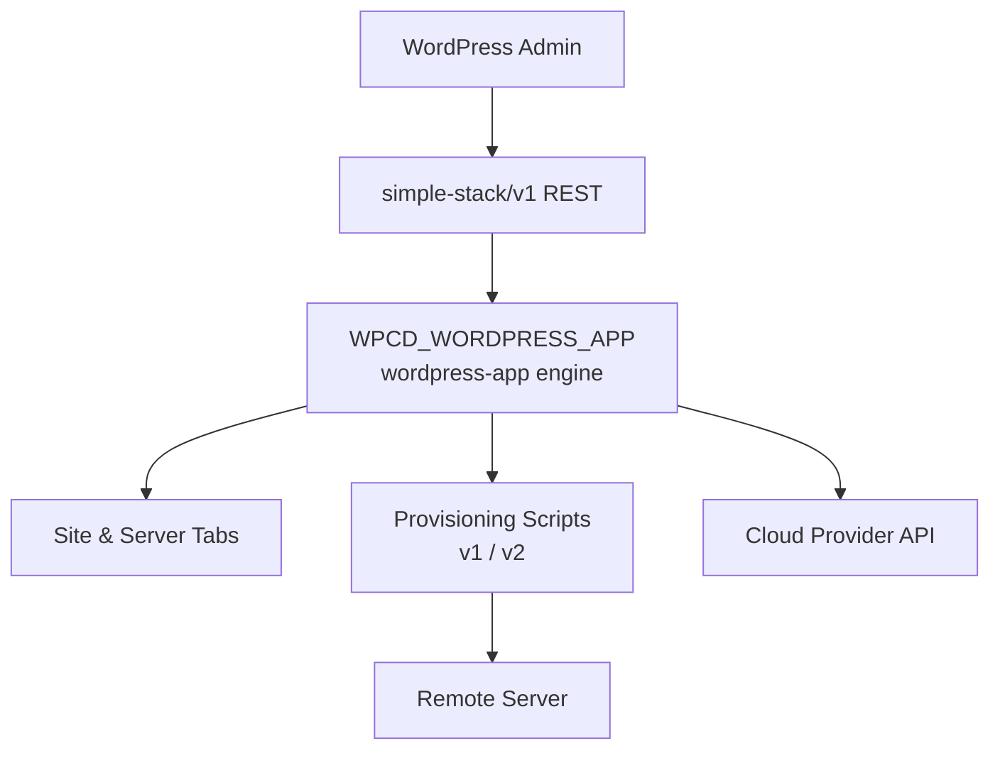
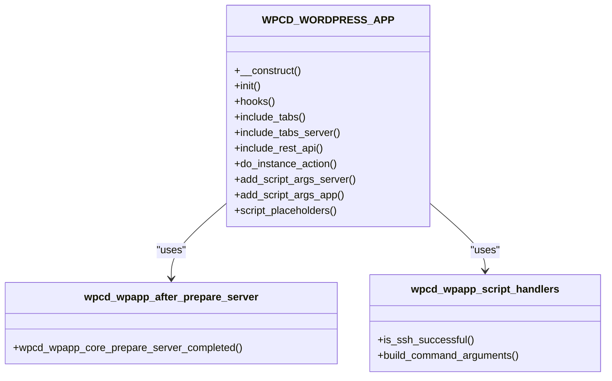
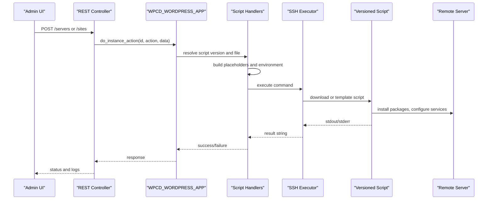
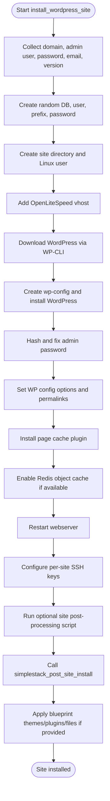
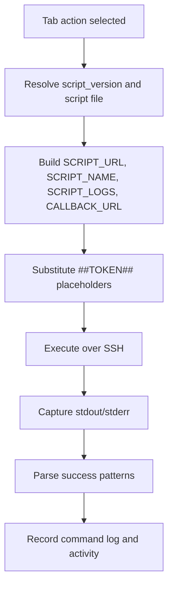
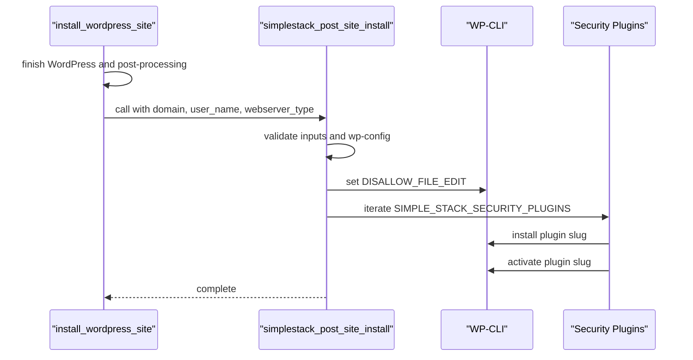
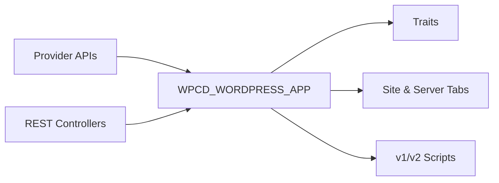

# WordPress Application Engine

<cite>
**Referenced Files in This Document**
- [README.md](file://README.md)
- [SIMPLESTACK.md](file://docs/SIMPLESTACK.md)
- [class-wordpress-app.php](file://includes/core/apps/wordpress-app/class-wordpress-app.php)
- [script-handlers.php](file://includes/core/apps/wordpress-app/traits/traits-for-class-wordpress-app/script-handlers.php)
- [after-prepare-server.php](file://includes/core/apps/wordpress-app/traits/traits-for-class-wordpress-app/after-prepare-server.php)
- [01-prepare_server.txt](file://includes/core/apps/wordpress-app/scripts/v2/raw/01-prepare_server.txt)
- [02-install_wordpress_site.txt](file://includes/core/apps/wordpress-app/scripts/v2/raw/02-install_wordpress_site.txt)
- [66-simplestack_post_install.txt](file://includes/core/apps/wordpress-app/scripts/v2/raw/66-simplestack_post_install.txt)
- [class-wpcd-app.php](file://includes/core/apps/class-wpcd-app.php)
- [class-wordpress-app-settings.php](file://includes/core/apps/wordpress-app/class-wordpress-app-settings.php)
</cite>

## Update Summary
**Changes Made**
- Updated to reflect the complete rewrite of WordPress application deployment system with new v2 script structure
- Added detailed documentation for hardened v2 scripts with Ubuntu 24.04/26.04 support
- Enhanced security documentation for OpenLiteSpeed-only provisioning
- Updated script versioning strategy documentation
- Added comprehensive environment variable handling documentation
- Expanded troubleshooting guide for v2-specific issues

## Table of Contents
1. [Introduction](#introduction)
2. [Project Structure](#project-structure)
3. [Core Components](#core-components)
4. [Architecture Overview](#architecture-overview)
5. [Detailed Component Analysis](#detailed-component-analysis)
6. [Dependency Analysis](#dependency-analysis)
7. [Performance Considerations](#performance-considerations)
8. [Troubleshooting Guide](#troubleshooting-guide)
9. [Conclusion](#conclusion)

## Introduction
SimpleStack is a private WordPress plugin that provisions cloud servers and installs a single, hardened OpenLiteSpeed-based stack with WordPress. It runs entirely from `wp-admin`, uses a React admin UI, and executes Bash provisioning scripts over SSH. The WordPress application engine is the `wordpress-app` app type: it registers tabs, REST endpoints, script handlers, hooks, and post-install automation for server preparation, site installation, SSL, caching, backups, monitoring, security hardening, and ongoing maintenance.

The engine's lifecycle is:
1. Provider API call creates or selects a server.
2. A versioned Bash provisioning script prepares Ubuntu, OpenLiteSpeed, PHP, MariaDB, Redis, Certbot, firewall, and tools.
3. A site installation script creates a database user, site directory, Linux user, OpenLiteSpeed vhost, WordPress files, cache configuration, and optional blueprint assets.
4. A post-install hook enforces hardening and optionally installs configured security plugins.
5. Ongoing operations are dispatched through tabs and REST actions back to the same script set.

**Updated** The v2 script structure now provides hardened, OpenLiteSpeed-only deployments with explicit Ubuntu 24.04 (noble) and 26.04 (resolute) support, pinned OpenLiteSpeed installer versions, and enhanced security validation.

**Section sources**
- [README.md:1-25](file://README.md#L1-L25)
- [SIMPLESTACK.md:15-63](file://docs/SIMPLESTACK.md#L15-L63)

## Project Structure
At a high level, SimpleStack separates:
- Plugin bootstrap and core classes under `includes/core/`.
- The WordPress application engine under `includes/core/apps/wordpress-app/`.
- Versioned provisioning scripts under `includes/core/apps/wordpress-app/scripts/v1/` and `scripts/v2/`.
- A built React admin UI under `assets/dist/`, sourced from `src/admin/`.
- REST controllers under `includes/core/api/`.

**Diagram sources**
- [SIMPLESTACK.md:15-32](file://docs/SIMPLESTACK.md#L15-L32)
- [class-wordpress-app.php:62-128](file://includes/core/apps/wordpress-app/class-wordpress-app.php#L62-L128)

**Section sources**
- [README.md:27-37](file://README.md#L27-L37)
- [SIMPLESTACK.md:15-32](file://docs/SIMPLESTACK.md#L15-L32)

## Core Components
The WordPress application engine is implemented by `WPCD_WORDPRESS_APP`, which extends the base app class and composes several traits:
- After-server-preparation tasks.
- Security tab logic.
- Command and log handling.
- Script argument building and placeholder substitution.
- Push callbacks from remote servers.
- Backup and upgrade helpers.
- Multi-tenant support.

Key responsibilities include:
- Registering the `wordpress-app` application name and script folder.
- Including site and server tabs dynamically.
- Enabling the REST API when configured.
- Hooking into command completion, logs, and deferred background actions.
- Supplying script placeholders and environment variables for each action.
- Dispatching instance actions for both servers and sites.

**Diagram sources**
- [class-wordpress-app.php:15-27](file://includes/core/apps/wordpress-app/class-wordpress-app.php#L15-L27)
- [class-wordpress-app.php:62-128](file://includes/core/apps/wordpress-app/class-wordpress-app.php#L62-L128)
- [script-handlers.php:14-23](file://includes/core/apps/wordpress-app/traits/traits-for-class-wordpress-app/script-handlers.php#L14-L23)

**Section sources**
- [class-wordpress-app.php:15-27](file://includes/core/apps/wordpress-app/class-wordpress-app.php#L15-L27)
- [class-wordpress-app.php:62-128](file://includes/core/apps/wordpress-app/class-wordpress-app.php#L62-L128)
- [class-wordpress-app.php:289-393](file://includes/core/apps/wordpress-app/class-wordpress-app.php#L289-L393)

## Architecture Overview
The engine coordinates three layers:
1. **Control plane:** React UI calls `simple-stack/v1` REST endpoints.
2. **PHP engine:** Controllers and `WPCD_WORDPRESS_APP` validate input, select the correct script version, build arguments, execute commands over SSH, and record logs.
3. **Remote execution:** Bash scripts perform OS-level provisioning and site management.

**Diagram sources**
- [SIMPLESTACK.md:42-63](file://docs/SIMPLESTACK.md#L42-L63)
- [class-wordpress-app.php:118-128](file://includes/core/apps/wordpress-app/class-wordpress-app.php#L118-L128)
- [script-handlers.php:23-22](file://includes/core/apps/wordpress-app/traits/traits-for-class-wordpress-app/script-handlers.php#L23-L22)

**Section sources**
- [SIMPLESTACK.md:67-114](file://docs/SIMPLESTACK.md#L67-L114)
- [class-wordpress-app.php:103-163](file://includes/core/apps/wordpress-app/class-wordpress-app.php#L103-L163)

## Detailed Component Analysis

### Application Lifecycle: Server Preparation
Server preparation is handled by `01-prepare_server.txt`. It performs:
- Root and noninteractive package manager checks.
- Common function loading.
- Normalization of `SIMPLE_STACK_ADMIN_IP`.
- Webserver validation (OpenLiteSpeed only).
- Ubuntu release validation against supported versions.
- Repository refresh and LiteSpeed repository setup.
- Pinned OpenLiteSpeed one-click installer download, syntax check, and optional SHA verification.
- MariaDB, Redis, WP-CLI, AWS CLI, update-notifier, and UFW firewall setup.
- PHP version loop for `lsphp83`, `lsphp84`, `lsphp85`, with explicit extension installation.
- Default PHP selection and OpenLiteSpeed webroot linkage.
- Certbot installation via Snap with DNS provider plugins.
- Unattended upgrades configuration.
- OpenLiteSpeed PHP settings, session paths, opcache, timezone, cron, and log symlinks.
- Firewall rules allowing SSH, HTTP, HTTPS, and conditionally port 7080.
- Optional server-level post-processing script execution.

**Updated** The v2 script includes hardened security measures including pinned OpenLiteSpeed installer versions, explicit Ubuntu version validation, and fail-closed firewall configuration.

```mermaid
flowchart TD
Start(["Start prepare_server"]) --> CheckRoot["Check root and noninteractive mode"]
CheckRoot --> LoadCommon["Load common functions"]
LoadCommon --> NormalizeIP["Normalize SIMPLE_STACK_ADMIN_IP"]
NormalizeIP --> ValidateWebserver["Validate webserver_type"]
ValidateWebserver --> ValidateUbuntu["Validate Ubuntu release"]
ValidateUbuntu --> Repos["Refresh repositories and add LiteSpeed repo"]
Repos --> InstallOLS["Download and run pinned ols1clk.sh"]
InstallOLS --> InstallMariaDB["Install MariaDB and client tools"]
InstallMariaDB --> InstallPHP["Install lsphp83/84/85 and extensions"]
InstallPHP --> SetDefaultPHP["Set default PHP and webroot link"]
SetDefaultPHP --> InstallCertbot["Install Certbot and DNS plugins"]
InstallCertbot --> ConfigureUnattended["Configure unattended-upgrades"]
ConfigureUnattended --> ConfigurePHP["Configure PHP sessions, opcache, timezone, cron"]
ConfigurePHP --> InstallRedis["Install Redis and PHP Redis extension"]
InstallRedis --> InstallTools["Install WP-CLI, AWS CLI, update-notifier"]
InstallTools --> ConfigureFirewall["Configure UFW and port 7080"]
ConfigureFirewall --> PostProcess["Run optional server post-processing script"]
PostProcess --> End(["Installation completed"])
```

**Diagram sources**
- [01-prepare_server.txt:1-27](file://includes/core/apps/wordpress-app/scripts/v2/raw/01-prepare_server.txt#L1-L27)
- [01-prepare_server.txt:48-67](file://includes/core/apps/wordpress-app/scripts/v2/raw/01-prepare_server.txt#L48-L67)
- [01-prepare_server.txt:180-345](file://includes/core/apps/wordpress-app/scripts/v2/raw/01-prepare_server.txt#L180-L345)
- [01-prepare_server.txt:348-410](file://includes/core/apps/wordpress-app/scripts/v2/raw/01-prepare_server.txt#L348-L410)
- [01-prepare_server.txt:412-544](file://includes/core/apps/wordpress-app/scripts/v2/raw/01-prepare_server.txt#L412-L544)
- [01-prepare_server.txt:547-605](file://includes/core/apps/wordpress-app/scripts/v2/raw/01-prepare_server.txt#L547-L605)
- [01-prepare_server.txt:616-708](file://includes/core/apps/wordpress-app/scripts/v2/raw/01-prepare_server.txt#L616-L708)

**Section sources**
- [01-prepare_server.txt:1-708](file://includes/core/apps/wordpress-app/scripts/v2/raw/01-prepare_server.txt#L1-L708)

### Application Lifecycle: WordPress Site Installation
Site installation is handled by `02-install_wordpress_site.txt`. It performs:
- Interactive or scripted collection of domain, admin credentials, email, and WordPress version.
- Random database name, prefix, user, and password generation.
- Database creation using common helper functions.
- Site directory creation and Linux user setup with group ownership.
- OpenLiteSpeed vhost creation.
- WordPress download, configuration, and installation via WP-CLI.
- Password hashing workaround for OpenLiteSpeed and PHP compatibility.
- wp-config options including auto-update behavior, memory limits, permalink structure, and cache constants.
- Page cache plugin installation for OpenLiteSpeed.
- Redis object cache configuration where available.
- Webserver restart.
- Per-site SSH public key authentication setup.
- Optional site-level post-processing script execution.
- Invocation of the SimpleStack post-install hook.
- Optional blueprint-driven theme/plugin/file deployment.

**Updated** The v2 script includes enhanced security hardening through the post-install hook and improved error handling throughout the installation process.

**Diagram sources**
- [02-install_wordpress_site.txt:1-75](file://includes/core/apps/wordpress-app/scripts/v2/raw/02-install_wordpress_site.txt#L1-L75)
- [02-install_wordpress_site.txt:76-108](file://includes/core/apps/wordpress-app/scripts/v2/raw/02-install_wordpress_site.txt#L76-L108)
- [02-install_wordpress_site.txt:110-175](file://includes/core/apps/wordpress-app/scripts/v2/raw/02-install_wordpress_site.txt#L110-L175)
- [02-install_wordpress_site.txt:177-240](file://includes/core/apps/wordpress-app/scripts/v2/raw/02-install_wordpress_site.txt#L177-L240)
- [02-install_wordpress_site.txt:245-324](file://includes/core/apps/wordpress-app/scripts/v2/raw/02-install_wordpress_site.txt#L245-L324)

**Section sources**
- [02-install_wordpress_site.txt:1-324](file://includes/core/apps/wordpress-app/scripts/v2/raw/02-install_wordpress_site.txt#L1-L324)

### Shell Script Execution System
The shell script system has two delivery modes:
- Raw scripts under `scripts/vN/raw/*.txt` are downloaded verbatim over HTTP from `SCRIPT_URL`.
- Template scripts under `scripts/vN/*.txt` are processed by PHP, substituting `##TOKEN##` placeholders before being sent as a command.

The script handler trait maps tab actions to script names, builds `SCRIPT_URL`, `SCRIPT_NAME`, `SCRIPT_LOGS`, and `CALLBACK_URL`, and merges them with common arguments. Success detection is script-specific, based on expected output strings rather than exit codes alone.

**Updated** The v2 scripts include enhanced error handling, checkpoint-based recovery, and improved logging throughout the execution pipeline.

**Diagram sources**
- [SIMPLESTACK.md:154-170](file://docs/SIMPLESTACK.md#L154-L170)
- [script-handlers.php:1394-1702](file://includes/core/apps/wordpress-app/traits/traits-for-class-wordpress-app/script-handlers.php#L1394-L1702)
- [script-handlers.php:23-22](file://includes/core/apps/wordpress-app/traits/traits-for-class-wordpress-app/script-handlers.php#L23-L22)

**Section sources**
- [SIMPLESTACK.md:154-170](file://docs/SIMPLESTACK.md#L154-L170)
- [script-handlers.php:1394-1702](file://includes/core/apps/wordpress-app/traits/traits-for-class-wordpress-app/script-handlers.php#L1394-L1702)

### Script Versioning Strategy
SimpleStack maintains two script sets:
- `scripts/v1/`: upstream scripts, preserved for legacy servers.
- `scripts/v2/`: SimpleStack-hardened scripts.

The default script version is `v2`, but each server retains its own `wpcd_server_scripts_version` meta value. Servers provisioned before the fork continue using `v1`; new servers use `v2`. The version dropdown lists both folders.

**Updated** Key differences in `v2`:
- Ubuntu 24.04 and 26.04 support with explicit codename mapping.
- Removal of nginx/LEMP branches - OpenLiteSpeed only.
- Explicit `lsphp83/84/85` installation loop with deterministic package management.
- Pinned `ols1clk.sh` tag (v3.1) and optional checksum verification.
- Hardened OpenLiteSpeed admin console handling with fail-closed security.
- Improved HTTPS and certificate management.
- New post-install hook for security hardening.
- Enhanced error handling and checkpoint-based recovery.

**Section sources**
- [SIMPLESTACK.md:172-191](file://docs/SIMPLESTACK.md#L172-L191)
- [README.md:101-102](file://README.md#L101-L102)
- [class-wpcd-app.php:200-250](file://includes/core/apps/class-wpcd-app.php#L200-L250)

### Environment Variable Handling
Environment variables bridge PHP configuration and remote Bash execution:
- `webserver_type`: validated early; defaults to `ols` and rejects unsupported values.
- `SIMPLE_STACK_ADMIN_IP`: normalized once, exported, and used for firewall and OpenLiteSpeed WebAdmin binding.
- `SIMPLE_STACK_OLS1CLK_SHA256`: optional SHA256 pin for the OpenLiteSpeed one-click installer.
- `post_processing_script_server`: optional URL for server-level post-processing.
- `post_processing_script_site`: optional URL for site-level post-processing.
- `blueprint`: JSON describing blueprint themes, plugins, and files.
- `SIMPLE_STACK_SECURITY_PLUGINS`: list of WordPress plugin slugs installed and activated after site installation.

**Updated** Validation occurs at multiple layers with enhanced security:
- PHP validates REST inputs and provider credentials.
- Bash normalizes and rejects unsafe values.
- Post-install slug validation restricts plugin names to safe characters and blocks path traversal.
- Fail-closed security model for OpenLiteSpeed WebAdmin access control.

**Section sources**
- [01-prepare_server.txt:22-46](file://includes/core/apps/wordpress-app/scripts/v2/raw/01-prepare_server.txt#L22-L46)
- [01-prepare_server.txt:236-249](file://includes/core/apps/wordpress-app/scripts/v2/raw/01-prepare_server.txt#L236-L249)
- [01-prepare_server.txt:693-703](file://includes/core/apps/wordpress-app/scripts/v2/raw/01-prepare_server.txt#L693-L703)
- [02-install_wordpress_site.txt:224-240](file://includes/core/apps/wordpress-app/scripts/v2/raw/02-install_wordpress_site.txt#L224-L240)
- [66-simplestack_post_install.txt:48-80](file://includes/core/apps/wordpress-app/scripts/v2/raw/66-simplestack_post_install.txt#L48-L80)
- [class-wpcd-app.php:252-350](file://includes/core/apps/class-wpcd-app.php#L252-L350)

### Provisioning Scripts: OpenLiteSpeed, PHP, Database, SSL, Security
- **OpenLiteSpeed:** Installed via a pinned `ols1clk.sh` tag (v3.1), with syntax checking and optional SHA verification. The script also configures webroot links, PHP binaries, and service status checks.
- **PHP:** Multiple `lsphp` versions are installed explicitly (83, 84, 85), with extension packages checked individually so missing optional extensions do not abort provisioning. Default PHP is set to `lsphp84`.
- **Database:** MariaDB is installed with a provider-specific Dpkg option to force new configuration files. Database creation for sites uses shared helper functions.
- **SSL:** Certbot is installed via Snap with DNS provider plugins. Port 7080 is denied by default and opened only for a configured admin IP.
- **Security:** UFW denies incoming traffic by default, allows SSH/HTTP/HTTPS, denies OpenLiteSpeed WebAdmin globally, and conditionally allows it from `SIMPLE_STACK_ADMIN_IP`. Post-install hardening sets `DISALLOW_FILE_EDIT` and can install configured security plugins.

**Updated** The v2 scripts implement a hardened security model with fail-closed defaults, explicit version pinning, and comprehensive validation throughout the provisioning process.

**Section sources**
- [01-prepare_server.txt:180-345](file://includes/core/apps/wordpress-app/scripts/v2/raw/01-prepare_server.txt#L180-L345)
- [01-prepare_server.txt:348-410](file://includes/core/apps/wordpress-app/scripts/v2/raw/01-prepare_server.txt#L348-L410)
- [01-prepare_server.txt:616-668](file://includes/core/apps/wordpress-app/scripts/v2/raw/01-prepare_server.txt#L616-L668)
- [SIMPLESTACK.md:193-205](file://docs/SIMPLESTACK.md#L193-L205)

### Post-Installation Hooks and Customization
The post-install hook `simplestack_post_site_install` runs after WordPress and any post-processing scripts have finished. Its responsibilities include:
- Ensuring `wp-config.php` exists.
- Setting `DISALLOW_FILE_EDIT true`.
- Installing and activating plugins listed in `SIMPLE_STACK_SECURITY_PLUGINS`.
- Validating plugin slugs to prevent arbitrary command injection.

Customization points:
- **Server-level customization:** Provide `post_processing_script_server` to run an additional script after server preparation.
- **Site-level customization:** Provide `post_processing_script_site` to run an additional script after site installation.
- **Blueprint customization:** Provide a `blueprint` JSON array to deploy themes, plugins, or arbitrary files during site installation.
- **Security plugin customization:** Filter `simplestack_post_site_install_plugins` to return a list of plugin slugs to install and activate automatically.
- **Tab extension:** Add new tabs through the existing filter mechanism; the React UI renders them generically from the schema.

**Updated** The v2 implementation includes enhanced security validation for plugin slugs and improved error handling throughout the post-install process.

**Diagram sources**
- [02-install_wordpress_site.txt:236-240](file://includes/core/apps/wordpress-app/scripts/v2/raw/02-install_wordpress_site.txt#L236-L240)
- [66-simplestack_post_install.txt:16-84](file://includes/core/apps/wordpress-app/scripts/v2/raw/66-simplestack_post_install.txt#L16-L84)

**Section sources**
- [66-simplestack_post_install.txt:1-86](file://includes/core/apps/wordpress-app/scripts/v2/raw/66-simplestack_post_install.txt#L1-L86)
- [SIMPLESTACK.md:247-275](file://docs/SIMPLESTACK.md#L247-L275)

### Ongoing Maintenance and Operational Capabilities
After provisioning, the engine exposes operational capabilities through tabs and REST actions:
- Services management, firewall rules, backups, Monit, Fail2ban, SSH keys, resize, power controls.
- Site-level SSL, cache, PHP options, `wp-config`, staging, clone, domain change, redirects, cron, SFTP, phpMyAdmin, Git integration, and per-site users.
- Activity feed merging command, SSH, and error logs.
- Security status probe for installed plugins, `DISALLOW_FILE_EDIT`, and served PHP version.

These are dispatched through the same script handler and success-parsing pipeline, ensuring consistent logging and state reporting.

**Section sources**
- [README.md:11-22](file://README.md#L11-L22)
- [SIMPLESTACK.md:67-114](file://docs/SIMPLESTACK.md#L67-L114)
- [class-wordpress-app.php:103-163](file://includes/core/apps/wordpress-app/class-wordpress-app.php#L103-L163)

## Dependency Analysis
The WordPress application engine depends on:
- **Provider APIs:** Vultr, UpCloud, custom server, and optionally DigitalOcean.
- **REST layer:** Thin adapters over the app engine's action dispatch.
- **Script handlers:** Mapping tab actions to versioned scripts and parsing results.
- **Traits:** Reusable behaviors for post-installation, security, commands, logs, push callbacks, backups, upgrades, and multi-tenancy.
- **Tabs:** Site and server UI panels that define fields and actions.

**Diagram sources**
- [class-wordpress-app.php:15-27](file://includes/core/apps/wordpress-app/class-wordpress-app.php#L15-L27)
- [class-wordpress-app.php:289-439](file://includes/core/apps/wordpress-app/class-wordpress-app.php#L289-L439)
- [SIMPLESTACK.md:278-297](file://docs/SIMPLESTACK.md#L278-L297)

**Section sources**
- [class-wordpress-app.php:15-27](file://includes/core/apps/wordpress-app/class-wordpress-app.php#L15-L27)
- [class-wordpress-app.php:289-439](file://includes/core/apps/wordpress-app/class-wordpress-app.php#L289-L439)
- [SIMPLESTACK.md:278-297](file://docs/SIMPLESTACK.md#L278-L297)

## Performance Considerations
- **Deterministic PHP installation:** The explicit `g_php_versions` loop avoids glob surprises and ensures reproducible stacks.
- **Optional extension failures:** Missing optional PHP extensions are logged as warnings instead of aborting provisioning.
- **Checkpointed provisioning:** Large blocks use checkpoint files to avoid re-running expensive steps and to detect incomplete runs.
- **Split long operations:** Package installation and updates are split into parts to keep the UI responsive.
- **Default PHP selection:** `lsphp84` is set as the default binary and webroot target, reducing runtime confusion.
- **Caching:** Redis object cache and OpenLiteSpeed page cache are enabled where possible.

**Updated** The v2 scripts include enhanced performance optimizations with explicit version pinning and improved error handling to reduce provisioning failures.

[No sources needed since this section provides general guidance]

## Troubleshooting Guide
Common failure areas and recovery procedures:

| Area | Symptom | Diagnosis | Recovery |
|---|---|---|---|
| Provider connection | Credentials saved but test fails | Provider API returns error or network issue | Verify API keys, region availability, and provider status |
| Server provisioning | Script exits early | Checkpoint file present but block did not complete | Inspect command logs; recreate server if block 150 failed |
| OpenLiteSpeed install | One-click installer fails | Syntax check or checksum mismatch | Verify `SIMPLE_STACK_OLS1CLK_SHA256` and network access |
| Ubuntu version | Unsupported OS detected | Not running Ubuntu 24.04 or 26.04 | Use supported Ubuntu LTS version |
| MariaDB install | Configuration conflict | Dpkg option required | Ensure provider image allows forced config replacement |
| Certbot install | Snap or DNS plugin fails | Snapd unhealthy or DNS credentials invalid | Check `systemctl status snapd` and DNS provider configuration |
| Firewall lockout | Cannot reach port 7080 | Admin IP not configured or wrong | Use SSH tunnel or correct `simplestack_admin_ip` setting |
| Site install | WordPress admin login fails | Password hash mismatch | Re-run site install or reset admin password via WP-CLI |
| Post-install hook | Security plugins not installed | Invalid slug or empty list | Filter `simplestack_post_site_install_plugins` and verify slugs |
| Logs | No activity feed | REST disabled or insufficient permissions | Enable REST API and ensure `manage_options` capability |
| Script version | Wrong scripts executing | Incorrect `wordpress_app_script_version` setting | Check settings and verify v2 folder exists |

**Updated** New v2-specific troubleshooting items include Ubuntu version validation, OpenLiteSpeed installer verification, and script version resolution issues.

Log analysis should focus on:
- Command logs for script stdout/stderr.
- SSH logs for connectivity and authentication issues.
- Error logs for PHP and provider errors.
- Activity feed for merged events across servers and sites.

Recovery procedures:
- For partial server provisioning, inspect checkpoint files and rerun the prepare script if safe.
- For site provisioning failures, delete stale `/etc/wpcd/<domain>` metadata and retry installation.
- For OpenLiteSpeed WebAdmin access issues, confirm firewall rules and admin IP normalization.
- For security plugin installation failures, validate plugin slugs and WordPress CLI availability.
- For Ubuntu version issues, ensure running supported LTS releases (24.04 or 26.04).
- For script version problems, verify `wordpress_app_script_version` setting and v2 folder existence.

**Section sources**
- [01-prepare_server.txt:74-93](file://includes/core/apps/wordpress-app/scripts/v2/raw/01-prepare_server.txt#L74-L93)
- [01-prepare_server.txt:427-444](file://includes/core/apps/wordpress-app/scripts/v2/raw/01-prepare_server.txt#L427-L444)
- [01-prepare_server.txt:647-668](file://includes/core/apps/wordpress-app/scripts/v2/raw/01-prepare_server.txt#L647-L668)
- [02-install_wordpress_site.txt:87-96](file://includes/core/apps/wordpress-app/scripts/v2/raw/02-install_wordpress_site.txt#L87-L96)
- [66-simplestack_post_install.txt:24-36](file://includes/core/apps/wordpress-app/scripts/v2/raw/66-simplestack_post_install.txt#L24-L36)
- [SIMPLESTACK.md:93-114](file://docs/SIMPLESTACK.md#L93-L114)
- [class-wpcd-app.php:200-250](file://includes/core/apps/class-wpcd-app.php#L200-L250)

## Conclusion
SimpleStack's WordPress application engine centralizes server provisioning, WordPress installation, and ongoing site management behind a secure, versioned Bash script system. The v2 script structure represents a complete rewrite focused on hardened security, explicit version pinning, and simplified OpenLiteSpeed-only deployments. It enforces OpenLiteSpeed-only operation, validates environments, pins critical installer versions, and applies hardening at both server and site levels. The React admin UI and REST API provide a modern control surface while preserving the proven script-based execution model. Operators can customize deployments through server/site post-processing scripts, blueprints, and the post-install hook, and they can extend operational capabilities by adding tabs and REST controllers without reimplementing the underlying dispatch pipeline.

**Updated** The v2 architecture provides enhanced security through fail-closed defaults, explicit version validation, and comprehensive error handling, making it more reliable and secure than the legacy v1 scripts while maintaining backward compatibility for existing deployments.

[No sources needed since this section summarizes without analyzing specific files]