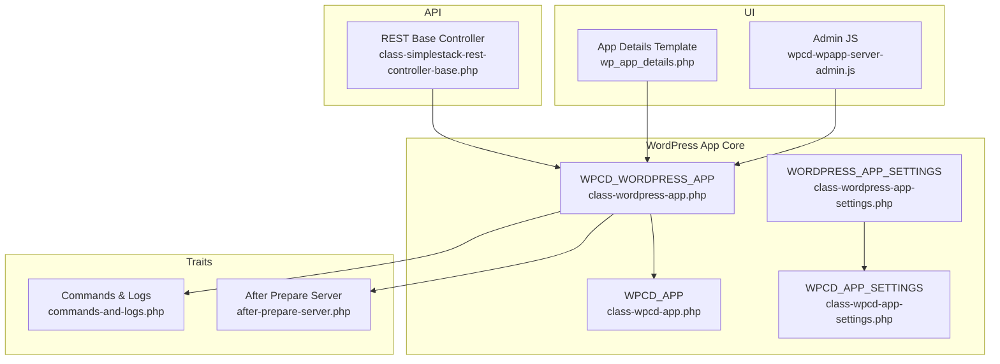
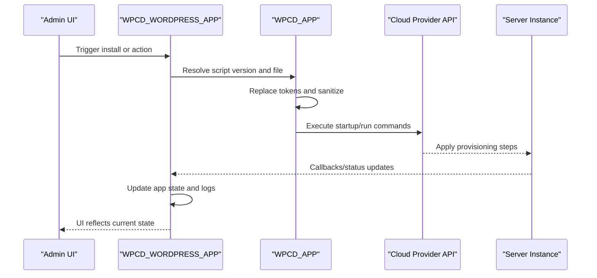
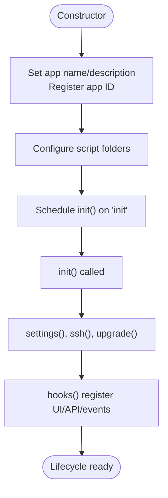
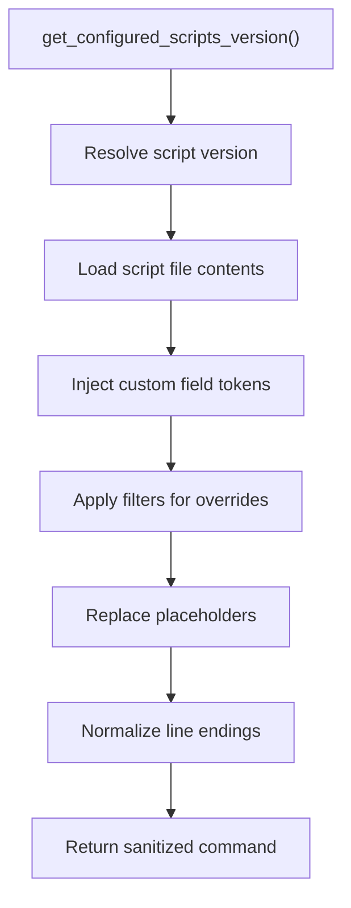
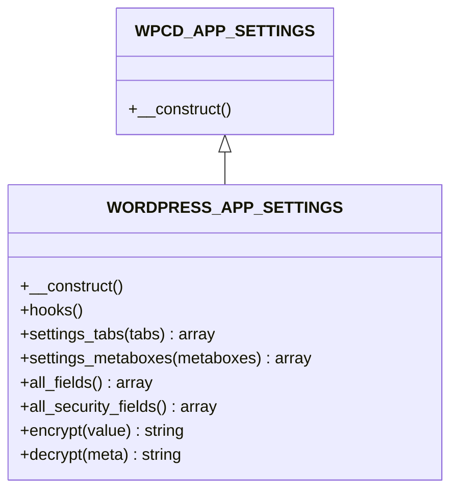
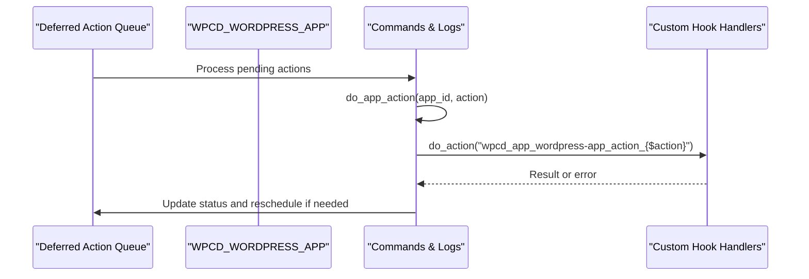
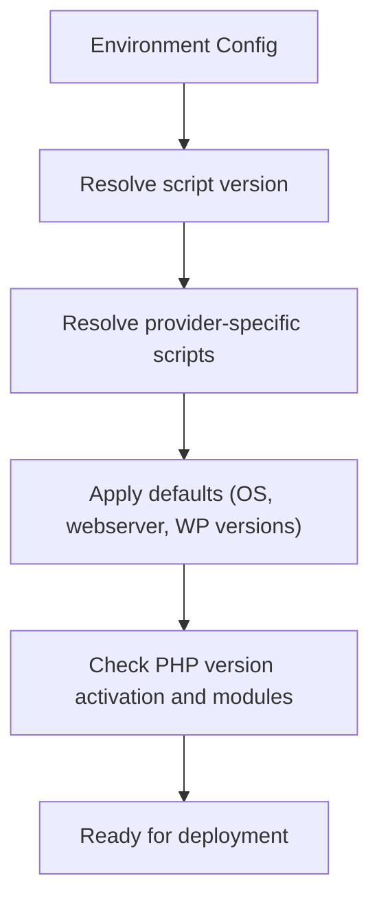
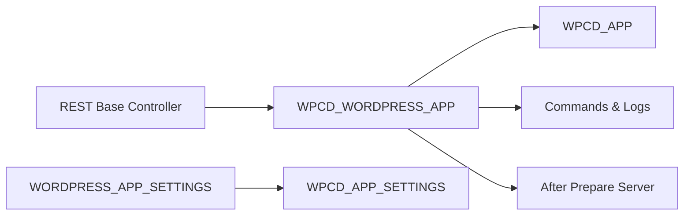

# WordPress Application Lifecycle Management

<cite>
**Referenced Files in This Document**
- [class-wordpress-app.php](file://includes/core/apps/wordpress-app/class-wordpress-app.php)
- [class-wpcd-app.php](file://includes/core/apps/class-wpcd-app.php)
- [class-wordpress-app-settings.php](file://includes/core/apps/wordpress-app/class-wordpress-app-settings.php)
- [class-wpcd-app-settings.php](file://includes/core/apps/class-wpcd-app-settings.php)
- [commands-and-logs.php](file://includes/core/apps/wordpress-app/traits/traits-for-class-wordpress-app/commands-and-logs.php)
- [after-prepare-server.php](file://includes/core/apps/wordpress-app/traits/traits-for-class-wordpress-app/after-prepare-server.php)
- [theme-and-plugin-updates.php](file://includes/core/apps/wordpress-app/tabs/theme-and-plugin-updates.php)
- [wp_app_details.php](file://includes/core/apps/wordpress-app/templates/wp_app_details.php)
- [wpcd-wpapp-server-admin.js](file://includes/core/apps/wordpress-app/assets/js/wpcd-wpapp-server-admin.js)
- [class-simplestack-rest-controller-base.php](file://includes/core/api/class-simplestack-rest-controller-base.php)
</cite>

## Table of Contents
1. [Introduction](#introduction)
2. [Project Structure](#project-structure)
3. [Core Components](#core-components)
4. [Architecture Overview](#architecture-overview)
5. [Detailed Component Analysis](#detailed-component-analysis)
6. [Dependency Analysis](#dependency-analysis)
7. [Performance Considerations](#performance-considerations)
8. [Troubleshooting Guide](#troubleshooting-guide)
9. [Conclusion](#conclusion)

## Introduction
This document explains how SimpleStack manages the complete lifecycle of WordPress applications: from initial provisioning through deployment, configuration, and maintenance. It focuses on the core WPCD_WORDPRESS_APP class architecture, initialization processes, state management, event handling, application settings, configuration validation, environment-specific deployments, and extensibility via hooks. It also covers performance considerations and best practices for large-scale WordPress deployments.

## Project Structure
The WordPress application lifecycle is implemented primarily under includes/core/apps/wordpress-app, with shared base classes under includes/core/apps and REST API controllers under includes/core/api. Key areas include:
- Core app class and traits for command execution, logs, and post-provisioning tasks
- Settings system for general and security configuration
- REST API controllers for server and site operations
- Admin UI assets and templates for installation flows

**Diagram sources**
- [class-wordpress-app.php:15-98](file://includes/core/apps/wordpress-app/class-wordpress-app.php#L15-L98)
- [class-wpcd-app.php:15-95](file://includes/core/apps/class-wpcd-app.php#L15-L95)
- [class-wordpress-app-settings.php:15-98](file://includes/core/apps/wordpress-app/class-wordpress-app-settings.php#L15-L98)
- [class-wpcd-app-settings.php:15-24](file://includes/core/apps/class-wpcd-app-settings.php#L15-L24)
- [commands-and-logs.php:500-700](file://includes/core/apps/wordpress-app/traits/traits-for-class-wordpress-app/commands-and-logs.php#L500-L700)
- [after-prepare-server.php:14-48](file://includes/core/apps/wordpress-app/traits/traits-for-class-wordpress-app/after-prepare-server.php#L14-L48)
- [wpcd-wpapp-server-admin.js:294-448](file://includes/core/apps/wordpress-app/assets/js/wpcd-wpapp-server-admin.js#L294-L448)
- [wp_app_details.php:34-51](file://includes/core/apps/wordpress-app/templates/wp_app_details.php#L34-L51)
- [class-simplestack-rest-controller-base.php:398-398](file://includes/core/api/class-simplestack-rest-controller-base.php#L398-L398)

**Section sources**
- [class-wordpress-app.php:15-98](file://includes/core/apps/wordpress-app/class-wordpress-app.php#L15-L98)
- [class-wpcd-app.php:15-95](file://includes/core/apps/class-wpcd-app.php#L15-L95)
- [class-wordpress-app-settings.php:15-98](file://includes/core/apps/wordpress-app/class-wordpress-app-settings.php#L15-L98)
- [class-wpcd-app-settings.php:15-24](file://includes/core/apps/class-wpcd-app-settings.php#L15-L24)

## Core Components
- WPCD_WORDPRESS_APP: The main application controller that initializes settings, SSH, upgrades, and hooks; loads tabs, REST API, and background actions; and coordinates lifecycle events.
- WPCD_APP: Base class providing script loading, token replacement, provider integration helpers, and common utilities used by all apps.
- WORDPRESS_APP_SETTINGS: Manages WordPress app settings pages, fields, and encryption for sensitive values.
- Commands & Logs trait: Centralizes deferred action processing, action dispatching, and log retrieval.
- After Prepare Server trait: Orchestrates post-provisioning tasks like callbacks, backups, and cleanup.

Key responsibilities:
- Initialization and hook registration
- Script templating and token replacement
- Deferred action queue and status tracking
- Environment-aware configuration and validation
- Extensibility points for custom hooks and REST endpoints

**Section sources**
- [class-wordpress-app.php:15-98](file://includes/core/apps/wordpress-app/class-wordpress-app.php#L15-L98)
- [class-wpcd-app.php:120-170](file://includes/core/apps/class-wpcd-app.php#L120-L170)
- [class-wordpress-app-settings.php:15-98](file://includes/core/apps/wordpress-app/class-wordpress-app-settings.php#L15-L98)
- [commands-and-logs.php:500-700](file://includes/core/apps/wordpress-app/traits/traits-for-class-wordpress-app/commands-and-logs.php#L500-L700)
- [after-prepare-server.php:14-48](file://includes/core/apps/wordpress-app/traits/traits-for-class-wordpress-app/after-prepare-server.php#L14-L48)

## Architecture Overview
The lifecycle spans several phases:
- Provisioning: Server creation and preparation scripts are selected, tokens replaced, and executed against the cloud provider.
- Deployment: WordPress installation scripts run, domain and SSL configured, and site metadata persisted.
- Configuration: Tabs and features (cache, firewall, backups, Git, etc.) are enabled based on settings.
- Maintenance: Updates, backups, monitoring, and health checks are managed via deferred actions and REST APIs.

**Diagram sources**
- [class-wpcd-app.php:1444-1469](file://includes/core/apps/class-wpcd-app.php#L1444-L1469)
- [class-wordpress-app.php:103-182](file://includes/core/apps/wordpress-app/class-wordpress-app.php#L103-L182)
- [commands-and-logs.php:500-700](file://includes/core/apps/wordpress-app/traits/traits-for-class-wordpress-app/commands-and-logs.php#L500-L700)

## Detailed Component Analysis

### WPCD_WORDPRESS_APP Class
Responsibilities:
- Initializes settings, SSH, upgrades, and registers extensive hooks for admin screens, REST API, background tasks, and lifecycle events.
- Loads site and server tabs conditionally based on feature flags and capabilities.
- Provides helper methods for web server type detection, domain resolution, SSL status, PHP version checks, and more.

Initialization flow:
- Constructor sets app name/description, registers app ID, configures script folders, and schedules init.
- Init method calls settings(), ssh(), upgrade(), and hooks().
- Hooks() wires up tab inclusion, REST API enablement, admin notices, AJAX handlers, deferred actions, and cleanup hooks.

Extensibility:
- Many do_action and apply_filters hooks allow third-party plugins to extend behavior, including tab inclusion, REST API controllers, and deferred actions.

**Diagram sources**
- [class-wordpress-app.php:62-98](file://includes/core/apps/wordpress-app/class-wordpress-app.php#L62-L98)
- [class-wordpress-app.php:103-182](file://includes/core/apps/wordpress-app/class-wordpress-app.php#L103-L182)

**Section sources**
- [class-wordpress-app.php:62-98](file://includes/core/apps/wordpress-app/class-wordpress-app.php#L62-L98)
- [class-wordpress-app.php:103-182](file://includes/core/apps/wordpress-app/class-wordpress-app.php#L103-L182)
- [class-wordpress-app.php:800-862](file://includes/core/apps/wordpress-app/class-wordpress-app.php#L800-L862)

### WPCD_APP Base Class
Responsibilities:
- Provides script resolution logic, token replacement, and provider command execution helpers.
- Exposes getters/setters for app metadata and utility functions for IP addresses, server lookups, and meta access.
- Validates and sanitizes inputs when constructing shell commands to prevent injection.

Script resolution and execution:
- Resolves script version using configured options with fallbacks.
- Loads script content, injects custom field tokens, applies filters, replaces placeholders, and normalizes line endings.

Security validations:
- get_simplestack_admin_ip validates allowed IPs/CIDRs before use in commands.
- get_post_site_install_plugins filters plugin slugs to safe characters.

**Diagram sources**
- [class-wpcd-app.php:216-228](file://includes/core/apps/class-wpcd-app.php#L216-L228)
- [class-wpcd-app.php:242-267](file://includes/core/apps/class-wpcd-app.php#L242-L267)
- [class-wpcd-app.php:283-314](file://includes/core/apps/class-wpcd-app.php#L283-L314)
- [class-wpcd-app.php:1444-1469](file://includes/core/apps/class-wpcd-app.php#L1444-L1469)

**Section sources**
- [class-wpcd-app.php:216-228](file://includes/core/apps/class-wpcd-app.php#L216-L228)
- [class-wpcd-app.php:242-267](file://includes/core/apps/class-wpcd-app.php#L242-L267)
- [class-wpcd-app.php:283-314](file://includes/core/apps/class-wpcd-app.php#L283-L314)
- [class-wpcd-app.php:1444-1469](file://includes/core/apps/class-wpcd-app.php#L1444-L1469)

### Application Settings System
Responsibilities:
- Adds settings tabs and metaboxes for WordPress app configuration.
- Encrypts and decrypts sensitive fields (AWS secret key, default WP password/user ID, Logtivity API key, SolidWP credentials).
- Organizes fields into General, Servers, Sites, Backup, DNS, Alerts, Notifications, Integrations, Styles, Email Gateway, Front-end Fields, REST API, White Label, Custom Scripts, Developer Options, and Git.

Validation and security:
- Sensitive values are encrypted at rest and decrypted on read.
- Security tabs provide granular control over visibility and access for site/server owners and roles.

**Diagram sources**
- [class-wpcd-app-settings.php:15-24](file://includes/core/apps/class-wpcd-app-settings.php#L15-L24)
- [class-wordpress-app-settings.php:15-98](file://includes/core/apps/wordpress-app/class-wordpress-app-settings.php#L15-L98)
- [class-wordpress-app-settings.php:180-236](file://includes/core/apps/wordpress-app/class-wordpress-app-settings.php#L180-L236)
- [class-wordpress-app-settings.php:370-402](file://includes/core/apps/wordpress-app/class-wordpress-app-settings.php#L370-L402)

**Section sources**
- [class-wordpress-app-settings.php:15-98](file://includes/core/apps/wordpress-app/class-wordpress-app-settings.php#L15-L98)
- [class-wordpress-app-settings.php:180-236](file://includes/core/apps/wordpress-app/class-wordpress-app-settings.php#L180-L236)
- [class-wordpress-app-settings.php:370-402](file://includes/core/apps/wordpress-app/class-wordpress-app-settings.php#L370-L402)

### State Management and Event Handling
Deferred actions:
- Actions are queued per app/server with status tracking and history logging.
- Deferred actions are processed in batches and re-scheduled if needed.

Action dispatch:
- do_app_action validates context, gathers attributes, clears prior errors, logs activity, and dispatches specific actions via dynamic hooks.
- do_instance_action handles server-level actions, integrates with provider details, and triggers lifecycle hooks such as after-server-create-commands.

Cleanup:
- Cleanup hooks ensure temporary files and sensitive data are removed after app/server deletion.

**Diagram sources**
- [commands-and-logs.php:500-700](file://includes/core/apps/wordpress-app/traits/traits-for-class-wordpress-app/commands-and-logs.php#L500-L700)
- [class-wordpress-app.php:157-182](file://includes/core/apps/wordpress-app/class-wordpress-app.php#L157-L182)

**Section sources**
- [commands-and-logs.php:500-700](file://includes/core/apps/wordpress-app/traits/traits-for-class-wordpress-app/commands-and-logs.php#L500-L700)
- [class-wordpress-app.php:157-182](file://includes/core/apps/wordpress-app/class-wordpress-app.php#L157-L182)

### Environment-Specific Deployments
Script versioning:
- The system selects v1 or v2 script folders based on configuration, with backward compatibility for legacy keys.
- Provider-specific scripts can be resolved by prefixing filenames.

Environment controls:
- Default OS, web server type, and allowed WordPress versions are configurable.
- PHP version activation states and module presence are tracked and enforced.

**Diagram sources**
- [class-wpcd-app.php:216-228](file://includes/core/apps/class-wpcd-app.php#L216-L228)
- [class-wordpress-app.php:738-785](file://includes/core/apps/wordpress-app/class-wordpress-app.php#L738-L785)
- [class-wordpress-app.php:1259-1335](file://includes/core/apps/wordpress-app/class-wordpress-app.php#L1259-L1335)

**Section sources**
- [class-wpcd-app.php:216-228](file://includes/core/apps/class-wpcd-app.php#L216-L228)
- [class-wordpress-app.php:738-785](file://includes/core/apps/wordpress-app/class-wordpress-app.php#L738-L785)
- [class-wordpress-app.php:1259-1335](file://includes/core/apps/wordpress-app/class-wordpress-app.php#L1259-L1335)

### Extending the Lifecycle with Custom Hooks
Common extension points:
- Tab inclusion: wpcd_wpapp_include_app_tabs and wpcd_wpapp_include_server_tabs
- REST API controllers: wpcd_wpapp_include_rest_api and filter wpcd_app_{app_name}_rest_api_controller_list
- Deferred actions: wpcd_app_{app_name}_action and wpcd_app_{app_name}_action_{action}
- Post-installation: wpcd_command_wordpress-app_completed_after_cleanup
- Cleanup: wpcd_cleanup_app_after and wpcd_cleanup_server_after

Best practices:
- Use provided hooks rather than overriding core methods.
- Validate inputs and sanitize outputs before injecting into commands or UI.
- Handle both success and failure paths via corresponding action hooks.

**Section sources**
- [class-wordpress-app.php:289-337](file://includes/core/apps/wordpress-app/class-wordpress-app.php#L289-L337)
- [class-wordpress-app.php:398-440](file://includes/core/apps/wordpress-app/class-wordpress-app.php#L398-L440)
- [commands-and-logs.php:500-700](file://includes/core/apps/wordpress-app/traits/traits-for-class-wordpress-app/commands-and-logs.php#L500-L700)
- [class-wordpress-app.php:157-182](file://includes/core/apps/wordpress-app/class-wordpress-app.php#L157-L182)

### Managing Application States
State tracking:
- Per-app action status stored in post meta.
- History entries recorded for auditability.
- Error clearing and logging around action execution.

Status display:
- Post states extended to show WordPress-specific labels and expiration information.

**Section sources**
- [commands-and-logs.php:560-598](file://includes/core/apps/wordpress-app/traits/traits-for-class-wordpress-app/commands-and-logs.php#L560-L598)
- [class-wordpress-app.php:175-176](file://includes/core/apps/wordpress-app/class-wordpress-app.php#L175-L176)

### Handling Deployment Failures
Failure handling patterns:
- Providers may return errors; actions abort gracefully and log warnings.
- Theme/plugin update failures trigger dedicated handlers to record outcomes and notify users.
- Cleanup hooks remove temporary artifacts and sensitive data after deletions.

Operational guidance:
- Inspect deferred action logs and command logs for root causes.
- Use REST endpoints to fetch logs and status updates.
- Leverage cleanup hooks to ensure consistent state after failures.

**Section sources**
- [commands-and-logs.php:659-665](file://includes/core/apps/wordpress-app/traits/traits-for-class-wordpress-app/commands-and-logs.php#L659-L665)
- [theme-and-plugin-updates.php:667-690](file://includes/core/apps/wordpress-app/tabs/theme-and-plugin-updates.php#L667-L690)
- [class-wordpress-app.php:5436-5460](file://includes/core/apps/wordpress-app/class-wordpress-app.php#L5436-L5460)

## Dependency Analysis
High-level dependencies:
- WPCD_WORDPRESS_APP depends on WPCD_APP for script and provider utilities.
- WORDPRESS_APP_SETTINGS extends WPCD_APP_SETTINGS for settings management.
- Traits encapsulate cross-cutting concerns (commands/logs, post-provisioning).
- REST base controller delegates tab actions to app-specific handlers.

**Diagram sources**
- [class-wordpress-app.php:15-98](file://includes/core/apps/wordpress-app/class-wordpress-app.php#L15-L98)
- [class-wpcd-app.php:15-95](file://includes/core/apps/class-wpcd-app.php#L15-L95)
- [class-wordpress-app-settings.php:15-98](file://includes/core/apps/wordpress-app/class-wordpress-app-settings.php#L15-L98)
- [class-wpcd-app-settings.php:15-24](file://includes/core/apps/class-wpcd-app-settings.php#L15-L24)
- [commands-and-logs.php:500-700](file://includes/core/apps/wordpress-app/traits/traits-for-class-wordpress-app/commands-and-logs.php#L500-L700)
- [after-prepare-server.php:14-48](file://includes/core/apps/wordpress-app/traits/traits-for-class-wordpress-app/after-prepare-server.php#L14-L48)
- [class-simplestack-rest-controller-base.php:398-398](file://includes/core/api/class-simplestack-rest-controller-base.php#L398-L398)

**Section sources**
- [class-wordpress-app.php:15-98](file://includes/core/apps/wordpress-app/class-wordpress-app.php#L15-L98)
- [class-wpcd-app.php:15-95](file://includes/core/apps/class-wpcd-app.php#L15-L95)
- [class-wordpress-app-settings.php:15-98](file://includes/core/apps/wordpress-app/class-wordpress-app-settings.php#L15-L98)
- [class-wpcd-app-settings.php:15-24](file://includes/core/apps/class-wpcd-app-settings.php#L15-L24)
- [commands-and-logs.php:500-700](file://includes/core/apps/wordpress-app/traits/traits-for-class-wordpress-app/commands-and-logs.php#L500-L700)
- [after-prepare-server.php:14-48](file://includes/core/apps/wordpress-app/traits/traits-for-class-wordpress-app/after-prepare-server.php#L14-L48)
- [class-simplestack-rest-controller-base.php:398-398](file://includes/core/api/class-simplestack-rest-controller-base.php#L398-L398)

## Performance Considerations
- Defer long-running tasks: Use deferred actions to avoid blocking requests and improve responsiveness.
- Batch processing: Process multiple pending actions in a single pass and reschedule as needed.
- Minimize I/O: Avoid unnecessary file reads; cache frequently accessed metadata where appropriate.
- Sanitize inputs early: Prevent expensive retries caused by malformed commands or invalid configurations.
- Conditional loading: Only load tabs and REST controllers when enabled to reduce overhead.

[No sources needed since this section provides general guidance]

## Troubleshooting Guide
Common issues and resolutions:
- Installation form validation fails: Check client-side validation and ensure required fields are present.
- Provider details unavailable: Verify provider credentials and instance existence; actions may abort safely.
- Stale logs or incomplete state: Fetch logs via REST endpoints and review deferred action history.
- Cleanup not running: Ensure cleanup hooks are triggered during app/server deletion.

Operational tips:
- Use admin notices and deferred action logs to diagnose problems.
- Validate environment settings (script version, allowed WP versions, PHP activation).
- Review security settings to ensure sensitive fields are properly encrypted.

**Section sources**
- [wpcd-wpapp-server-admin.js:294-448](file://includes/core/apps/wordpress-app/assets/js/wpcd-wpapp-server-admin.js#L294-L448)
- [commands-and-logs.php:659-665](file://includes/core/apps/wordpress-app/traits/traits-for-class-wordpress-app/commands-and-logs.php#L659-L665)
- [wp_app_details.php:34-51](file://includes/core/apps/wordpress-app/templates/wp_app_details.php#L34-L51)

## Conclusion
SimpleStack’s WordPress application lifecycle management centers on a robust WPCD_WORDPRESS_APP class that orchestrates initialization, configuration, deployment, and maintenance through well-defined hooks and traits. The WPCD_APP base class ensures secure and flexible script handling, while the settings system provides comprehensive configuration and security controls. By leveraging deferred actions, environment-specific deployments, and extensible hooks, administrators and developers can manage large-scale WordPress deployments reliably and efficiently.

[No sources needed since this section summarizes without analyzing specific files]